# Polyfork: free low-poly 3D models

**2,787 free low-poly 3D models and 26 themed kits** for three.js, games and the web. GLB or ES module, no account, no key.

[Browse on polyfork.dev](https://polyfork.dev/assets) · [Kits](#kits) · [By type](#browse-by-type) · [catalog.json](catalog.json)

<a href="https://polyfork.dev/asset/pop-top-camper-van-62a322"></a>

## A model is a program

Load a Polyfork model as a mesh, or import it as code and change it with knobs. This page runs as it is: save it as `van.html` and open it.

```html
<!doctype html>
<body style="margin:0">
<script type="importmap">
{ "imports": {
  "three": "https://unpkg.com/three@0.180.0/build/three.module.js",
  "three/addons/": "https://unpkg.com/three@0.180.0/examples/jsm/"
} }
</script>
<script type="module">
  import * as THREE from 'three';
  import { createAsset } from 'https://polyfork.dev/cdn/pop-top-camper-van-62a322.mjs';

  const scene = new THREE.Scene();
  scene.background = new THREE.Color('#e9edf3');
  scene.add(new THREE.HemisphereLight('#ffffff', '#8a94a6', 3));

  const camera = new THREE.PerspectiveCamera(35, innerWidth / innerHeight, 0.1, 100);
  camera.position.set(6, 3.5, 7);
  camera.lookAt(0, 1, 0);

  const renderer = new THREE.WebGLRenderer({ antialias: true });
  renderer.setSize(innerWidth, innerHeight);
  document.body.append(renderer.domElement);

  // Every knob is an argument. Try roof: 1, colorway: 'sunflower', season: 'summer'.
  scene.add(createAsset({ colorway: 'tomato', roof: 0, season: 'winter' }));

  renderer.render(scene, camera);
</script>
```

Want a plain mesh? Every model is also a glTF 2.0 file, for three.js, Unity, Godot, Blender or anything else that reads GLB:

```js
import { GLTFLoader } from 'three/addons/loaders/GLTFLoader.js';

const gltf = await new GLTFLoader().loadAsync('https://polyfork.dev/cdn/pop-top-camper-van-62a322.glb');
scene.add(gltf.scene);
```

Each model's page on polyfork.dev lists its knobs and has FBX, USD and OBJ too. Using Unity? There is a [connector](https://github.com/lucas-martinic/polyfork-unity-connector).

## Kits

Every kit is a themed set of parts on one palette and one scale, so everything you combine belongs to the same world.

<table>
<tr>
<td align="center" valign="top" width="33%"><a href="kits/3d-ui-kit-5635f7.md">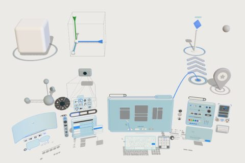<br><strong>3D UI kit</strong></a><br><sub>61 parts</sub></td>
<td align="center" valign="top" width="33%"><a href="kits/campground-lake-ad32b0.md">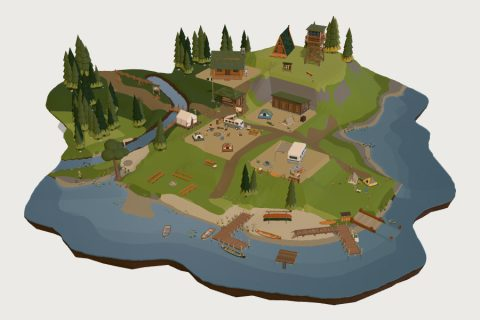<br><strong>Campground &amp; Lake</strong></a><br><sub>62 parts</sub></td>
<td align="center" valign="top" width="33%"><a href="kits/chrome-arcology-transit-kit-87a0e1.md">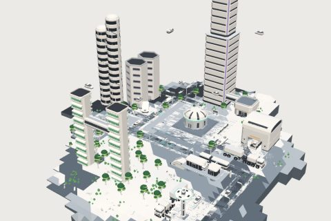<br><strong>Chrome Arcology Transit kit</strong></a><br><sub>58 parts</sub></td>
</tr>
<tr>
<td align="center" valign="top" width="33%"><a href="kits/clockwork-hand-adornments-kit-3aeccc.md">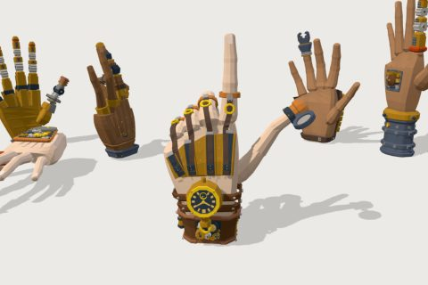<br><strong>Clockwork Hand Adornments kit</strong></a><br><sub>50 parts</sub></td>
<td align="center" valign="top" width="33%"><a href="kits/construction-site-9e40b0.md">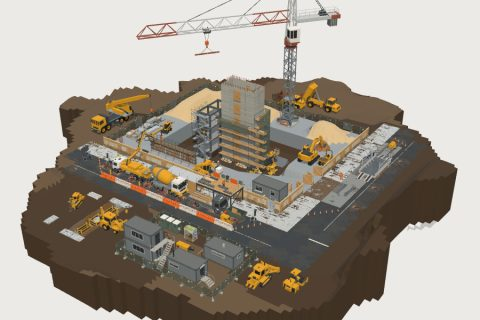<br><strong>Construction Site</strong></a><br><sub>62 parts</sub></td>
<td align="center" valign="top" width="33%"><a href="kits/coral-reef-a7128a.md">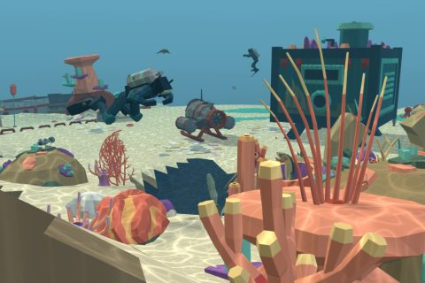<br><strong>Coral Reef</strong></a><br><sub>54 parts</sub></td>
</tr>
<tr>
<td align="center" valign="top" width="33%"><a href="kits/countryside-railway-9b4c57.md">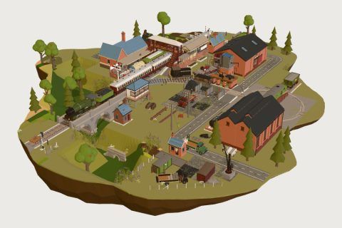<br><strong>Countryside Railway</strong></a><br><sub>103 parts</sub></td>
<td align="center" valign="top" width="33%"><a href="kits/cozy-farm-cc979f.md">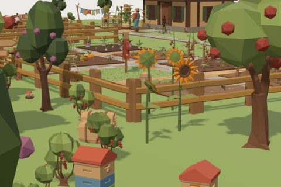<br><strong>Cozy Farm</strong></a><br><sub>60 parts</sub></td>
<td align="center" valign="top" width="33%"><a href="kits/emerald-gilded-runes-kit-abfc30.md">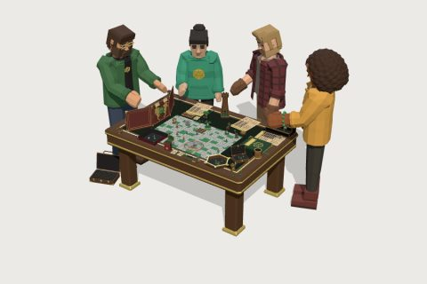<br><strong>Emerald Gilded Runes kit</strong></a><br><sub>60 parts</sub></td>
</tr>
<tr>
<td align="center" valign="top" width="33%"><a href="kits/frontier-town-a0085b.md">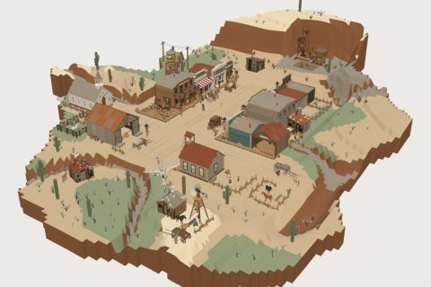<br><strong>Frontier Town</strong></a><br><sub>61 parts</sub></td>
<td align="center" valign="top" width="33%"><a href="kits/halloween-night-46ade4.md">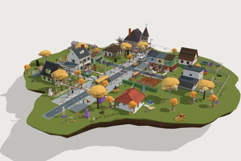<br><strong>Halloween Night</strong></a><br><sub>61 parts</sub></td>
<td align="center" valign="top" width="33%"><a href="kits/hospital-kit-2ebfcb.md">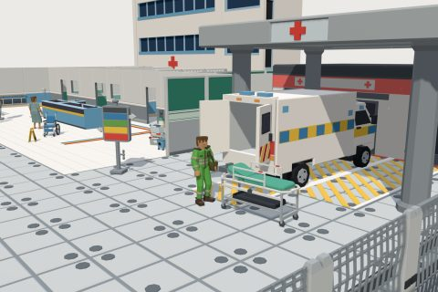<br><strong>Hospital kit</strong></a><br><sub>57 parts</sub></td>
</tr>
<tr>
<td align="center" valign="top" width="33%"><a href="kits/japanese-suburban-city-street-baa482.md">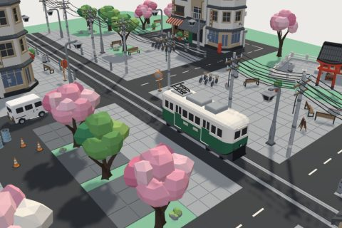<br><strong>Little Tokyo kit</strong></a><br><sub>57 parts</sub></td>
<td align="center" valign="top" width="33%"><a href="kits/medieval-village-kit-ca0b43.md">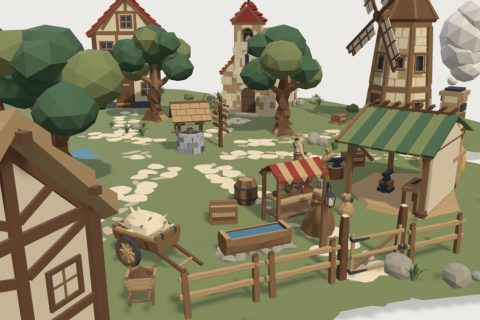<br><strong>Medieval Village Kit</strong></a><br><sub>60 parts</sub></td>
<td align="center" valign="top" width="33%"><a href="kits/modern-restaurant-cafe-01ea4c.md">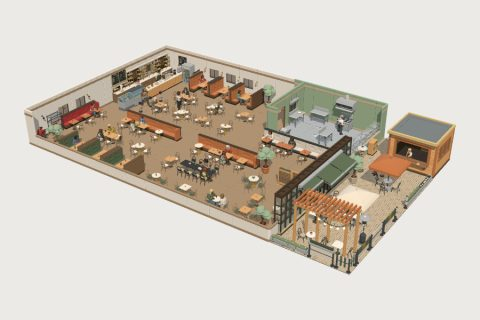<br><strong>Modern Restaurant Cafe kit</strong></a><br><sub>60 parts</sub></td>
</tr>
<tr>
<td align="center" valign="top" width="33%"><a href="kits/neighborhood-pathways-kit-a992cf.md">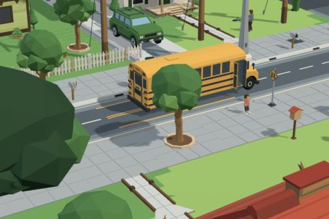<br><strong>Neighborhood Pathways kit</strong></a><br><sub>61 parts</sub></td>
<td align="center" valign="top" width="33%"><a href="kits/nyc-city-kit-fbca88.md">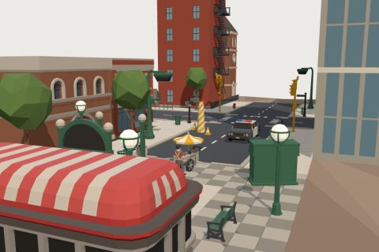<br><strong>New York City Kit</strong></a><br><sub>73 parts</sub></td>
<td align="center" valign="top" width="33%"><a href="kits/office-794453.md">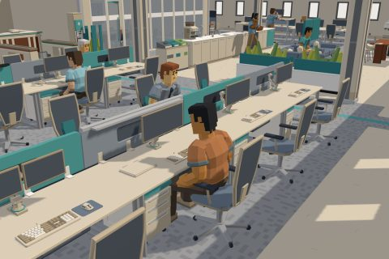<br><strong>Office</strong></a><br><sub>60 parts</sub></td>
</tr>
<tr>
<td align="center" valign="top" width="33%"><a href="kits/office-reefscape-kit-1afd7c.md">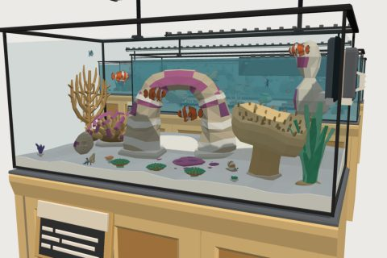<br><strong>Office Reefscape kit</strong></a><br><sub>60 parts</sub></td>
<td align="center" valign="top" width="33%"><a href="kits/pirate-cove-2ebea4.md">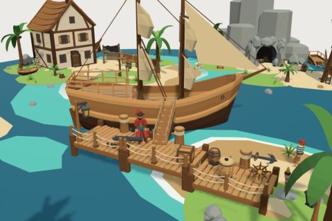<br><strong>Pirate Cove kit</strong></a><br><sub>61 parts</sub></td>
<td align="center" valign="top" width="33%"><a href="kits/racing-cars-kit-660d53.md">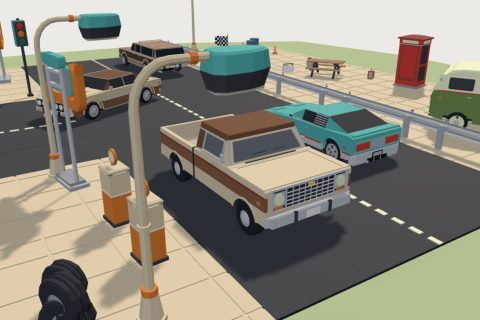<br><strong>Retro Cars Kit</strong></a><br><sub>29 parts</sub></td>
</tr>
<tr>
<td align="center" valign="top" width="33%"><a href="kits/skatepark-0922a9.md">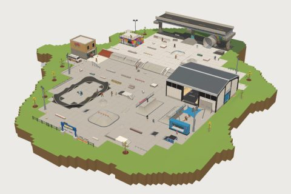<br><strong>Skatepark kit</strong></a><br><sub>60 parts</sub></td>
<td align="center" valign="top" width="33%"><a href="kits/salvage-commons-d0be9f.md">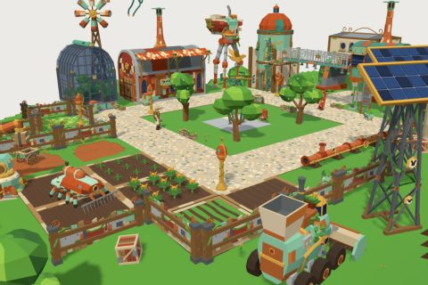<br><strong>Sky Town</strong></a><br><sub>62 parts</sub></td>
<td align="center" valign="top" width="33%"><a href="kits/space-base-kit-cf65de.md">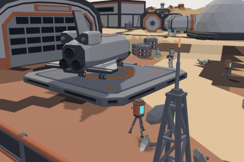<br><strong>Space Base Kit</strong></a><br><sub>61 parts</sub></td>
</tr>
<tr>
<td align="center" valign="top" width="33%"><a href="kits/spaceship-wars-kit-234642.md">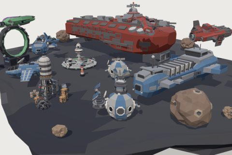<br><strong>Spaceship Wars Kit</strong></a><br><sub>29 parts</sub></td>
<td align="center" valign="top" width="33%"><a href="kits/stadium-5db167.md">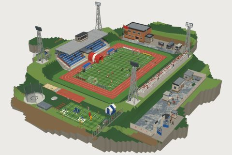<br><strong>Stadium</strong></a><br><sub>71 parts</sub></td>
</tr>
</table>

### In production

- [Airport](kits/airport-43b137.md), 1 part so far
- [Alpine and Snow](kits/alpine-and-snow-092f66.md), 59 parts so far
- [Chile: Fiestas Patrias](kits/chile-fiestas-patrias-87e847.md), 58 parts so far
- [Coast and Boardwalk](kits/coast-and-boardwalk-d883fd.md), 59 parts so far
- [Dragons Lair](kits/dragons-lair-dark-dragon-782570.md), 7 parts so far
- [Dungeon & Crypt](kits/dungeon-crypt-c27d93.md), 67 parts so far
- [Día de Muertos kit](kits/dia-de-muertos-f2f8f8.md), 60 parts so far
- [Easter Island (Rapa Nui)](kits/easter-island-rapa-nui-368e86.md), 58 parts so far
- [Hotel Casino kit](kits/casino-3dd029.md), 122 parts so far
- [Insect World kit](kits/insect-world-e44b9f.md), 55 parts so far
- [Medieval Japan](kits/medieval-japan-cb01ad.md), 60 parts so far
- [Nature & Forest Kit](kits/nature-forest-kit-f29d6a.md), 59 parts so far
- [Open Plan](kits/open-plan-b2ebd3.md), 63 parts so far
- [Prehistoric Valley](kits/prehistoric-valley-8638dc.md), 58 parts so far
- [Research Lab](kits/research-lab-9b9b5d.md), 61 parts so far
- [Roadside Americana](kits/roadside-americana-50d40c.md), 60 parts so far
- [University](kits/university-959b66.md), 61 parts so far

## Browse by type

| Type | Models |
|---|--:|
| [Characters](models/characters.md) | 193 |
| [Animals](models/animals.md) | 118 |
| [Buildings](models/buildings.md) | 374 |
| [Vehicles](models/vehicles.md) | 180 |
| [Props](models/props.md) | 1,768 |
| [Terrain](models/terrain.md) | 18 |
| [Attachments](models/attachments.md) | 48 |
| [Nano](models/nano.md) | 86 |
| [Hands](models/hands.md) | 2 |

Looking for something specific? Search [polyfork.dev/assets](https://polyfork.dev/assets), or ask for a model that is not here yet on the [requests board](https://polyfork.dev/requests).

## For tools and agents

[`catalog.json`](catalog.json) lists every model with its links. To search, use the [API](https://polyfork.dev/llms.txt), which needs no key for free models.

## What is in this repository

An index: names, links and small kit covers. **There are no model files here**, they stay on polyfork.dev, so a link always gets the latest version of a model. The list is generated from the live catalogue.

## Licence

Free models can be used in personal and commercial projects, changed however you like, and need no attribution. Please do not re-upload or redistribute the files themselves. If your product should keep its own copies rather than link to ours, that is the [platform licence](https://polyfork.dev/platform). The [full terms](https://polyfork.dev/licensing) apply, and [LICENSE.md](LICENSE.md) covers this index.
