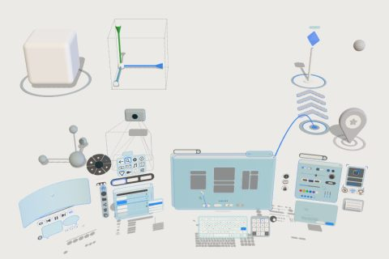

# 3D UI kit

61 free low-poly parts on one palette and one scale, so everything you combine belongs to the same world.

[Open the kit on Polyfork](https://polyfork.dev/kit/3d-ui-kit-5635f7) · [All kits](../README.md#kits)

<table>
<tr>
<td align="center" valign="top" width="25%"> <a href="https://polyfork.dev/asset/app-icon-family-d686c7">App Icon Family</a> <a href="https://polyfork.dev/cdn/app-icon-family-d686c7.glb">GLB</a> · <a href="https://polyfork.dev/cdn/app-icon-family-d686c7.mjs">module</a></td>
<td align="center" valign="top" width="25%"> <a href="https://polyfork.dev/asset/arrow-cursor-7d5415">Arrow Cursor</a> <a href="https://polyfork.dev/cdn/arrow-cursor-7d5415.glb">GLB</a> · <a href="https://polyfork.dev/cdn/arrow-cursor-7d5415.mjs">module</a></td>
<td align="center" valign="top" width="25%"> <a href="https://polyfork.dev/asset/avatar-frame-793ad0">Avatar Frame</a> <a href="https://polyfork.dev/cdn/avatar-frame-793ad0.glb">GLB</a> · <a href="https://polyfork.dev/cdn/avatar-frame-793ad0.mjs">module</a></td>
<td align="center" valign="top" width="25%"> <a href="https://polyfork.dev/asset/axis-triad-187443">Axis Triad</a> <a href="https://polyfork.dev/cdn/axis-triad-187443.glb">GLB</a> · <a href="https://polyfork.dev/cdn/axis-triad-187443.mjs">module</a></td>
</tr>
<tr>
<td align="center" valign="top" width="25%"> <a href="https://polyfork.dev/asset/bounding-box-cage-57c3d1">Bounding Box Cage</a> <a href="https://polyfork.dev/cdn/bounding-box-cage-57c3d1.glb">GLB</a> · <a href="https://polyfork.dev/cdn/bounding-box-cage-57c3d1.mjs">module</a></td>
<td align="center" valign="top" width="25%"> <a href="https://polyfork.dev/asset/camera-gizmo-2d038e">Camera Gizmo</a> <a href="https://polyfork.dev/cdn/camera-gizmo-2d038e.glb">GLB</a> · <a href="https://polyfork.dev/cdn/camera-gizmo-2d038e.mjs">module</a></td>
<td align="center" valign="top" width="25%"> <a href="https://polyfork.dev/asset/checkbox-094277">Checkbox</a> <a href="https://polyfork.dev/cdn/checkbox-094277.glb">GLB</a> · <a href="https://polyfork.dev/cdn/checkbox-094277.mjs">module</a></td>
<td align="center" valign="top" width="25%"> <a href="https://polyfork.dev/asset/colour-swatch-picker-118762">Colour Swatch Picker</a> <a href="https://polyfork.dev/cdn/colour-swatch-picker-118762.glb">GLB</a> · <a href="https://polyfork.dev/cdn/colour-swatch-picker-118762.mjs">module</a></td>
</tr>
<tr>
<td align="center" valign="top" width="25%"> <a href="https://polyfork.dev/asset/content-card-1e37ea">Content Card</a> <a href="https://polyfork.dev/cdn/content-card-1e37ea.glb">GLB</a> · <a href="https://polyfork.dev/cdn/content-card-1e37ea.mjs">module</a></td>
<td align="center" valign="top" width="25%"> <a href="https://polyfork.dev/asset/context-menu-list-551201">Context Menu List</a> <a href="https://polyfork.dev/cdn/context-menu-list-551201.glb">GLB</a> · <a href="https://polyfork.dev/cdn/context-menu-list-551201.mjs">module</a></td>
<td align="center" valign="top" width="25%"> <a href="https://polyfork.dev/asset/curved-panel-97d28a">Curved Panel</a> <a href="https://polyfork.dev/cdn/curved-panel-97d28a.glb">GLB</a> · <a href="https://polyfork.dev/cdn/curved-panel-97d28a.mjs">module</a></td>
<td align="center" valign="top" width="25%"> <a href="https://polyfork.dev/asset/direction-chevron-59b24a">Direction Chevron</a> <a href="https://polyfork.dev/cdn/direction-chevron-59b24a.glb">GLB</a> · <a href="https://polyfork.dev/cdn/direction-chevron-59b24a.mjs">module</a></td>
</tr>
<tr>
<td align="center" valign="top" width="25%"> <a href="https://polyfork.dev/asset/emoji-reaction-bubble-3e0321">Emoji Reaction Bubble</a> <a href="https://polyfork.dev/cdn/emoji-reaction-bubble-3e0321.glb">GLB</a> · <a href="https://polyfork.dev/cdn/emoji-reaction-bubble-3e0321.mjs">module</a></td>
<td align="center" valign="top" width="25%"> <a href="https://polyfork.dev/asset/floating-keyboard-b29cb8">Floating Keyboard</a> <a href="https://polyfork.dev/cdn/floating-keyboard-b29cb8.glb">GLB</a> · <a href="https://polyfork.dev/cdn/floating-keyboard-b29cb8.mjs">module</a></td>
<td align="center" valign="top" width="25%"> <a href="https://polyfork.dev/asset/floating-nameplate-4e04da">Floating Nameplate</a> <a href="https://polyfork.dev/cdn/floating-nameplate-4e04da.glb">GLB</a> · <a href="https://polyfork.dev/cdn/floating-nameplate-4e04da.mjs">module</a></td>
<td align="center" valign="top" width="25%"> <a href="https://polyfork.dev/asset/floor-target-ring-d55035">Floor Target Ring</a> <a href="https://polyfork.dev/cdn/floor-target-ring-d55035.glb">GLB</a> · <a href="https://polyfork.dev/cdn/floor-target-ring-d55035.mjs">module</a></td>
</tr>
<tr>
<td align="center" valign="top" width="25%"> <a href="https://polyfork.dev/asset/gaze-reticle-ring-34afdc">Gaze Reticle Ring</a> <a href="https://polyfork.dev/cdn/gaze-reticle-ring-34afdc.glb">GLB</a> · <a href="https://polyfork.dev/cdn/gaze-reticle-ring-34afdc.mjs">module</a></td>
<td align="center" valign="top" width="25%"> <a href="https://polyfork.dev/asset/grid-tray-caad10">Grid Tray</a> <a href="https://polyfork.dev/cdn/grid-tray-caad10.glb">GLB</a> · <a href="https://polyfork.dev/cdn/grid-tray-caad10.mjs">module</a></td>
<td align="center" valign="top" width="25%"> <a href="https://polyfork.dev/asset/hand-cursor-62192f">Hand Cursor</a> <a href="https://polyfork.dev/cdn/hand-cursor-62192f.glb">GLB</a> · <a href="https://polyfork.dev/cdn/hand-cursor-62192f.mjs">module</a></td>
<td align="center" valign="top" width="25%"> <a href="https://polyfork.dev/asset/input-field-02a402">Input Field</a> <a href="https://polyfork.dev/cdn/input-field-02a402.glb">GLB</a> · <a href="https://polyfork.dev/cdn/input-field-02a402.mjs">module</a></td>
</tr>
<tr>
<td align="center" valign="top" width="25%"> <a href="https://polyfork.dev/asset/laser-pointer-ray-a70928">Laser Pointer Ray</a> <a href="https://polyfork.dev/cdn/laser-pointer-ray-a70928.glb">GLB</a> · <a href="https://polyfork.dev/cdn/laser-pointer-ray-a70928.mjs">module</a></td>
<td align="center" valign="top" width="25%"> <a href="https://polyfork.dev/asset/level-meter-505bf6">Level Meter</a> <a href="https://polyfork.dev/cdn/level-meter-505bf6.glb">GLB</a> · <a href="https://polyfork.dev/cdn/level-meter-505bf6.mjs">module</a></td>
<td align="center" valign="top" width="25%"> <a href="https://polyfork.dev/asset/light-gizmo-8efad9">Light Gizmo</a> <a href="https://polyfork.dev/cdn/light-gizmo-8efad9.glb">GLB</a> · <a href="https://polyfork.dev/cdn/light-gizmo-8efad9.mjs">module</a></td>
<td align="center" valign="top" width="25%"> <a href="https://polyfork.dev/asset/list-row-9a4186">List Row</a> <a href="https://polyfork.dev/cdn/list-row-9a4186.glb">GLB</a> · <a href="https://polyfork.dev/cdn/list-row-9a4186.mjs">module</a></td>
</tr>
<tr>
<td align="center" valign="top" width="25%"> <a href="https://polyfork.dev/asset/loading-spinner-ring-74fd8c">Loading Spinner Ring</a> <a href="https://polyfork.dev/cdn/loading-spinner-ring-74fd8c.glb">GLB</a> · <a href="https://polyfork.dev/cdn/loading-spinner-ring-74fd8c.mjs">module</a></td>
<td align="center" valign="top" width="25%"> <a href="https://polyfork.dev/asset/location-pin-7b709c">Location Pin</a> <a href="https://polyfork.dev/cdn/location-pin-7b709c.glb">GLB</a> · <a href="https://polyfork.dev/cdn/location-pin-7b709c.mjs">module</a></td>
<td align="center" valign="top" width="25%"> <a href="https://polyfork.dev/asset/media-icon-416f95">Media Icon</a> <a href="https://polyfork.dev/cdn/media-icon-416f95.glb">GLB</a> · <a href="https://polyfork.dev/cdn/media-icon-416f95.mjs">module</a></td>
<td align="center" valign="top" width="25%"> <a href="https://polyfork.dev/asset/modal-dialog-e4e76d">Modal Dialog</a> <a href="https://polyfork.dev/cdn/modal-dialog-e4e76d.glb">GLB</a> · <a href="https://polyfork.dev/cdn/modal-dialog-e4e76d.mjs">module</a></td>
</tr>
<tr>
<td align="center" valign="top" width="25%"> <a href="https://polyfork.dev/asset/navigation-icon-fcf0d4">Navigation Icon</a> <a href="https://polyfork.dev/cdn/navigation-icon-fcf0d4.glb">GLB</a> · <a href="https://polyfork.dev/cdn/navigation-icon-fcf0d4.mjs">module</a></td>
<td align="center" valign="top" width="25%"> <a href="https://polyfork.dev/asset/notification-badge-001f0e">Notification Badge</a> <a href="https://polyfork.dev/cdn/notification-badge-001f0e.glb">GLB</a> · <a href="https://polyfork.dev/cdn/notification-badge-001f0e.mjs">module</a></td>
<td align="center" valign="top" width="25%"> <a href="https://polyfork.dev/asset/numeric-keypad-852767">Numeric Keypad</a> <a href="https://polyfork.dev/cdn/numeric-keypad-852767.glb">GLB</a> · <a href="https://polyfork.dev/cdn/numeric-keypad-852767.mjs">module</a></td>
<td align="center" valign="top" width="25%"> <a href="https://polyfork.dev/asset/object-icon-4ae10f">Object Icon</a> <a href="https://polyfork.dev/cdn/object-icon-4ae10f.glb">GLB</a> · <a href="https://polyfork.dev/cdn/object-icon-4ae10f.mjs">module</a></td>
</tr>
<tr>
<td align="center" valign="top" width="25%"> <a href="https://polyfork.dev/asset/pagination-dots-2be26a">Pagination Dots</a> <a href="https://polyfork.dev/cdn/pagination-dots-2be26a.glb">GLB</a> · <a href="https://polyfork.dev/cdn/pagination-dots-2be26a.mjs">module</a></td>
<td align="center" valign="top" width="25%"> <a href="https://polyfork.dev/asset/picker-drum-wheel-059a3e">Picker Drum Wheel</a> <a href="https://polyfork.dev/cdn/picker-drum-wheel-059a3e.glb">GLB</a> · <a href="https://polyfork.dev/cdn/picker-drum-wheel-059a3e.mjs">module</a></td>
<td align="center" valign="top" width="25%"> <a href="https://polyfork.dev/asset/progress-bar-4da04c">Progress Bar</a> <a href="https://polyfork.dev/cdn/progress-bar-4da04c.glb">GLB</a> · <a href="https://polyfork.dev/cdn/progress-bar-4da04c.mjs">module</a></td>
<td align="center" valign="top" width="25%"> <a href="https://polyfork.dev/asset/push-button-979dc6">Push Button</a> <a href="https://polyfork.dev/cdn/push-button-979dc6.glb">GLB</a> · <a href="https://polyfork.dev/cdn/push-button-979dc6.mjs">module</a></td>
</tr>
<tr>
<td align="center" valign="top" width="25%"> <a href="https://polyfork.dev/asset/radial-pie-menu-d4abda">Radial Pie Menu</a> <a href="https://polyfork.dev/cdn/radial-pie-menu-d4abda.glb">GLB</a> · <a href="https://polyfork.dev/cdn/radial-pie-menu-d4abda.mjs">module</a></td>
<td align="center" valign="top" width="25%"> <a href="https://polyfork.dev/asset/radio-button-049d31">Radio Button</a> <a href="https://polyfork.dev/cdn/radio-button-049d31.glb">GLB</a> · <a href="https://polyfork.dev/cdn/radio-button-049d31.mjs">module</a></td>
<td align="center" valign="top" width="25%"> <a href="https://polyfork.dev/asset/resize-corner-handle-ed74ac">Resize Corner Handle</a> <a href="https://polyfork.dev/cdn/resize-corner-handle-ed74ac.glb">GLB</a> · <a href="https://polyfork.dev/cdn/resize-corner-handle-ed74ac.mjs">module</a></td>
<td align="center" valign="top" width="25%"> <a href="https://polyfork.dev/asset/rotary-dial-981a5a">Rotary Dial</a> <a href="https://polyfork.dev/cdn/rotary-dial-981a5a.glb">GLB</a> · <a href="https://polyfork.dev/cdn/rotary-dial-981a5a.mjs">module</a></td>
</tr>
<tr>
<td align="center" valign="top" width="25%"> <a href="https://polyfork.dev/asset/scroll-bar-fc8256">Scroll Bar</a> <a href="https://polyfork.dev/cdn/scroll-bar-fc8256.glb">GLB</a> · <a href="https://polyfork.dev/cdn/scroll-bar-fc8256.mjs">module</a></td>
<td align="center" valign="top" width="25%"> <a href="https://polyfork.dev/asset/segmented-control-216cae">Segmented Control</a> <a href="https://polyfork.dev/cdn/segmented-control-216cae.glb">GLB</a> · <a href="https://polyfork.dev/cdn/segmented-control-216cae.mjs">module</a></td>
<td align="center" valign="top" width="25%"> <a href="https://polyfork.dev/asset/selection-corner-brackets-bfc6ad">Selection Corner Brackets</a> <a href="https://polyfork.dev/cdn/selection-corner-brackets-bfc6ad.glb">GLB</a> · <a href="https://polyfork.dev/cdn/selection-corner-brackets-bfc6ad.mjs">module</a></td>
<td align="center" valign="top" width="25%"> <a href="https://polyfork.dev/asset/side-dock-458f18">Side Dock</a> <a href="https://polyfork.dev/cdn/side-dock-458f18.glb">GLB</a> · <a href="https://polyfork.dev/cdn/side-dock-458f18.mjs">module</a></td>
</tr>
<tr>
<td align="center" valign="top" width="25%"> <a href="https://polyfork.dev/asset/slider-19587c">Slider</a> <a href="https://polyfork.dev/cdn/slider-19587c.glb">GLB</a> · <a href="https://polyfork.dev/cdn/slider-19587c.mjs">module</a></td>
<td align="center" valign="top" width="25%"> <a href="https://polyfork.dev/asset/speech-bubble-c51606">Speech Bubble</a> <a href="https://polyfork.dev/cdn/speech-bubble-c51606.glb">GLB</a> · <a href="https://polyfork.dev/cdn/speech-bubble-c51606.mjs">module</a></td>
<td align="center" valign="top" width="25%"> <a href="https://polyfork.dev/asset/star-rating-row-5d8824">Star Rating Row</a> <a href="https://polyfork.dev/cdn/star-rating-row-5d8824.glb">GLB</a> · <a href="https://polyfork.dev/cdn/star-rating-row-5d8824.mjs">module</a></td>
<td align="center" valign="top" width="25%"> <a href="https://polyfork.dev/asset/status-icon-fbbbb6">Status Icon</a> <a href="https://polyfork.dev/cdn/status-icon-fbbbb6.glb">GLB</a> · <a href="https://polyfork.dev/cdn/status-icon-fbbbb6.mjs">module</a></td>
</tr>
<tr>
<td align="center" valign="top" width="25%"> <a href="https://polyfork.dev/asset/stepper-2deea3">Stepper</a> <a href="https://polyfork.dev/cdn/stepper-2deea3.glb">GLB</a> · <a href="https://polyfork.dev/cdn/stepper-2deea3.mjs">module</a></td>
<td align="center" valign="top" width="25%"> <a href="https://polyfork.dev/asset/tab-bar-02457c">Tab Bar</a> <a href="https://polyfork.dev/cdn/tab-bar-02457c.glb">GLB</a> · <a href="https://polyfork.dev/cdn/tab-bar-02457c.mjs">module</a></td>
<td align="center" valign="top" width="25%"> <a href="https://polyfork.dev/asset/teleport-arc-adfed4">Teleport Arc</a> <a href="https://polyfork.dev/cdn/teleport-arc-adfed4.glb">GLB</a> · <a href="https://polyfork.dev/cdn/teleport-arc-adfed4.mjs">module</a></td>
<td align="center" valign="top" width="25%"> <a href="https://polyfork.dev/asset/toast-notification-68ccf5">Toast Notification</a> <a href="https://polyfork.dev/cdn/toast-notification-68ccf5.glb">GLB</a> · <a href="https://polyfork.dev/cdn/toast-notification-68ccf5.mjs">module</a></td>
</tr>
<tr>
<td align="center" valign="top" width="25%"> <a href="https://polyfork.dev/asset/toggle-switch-31233d">Toggle Switch</a> <a href="https://polyfork.dev/cdn/toggle-switch-31233d.glb">GLB</a> · <a href="https://polyfork.dev/cdn/toggle-switch-31233d.mjs">module</a></td>
<td align="center" valign="top" width="25%"> <a href="https://polyfork.dev/asset/tooltip-bubble-cadc2a">Tooltip Bubble</a> <a href="https://polyfork.dev/cdn/tooltip-bubble-cadc2a.glb">GLB</a> · <a href="https://polyfork.dev/cdn/tooltip-bubble-cadc2a.mjs">module</a></td>
<td align="center" valign="top" width="25%"> <a href="https://polyfork.dev/asset/transform-gizmo-eed249">Transform Gizmo</a> <a href="https://polyfork.dev/cdn/transform-gizmo-eed249.glb">GLB</a> · <a href="https://polyfork.dev/cdn/transform-gizmo-eed249.mjs">module</a></td>
<td align="center" valign="top" width="25%"> <a href="https://polyfork.dev/asset/view-cube-1f8553">View Cube</a> <a href="https://polyfork.dev/cdn/view-cube-1f8553.glb">GLB</a> · <a href="https://polyfork.dev/cdn/view-cube-1f8553.mjs">module</a></td>
</tr>
<tr>
<td align="center" valign="top" width="25%"> <a href="https://polyfork.dev/asset/virtual-thumbstick-975cdd">Virtual Thumbstick</a> <a href="https://polyfork.dev/cdn/virtual-thumbstick-975cdd.glb">GLB</a> · <a href="https://polyfork.dev/cdn/virtual-thumbstick-975cdd.mjs">module</a></td>
<td align="center" valign="top" width="25%"> <a href="https://polyfork.dev/asset/waypoint-beacon-23ba00">Waypoint Beacon</a> <a href="https://polyfork.dev/cdn/waypoint-beacon-23ba00.glb">GLB</a> · <a href="https://polyfork.dev/cdn/waypoint-beacon-23ba00.mjs">module</a></td>
<td align="center" valign="top" width="25%"> <a href="https://polyfork.dev/asset/window-grab-bar-3072a7">Window Grab Bar</a> <a href="https://polyfork.dev/cdn/window-grab-bar-3072a7.glb">GLB</a> · <a href="https://polyfork.dev/cdn/window-grab-bar-3072a7.mjs">module</a></td>
<td align="center" valign="top" width="25%"> <a href="https://polyfork.dev/asset/window-panel-37ba8e">Window Panel</a> <a href="https://polyfork.dev/cdn/window-panel-37ba8e.glb">GLB</a> · <a href="https://polyfork.dev/cdn/window-panel-37ba8e.mjs">module</a></td>
</tr>
<tr>
<td align="center" valign="top" width="25%"> <a href="https://polyfork.dev/asset/wrist-menu-band-ce6cae">Wrist Menu Band</a> <a href="https://polyfork.dev/cdn/wrist-menu-band-ce6cae.glb">GLB</a> · <a href="https://polyfork.dev/cdn/wrist-menu-band-ce6cae.mjs">module</a></td>
</tr>
</table>
