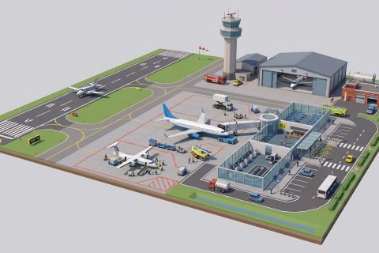

# Airport

In production, 1 part so far. Every part below is already free to use.

[Open the kit on Polyfork](https://polyfork.dev/kit/airport-43b137) · [All kits](../README.md#kits)

<table>
<tr>
<td align="center" valign="top" width="25%"> <a href="https://polyfork.dev/asset/flight-attendant-befaf4">Flight Attendant</a> <a href="https://polyfork.dev/cdn/flight-attendant-befaf4.glb">GLB</a> · <a href="https://polyfork.dev/cdn/flight-attendant-befaf4.mjs">module</a></td>
</tr>
</table>
