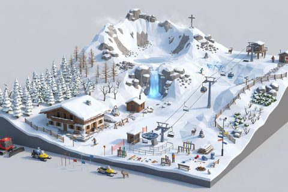

# Alpine and Snow

In production, 59 parts so far. Every part below is already free to use.

[Open the kit on Polyfork](https://polyfork.dev/kit/alpine-and-snow-092f66) · [All kits](../README.md#kits)

<table>
<tr>
<td align="center" valign="top" width="25%"> <a href="https://polyfork.dev/asset/akja-rescue-sledge-a3727f">Akja Rescue Sledge</a> <a href="https://polyfork.dev/cdn/akja-rescue-sledge-a3727f.glb">GLB</a> · <a href="https://polyfork.dev/cdn/akja-rescue-sledge-a3727f.mjs">module</a></td>
<td align="center" valign="top" width="25%"> <a href="https://polyfork.dev/asset/alpine-bench-32fa62">Alpine Bench</a> <a href="https://polyfork.dev/cdn/alpine-bench-32fa62.glb">GLB</a> · <a href="https://polyfork.dev/cdn/alpine-bench-32fa62.mjs">module</a></td>
<td align="center" valign="top" width="25%"> <a href="https://polyfork.dev/asset/alpine-chalet-47d59e">Alpine Chalet</a> <a href="https://polyfork.dev/cdn/alpine-chalet-47d59e.glb">GLB</a> · <a href="https://polyfork.dev/cdn/alpine-chalet-47d59e.mjs">module</a></td>
<td align="center" valign="top" width="25%"> <a href="https://polyfork.dev/asset/alpine-fingerpost-d47349">Alpine Fingerpost</a> <a href="https://polyfork.dev/cdn/alpine-fingerpost-d47349.glb">GLB</a> · <a href="https://polyfork.dev/cdn/alpine-fingerpost-d47349.mjs">module</a></td>
</tr>
<tr>
<td align="center" valign="top" width="25%"> <a href="https://polyfork.dev/asset/alpine-hay-barn-3965e5">Alpine Hay Barn</a> <a href="https://polyfork.dev/cdn/alpine-hay-barn-3965e5.glb">GLB</a> · <a href="https://polyfork.dev/cdn/alpine-hay-barn-3965e5.mjs">module</a></td>
<td align="center" valign="top" width="25%"> <a href="https://polyfork.dev/asset/alpine-ibex-2a288a">Alpine Ibex</a> <a href="https://polyfork.dev/cdn/alpine-ibex-2a288a.glb">GLB</a> · <a href="https://polyfork.dev/cdn/alpine-ibex-2a288a.mjs">module</a></td>
<td align="center" valign="top" width="25%"> <a href="https://polyfork.dev/asset/avalanche-barrier-run-02a615">Avalanche Barrier Run</a> <a href="https://polyfork.dev/cdn/avalanche-barrier-run-02a615.glb">GLB</a> · <a href="https://polyfork.dev/cdn/avalanche-barrier-run-02a615.mjs">module</a></td>
<td align="center" valign="top" width="25%"> <a href="https://polyfork.dev/asset/avalanche-gas-exploder-78b46f">Avalanche Gas Exploder</a> <a href="https://polyfork.dev/cdn/avalanche-gas-exploder-78b46f.glb">GLB</a> · <a href="https://polyfork.dev/cdn/avalanche-gas-exploder-78b46f.mjs">module</a></td>
</tr>
<tr>
<td align="center" valign="top" width="25%"> <a href="https://polyfork.dev/asset/bare-mountain-rowan-10e72e">Bare Mountain Rowan</a> <a href="https://polyfork.dev/cdn/bare-mountain-rowan-10e72e.glb">GLB</a> · <a href="https://polyfork.dev/cdn/bare-mountain-rowan-10e72e.mjs">module</a></td>
<td align="center" valign="top" width="25%"> <a href="https://polyfork.dev/asset/boulder-field-cluster-08e364">Boulder Field Cluster</a> <a href="https://polyfork.dev/cdn/boulder-field-cluster-08e364.glb">GLB</a> · <a href="https://polyfork.dev/cdn/boulder-field-cluster-08e364.mjs">module</a></td>
<td align="center" valign="top" width="25%"> <a href="https://polyfork.dev/asset/chairlift-chair-2beb2b">Chairlift Chair</a> <a href="https://polyfork.dev/cdn/chairlift-chair-2beb2b.glb">GLB</a> · <a href="https://polyfork.dev/cdn/chairlift-chair-2beb2b.mjs">module</a></td>
<td align="center" valign="top" width="25%"> <a href="https://polyfork.dev/asset/cleared-fire-pit-399cda">Cleared Fire Pit</a> <a href="https://polyfork.dev/cdn/cleared-fire-pit-399cda.glb">GLB</a> · <a href="https://polyfork.dev/cdn/cleared-fire-pit-399cda.mjs">module</a></td>
</tr>
<tr>
<td align="center" valign="top" width="25%"> <a href="https://polyfork.dev/asset/cleared-stone-path-tile-7e92bc">Cleared Stone Path Tile</a> <a href="https://polyfork.dev/cdn/cleared-stone-path-tile-7e92bc.glb">GLB</a> · <a href="https://polyfork.dev/cdn/cleared-stone-path-tile-7e92bc.mjs">module</a></td>
<td align="center" valign="top" width="25%"> <a href="https://polyfork.dev/asset/deep-powder-tile-1fcec9">Deep Powder Tile</a> <a href="https://polyfork.dev/cdn/deep-powder-tile-1fcec9.glb">GLB</a> · <a href="https://polyfork.dev/cdn/deep-powder-tile-1fcec9.mjs">module</a></td>
<td align="center" valign="top" width="25%"> <a href="https://polyfork.dev/asset/dwarf-pine-mat-faee77">Dwarf Pine Mat</a> <a href="https://polyfork.dev/cdn/dwarf-pine-mat-faee77.glb">GLB</a> · <a href="https://polyfork.dev/cdn/dwarf-pine-mat-faee77.mjs">module</a></td>
<td align="center" valign="top" width="25%"> <a href="https://polyfork.dev/asset/frozen-water-trough-61c835">Frozen Water Trough</a> <a href="https://polyfork.dev/cdn/frozen-water-trough-61c835.glb">GLB</a> · <a href="https://polyfork.dev/cdn/frozen-water-trough-61c835.mjs">module</a></td>
</tr>
<tr>
<td align="center" valign="top" width="25%"> <a href="https://polyfork.dev/asset/frozen-waterfall-5d1fc6">Frozen Waterfall</a> <a href="https://polyfork.dev/cdn/frozen-waterfall-5d1fc6.glb">GLB</a> · <a href="https://polyfork.dev/cdn/frozen-waterfall-5d1fc6.mjs">module</a></td>
<td align="center" valign="top" width="25%"> <a href="https://polyfork.dev/asset/gondola-cabin-c05230">Gondola Cabin</a> <a href="https://polyfork.dev/cdn/gondola-cabin-c05230.glb">GLB</a> · <a href="https://polyfork.dev/cdn/gondola-cabin-c05230.mjs">module</a></td>
<td align="center" valign="top" width="25%"> <a href="https://polyfork.dev/asset/groomed-piste-tile-32b2a2">Groomed Piste Tile</a> <a href="https://polyfork.dev/cdn/groomed-piste-tile-32b2a2.glb">GLB</a> · <a href="https://polyfork.dev/cdn/groomed-piste-tile-32b2a2.mjs">module</a></td>
<td align="center" valign="top" width="25%"> <a href="https://polyfork.dev/asset/groomer-fuel-drum-9d56e6">Groomer Fuel Drum</a> <a href="https://polyfork.dev/cdn/groomer-fuel-drum-9d56e6.glb">GLB</a> · <a href="https://polyfork.dev/cdn/groomer-fuel-drum-9d56e6.mjs">module</a></td>
</tr>
<tr>
<td align="center" valign="top" width="25%"> <a href="https://polyfork.dev/asset/groomer-winch-anchor-8f2495">Groomer Winch Anchor</a> <a href="https://polyfork.dev/cdn/groomer-winch-anchor-8f2495.glb">GLB</a> · <a href="https://polyfork.dev/cdn/groomer-winch-anchor-8f2495.mjs">module</a></td>
<td align="center" valign="top" width="25%"> <a href="https://polyfork.dev/asset/haul-rope-span-6ad505">Haul Rope Span</a> <a href="https://polyfork.dev/cdn/haul-rope-span-6ad505.glb">GLB</a> · <a href="https://polyfork.dev/cdn/haul-rope-span-6ad505.mjs">module</a></td>
<td align="center" valign="top" width="25%"> <a href="https://polyfork.dev/asset/ice-axe-and-crampon-e4c7c1">Ice Axe and Crampon Set</a> <a href="https://polyfork.dev/cdn/ice-axe-and-crampon-e4c7c1.glb">GLB</a> · <a href="https://polyfork.dev/cdn/ice-axe-and-crampon-e4c7c1.mjs">module</a></td>
<td align="center" valign="top" width="25%"> <a href="https://polyfork.dev/asset/lift-operator-899cf8">Lift Operator</a> <a href="https://polyfork.dev/cdn/lift-operator-899cf8.glb">GLB</a> · <a href="https://polyfork.dev/cdn/lift-operator-899cf8.mjs">module</a></td>
</tr>
<tr>
<td align="center" valign="top" width="25%"> <a href="https://polyfork.dev/asset/lift-pylon-4e4385">Lift Pylon</a> <a href="https://polyfork.dev/cdn/lift-pylon-4e4385.glb">GLB</a> · <a href="https://polyfork.dev/cdn/lift-pylon-4e4385.mjs">module</a></td>
<td align="center" valign="top" width="25%"> <a href="https://polyfork.dev/asset/lift-top-station-46d313">Lift Top Station</a> <a href="https://polyfork.dev/cdn/lift-top-station-46d313.glb">GLB</a> · <a href="https://polyfork.dev/cdn/lift-top-station-46d313.mjs">module</a></td>
<td align="center" valign="top" width="25%"> <a href="https://polyfork.dev/asset/mountain-hare-d9c64c">Mountain Hare</a> <a href="https://polyfork.dev/cdn/mountain-hare-d9c64c.glb">GLB</a> · <a href="https://polyfork.dev/cdn/mountain-hare-d9c64c.mjs">module</a></td>
<td align="center" valign="top" width="25%"> <a href="https://polyfork.dev/asset/mountain-refuge-hut-32ab1e">Mountain Refuge Hut</a> <a href="https://polyfork.dev/cdn/mountain-refuge-hut-32ab1e.glb">GLB</a> · <a href="https://polyfork.dev/cdn/mountain-refuge-hut-32ab1e.mjs">module</a></td>
</tr>
<tr>
<td align="center" valign="top" width="25%"> <a href="https://polyfork.dev/asset/mountaineer-13df29">Mountaineer</a> <a href="https://polyfork.dev/cdn/mountaineer-13df29.glb">GLB</a> · <a href="https://polyfork.dev/cdn/mountaineer-13df29.mjs">module</a></td>
<td align="center" valign="top" width="25%"> <a href="https://polyfork.dev/asset/piste-basher-snowcat-92fe8b">Piste Basher Snowcat</a> <a href="https://polyfork.dev/cdn/piste-basher-snowcat-92fe8b.glb">GLB</a> · <a href="https://polyfork.dev/cdn/piste-basher-snowcat-92fe8b.mjs">module</a></td>
<td align="center" valign="top" width="25%"> <a href="https://polyfork.dev/asset/piste-floodlight-mast-a31cf2">Piste Floodlight Mast</a> <a href="https://polyfork.dev/cdn/piste-floodlight-mast-a31cf2.glb">GLB</a> · <a href="https://polyfork.dev/cdn/piste-floodlight-mast-a31cf2.mjs">module</a></td>
<td align="center" valign="top" width="25%"> <a href="https://polyfork.dev/asset/piste-marker-pole-7480c3">Piste Marker Pole</a> <a href="https://polyfork.dev/cdn/piste-marker-pole-7480c3.glb">GLB</a> · <a href="https://polyfork.dev/cdn/piste-marker-pole-7480c3.mjs">module</a></td>
</tr>
<tr>
<td align="center" valign="top" width="25%"> <a href="https://polyfork.dev/asset/piste-patrol-hut-17a90a">Piste Patrol Hut</a> <a href="https://polyfork.dev/cdn/piste-patrol-hut-17a90a.glb">GLB</a> · <a href="https://polyfork.dev/cdn/piste-patrol-hut-17a90a.mjs">module</a></td>
<td align="center" valign="top" width="25%"> <a href="https://polyfork.dev/asset/piste-patroller-cef4c2">Piste Patroller</a> <a href="https://polyfork.dev/cdn/piste-patroller-cef4c2.glb">GLB</a> · <a href="https://polyfork.dev/cdn/piste-patroller-cef4c2.mjs">module</a></td>
<td align="center" valign="top" width="25%"> <a href="https://polyfork.dev/asset/probe-and-shovel-set-06d115">Probe and Shovel Set</a> <a href="https://polyfork.dev/cdn/probe-and-shovel-set-06d115.glb">GLB</a> · <a href="https://polyfork.dev/cdn/probe-and-shovel-set-06d115.mjs">module</a></td>
<td align="center" valign="top" width="25%"> <a href="https://polyfork.dev/asset/race-start-hut-c6d405">Race Start Hut</a> <a href="https://polyfork.dev/cdn/race-start-hut-c6d405.glb">GLB</a> · <a href="https://polyfork.dev/cdn/race-start-hut-c6d405.mjs">module</a></td>
</tr>
<tr>
<td align="center" valign="top" width="25%"> <a href="https://polyfork.dev/asset/rock-climbing-anchor-8ddf1c">Rock Climbing Anchor</a> <a href="https://polyfork.dev/cdn/rock-climbing-anchor-8ddf1c.glb">GLB</a> · <a href="https://polyfork.dev/cdn/rock-climbing-anchor-8ddf1c.mjs">module</a></td>
<td align="center" valign="top" width="25%"> <a href="https://polyfork.dev/asset/rock-outcrop-158ac3">Rock Outcrop</a> <a href="https://polyfork.dev/cdn/rock-outcrop-158ac3.glb">GLB</a> · <a href="https://polyfork.dev/cdn/rock-outcrop-158ac3.mjs">module</a></td>
<td align="center" valign="top" width="25%"> <a href="https://polyfork.dev/asset/rope-coil-and-harness-5b51d5">Rope Coil and Harness</a> <a href="https://polyfork.dev/cdn/rope-coil-and-harness-5b51d5.glb">GLB</a> · <a href="https://polyfork.dev/cdn/rope-coil-and-harness-5b51d5.mjs">module</a></td>
<td align="center" valign="top" width="25%"> <a href="https://polyfork.dev/asset/rope-tow-run-c0fbbd">Rope Tow Run</a> <a href="https://polyfork.dev/cdn/rope-tow-run-c0fbbd.glb">GLB</a> · <a href="https://polyfork.dev/cdn/rope-tow-run-c0fbbd.mjs">module</a></td>
</tr>
<tr>
<td align="center" valign="top" width="25%"> <a href="https://polyfork.dev/asset/safety-net-run-ecf381">Safety Net Run</a> <a href="https://polyfork.dev/cdn/safety-net-run-ecf381.glb">GLB</a> · <a href="https://polyfork.dev/cdn/safety-net-run-ecf381.mjs">module</a></td>
<td align="center" valign="top" width="25%"> <a href="https://polyfork.dev/asset/scree-heap-42cce5">Scree Heap</a> <a href="https://polyfork.dev/cdn/scree-heap-42cce5.glb">GLB</a> · <a href="https://polyfork.dev/cdn/scree-heap-42cce5.mjs">module</a></td>
<td align="center" valign="top" width="25%"> <a href="https://polyfork.dev/asset/ski-and-pole-stack-9d4d53">Ski and Pole Stack</a> <a href="https://polyfork.dev/cdn/ski-and-pole-stack-9d4d53.glb">GLB</a> · <a href="https://polyfork.dev/cdn/ski-and-pole-stack-9d4d53.mjs">module</a></td>
<td align="center" valign="top" width="25%"> <a href="https://polyfork.dev/asset/ski-lift-base-station-924491">Ski Lift Base Station</a> <a href="https://polyfork.dev/cdn/ski-lift-base-station-924491.glb">GLB</a> · <a href="https://polyfork.dev/cdn/ski-lift-base-station-924491.mjs">module</a></td>
</tr>
<tr>
<td align="center" valign="top" width="25%"> <a href="https://polyfork.dev/asset/skier-e7ad44">Skier</a> <a href="https://polyfork.dev/cdn/skier-e7ad44.glb">GLB</a> · <a href="https://polyfork.dev/cdn/skier-e7ad44.mjs">module</a></td>
<td align="center" valign="top" width="25%"> <a href="https://polyfork.dev/asset/slalom-gate-7f4875">Slalom Gate</a> <a href="https://polyfork.dev/cdn/slalom-gate-7f4875.glb">GLB</a> · <a href="https://polyfork.dev/cdn/slalom-gate-7f4875.mjs">module</a></td>
<td align="center" valign="top" width="25%"> <a href="https://polyfork.dev/asset/snow-cannon-cc3ea5">Snow Cannon</a> <a href="https://polyfork.dev/cdn/snow-cannon-cc3ea5.glb">GLB</a> · <a href="https://polyfork.dev/cdn/snow-cannon-cc3ea5.mjs">module</a></td>
<td align="center" valign="top" width="25%"> <a href="https://polyfork.dev/asset/snow-fence-run-55a09a">Snow Fence Run</a> <a href="https://polyfork.dev/cdn/snow-fence-run-55a09a.glb">GLB</a> · <a href="https://polyfork.dev/cdn/snow-fence-run-55a09a.mjs">module</a></td>
</tr>
<tr>
<td align="center" valign="top" width="25%"> <a href="https://polyfork.dev/asset/snow-capped-log-pile-8719e7">Snow-Capped Log Pile</a> <a href="https://polyfork.dev/cdn/snow-capped-log-pile-8719e7.glb">GLB</a> · <a href="https://polyfork.dev/cdn/snow-capped-log-pile-8719e7.mjs">module</a></td>
<td align="center" valign="top" width="25%"> <a href="https://polyfork.dev/asset/snow-laden-spruce-36716e">Snow-Laden Spruce</a> <a href="https://polyfork.dev/cdn/snow-laden-spruce-36716e.glb">GLB</a> · <a href="https://polyfork.dev/cdn/snow-laden-spruce-36716e.mjs">module</a></td>
<td align="center" valign="top" width="25%"> <a href="https://polyfork.dev/asset/snowboard-rack-ecad90">Snowboard Rack</a> <a href="https://polyfork.dev/cdn/snowboard-rack-ecad90.glb">GLB</a> · <a href="https://polyfork.dev/cdn/snowboard-rack-ecad90.mjs">module</a></td>
<td align="center" valign="top" width="25%"> <a href="https://polyfork.dev/asset/snowmobile-e0fef3">Snowmobile</a> <a href="https://polyfork.dev/cdn/snowmobile-e0fef3.glb">GLB</a> · <a href="https://polyfork.dev/cdn/snowmobile-e0fef3.mjs">module</a></td>
</tr>
<tr>
<td align="center" valign="top" width="25%"> <a href="https://polyfork.dev/asset/stone-cairn-a9bf48">Stone Cairn</a> <a href="https://polyfork.dev/cdn/stone-cairn-a9bf48.glb">GLB</a> · <a href="https://polyfork.dev/cdn/stone-cairn-a9bf48.mjs">module</a></td>
<td align="center" valign="top" width="25%"> <a href="https://polyfork.dev/asset/summit-cross-181eba">Summit Cross</a> <a href="https://polyfork.dev/cdn/summit-cross-181eba.glb">GLB</a> · <a href="https://polyfork.dev/cdn/summit-cross-181eba.mjs">module</a></td>
<td align="center" valign="top" width="25%"> <a href="https://polyfork.dev/asset/timber-ski-rack-8239d1">Timber Ski Rack</a> <a href="https://polyfork.dev/cdn/timber-ski-rack-8239d1.glb">GLB</a> · <a href="https://polyfork.dev/cdn/timber-ski-rack-8239d1.mjs">module</a></td>
<td align="center" valign="top" width="25%"> <a href="https://polyfork.dev/asset/wayfinder-post-961fcd">Wayfinder Post</a> <a href="https://polyfork.dev/cdn/wayfinder-post-961fcd.glb">GLB</a> · <a href="https://polyfork.dev/cdn/wayfinder-post-961fcd.mjs">module</a></td>
</tr>
<tr>
<td align="center" valign="top" width="25%"> <a href="https://polyfork.dev/asset/weather-station-mast-f84278">Weather Station Mast</a> <a href="https://polyfork.dev/cdn/weather-station-mast-f84278.glb">GLB</a> · <a href="https://polyfork.dev/cdn/weather-station-mast-f84278.mjs">module</a></td>
<td align="center" valign="top" width="25%"> <a href="https://polyfork.dev/asset/windblown-larch-abb99c">Windblown Larch</a> <a href="https://polyfork.dev/cdn/windblown-larch-abb99c.glb">GLB</a> · <a href="https://polyfork.dev/cdn/windblown-larch-abb99c.mjs">module</a></td>
<td align="center" valign="top" width="25%"> <a href="https://polyfork.dev/asset/wooden-toboggan-940bbc">Wooden Toboggan</a> <a href="https://polyfork.dev/cdn/wooden-toboggan-940bbc.glb">GLB</a> · <a href="https://polyfork.dev/cdn/wooden-toboggan-940bbc.mjs">module</a></td>
</tr>
</table>
