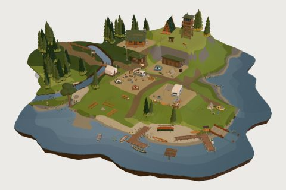

# Campground & Lake

62 free low-poly parts on one palette and one scale, so everything you combine belongs to the same world.

[Open the kit on Polyfork](https://polyfork.dev/kit/campground-lake-ad32b0) · [All kits](../README.md#kits)

<table>
<tr>
<td align="center" valign="top" width="25%"> <a href="https://polyfork.dev/asset/a-frame-cabin-6cb550">A-Frame Cabin</a> <a href="https://polyfork.dev/cdn/a-frame-cabin-6cb550.glb">GLB</a> · <a href="https://polyfork.dev/cdn/a-frame-cabin-6cb550.mjs">module</a></td>
<td align="center" valign="top" width="25%"> <a href="https://polyfork.dev/asset/amphitheatre-bench-row-d72422">Amphitheatre Bench Row</a> <a href="https://polyfork.dev/cdn/amphitheatre-bench-row-d72422.glb">GLB</a> · <a href="https://polyfork.dev/cdn/amphitheatre-bench-row-d72422.mjs">module</a></td>
<td align="center" valign="top" width="25%"> <a href="https://polyfork.dev/asset/backpacker-f56207">Backpacker</a> <a href="https://polyfork.dev/cdn/backpacker-f56207.glb">GLB</a> · <a href="https://polyfork.dev/cdn/backpacker-f56207.mjs">module</a></td>
<td align="center" valign="top" width="25%"> <a href="https://polyfork.dev/asset/bear-proof-food-locker-9144bb">Bear-Proof Food Locker</a> <a href="https://polyfork.dev/cdn/bear-proof-food-locker-9144bb.glb">GLB</a> · <a href="https://polyfork.dev/cdn/bear-proof-food-locker-9144bb.mjs">module</a></td>
</tr>
<tr>
<td align="center" valign="top" width="25%"> <a href="https://polyfork.dev/asset/boat-launch-ramp-dbde11">Boat Launch Ramp</a> <a href="https://polyfork.dev/cdn/boat-launch-ramp-dbde11.glb">GLB</a> · <a href="https://polyfork.dev/cdn/boat-launch-ramp-dbde11.mjs">module</a></td>
<td align="center" valign="top" width="25%"> <a href="https://polyfork.dev/asset/camp-canoe-c65d2a">Camp Canoe</a> <a href="https://polyfork.dev/cdn/camp-canoe-c65d2a.glb">GLB</a> · <a href="https://polyfork.dev/cdn/camp-canoe-c65d2a.mjs">module</a></td>
<td align="center" valign="top" width="25%"> <a href="https://polyfork.dev/asset/camp-cooler-8ba941">Camp Cooler</a> <a href="https://polyfork.dev/cdn/camp-cooler-8ba941.glb">GLB</a> · <a href="https://polyfork.dev/cdn/camp-cooler-8ba941.mjs">module</a></td>
<td align="center" valign="top" width="25%"> <a href="https://polyfork.dev/asset/camp-dutch-oven-843dda">Camp Dutch Oven</a> <a href="https://polyfork.dev/cdn/camp-dutch-oven-843dda.glb">GLB</a> · <a href="https://polyfork.dev/cdn/camp-dutch-oven-843dda.mjs">module</a></td>
</tr>
<tr>
<td align="center" valign="top" width="25%"> <a href="https://polyfork.dev/asset/camp-kitchen-table-dfa2ab">Camp Kitchen Table</a> <a href="https://polyfork.dev/cdn/camp-kitchen-table-dfa2ab.glb">GLB</a> · <a href="https://polyfork.dev/cdn/camp-kitchen-table-dfa2ab.mjs">module</a></td>
<td align="center" valign="top" width="25%"> <a href="https://polyfork.dev/asset/camp-notice-board-c0be42">Camp Notice Board</a> <a href="https://polyfork.dev/cdn/camp-notice-board-c0be42.glb">GLB</a> · <a href="https://polyfork.dev/cdn/camp-notice-board-c0be42.mjs">module</a></td>
<td align="center" valign="top" width="25%"> <a href="https://polyfork.dev/asset/camp-water-jug-1aba54">Camp Water Jug</a> <a href="https://polyfork.dev/cdn/camp-water-jug-1aba54.glb">GLB</a> · <a href="https://polyfork.dev/cdn/camp-water-jug-1aba54.mjs">module</a></td>
<td align="center" valign="top" width="25%"> <a href="https://polyfork.dev/asset/campfire-cooking-grate-884d56">Campfire Cooking Grate</a> <a href="https://polyfork.dev/cdn/campfire-cooking-grate-884d56.glb">GLB</a> · <a href="https://polyfork.dev/cdn/campfire-cooking-grate-884d56.mjs">module</a></td>
</tr>
<tr>
<td align="center" valign="top" width="25%"> <a href="https://polyfork.dev/asset/campfire-parent-b1c0d5">Campfire Parent</a> <a href="https://polyfork.dev/cdn/campfire-parent-b1c0d5.glb">GLB</a> · <a href="https://polyfork.dev/cdn/campfire-parent-b1c0d5.mjs">module</a></td>
<td align="center" valign="top" width="25%"> <a href="https://polyfork.dev/asset/campground-lake-terrain-b5f899">Campground &amp; Lake Terrain</a> <a href="https://polyfork.dev/cdn/campground-lake-terrain-b5f899.glb">GLB</a> · <a href="https://polyfork.dev/cdn/campground-lake-terrain-b5f899.mjs">module</a></td>
<td align="center" valign="top" width="25%"> <a href="https://polyfork.dev/asset/campground-pine-stand-0bf4f2">Campground Pine Stand</a> <a href="https://polyfork.dev/cdn/campground-pine-stand-0bf4f2.glb">GLB</a> · <a href="https://polyfork.dev/cdn/campground-pine-stand-0bf4f2.mjs">module</a></td>
<td align="center" valign="top" width="25%"> <a href="https://polyfork.dev/asset/campground-rail-fence-run-524013">Campground Rail Fence Run</a> <a href="https://polyfork.dev/cdn/campground-rail-fence-run-524013.glb">GLB</a> · <a href="https://polyfork.dev/cdn/campground-rail-fence-run-524013.mjs">module</a></td>
</tr>
<tr>
<td align="center" valign="top" width="25%"> <a href="https://polyfork.dev/asset/camping-lantern-21d14b">Camping Lantern</a> <a href="https://polyfork.dev/cdn/camping-lantern-21d14b.glb">GLB</a> · <a href="https://polyfork.dev/cdn/camping-lantern-21d14b.mjs">module</a></td>
<td align="center" valign="top" width="25%"> <a href="https://polyfork.dev/asset/canoe-rack-c8126e">Canoe Rack</a> <a href="https://polyfork.dev/cdn/canoe-rack-c8126e.glb">GLB</a> · <a href="https://polyfork.dev/cdn/canoe-rack-c8126e.mjs">module</a></td>
<td align="center" valign="top" width="25%"> <a href="https://polyfork.dev/asset/canvas-ridge-tent-f0df0d">Canvas Ridge Tent</a> <a href="https://polyfork.dev/cdn/canvas-ridge-tent-f0df0d.glb">GLB</a> · <a href="https://polyfork.dev/cdn/canvas-ridge-tent-f0df0d.mjs">module</a></td>
<td align="center" valign="top" width="25%"> <a href="https://polyfork.dev/asset/canvas-wall-tent-de8a04">Canvas Wall Tent</a> <a href="https://polyfork.dev/cdn/canvas-wall-tent-de8a04.glb">GLB</a> · <a href="https://polyfork.dev/cdn/canvas-wall-tent-de8a04.mjs">module</a></td>
</tr>
<tr>
<td align="center" valign="top" width="25%"> <a href="https://polyfork.dev/asset/cordwood-pile-b5229b">Cordwood Pile</a> <a href="https://polyfork.dev/cdn/cordwood-pile-b5229b.glb">GLB</a> · <a href="https://polyfork.dev/cdn/cordwood-pile-b5229b.mjs">module</a></td>
<td align="center" valign="top" width="25%"> <a href="https://polyfork.dev/asset/creek-footbridge-d35cf7">Creek Footbridge</a> <a href="https://polyfork.dev/cdn/creek-footbridge-d35cf7.glb">GLB</a> · <a href="https://polyfork.dev/cdn/creek-footbridge-d35cf7.mjs">module</a></td>
<td align="center" valign="top" width="25%"> <a href="https://polyfork.dev/asset/dome-tent-9ee59d">Dome Tent</a> <a href="https://polyfork.dev/cdn/dome-tent-9ee59d.glb">GLB</a> · <a href="https://polyfork.dev/cdn/dome-tent-9ee59d.mjs">module</a></td>
<td align="center" valign="top" width="25%"> <a href="https://polyfork.dev/asset/exposed-tree-roots-e1409c">Exposed Tree Roots</a> <a href="https://polyfork.dev/cdn/exposed-tree-roots-e1409c.glb">GLB</a> · <a href="https://polyfork.dev/cdn/exposed-tree-roots-e1409c.mjs">module</a></td>
</tr>
<tr>
<td align="center" valign="top" width="25%"> <a href="https://polyfork.dev/asset/folding-camp-chair-2fc7d1">Folding Camp Chair</a> <a href="https://polyfork.dev/cdn/folding-camp-chair-2fc7d1.glb">GLB</a> · <a href="https://polyfork.dev/cdn/folding-camp-chair-2fc7d1.mjs">module</a></td>
<td align="center" valign="top" width="25%"> <a href="https://polyfork.dev/asset/hammock-on-posts-7d5c47">Hammock on Posts</a> <a href="https://polyfork.dev/cdn/hammock-on-posts-7d5c47.glb">GLB</a> · <a href="https://polyfork.dev/cdn/hammock-on-posts-7d5c47.mjs">module</a></td>
<td align="center" valign="top" width="25%"> <a href="https://polyfork.dev/asset/heavy-timber-picnic-table-1ac060">Heavy Timber Picnic Table</a> <a href="https://polyfork.dev/cdn/heavy-timber-picnic-table-1ac060.glb">GLB</a> · <a href="https://polyfork.dev/cdn/heavy-timber-picnic-table-1ac060.mjs">module</a></td>
<td align="center" valign="top" width="25%"> <a href="https://polyfork.dev/asset/hip-roof-ranger-station-581dd5">Hip-Roof Ranger Station</a> <a href="https://polyfork.dev/cdn/hip-roof-ranger-station-581dd5.glb">GLB</a> · <a href="https://polyfork.dev/cdn/hip-roof-ranger-station-581dd5.mjs">module</a></td>
</tr>
<tr>
<td align="center" valign="top" width="25%"> <a href="https://polyfork.dev/asset/kid-with-a-flashlight-1a9e4c">Kid with a Flashlight</a> <a href="https://polyfork.dev/cdn/kid-with-a-flashlight-1a9e4c.glb">GLB</a> · <a href="https://polyfork.dev/cdn/kid-with-a-flashlight-1a9e4c.mjs">module</a></td>
<td align="center" valign="top" width="25%"> <a href="https://polyfork.dev/asset/lake-angler-1c4740">Lake Angler</a> <a href="https://polyfork.dev/cdn/lake-angler-1c4740.glb">GLB</a> · <a href="https://polyfork.dev/cdn/lake-angler-1c4740.mjs">module</a></td>
<td align="center" valign="top" width="25%"> <a href="https://polyfork.dev/asset/lake-dock-run-f5380e">Lake Dock Run</a> <a href="https://polyfork.dev/cdn/lake-dock-run-f5380e.glb">GLB</a> · <a href="https://polyfork.dev/cdn/lake-dock-run-f5380e.mjs">module</a></td>
<td align="center" valign="top" width="25%"> <a href="https://polyfork.dev/asset/lake-kayak-930d0b">Lake Kayak</a> <a href="https://polyfork.dev/cdn/lake-kayak-930d0b.glb">GLB</a> · <a href="https://polyfork.dev/cdn/lake-kayak-930d0b.mjs">module</a></td>
</tr>
<tr>
<td align="center" valign="top" width="25%"> <a href="https://polyfork.dev/asset/lake-pebbles-6c0359">Lake Pebbles</a> <a href="https://polyfork.dev/cdn/lake-pebbles-6c0359.glb">GLB</a> · <a href="https://polyfork.dev/cdn/lake-pebbles-6c0359.mjs">module</a></td>
<td align="center" valign="top" width="25%"> <a href="https://polyfork.dev/asset/lake-rowing-skiff-4916e7">Lake Rowing Skiff</a> <a href="https://polyfork.dev/cdn/lake-rowing-skiff-4916e7.glb">GLB</a> · <a href="https://polyfork.dev/cdn/lake-rowing-skiff-4916e7.mjs">module</a></td>
<td align="center" valign="top" width="25%"> <a href="https://polyfork.dev/asset/lakeside-swing-tree-02c084">Lakeside Swing Tree</a> <a href="https://polyfork.dev/cdn/lakeside-swing-tree-02c084.glb">GLB</a> · <a href="https://polyfork.dev/cdn/lakeside-swing-tree-02c084.mjs">module</a></td>
<td align="center" valign="top" width="25%"> <a href="https://polyfork.dev/asset/life-jacket-post-15c73a">Life Jacket Post</a> <a href="https://polyfork.dev/cdn/life-jacket-post-15c73a.glb">GLB</a> · <a href="https://polyfork.dev/cdn/life-jacket-post-15c73a.mjs">module</a></td>
</tr>
<tr>
<td align="center" valign="top" width="25%"> <a href="https://polyfork.dev/asset/lily-pads-b0c5d0">Lily Pads</a> <a href="https://polyfork.dev/cdn/lily-pads-b0c5d0.glb">GLB</a> · <a href="https://polyfork.dev/cdn/lily-pads-b0c5d0.mjs">module</a></td>
<td align="center" valign="top" width="25%"> <a href="https://polyfork.dev/asset/marshmallow-stick-e955c7">Marshmallow Stick</a> <a href="https://polyfork.dev/cdn/marshmallow-stick-e955c7.glb">GLB</a> · <a href="https://polyfork.dev/cdn/marshmallow-stick-e955c7.mjs">module</a></td>
<td align="center" valign="top" width="25%"> <a href="https://polyfork.dev/asset/park-ranger-c1697e">Park Ranger</a> <a href="https://polyfork.dev/cdn/park-ranger-c1697e.glb">GLB</a> · <a href="https://polyfork.dev/cdn/park-ranger-c1697e.mjs">module</a></td>
<td align="center" valign="top" width="25%"> <a href="https://polyfork.dev/asset/pitch-marker-post-a87f8f">Pitch Marker Post</a> <a href="https://polyfork.dev/cdn/pitch-marker-post-a87f8f.glb">GLB</a> · <a href="https://polyfork.dev/cdn/pitch-marker-post-a87f8f.mjs">module</a></td>
</tr>
<tr>
<td align="center" valign="top" width="25%"> <a href="https://polyfork.dev/asset/pop-top-camper-van-62a322">Pop-Top Camper Van</a> <a href="https://polyfork.dev/cdn/pop-top-camper-van-62a322.glb">GLB</a> · <a href="https://polyfork.dev/cdn/pop-top-camper-van-62a322.mjs">module</a></td>
<td align="center" valign="top" width="25%"> <a href="https://polyfork.dev/asset/porch-log-cabin-d2f3ef">Porch Log Cabin</a> <a href="https://polyfork.dev/cdn/porch-log-cabin-d2f3ef.glb">GLB</a> · <a href="https://polyfork.dev/cdn/porch-log-cabin-d2f3ef.mjs">module</a></td>
<td align="center" valign="top" width="25%"> <a href="https://polyfork.dev/asset/propped-fishing-rod-072978">Propped Fishing Rod</a> <a href="https://polyfork.dev/cdn/propped-fishing-rod-072978.glb">GLB</a> · <a href="https://polyfork.dev/cdn/propped-fishing-rod-072978.mjs">module</a></td>
<td align="center" valign="top" width="25%"> <a href="https://polyfork.dev/asset/reed-bed-bbbefb">Reed Bed</a> <a href="https://polyfork.dev/cdn/reed-bed-bbbefb.glb">GLB</a> · <a href="https://polyfork.dev/cdn/reed-bed-bbbefb.mjs">module</a></td>
</tr>
<tr>
<td align="center" valign="top" width="25%"> <a href="https://polyfork.dev/asset/rope-swing-on-a-ada4bb">Rope Swing on a Branch</a> <a href="https://polyfork.dev/cdn/rope-swing-on-a-ada4bb.glb">GLB</a> · <a href="https://polyfork.dev/cdn/rope-swing-on-a-ada4bb.mjs">module</a></td>
<td align="center" valign="top" width="25%"> <a href="https://polyfork.dev/asset/rv-travel-trailer-bd53d7">RV Travel Trailer</a> <a href="https://polyfork.dev/cdn/rv-travel-trailer-bd53d7.glb">GLB</a> · <a href="https://polyfork.dev/cdn/rv-travel-trailer-bd53d7.mjs">module</a></td>
<td align="center" valign="top" width="25%"> <a href="https://polyfork.dev/asset/self-registration-post-e4636f">Self-Registration Post</a> <a href="https://polyfork.dev/cdn/self-registration-post-e4636f.glb">GLB</a> · <a href="https://polyfork.dev/cdn/self-registration-post-e4636f.mjs">module</a></td>
<td align="center" valign="top" width="25%"> <a href="https://polyfork.dev/asset/sleeping-bag-730d7d">Sleeping Bag</a> <a href="https://polyfork.dev/cdn/sleeping-bag-730d7d.glb">GLB</a> · <a href="https://polyfork.dev/cdn/sleeping-bag-730d7d.mjs">module</a></td>
</tr>
<tr>
<td align="center" valign="top" width="25%"> <a href="https://polyfork.dev/asset/splay-leg-lookout-tower-6fae7e">Splay-Leg Lookout Tower</a> <a href="https://polyfork.dev/cdn/splay-leg-lookout-tower-6fae7e.glb">GLB</a> · <a href="https://polyfork.dev/cdn/splay-leg-lookout-tower-6fae7e.mjs">module</a></td>
<td align="center" valign="top" width="25%"> <a href="https://polyfork.dev/asset/split-log-bench-289780">Split-Log Bench</a> <a href="https://polyfork.dev/cdn/split-log-bench-289780.glb">GLB</a> · <a href="https://polyfork.dev/cdn/split-log-bench-289780.mjs">module</a></td>
<td align="center" valign="top" width="25%"> <a href="https://polyfork.dev/asset/splitting-axe-in-a-afd1d5">Splitting Axe in a Block</a> <a href="https://polyfork.dev/cdn/splitting-axe-in-a-afd1d5.glb">GLB</a> · <a href="https://polyfork.dev/cdn/splitting-axe-in-a-afd1d5.mjs">module</a></td>
<td align="center" valign="top" width="25%"> <a href="https://polyfork.dev/asset/stand-up-paddleboard-92874f">Stand-Up Paddleboard</a> <a href="https://polyfork.dev/cdn/stand-up-paddleboard-92874f.glb">GLB</a> · <a href="https://polyfork.dev/cdn/stand-up-paddleboard-92874f.mjs">module</a></td>
</tr>
<tr>
<td align="center" valign="top" width="25%"> <a href="https://polyfork.dev/asset/stone-ring-campfire-8a0c6f">Stone-Ring Campfire</a> <a href="https://polyfork.dev/cdn/stone-ring-campfire-8a0c6f.glb">GLB</a> · <a href="https://polyfork.dev/cdn/stone-ring-campfire-8a0c6f.mjs">module</a></td>
<td align="center" valign="top" width="25%"> <a href="https://polyfork.dev/asset/string-light-run-01ba14">String Light Run</a> <a href="https://polyfork.dev/cdn/string-light-run-01ba14.glb">GLB</a> · <a href="https://polyfork.dev/cdn/string-light-run-01ba14.mjs">module</a></td>
<td align="center" valign="top" width="25%"> <a href="https://polyfork.dev/asset/swim-raft-6aefb5">Swim Raft</a> <a href="https://polyfork.dev/cdn/swim-raft-6aefb5.glb">GLB</a> · <a href="https://polyfork.dev/cdn/swim-raft-6aefb5.mjs">module</a></td>
<td align="center" valign="top" width="25%"> <a href="https://polyfork.dev/asset/tackle-box-efd0ee">Tackle Box</a> <a href="https://polyfork.dev/cdn/tackle-box-efd0ee.glb">GLB</a> · <a href="https://polyfork.dev/cdn/tackle-box-efd0ee.mjs">module</a></td>
</tr>
<tr>
<td align="center" valign="top" width="25%"> <a href="https://polyfork.dev/asset/teardrop-trailer-580e25">Teardrop Trailer</a> <a href="https://polyfork.dev/cdn/teardrop-trailer-580e25.glb">GLB</a> · <a href="https://polyfork.dev/cdn/teardrop-trailer-580e25.mjs">module</a></td>
<td align="center" valign="top" width="25%"> <a href="https://polyfork.dev/asset/timber-wash-house-c7e7d5">Timber Wash House</a> <a href="https://polyfork.dev/cdn/timber-wash-house-c7e7d5.glb">GLB</a> · <a href="https://polyfork.dev/cdn/timber-wash-house-c7e7d5.mjs">module</a></td>
<td align="center" valign="top" width="25%"> <a href="https://polyfork.dev/asset/trail-bike-on-a-652470">Trail Bike on a Post</a> <a href="https://polyfork.dev/cdn/trail-bike-on-a-652470.glb">GLB</a> · <a href="https://polyfork.dev/cdn/trail-bike-on-a-652470.mjs">module</a></td>
<td align="center" valign="top" width="25%"> <a href="https://polyfork.dev/asset/trailhead-sign-aa29e1">Trailhead Sign</a> <a href="https://polyfork.dev/cdn/trailhead-sign-aa29e1.glb">GLB</a> · <a href="https://polyfork.dev/cdn/trailhead-sign-aa29e1.mjs">module</a></td>
</tr>
<tr>
<td align="center" valign="top" width="25%"> <a href="https://polyfork.dev/asset/two-burner-camp-stove-3e83f5">Two-Burner Camp Stove</a> <a href="https://polyfork.dev/cdn/two-burner-camp-stove-3e83f5.glb">GLB</a> · <a href="https://polyfork.dev/cdn/two-burner-camp-stove-3e83f5.mjs">module</a></td>
<td align="center" valign="top" width="25%"> <a href="https://polyfork.dev/asset/wetland-boardwalk-run-6aa967">Wetland Boardwalk Run</a> <a href="https://polyfork.dev/cdn/wetland-boardwalk-run-6aa967.glb">GLB</a> · <a href="https://polyfork.dev/cdn/wetland-boardwalk-run-6aa967.mjs">module</a></td>
</tr>
</table>
