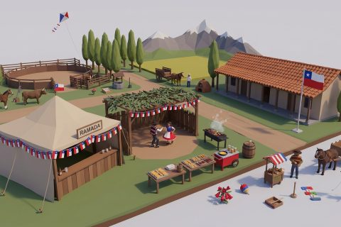

# Chile: Fiestas Patrias

In production, 62 parts so far. Every part below is already free to use.

[Open the kit on Polyfork](https://polyfork.dev/kit/chile-fiestas-patrias-87e847) · [All kits](../README.md#kits)

<table>
<tr>
<td align="center" valign="top" width="25%"> <a href="https://polyfork.dev/asset/adobe-colonial-farmhouse-cf13d8">Adobe Colonial Farmhouse</a> <a href="https://polyfork.dev/cdn/adobe-colonial-farmhouse-cf13d8.glb">GLB</a> · <a href="https://polyfork.dev/cdn/adobe-colonial-farmhouse-cf13d8.mjs">module</a></td>
<td align="center" valign="top" width="25%"> <a href="https://polyfork.dev/asset/adobe-tapia-wall-run-074dd5">Adobe Tapia Wall Run</a> <a href="https://polyfork.dev/cdn/adobe-tapia-wall-run-074dd5.glb">GLB</a> · <a href="https://polyfork.dev/cdn/adobe-tapia-wall-run-074dd5.mjs">module</a></td>
<td align="center" valign="top" width="25%"> <a href="https://polyfork.dev/asset/band-stage-bf9117">Band Stage</a> <a href="https://polyfork.dev/cdn/band-stage-bf9117.glb">GLB</a> · <a href="https://polyfork.dev/cdn/band-stage-bf9117.mjs">module</a></td>
<td align="center" valign="top" width="25%"> <a href="https://polyfork.dev/asset/barrel-organ-cart-30799d">Barrel Organ Cart</a> <a href="https://polyfork.dev/cdn/barrel-organ-cart-30799d.glb">GLB</a> · <a href="https://polyfork.dev/cdn/barrel-organ-cart-30799d.mjs">module</a></td>
</tr>
<tr>
<td align="center" valign="top" width="25%"> <a href="https://polyfork.dev/asset/basket-of-humitas-3cb716">Basket of Humitas</a> <a href="https://polyfork.dev/cdn/basket-of-humitas-3cb716.glb">GLB</a> · <a href="https://polyfork.dev/cdn/basket-of-humitas-3cb716.mjs">module</a></td>
<td align="center" valign="top" width="25%"> <a href="https://polyfork.dev/asset/box-of-red-wine-08d2b3">Box of Red Wine</a> <a href="https://polyfork.dev/cdn/box-of-red-wine-08d2b3.glb">GLB</a> · <a href="https://polyfork.dev/cdn/box-of-red-wine-08d2b3.mjs">module</a></td>
<td align="center" valign="top" width="25%"> <a href="https://polyfork.dev/asset/carrera-a-la-chilena-fd9544">Carrera a la Chilena Straight</a> <a href="https://polyfork.dev/cdn/carrera-a-la-chilena-fd9544.glb">GLB</a> · <a href="https://polyfork.dev/cdn/carrera-a-la-chilena-fd9544.mjs">module</a></td>
<td align="center" valign="top" width="25%"> <a href="https://polyfork.dev/asset/carreta-caeccd">Carreta</a> <a href="https://polyfork.dev/cdn/carreta-caeccd.glb">GLB</a> · <a href="https://polyfork.dev/cdn/carreta-caeccd.mjs">module</a></td>
</tr>
<tr>
<td align="center" valign="top" width="25%"> <a href="https://polyfork.dev/asset/cazuela-pot-79f0ee">Cazuela Pot</a> <a href="https://polyfork.dev/cdn/cazuela-pot-79f0ee.glb">GLB</a> · <a href="https://polyfork.dev/cdn/cazuela-pot-79f0ee.mjs">module</a></td>
<td align="center" valign="top" width="25%"> <a href="https://polyfork.dev/asset/central-valley-field-tile-f4ec17">Central Valley Field Tile</a> <a href="https://polyfork.dev/cdn/central-valley-field-tile-f4ec17.glb">GLB</a> · <a href="https://polyfork.dev/cdn/central-valley-field-tile-f4ec17.mjs">module</a></td>
<td align="center" valign="top" width="25%"> <a href="https://polyfork.dev/asset/charcoal-parrilla-8a1731">Charcoal Parrilla</a> <a href="https://polyfork.dev/cdn/charcoal-parrilla-8a1731.glb">GLB</a> · <a href="https://polyfork.dev/cdn/charcoal-parrilla-8a1731.mjs">module</a></td>
<td align="center" valign="top" width="25%"> <a href="https://polyfork.dev/asset/chicha-barrel-77037f">Chicha Barrel</a> <a href="https://polyfork.dev/cdn/chicha-barrel-77037f.glb">GLB</a> · <a href="https://polyfork.dev/cdn/chicha-barrel-77037f.mjs">module</a></td>
</tr>
<tr>
<td align="center" valign="top" width="25%"> <a href="https://polyfork.dev/asset/chicha-chuico-c45103">Chicha Chuico</a> <a href="https://polyfork.dev/cdn/chicha-chuico-c45103.glb">GLB</a> · <a href="https://polyfork.dev/cdn/chicha-chuico-c45103.mjs">module</a></td>
<td align="center" valign="top" width="25%"> <a href="https://polyfork.dev/asset/chile-fiestas-patrias-terrain-c8ce87">Chile: Fiestas Patrias Terrain</a> <a href="https://polyfork.dev/cdn/chile-fiestas-patrias-terrain-c8ce87.glb">GLB</a> · <a href="https://polyfork.dev/cdn/chile-fiestas-patrias-terrain-c8ce87.mjs">module</a></td>
<td align="center" valign="top" width="25%"> <a href="https://polyfork.dev/asset/chilean-flag-on-a-8b9693">Chilean Flag on a Flagpole</a> <a href="https://polyfork.dev/cdn/chilean-flag-on-a-8b9693.glb">GLB</a> · <a href="https://polyfork.dev/cdn/chilean-flag-on-a-8b9693.mjs">module</a></td>
<td align="center" valign="top" width="25%"> <a href="https://polyfork.dev/asset/chilean-palm-45fef5">Chilean Palm</a> <a href="https://polyfork.dev/cdn/chilean-palm-45fef5.glb">GLB</a> · <a href="https://polyfork.dev/cdn/chilean-palm-45fef5.mjs">module</a></td>
</tr>
<tr>
<td align="center" valign="top" width="25%"> <a href="https://polyfork.dev/asset/china-cueca-dancer-c1707a">China, Cueca Dancer</a> <a href="https://polyfork.dev/cdn/china-cueca-dancer-c1707a.glb">GLB</a> · <a href="https://polyfork.dev/cdn/china-cueca-dancer-c1707a.mjs">module</a></td>
<td align="center" valign="top" width="25%"> <a href="https://polyfork.dev/asset/chinchinero-2cc296">Chinchinero</a> <a href="https://polyfork.dev/cdn/chinchinero-2cc296.glb">GLB</a> · <a href="https://polyfork.dev/cdn/chinchinero-2cc296.mjs">module</a></td>
<td align="center" valign="top" width="25%"> <a href="https://polyfork.dev/asset/clay-wine-jug-b4ebd3">Clay Wine Jug</a> <a href="https://polyfork.dev/cdn/clay-wine-jug-b4ebd3.glb">GLB</a> · <a href="https://polyfork.dev/cdn/clay-wine-jug-b4ebd3.mjs">module</a></td>
<td align="center" valign="top" width="25%"> <a href="https://polyfork.dev/asset/copihue-bunch-de8436">Copihue Bunch</a> <a href="https://polyfork.dev/cdn/copihue-bunch-de8436.glb">GLB</a> · <a href="https://polyfork.dev/cdn/copihue-bunch-de8436.mjs">module</a></td>
</tr>
<tr>
<td align="center" valign="top" width="25%"> <a href="https://polyfork.dev/asset/corralero-horse-313f1a">Corralero Horse</a> <a href="https://polyfork.dev/cdn/corralero-horse-313f1a.glb">GLB</a> · <a href="https://polyfork.dev/cdn/corralero-horse-313f1a.mjs">module</a></td>
<td align="center" valign="top" width="25%"> <a href="https://polyfork.dev/asset/country-well-8feec8">Country Well</a> <a href="https://polyfork.dev/cdn/country-well-8feec8.glb">GLB</a> · <a href="https://polyfork.dev/cdn/country-well-8feec8.mjs">module</a></td>
<td align="center" valign="top" width="25%"> <a href="https://polyfork.dev/asset/cueca-handkerchief-8a9e28">Cueca Handkerchief</a> <a href="https://polyfork.dev/cdn/cueca-handkerchief-8a9e28.glb">GLB</a> · <a href="https://polyfork.dev/cdn/cueca-handkerchief-8a9e28.mjs">module</a></td>
<td align="center" valign="top" width="25%"> <a href="https://polyfork.dev/asset/cueca-musician-d71a2e">Cueca Musician</a> <a href="https://polyfork.dev/cdn/cueca-musician-d71a2e.glb">GLB</a> · <a href="https://polyfork.dev/cdn/cueca-musician-d71a2e.mjs">module</a></td>
</tr>
<tr>
<td align="center" valign="top" width="25%"> <a href="https://polyfork.dev/asset/dirt-road-tile-52acff">Dirt Road Tile</a> <a href="https://polyfork.dev/cdn/dirt-road-tile-52acff.glb">GLB</a> · <a href="https://polyfork.dev/cdn/dirt-road-tile-52acff.mjs">module</a></td>
<td align="center" valign="top" width="25%"> <a href="https://polyfork.dev/asset/emboque-bfbc2e">Emboque</a> <a href="https://polyfork.dev/cdn/emboque-bfbc2e.glb">GLB</a> · <a href="https://polyfork.dev/cdn/emboque-bfbc2e.mjs">module</a></td>
<td align="center" valign="top" width="25%"> <a href="https://polyfork.dev/asset/espino-cd3edd">Espino</a> <a href="https://polyfork.dev/cdn/espino-cd3edd.glb">GLB</a> · <a href="https://polyfork.dev/cdn/espino-cd3edd.mjs">module</a></td>
<td align="center" valign="top" width="25%"> <a href="https://polyfork.dev/asset/fonda-6e7b81">Fonda</a> <a href="https://polyfork.dev/cdn/fonda-6e7b81.glb">GLB</a> · <a href="https://polyfork.dev/cdn/fonda-6e7b81.mjs">module</a></td>
</tr>
<tr>
<td align="center" valign="top" width="25%"> <a href="https://polyfork.dev/asset/fonda-bar-counter-run-158f9d">Fonda Bar Counter Run</a> <a href="https://polyfork.dev/cdn/fonda-bar-counter-run-158f9d.glb">GLB</a> · <a href="https://polyfork.dev/cdn/fonda-bar-counter-run-158f9d.mjs">module</a></td>
<td align="center" valign="top" width="25%"> <a href="https://polyfork.dev/asset/fonda-long-table-e4aff2">Fonda Long Table</a> <a href="https://polyfork.dev/cdn/fonda-long-table-e4aff2.glb">GLB</a> · <a href="https://polyfork.dev/cdn/fonda-long-table-e4aff2.mjs">module</a></td>
<td align="center" valign="top" width="25%"> <a href="https://polyfork.dev/asset/guirnalda-run-25f4bc">Guirnalda Run</a> <a href="https://polyfork.dev/cdn/guirnalda-run-25f4bc.glb">GLB</a> · <a href="https://polyfork.dev/cdn/guirnalda-run-25f4bc.mjs">module</a></td>
<td align="center" valign="top" width="25%"> <a href="https://polyfork.dev/asset/guitar-b013ee">Guitar</a> <a href="https://polyfork.dev/cdn/guitar-b013ee.glb">GLB</a> · <a href="https://polyfork.dev/cdn/guitar-b013ee.mjs">module</a></td>
</tr>
<tr>
<td align="center" valign="top" width="25%"> <a href="https://polyfork.dev/asset/hornito-6fd0df">Hornito</a> <a href="https://polyfork.dev/cdn/hornito-6fd0df.glb">GLB</a> · <a href="https://polyfork.dev/cdn/hornito-6fd0df.mjs">module</a></td>
<td align="center" valign="top" width="25%"> <a href="https://polyfork.dev/asset/huaso-c4847f">Huaso</a> <a href="https://polyfork.dev/cdn/huaso-c4847f.glb">GLB</a> · <a href="https://polyfork.dev/cdn/huaso-c4847f.mjs">module</a></td>
<td align="center" valign="top" width="25%"> <a href="https://polyfork.dev/asset/huaso-spurs-d78230">Huaso Spurs</a> <a href="https://polyfork.dev/cdn/huaso-spurs-d78230.glb">GLB</a> · <a href="https://polyfork.dev/cdn/huaso-spurs-d78230.mjs">module</a></td>
<td align="center" valign="top" width="25%"> <a href="https://polyfork.dev/asset/juego-de-la-rana-659e89">Juego de la Rana</a> <a href="https://polyfork.dev/cdn/juego-de-la-rana-659e89.glb">GLB</a> · <a href="https://polyfork.dev/cdn/juego-de-la-rana-659e89.mjs">module</a></td>
</tr>
<tr>
<td align="center" valign="top" width="25%"> <a href="https://polyfork.dev/asset/kite-kid-0a7d70">Kite Kid</a> <a href="https://polyfork.dev/cdn/kite-kid-0a7d70.glb">GLB</a> · <a href="https://polyfork.dev/cdn/kite-kid-0a7d70.mjs">module</a></td>
<td align="center" valign="top" width="25%"> <a href="https://polyfork.dev/asset/kite-spool-with-hilo-fe7e05">Kite Spool with Hilo Curado</a> <a href="https://polyfork.dev/cdn/kite-spool-with-hilo-fe7e05.glb">GLB</a> · <a href="https://polyfork.dev/cdn/kite-spool-with-hilo-fe7e05.mjs">module</a></td>
<td align="center" valign="top" width="25%"> <a href="https://polyfork.dev/asset/medialuna-gallery-run-2dfbdd">Medialuna Gallery Run</a> <a href="https://polyfork.dev/cdn/medialuna-gallery-run-2dfbdd.glb">GLB</a> · <a href="https://polyfork.dev/cdn/medialuna-gallery-run-2dfbdd.mjs">module</a></td>
<td align="center" valign="top" width="25%"> <a href="https://polyfork.dev/asset/medialuna-wall-run-ba2071">Medialuna Wall Run</a> <a href="https://polyfork.dev/cdn/medialuna-wall-run-ba2071.glb">GLB</a> · <a href="https://polyfork.dev/cdn/medialuna-wall-run-ba2071.mjs">module</a></td>
</tr>
<tr>
<td align="center" valign="top" width="25%"> <a href="https://polyfork.dev/asset/montura-on-a-saddle-22b974">Montura on a Saddle Stand</a> <a href="https://polyfork.dev/cdn/montura-on-a-saddle-22b974.glb">GLB</a> · <a href="https://polyfork.dev/cdn/montura-on-a-saddle-22b974.mjs">module</a></td>
<td align="center" valign="top" width="25%"> <a href="https://polyfork.dev/asset/mote-con-huesillo-stand-d628d1">Mote con Huesillo Stand</a> <a href="https://polyfork.dev/cdn/mote-con-huesillo-stand-d628d1.glb">GLB</a> · <a href="https://polyfork.dev/cdn/mote-con-huesillo-stand-d628d1.mjs">module</a></td>
<td align="center" valign="top" width="25%"> <a href="https://polyfork.dev/asset/organillero-67b687">Organillero</a> <a href="https://polyfork.dev/cdn/organillero-67b687.glb">GLB</a> · <a href="https://polyfork.dev/cdn/organillero-67b687.mjs">module</a></td>
<td align="center" valign="top" width="25%"> <a href="https://polyfork.dev/asset/ox-42c83f">Ox</a> <a href="https://polyfork.dev/cdn/ox-42c83f.glb">GLB</a> · <a href="https://polyfork.dev/cdn/ox-42c83f.mjs">module</a></td>
</tr>
<tr>
<td align="center" valign="top" width="25%"> <a href="https://polyfork.dev/asset/palo-encebado-5b651c">Palo Encebado</a> <a href="https://polyfork.dev/cdn/palo-encebado-5b651c.glb">GLB</a> · <a href="https://polyfork.dev/cdn/palo-encebado-5b651c.mjs">module</a></td>
<td align="center" valign="top" width="25%"> <a href="https://polyfork.dev/asset/pandero-19beae">Pandero</a> <a href="https://polyfork.dev/cdn/pandero-19beae.glb">GLB</a> · <a href="https://polyfork.dev/cdn/pandero-19beae.mjs">module</a></td>
<td align="center" valign="top" width="25%"> <a href="https://polyfork.dev/asset/parrilla-cook-255918">Parrilla Cook</a> <a href="https://polyfork.dev/cdn/parrilla-cook-255918.glb">GLB</a> · <a href="https://polyfork.dev/cdn/parrilla-cook-255918.mjs">module</a></td>
<td align="center" valign="top" width="25%"> <a href="https://polyfork.dev/asset/parron-run-0374e5">Parron Run</a> <a href="https://polyfork.dev/cdn/parron-run-0374e5.glb">GLB</a> · <a href="https://polyfork.dev/cdn/parron-run-0374e5.mjs">module</a></td>
</tr>
<tr>
<td align="center" valign="top" width="25%"> <a href="https://polyfork.dev/asset/plank-bench-c46528">Plank Bench</a> <a href="https://polyfork.dev/cdn/plank-bench-c46528.glb">GLB</a> · <a href="https://polyfork.dev/cdn/plank-bench-c46528.mjs">module</a></td>
<td align="center" valign="top" width="25%"> <a href="https://polyfork.dev/asset/poplar-row-run-cdc69f">Poplar Row Run</a> <a href="https://polyfork.dev/cdn/poplar-row-run-cdc69f.glb">GLB</a> · <a href="https://polyfork.dev/cdn/poplar-row-run-cdc69f.mjs">module</a></td>
<td align="center" valign="top" width="25%"> <a href="https://polyfork.dev/asset/pot-of-pebre-409c80">Pot of Pebre</a> <a href="https://polyfork.dev/cdn/pot-of-pebre-409c80.glb">GLB</a> · <a href="https://polyfork.dev/cdn/pot-of-pebre-409c80.mjs">module</a></td>
<td align="center" valign="top" width="25%"> <a href="https://polyfork.dev/asset/race-sack-04eb6d">Race Sack</a> <a href="https://polyfork.dev/cdn/race-sack-04eb6d.glb">GLB</a> · <a href="https://polyfork.dev/cdn/race-sack-04eb6d.mjs">module</a></td>
</tr>
<tr>
<td align="center" valign="top" width="25%"> <a href="https://polyfork.dev/asset/ramada-ad6191">Ramada</a> <a href="https://polyfork.dev/cdn/ramada-ad6191.glb">GLB</a> · <a href="https://polyfork.dev/cdn/ramada-ad6191.mjs">module</a></td>
<td align="center" valign="top" width="25%"> <a href="https://polyfork.dev/asset/rayuela-box-4587d4">Rayuela Box</a> <a href="https://polyfork.dev/cdn/rayuela-box-4587d4.glb">GLB</a> · <a href="https://polyfork.dev/cdn/rayuela-box-4587d4.mjs">module</a></td>
<td align="center" valign="top" width="25%"> <a href="https://polyfork.dev/asset/remolino-pinwheel-1ca67e">Remolino Pinwheel</a> <a href="https://polyfork.dev/cdn/remolino-pinwheel-1ca67e.glb">GLB</a> · <a href="https://polyfork.dev/cdn/remolino-pinwheel-1ca67e.mjs">module</a></td>
<td align="center" valign="top" width="25%"> <a href="https://polyfork.dev/asset/apinadero-pen-ed2455">Rodeo Holding Pen</a> <a href="https://polyfork.dev/cdn/apinadero-pen-ed2455.glb">GLB</a> · <a href="https://polyfork.dev/cdn/apinadero-pen-ed2455.mjs">module</a></td>
</tr>
<tr>
<td align="center" valign="top" width="25%"> <a href="https://polyfork.dev/asset/sopaipilla-cart-712632">Sopaipilla Cart</a> <a href="https://polyfork.dev/cdn/sopaipilla-cart-712632.glb">GLB</a> · <a href="https://polyfork.dev/cdn/sopaipilla-cart-712632.mjs">module</a></td>
<td align="center" valign="top" width="25%"> <a href="https://polyfork.dev/asset/taca-taca-616f6a">Taca-Taca</a> <a href="https://polyfork.dev/cdn/taca-taca-616f6a.glb">GLB</a> · <a href="https://polyfork.dev/cdn/taca-taca-616f6a.mjs">module</a></td>
<td align="center" valign="top" width="25%"> <a href="https://polyfork.dev/asset/terremoto-ffa776">Terremoto</a> <a href="https://polyfork.dev/cdn/terremoto-ffa776.glb">GLB</a> · <a href="https://polyfork.dev/cdn/terremoto-ffa776.mjs">module</a></td>
<td align="center" valign="top" width="25%"> <a href="https://polyfork.dev/asset/tray-of-empanadas-de-676fc2">Tray of Empanadas de Pino</a> <a href="https://polyfork.dev/cdn/tray-of-empanadas-de-676fc2.glb">GLB</a> · <a href="https://polyfork.dev/cdn/tray-of-empanadas-de-676fc2.mjs">module</a></td>
</tr>
<tr>
<td align="center" valign="top" width="25%"> <a href="https://polyfork.dev/asset/trompo-80e3a5">Trompo</a> <a href="https://polyfork.dev/cdn/trompo-80e3a5.glb">GLB</a> · <a href="https://polyfork.dev/cdn/trompo-80e3a5.mjs">module</a></td>
<td align="center" valign="top" width="25%"> <a href="https://polyfork.dev/asset/volantin-398e88">Volantin</a> <a href="https://polyfork.dev/cdn/volantin-398e88.glb">GLB</a> · <a href="https://polyfork.dev/cdn/volantin-398e88.mjs">module</a></td>
</tr>
</table>
