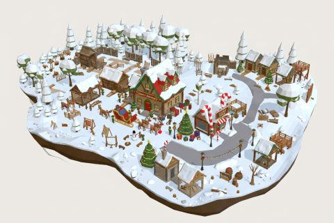

# Christmas Village

In production, 28 parts so far. Every part below is already free to use.

[Open the kit on Polyfork](https://polyfork.dev/kit/christmas-village-fbc27a) · [All kits](../README.md#kits)

<table>
<tr>
<td align="center" valign="top" width="25%"> <a href="https://polyfork.dev/asset/a-frame-cut-tree-7bb743">A-Frame Cut Tree Rack</a> <a href="https://polyfork.dev/cdn/a-frame-cut-tree-7bb743.glb">GLB</a> · <a href="https://polyfork.dev/cdn/a-frame-cut-tree-7bb743.mjs">module</a></td>
<td align="center" valign="top" width="25%"> <a href="https://polyfork.dev/asset/big-wrapped-present-57b639">Big Wrapped Present</a> <a href="https://polyfork.dev/cdn/big-wrapped-present-57b639.glb">GLB</a> · <a href="https://polyfork.dev/cdn/big-wrapped-present-57b639.mjs">module</a></td>
<td align="center" valign="top" width="25%"> <a href="https://polyfork.dev/asset/candy-cane-path-markers-2310e4">Candy Cane Path Markers</a> <a href="https://polyfork.dev/cdn/candy-cane-path-markers-2310e4.glb">GLB</a> · <a href="https://polyfork.dev/cdn/candy-cane-path-markers-2310e4.mjs">module</a></td>
<td align="center" valign="top" width="25%"> <a href="https://polyfork.dev/asset/caroler-e0234a">Caroler</a> <a href="https://polyfork.dev/cdn/caroler-e0234a.glb">GLB</a> · <a href="https://polyfork.dev/cdn/caroler-e0234a.mjs">module</a></td>
</tr>
<tr>
<td align="center" valign="top" width="25%"> <a href="https://polyfork.dev/asset/christmas-village-terrain-662c58">Christmas Village Terrain</a> <a href="https://polyfork.dev/cdn/christmas-village-terrain-662c58.glb">GLB</a> · <a href="https://polyfork.dev/cdn/christmas-village-terrain-662c58.mjs">module</a></td>
<td align="center" valign="top" width="25%"> <a href="https://polyfork.dev/asset/cut-fir-in-a-21d18a">Cut Fir in a Bucket</a> <a href="https://polyfork.dev/cdn/cut-fir-in-a-21d18a.glb">GLB</a> · <a href="https://polyfork.dev/cdn/cut-fir-in-a-21d18a.mjs">module</a></td>
<td align="center" valign="top" width="25%"> <a href="https://polyfork.dev/asset/elf-carrying-presents-d2dda9">Elf Carrying Presents</a> <a href="https://polyfork.dev/cdn/elf-carrying-presents-d2dda9.glb">GLB</a> · <a href="https://polyfork.dev/cdn/elf-carrying-presents-d2dda9.mjs">module</a></td>
<td align="center" valign="top" width="25%"> <a href="https://polyfork.dev/asset/elf-toymaker-6f2ad7">Elf Toymaker</a> <a href="https://polyfork.dev/cdn/elf-toymaker-6f2ad7.glb">GLB</a> · <a href="https://polyfork.dev/cdn/elf-toymaker-6f2ad7.mjs">module</a></td>
</tr>
<tr>
<td align="center" valign="top" width="25%"> <a href="https://polyfork.dev/asset/front-yard-fir-tree-0a278d">Front-Yard Fir Tree</a> <a href="https://polyfork.dev/cdn/front-yard-fir-tree-0a278d.glb">GLB</a> · <a href="https://polyfork.dev/cdn/front-yard-fir-tree-0a278d.mjs">module</a></td>
<td align="center" valign="top" width="25%"> <a href="https://polyfork.dev/asset/garland-lamp-post-af02f0">Garland Lamp Post</a> <a href="https://polyfork.dev/cdn/garland-lamp-post-af02f0.glb">GLB</a> · <a href="https://polyfork.dev/cdn/garland-lamp-post-af02f0.mjs">module</a></td>
<td align="center" valign="top" width="25%"> <a href="https://polyfork.dev/asset/giant-lawn-ornament-ball-a92ef6">Giant Lawn Ornament Ball</a> <a href="https://polyfork.dev/cdn/giant-lawn-ornament-ball-a92ef6.glb">GLB</a> · <a href="https://polyfork.dev/cdn/giant-lawn-ornament-ball-a92ef6.mjs">module</a></td>
<td align="center" valign="top" width="25%"> <a href="https://polyfork.dev/asset/gingerbread-house-8b9049">Gingerbread House</a> <a href="https://polyfork.dev/cdn/gingerbread-house-8b9049.glb">GLB</a> · <a href="https://polyfork.dev/cdn/gingerbread-house-8b9049.mjs">module</a></td>
</tr>
<tr>
<td align="center" valign="top" width="25%"> <a href="https://polyfork.dev/asset/hot-cocoa-stand-884f36">Hot Cocoa Stand</a> <a href="https://polyfork.dev/cdn/hot-cocoa-stand-884f36.glb">GLB</a> · <a href="https://polyfork.dev/cdn/hot-cocoa-stand-884f36.mjs">module</a></td>
<td align="center" valign="top" width="25%"> <a href="https://polyfork.dev/asset/kid-in-a-puffy-c6164a">Kid in a Puffy Coat</a> <a href="https://polyfork.dev/cdn/kid-in-a-puffy-c6164a.glb">GLB</a> · <a href="https://polyfork.dev/cdn/kid-in-a-puffy-c6164a.mjs">module</a></td>
<td align="center" valign="top" width="25%"> <a href="https://polyfork.dev/asset/kids-snow-fort-c31153">Kids&#039; Snow Fort</a> <a href="https://polyfork.dev/cdn/kids-snow-fort-c31153.glb">GLB</a> · <a href="https://polyfork.dev/cdn/kids-snow-fort-c31153.mjs">module</a></td>
<td align="center" valign="top" width="25%"> <a href="https://polyfork.dev/asset/letters-to-santa-mailbox-f223e5">Letters-to-Santa Mailbox</a> <a href="https://polyfork.dev/cdn/letters-to-santa-mailbox-f223e5.glb">GLB</a> · <a href="https://polyfork.dev/cdn/letters-to-santa-mailbox-f223e5.mjs">module</a></td>
</tr>
<tr>
<td align="center" valign="top" width="25%"> <a href="https://polyfork.dev/asset/light-up-wireframe-reindeer-8627df">Light-Up Wireframe Reindeer</a> <a href="https://polyfork.dev/cdn/light-up-wireframe-reindeer-8627df.glb">GLB</a> · <a href="https://polyfork.dev/cdn/light-up-wireframe-reindeer-8627df.mjs">module</a></td>
<td align="center" valign="top" width="25%"> <a href="https://polyfork.dev/asset/mrs-claus-e8be40">Mrs Claus</a> <a href="https://polyfork.dev/cdn/mrs-claus-e8be40.glb">GLB</a> · <a href="https://polyfork.dev/cdn/mrs-claus-e8be40.mjs">module</a></td>
<td align="center" valign="top" width="25%"> <a href="https://polyfork.dev/asset/north-pole-sign-post-a91f4d">North Pole Sign Post</a> <a href="https://polyfork.dev/cdn/north-pole-sign-post-a91f4d.glb">GLB</a> · <a href="https://polyfork.dev/cdn/north-pole-sign-post-a91f4d.mjs">module</a></td>
<td align="center" valign="top" width="25%"> <a href="https://polyfork.dev/asset/north-pole-treat-table-91a6e4">North Pole Treat Table</a> <a href="https://polyfork.dev/cdn/north-pole-treat-table-91a6e4.glb">GLB</a> · <a href="https://polyfork.dev/cdn/north-pole-treat-table-91a6e4.mjs">module</a></td>
</tr>
<tr>
<td align="center" valign="top" width="25%"> <a href="https://polyfork.dev/asset/parent-carrying-a-cut-b77909">Parent Carrying a Cut Tree</a> <a href="https://polyfork.dev/cdn/parent-carrying-a-cut-b77909.glb">GLB</a> · <a href="https://polyfork.dev/cdn/parent-carrying-a-cut-b77909.mjs">module</a></td>
<td align="center" valign="top" width="25%"> <a href="https://polyfork.dev/asset/roofline-string-light-run-fa1160">Roofline String Light Run</a> <a href="https://polyfork.dev/cdn/roofline-string-light-run-fa1160.glb">GLB</a> · <a href="https://polyfork.dev/cdn/roofline-string-light-run-fa1160.mjs">module</a></td>
<td align="center" valign="top" width="25%"> <a href="https://polyfork.dev/asset/sack-of-toys-c53e9e">Sack of Toys</a> <a href="https://polyfork.dev/cdn/sack-of-toys-c53e9e.glb">GLB</a> · <a href="https://polyfork.dev/cdn/sack-of-toys-c53e9e.mjs">module</a></td>
<td align="center" valign="top" width="25%"> <a href="https://polyfork.dev/asset/santa-0e0332">Santa</a> <a href="https://polyfork.dev/cdn/santa-0e0332.glb">GLB</a> · <a href="https://polyfork.dev/cdn/santa-0e0332.mjs">module</a></td>
</tr>
<tr>
<td align="center" valign="top" width="25%"> <a href="https://polyfork.dev/asset/santa-s-sleigh-f1a047">Santa&#039;s Sleigh</a> <a href="https://polyfork.dev/cdn/santa-s-sleigh-f1a047.glb">GLB</a> · <a href="https://polyfork.dev/cdn/santa-s-sleigh-f1a047.mjs">module</a></td>
<td align="center" valign="top" width="25%"> <a href="https://polyfork.dev/asset/snow-shovel-4196ff">Snow Shovel</a> <a href="https://polyfork.dev/cdn/snow-shovel-4196ff.glb">GLB</a> · <a href="https://polyfork.dev/cdn/snow-shovel-4196ff.mjs">module</a></td>
<td align="center" valign="top" width="25%"> <a href="https://polyfork.dev/asset/snowman-18c02d">Snowman</a> <a href="https://polyfork.dev/cdn/snowman-18c02d.glb">GLB</a> · <a href="https://polyfork.dev/cdn/snowman-18c02d.mjs">module</a></td>
<td align="center" valign="top" width="25%"> <a href="https://polyfork.dev/asset/wrapped-present-pile-b2ddd9">Wrapped Present Pile</a> <a href="https://polyfork.dev/cdn/wrapped-present-pile-b2ddd9.glb">GLB</a> · <a href="https://polyfork.dev/cdn/wrapped-present-pile-b2ddd9.mjs">module</a></td>
</tr>
</table>
