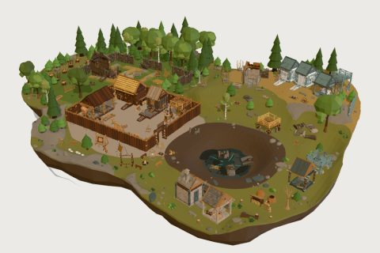

# Chronos Hearth kit

61 free low-poly parts on one palette and one scale, so everything you combine belongs to the same world.

[Open the kit on Polyfork](https://polyfork.dev/kit/chronos-hearth-kit-4827fd) · [All kits](../README.md#kits)

<table>
<tr>
<td align="center" valign="top" width="25%"> <a href="https://polyfork.dev/asset/adjustable-bay-stilt-426c90">Adjustable Bay Stilt</a> <a href="https://polyfork.dev/cdn/adjustable-bay-stilt-426c90.glb">GLB</a> · <a href="https://polyfork.dev/cdn/adjustable-bay-stilt-426c90.mjs">module</a></td>
<td align="center" valign="top" width="25%"> <a href="https://polyfork.dev/asset/adjustable-hearth-cooking-lift-bc42d1">Adjustable Hearth Cooking Lift</a> <a href="https://polyfork.dev/cdn/adjustable-hearth-cooking-lift-bc42d1.glb">GLB</a> · <a href="https://polyfork.dev/cdn/adjustable-hearth-cooking-lift-bc42d1.mjs">module</a></td>
<td align="center" valign="top" width="25%"> <a href="https://polyfork.dev/asset/bay-fitting-survival-stair-b08e0d">Bay-Fitting Survival Stair</a> <a href="https://polyfork.dev/cdn/bay-fitting-survival-stair-b08e0d.glb">GLB</a> · <a href="https://polyfork.dev/cdn/bay-fitting-survival-stair-b08e0d.mjs">module</a></td>
<td align="center" valign="top" width="25%"> <a href="https://polyfork.dev/asset/beam-lashing-assembly-jig-813178">Beam Lashing Assembly Jig</a> <a href="https://polyfork.dev/cdn/beam-lashing-assembly-jig-813178.glb">GLB</a> · <a href="https://polyfork.dev/cdn/beam-lashing-assembly-jig-813178.mjs">module</a></td>
</tr>
<tr>
<td align="center" valign="top" width="25%"> <a href="https://polyfork.dev/asset/charcoal-production-kiln-853efe">Charcoal Production Kiln</a> <a href="https://polyfork.dev/cdn/charcoal-production-kiln-853efe.glb">GLB</a> · <a href="https://polyfork.dev/cdn/charcoal-production-kiln-853efe.mjs">module</a></td>
<td align="center" valign="top" width="25%"> <a href="https://polyfork.dev/asset/chimney-roof-passage-90dedd">Chimney Roof Passage</a> <a href="https://polyfork.dev/cdn/chimney-roof-passage-90dedd.glb">GLB</a> · <a href="https://polyfork.dev/cdn/chimney-roof-passage-90dedd.mjs">module</a></td>
<td align="center" valign="top" width="25%"> <a href="https://polyfork.dev/asset/chronos-hearth-terrain-764465">Chronos Hearth Terrain</a> <a href="https://polyfork.dev/cdn/chronos-hearth-terrain-764465.glb">GLB</a> · <a href="https://polyfork.dev/cdn/chronos-hearth-terrain-764465.mjs">module</a></td>
<td align="center" valign="top" width="25%"> <a href="https://polyfork.dev/asset/controllable-food-smoker-aac206">Controllable Food Smoker</a> <a href="https://polyfork.dev/cdn/controllable-food-smoker-aac206.glb">GLB</a> · <a href="https://polyfork.dev/cdn/controllable-food-smoker-aac206.mjs">module</a></td>
</tr>
<tr>
<td align="center" valign="top" width="25%"> <a href="https://polyfork.dev/asset/counterweighted-bay-gate-dcca8f">Counterweighted Bay Gate</a> <a href="https://polyfork.dev/cdn/counterweighted-bay-gate-dcca8f.glb">GLB</a> · <a href="https://polyfork.dev/cdn/counterweighted-bay-gate-dcca8f.mjs">module</a></td>
<td align="center" valign="top" width="25%"> <a href="https://polyfork.dev/asset/damaged-time-core-2fbf9b">Damaged Time Core</a> <a href="https://polyfork.dev/cdn/damaged-time-core-2fbf9b.glb">GLB</a> · <a href="https://polyfork.dev/cdn/damaged-time-core-2fbf9b.mjs">module</a></td>
<td align="center" valign="top" width="25%"> <a href="https://polyfork.dev/asset/deck-safe-clay-cooking-c8345b">Deck-Safe Clay Cooking Hearth</a> <a href="https://polyfork.dev/cdn/deck-safe-clay-cooking-c8345b.glb">GLB</a> · <a href="https://polyfork.dev/cdn/deck-safe-clay-cooking-c8345b.mjs">module</a></td>
<td align="center" valign="top" width="25%"> <a href="https://polyfork.dev/asset/device-disassembly-fixture-24f94f">Device Disassembly Fixture</a> <a href="https://polyfork.dev/cdn/device-disassembly-fixture-24f94f.glb">GLB</a> · <a href="https://polyfork.dev/cdn/device-disassembly-fixture-24f94f.mjs">module</a></td>
</tr>
<tr>
<td align="center" valign="top" width="25%"> <a href="https://polyfork.dev/asset/eave-rainwater-channel-0213e7">Eave Rainwater Channel</a> <a href="https://polyfork.dev/cdn/eave-rainwater-channel-0213e7.glb">GLB</a> · <a href="https://polyfork.dev/cdn/eave-rainwater-channel-0213e7.mjs">module</a></td>
<td align="center" valign="top" width="25%"> <a href="https://polyfork.dev/asset/firewood-processing-stand-b186ea">Firewood Processing Stand</a> <a href="https://polyfork.dev/cdn/firewood-processing-stand-b186ea.glb">GLB</a> · <a href="https://polyfork.dev/cdn/firewood-processing-stand-b186ea.mjs">module</a></td>
<td align="center" valign="top" width="25%"> <a href="https://polyfork.dev/asset/flint-knapping-work-seat-c6daf6">Flint-Knapping Work Seat</a> <a href="https://polyfork.dev/cdn/flint-knapping-work-seat-c6daf6.glb">GLB</a> · <a href="https://polyfork.dev/cdn/flint-knapping-work-seat-c6daf6.mjs">module</a></td>
<td align="center" valign="top" width="25%"> <a href="https://polyfork.dev/asset/foundation-access-wedge-5d2716">Foundation Access Wedge</a> <a href="https://polyfork.dev/cdn/foundation-access-wedge-5d2716.glb">GLB</a> · <a href="https://polyfork.dev/cdn/foundation-access-wedge-5d2716.mjs">module</a></td>
</tr>
<tr>
<td align="center" valign="top" width="25%"> <a href="https://polyfork.dev/asset/gravity-water-filter-stack-4a54f5">Gravity Water Filter Stack</a> <a href="https://polyfork.dev/cdn/gravity-water-filter-stack-4a54f5.glb">GLB</a> · <a href="https://polyfork.dev/cdn/gravity-water-filter-stack-4a54f5.mjs">module</a></td>
<td align="center" valign="top" width="25%"> <a href="https://polyfork.dev/asset/harvestable-flint-seam-a43ff4">Harvestable Flint Seam</a> <a href="https://polyfork.dev/cdn/harvestable-flint-seam-a43ff4.glb">GLB</a> · <a href="https://polyfork.dev/cdn/harvestable-flint-seam-a43ff4.mjs">module</a></td>
<td align="center" valign="top" width="25%"> <a href="https://polyfork.dev/asset/hearth-log-bench-c3c5ec">Hearth Log Bench</a> <a href="https://polyfork.dev/cdn/hearth-log-bench-c3c5ec.glb">GLB</a> · <a href="https://polyfork.dev/cdn/hearth-log-bench-c3c5ec.mjs">module</a></td>
<td align="center" valign="top" width="25%"> <a href="https://polyfork.dev/asset/hide-fleshing-workstation-36c93e">Hide Fleshing Workstation</a> <a href="https://polyfork.dev/cdn/hide-fleshing-workstation-36c93e.glb">GLB</a> · <a href="https://polyfork.dev/cdn/hide-fleshing-workstation-36c93e.mjs">module</a></td>
</tr>
<tr>
<td align="center" valign="top" width="25%"> <a href="https://polyfork.dev/asset/hide-rain-catchment-funnel-e41d94">Hide Rain Catchment Funnel</a> <a href="https://polyfork.dev/cdn/hide-rain-catchment-funnel-e41d94.glb">GLB</a> · <a href="https://polyfork.dev/cdn/hide-rain-catchment-funnel-e41d94.mjs">module</a></td>
<td align="center" valign="top" width="25%"> <a href="https://polyfork.dev/asset/hide-waterproofing-vat-674ab6">Hide Waterproofing Vat</a> <a href="https://polyfork.dev/cdn/hide-waterproofing-vat-674ab6.glb">GLB</a> · <a href="https://polyfork.dev/cdn/hide-waterproofing-vat-674ab6.mjs">module</a></td>
<td align="center" valign="top" width="25%"> <a href="https://polyfork.dev/asset/interchangeable-survival-wall-c0e158">Interchangeable Survival Wall</a> <a href="https://polyfork.dev/cdn/interchangeable-survival-wall-c0e158.glb">GLB</a> · <a href="https://polyfork.dev/cdn/interchangeable-survival-wall-c0e158.mjs">module</a></td>
<td align="center" valign="top" width="25%"> <a href="https://polyfork.dev/asset/interlocking-bay-foundation-53ffe9">Interlocking Bay Foundation</a> <a href="https://polyfork.dev/cdn/interlocking-bay-foundation-53ffe9.glb">GLB</a> · <a href="https://polyfork.dev/cdn/interlocking-bay-foundation-53ffe9.mjs">module</a></td>
</tr>
<tr>
<td align="center" valign="top" width="25%"> <a href="https://polyfork.dev/asset/laced-hide-stretching-rack-8152a1">Laced Hide Stretching Rack</a> <a href="https://polyfork.dev/cdn/laced-hide-stretching-rack-8152a1.glb">GLB</a> · <a href="https://polyfork.dev/cdn/laced-hide-stretching-rack-8152a1.mjs">module</a></td>
<td align="center" valign="top" width="25%"> <a href="https://polyfork.dev/asset/layered-leaf-sleeping-cot-7ddad4">Layered Leaf Sleeping Cot</a> <a href="https://polyfork.dev/cdn/layered-leaf-sleeping-cot-7ddad4.glb">GLB</a> · <a href="https://polyfork.dev/cdn/layered-leaf-sleeping-cot-7ddad4.mjs">module</a></td>
<td align="center" valign="top" width="25%"> <a href="https://polyfork.dev/asset/lime-mortar-mixing-pit-57c677">Lime Mortar Mixing Pit</a> <a href="https://polyfork.dev/cdn/lime-mortar-mixing-pit-57c677.glb">GLB</a> · <a href="https://polyfork.dev/cdn/lime-mortar-mixing-pit-57c677.mjs">module</a></td>
<td align="center" valign="top" width="25%"> <a href="https://polyfork.dev/asset/log-store-25e0b5">Log Store</a> <a href="https://polyfork.dev/cdn/log-store-25e0b5.glb">GLB</a> · <a href="https://polyfork.dev/cdn/log-store-25e0b5.mjs">module</a></td>
</tr>
<tr>
<td align="center" valign="top" width="25%"> <a href="https://polyfork.dev/asset/managed-withy-coppice-5b7759">Managed Withy Coppice</a> <a href="https://polyfork.dev/cdn/managed-withy-coppice-5b7759.glb">GLB</a> · <a href="https://polyfork.dev/cdn/managed-withy-coppice-5b7759.mjs">module</a></td>
<td align="center" valign="top" width="25%"> <a href="https://polyfork.dev/asset/manual-edge-maintenance-station-0f239d">Manual Edge Maintenance Station</a> <a href="https://polyfork.dev/cdn/manual-edge-maintenance-station-0f239d.glb">GLB</a> · <a href="https://polyfork.dev/cdn/manual-edge-maintenance-station-0f239d.mjs">module</a></td>
<td align="center" valign="top" width="25%"> <a href="https://polyfork.dev/asset/modular-deck-edge-guard-f3bee6">Modular Deck Edge Guard</a> <a href="https://polyfork.dev/cdn/modular-deck-edge-guard-f3bee6.glb">GLB</a> · <a href="https://polyfork.dev/cdn/modular-deck-edge-guard-f3bee6.mjs">module</a></td>
<td align="center" valign="top" width="25%"> <a href="https://polyfork.dev/asset/modular-doorstep-bridge-df54e1">Modular Doorstep Bridge</a> <a href="https://polyfork.dev/cdn/modular-doorstep-bridge-df54e1.glb">GLB</a> · <a href="https://polyfork.dev/cdn/modular-doorstep-bridge-df54e1.mjs">module</a></td>
</tr>
<tr>
<td align="center" valign="top" width="25%"> <a href="https://polyfork.dev/asset/modular-gable-infill-e16669">Modular Gable Infill</a> <a href="https://polyfork.dev/cdn/modular-gable-infill-e16669.glb">GLB</a> · <a href="https://polyfork.dev/cdn/modular-gable-infill-e16669.mjs">module</a></td>
<td align="center" valign="top" width="25%"> <a href="https://polyfork.dev/asset/open-campfire-5b463f">Open Campfire</a> <a href="https://polyfork.dev/cdn/open-campfire-5b463f.glb">GLB</a> · <a href="https://polyfork.dev/cdn/open-campfire-5b463f.mjs">module</a></td>
<td align="center" valign="top" width="25%"> <a href="https://polyfork.dev/asset/open-bay-structural-post-f840a9">Open-Bay Structural Post</a> <a href="https://polyfork.dev/cdn/open-bay-structural-post-f840a9.glb">GLB</a> · <a href="https://polyfork.dev/cdn/open-bay-structural-post-f840a9.mjs">module</a></td>
<td align="center" valign="top" width="25%"> <a href="https://polyfork.dev/asset/padded-equipment-carrying-frame-d691c8">Padded Equipment Carrying Frame</a> <a href="https://polyfork.dev/cdn/padded-equipment-carrying-frame-d691c8.glb">GLB</a> · <a href="https://polyfork.dev/cdn/padded-equipment-carrying-frame-d691c8.mjs">module</a></td>
</tr>
<tr>
<td align="center" valign="top" width="25%"> <a href="https://polyfork.dev/asset/palisade-wall-621e29">Palisade Wall</a> <a href="https://polyfork.dev/cdn/palisade-wall-621e29.glb">GLB</a> · <a href="https://polyfork.dev/cdn/palisade-wall-621e29.mjs">module</a></td>
<td align="center" valign="top" width="25%"> <a href="https://polyfork.dev/asset/plant-fibre-retting-trough-0e8969">Plant Fibre Retting Trough</a> <a href="https://polyfork.dev/cdn/plant-fibre-retting-trough-0e8969.glb">GLB</a> · <a href="https://polyfork.dev/cdn/plant-fibre-retting-trough-0e8969.mjs">module</a></td>
<td align="center" valign="top" width="25%"> <a href="https://polyfork.dev/asset/portable-device-charging-dock-b175a5">Portable Device Charging Dock</a> <a href="https://polyfork.dev/cdn/portable-device-charging-dock-b175a5.glb">GLB</a> · <a href="https://polyfork.dev/cdn/portable-device-charging-dock-b175a5.mjs">module</a></td>
<td align="center" valign="top" width="25%"> <a href="https://polyfork.dev/asset/recessed-bay-tie-beam-666d73">Recessed Bay Tie Beam</a> <a href="https://polyfork.dev/cdn/recessed-bay-tie-beam-666d73.glb">GLB</a> · <a href="https://polyfork.dev/cdn/recessed-bay-tie-beam-666d73.mjs">module</a></td>
</tr>
<tr>
<td align="center" valign="top" width="25%"> <a href="https://polyfork.dev/asset/recessed-storey-deck-fe19ec">Recessed Storey Deck</a> <a href="https://polyfork.dev/cdn/recessed-storey-deck-fe19ec.glb">GLB</a> · <a href="https://polyfork.dev/cdn/recessed-storey-deck-fe19ec.mjs">module</a></td>
<td align="center" valign="top" width="25%"> <a href="https://polyfork.dev/asset/resin-extraction-workstation-766433">Resin Extraction Workstation</a> <a href="https://polyfork.dev/cdn/resin-extraction-workstation-766433.glb">GLB</a> · <a href="https://polyfork.dev/cdn/resin-extraction-workstation-766433.mjs">module</a></td>
<td align="center" valign="top" width="25%"> <a href="https://polyfork.dev/asset/retractable-deck-ladder-hatch-7db90f">Retractable Deck Ladder Hatch</a> <a href="https://polyfork.dev/cdn/retractable-deck-ladder-hatch-7db90f.glb">GLB</a> · <a href="https://polyfork.dev/cdn/retractable-deck-ladder-hatch-7db90f.mjs">module</a></td>
<td align="center" valign="top" width="25%"> <a href="https://polyfork.dev/asset/retrofit-wall-buttress-4e89f7">Retrofit Wall Buttress</a> <a href="https://polyfork.dev/cdn/retrofit-wall-buttress-4e89f7.glb">GLB</a> · <a href="https://polyfork.dev/cdn/retrofit-wall-buttress-4e89f7.mjs">module</a></td>
</tr>
<tr>
<td align="center" valign="top" width="25%"> <a href="https://polyfork.dev/asset/rollable-hide-door-insert-007304">Rollable Hide Door Insert</a> <a href="https://polyfork.dev/cdn/rollable-hide-door-insert-007304.glb">GLB</a> · <a href="https://polyfork.dev/cdn/rollable-hide-door-insert-007304.mjs">module</a></td>
<td align="center" valign="top" width="25%"> <a href="https://polyfork.dev/asset/saddle-quern-food-mill-8e3657">Saddle Quern Food Mill</a> <a href="https://polyfork.dev/cdn/saddle-quern-food-mill-8e3657.glb">GLB</a> · <a href="https://polyfork.dev/cdn/saddle-quern-food-mill-8e3657.mjs">module</a></td>
<td align="center" valign="top" width="25%"> <a href="https://polyfork.dev/asset/salvaged-machine-hull-section-e18dc6">Salvaged Machine Hull Section</a> <a href="https://polyfork.dev/cdn/salvaged-machine-hull-section-e18dc6.glb">GLB</a> · <a href="https://polyfork.dev/cdn/salvaged-machine-hull-section-e18dc6.mjs">module</a></td>
<td align="center" valign="top" width="25%"> <a href="https://polyfork.dev/asset/structural-corner-joint-shoe-47be8d">Structural Corner Joint Shoe</a> <a href="https://polyfork.dev/cdn/structural-corner-joint-shoe-47be8d.glb">GLB</a> · <a href="https://polyfork.dev/cdn/structural-corner-joint-shoe-47be8d.mjs">module</a></td>
</tr>
<tr>
<td align="center" valign="top" width="25%"> <a href="https://polyfork.dev/asset/survival-door-insert-3b50a8">Survival Door Insert</a> <a href="https://polyfork.dev/cdn/survival-door-insert-3b50a8.glb">GLB</a> · <a href="https://polyfork.dev/cdn/survival-door-insert-3b50a8.mjs">module</a></td>
<td align="center" valign="top" width="25%"> <a href="https://polyfork.dev/asset/survival-roof-assembly-module-20c655">Survival Roof Assembly Module</a> <a href="https://polyfork.dev/cdn/survival-roof-assembly-module-20c655.glb">GLB</a> · <a href="https://polyfork.dev/cdn/survival-roof-assembly-module-20c655.mjs">module</a></td>
<td align="center" valign="top" width="25%"> <a href="https://polyfork.dev/asset/terrain-sealing-foundation-skirt-8cd3fc">Terrain-Sealing Foundation Skirt</a> <a href="https://polyfork.dev/cdn/terrain-sealing-foundation-skirt-8cd3fc.glb">GLB</a> · <a href="https://polyfork.dev/cdn/terrain-sealing-foundation-skirt-8cd3fc.mjs">module</a></td>
<td align="center" valign="top" width="25%"> <a href="https://polyfork.dev/asset/time-core-stabilizer-034ed1">Time Core Stabilizer</a> <a href="https://polyfork.dev/cdn/time-core-stabilizer-034ed1.glb">GLB</a> · <a href="https://polyfork.dev/cdn/time-core-stabilizer-034ed1.mjs">module</a></td>
</tr>
<tr>
<td align="center" valign="top" width="25%"> <a href="https://polyfork.dev/asset/tool-rack-f77b81">Tool Rack</a> <a href="https://polyfork.dev/cdn/tool-rack-f77b81.glb">GLB</a> · <a href="https://polyfork.dev/cdn/tool-rack-f77b81.mjs">module</a></td>
<td align="center" valign="top" width="25%"> <a href="https://polyfork.dev/asset/top-hinged-survival-shutter-cd9054">Top-Hinged Survival Shutter</a> <a href="https://polyfork.dev/cdn/top-hinged-survival-shutter-cd9054.glb">GLB</a> · <a href="https://polyfork.dev/cdn/top-hinged-survival-shutter-cd9054.mjs">module</a></td>
<td align="center" valign="top" width="25%"> <a href="https://polyfork.dev/asset/turning-stair-landing-066019">Turning Stair Landing</a> <a href="https://polyfork.dev/cdn/turning-stair-landing-066019.glb">GLB</a> · <a href="https://polyfork.dev/cdn/turning-stair-landing-066019.mjs">module</a></td>
<td align="center" valign="top" width="25%"> <a href="https://polyfork.dev/asset/twin-hide-workshop-bellows-3aca72">Twin Hide Workshop Bellows</a> <a href="https://polyfork.dev/cdn/twin-hide-workshop-bellows-3aca72.glb">GLB</a> · <a href="https://polyfork.dev/cdn/twin-hide-workshop-bellows-3aca72.mjs">module</a></td>
</tr>
<tr>
<td align="center" valign="top" width="25%"> <a href="https://polyfork.dev/asset/upgradeable-assembly-workbench-a18ff3">Upgradeable Assembly Workbench</a> <a href="https://polyfork.dev/cdn/upgradeable-assembly-workbench-a18ff3.glb">GLB</a> · <a href="https://polyfork.dev/cdn/upgradeable-assembly-workbench-a18ff3.mjs">module</a></td>
<td align="center" valign="top" width="25%"> <a href="https://polyfork.dev/asset/ventilated-hide-food-larder-f53174">Ventilated Hide Food Larder</a> <a href="https://polyfork.dev/cdn/ventilated-hide-food-larder-f53174.glb">GLB</a> · <a href="https://polyfork.dev/cdn/ventilated-hide-food-larder-f53174.mjs">module</a></td>
<td align="center" valign="top" width="25%"> <a href="https://polyfork.dev/asset/wall-breach-repair-insert-13ce6b">Wall Breach Repair Insert</a> <a href="https://polyfork.dev/cdn/wall-breach-repair-insert-13ce6b.glb">GLB</a> · <a href="https://polyfork.dev/cdn/wall-breach-repair-insert-13ce6b.mjs">module</a></td>
<td align="center" valign="top" width="25%"> <a href="https://polyfork.dev/asset/wattle-panel-weaving-jig-d1aa1c">Wattle Panel Weaving Jig</a> <a href="https://polyfork.dev/cdn/wattle-panel-weaving-jig-d1aa1c.glb">GLB</a> · <a href="https://polyfork.dev/cdn/wattle-panel-weaving-jig-d1aa1c.mjs">module</a></td>
</tr>
<tr>
<td align="center" valign="top" width="25%"> <a href="https://polyfork.dev/asset/workshop-exhaust-modules-94599c">Workshop Exhaust Modules</a> <a href="https://polyfork.dev/cdn/workshop-exhaust-modules-94599c.glb">GLB</a> · <a href="https://polyfork.dev/cdn/workshop-exhaust-modules-94599c.mjs">module</a></td>
</tr>
</table>
