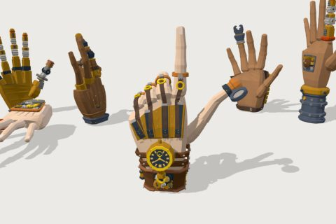

# Clockwork Hand Adornments kit

50 free low-poly parts on one palette and one scale, so everything you combine belongs to the same world.

[Open the kit on Polyfork](https://polyfork.dev/kit/clockwork-hand-adornments-kit-3aeccc) · [All kits](../README.md#kits)

<table>
<tr>
<td align="center" valign="top" width="25%"> <a href="https://polyfork.dev/asset/articulated-claw-finger-16f729">Articulated Claw Finger</a> <a href="https://polyfork.dev/cdn/articulated-claw-finger-16f729.glb">GLB</a> · <a href="https://polyfork.dev/cdn/articulated-claw-finger-16f729.mjs">module</a></td>
<td align="center" valign="top" width="25%"> <a href="https://polyfork.dev/asset/articulated-joint-piece-09da6c">Articulated Joint Piece</a> <a href="https://polyfork.dev/cdn/articulated-joint-piece-09da6c.glb">GLB</a> · <a href="https://polyfork.dev/cdn/articulated-joint-piece-09da6c.mjs">module</a></td>
<td align="center" valign="top" width="25%"> <a href="https://polyfork.dev/asset/base-hand-e3398a">Base Hand</a> <a href="https://polyfork.dev/cdn/base-hand-e3398a.glb">GLB</a> · <a href="https://polyfork.dev/cdn/base-hand-e3398a.mjs">module</a></td>
<td align="center" valign="top" width="25%"> <a href="https://polyfork.dev/asset/buckle-tendon-58b71c">Buckle Tendon</a> <a href="https://polyfork.dev/cdn/buckle-tendon-58b71c.glb">GLB</a> · <a href="https://polyfork.dev/cdn/buckle-tendon-58b71c.mjs">module</a></td>
</tr>
<tr>
<td align="center" valign="top" width="25%"> <a href="https://polyfork.dev/asset/chain-tendon-c538a3">Chain Tendon</a> <a href="https://polyfork.dev/cdn/chain-tendon-c538a3.glb">GLB</a> · <a href="https://polyfork.dev/cdn/chain-tendon-c538a3.mjs">module</a></td>
<td align="center" valign="top" width="25%"> <a href="https://polyfork.dev/asset/chain-link-bracelet-d3db3e">Clamp Thumb</a> <a href="https://polyfork.dev/cdn/chain-link-bracelet-d3db3e.glb">GLB</a> · <a href="https://polyfork.dev/cdn/chain-link-bracelet-d3db3e.mjs">module</a></td>
<td align="center" valign="top" width="25%"> <a href="https://polyfork.dev/asset/clockwork-back-plate-92537f">Clockwork Back Plate</a> <a href="https://polyfork.dev/cdn/clockwork-back-plate-92537f.glb">GLB</a> · <a href="https://polyfork.dev/cdn/clockwork-back-plate-92537f.mjs">module</a></td>
<td align="center" valign="top" width="25%"> <a href="https://polyfork.dev/asset/clockwork-cuff-bracelet-e6123f">Clockwork Cuff Bracelet</a> <a href="https://polyfork.dev/cdn/clockwork-cuff-bracelet-e6123f.glb">GLB</a> · <a href="https://polyfork.dev/cdn/clockwork-cuff-bracelet-e6123f.mjs">module</a></td>
</tr>
<tr>
<td align="center" valign="top" width="25%"> <a href="https://polyfork.dev/asset/small-pipe-joint-e037a0">Clockwork Finger Set</a> <a href="https://polyfork.dev/cdn/small-pipe-joint-e037a0.glb">GLB</a> · <a href="https://polyfork.dev/cdn/small-pipe-joint-e037a0.mjs">module</a></td>
<td align="center" valign="top" width="25%"> <a href="https://polyfork.dev/asset/clockwork-hand-adornments-loadout-f66238">Clockwork Hand Adornments Loadout</a> <a href="https://polyfork.dev/cdn/clockwork-hand-adornments-loadout-f66238.glb">GLB</a> · <a href="https://polyfork.dev/cdn/clockwork-hand-adornments-loadout-f66238.mjs">module</a></td>
<td align="center" valign="top" width="25%"> <a href="https://polyfork.dev/asset/clockwork-index-finger-29f445">Clockwork Index Finger</a> <a href="https://polyfork.dev/cdn/clockwork-index-finger-29f445.glb">GLB</a> · <a href="https://polyfork.dev/cdn/clockwork-index-finger-29f445.mjs">module</a></td>
<td align="center" valign="top" width="25%"> <a href="https://polyfork.dev/asset/riveted-grip-pad-1c0abc">Clockwork Palm</a> <a href="https://polyfork.dev/cdn/riveted-grip-pad-1c0abc.glb">GLB</a> · <a href="https://polyfork.dev/cdn/riveted-grip-pad-1c0abc.mjs">module</a></td>
</tr>
<tr>
<td align="center" valign="top" width="25%"> <a href="https://polyfork.dev/asset/decorative-bracelet-clasp-e4cc0a">Decorative Bracelet Clasp</a> <a href="https://polyfork.dev/cdn/decorative-bracelet-clasp-e4cc0a.glb">GLB</a> · <a href="https://polyfork.dev/cdn/decorative-bracelet-clasp-e4cc0a.mjs">module</a></td>
<td align="center" valign="top" width="25%"> <a href="https://polyfork.dev/asset/decorative-wire-coil-50561a">Decorative Wire Coil</a> <a href="https://polyfork.dev/cdn/decorative-wire-coil-50561a.glb">GLB</a> · <a href="https://polyfork.dev/cdn/decorative-wire-coil-50561a.mjs">module</a></td>
<td align="center" valign="top" width="25%"> <a href="https://polyfork.dev/asset/segmented-bracelet-c52b8d">Drill-Bit Middle Finger</a> <a href="https://polyfork.dev/cdn/segmented-bracelet-c52b8d.glb">GLB</a> · <a href="https://polyfork.dev/cdn/segmented-bracelet-c52b8d.mjs">module</a></td>
<td align="center" valign="top" width="25%"> <a href="https://polyfork.dev/asset/mechanical-finger-extender-base-6471f4">Extender Base</a> <a href="https://polyfork.dev/cdn/mechanical-finger-extender-base-6471f4.glb">GLB</a> · <a href="https://polyfork.dev/cdn/mechanical-finger-extender-base-6471f4.mjs">module</a></td>
</tr>
<tr>
<td align="center" valign="top" width="25%"> <a href="https://polyfork.dev/asset/mechanical-finger-extender-claw-38a9a3">Extender Claw</a> <a href="https://polyfork.dev/cdn/mechanical-finger-extender-claw-38a9a3.glb">GLB</a> · <a href="https://polyfork.dev/cdn/mechanical-finger-extender-claw-38a9a3.mjs">module</a></td>
<td align="center" valign="top" width="25%"> <a href="https://polyfork.dev/asset/whimsical-pipe-connector-cbc857">Forearm Socket</a> <a href="https://polyfork.dev/cdn/whimsical-pipe-connector-cbc857.glb">GLB</a> · <a href="https://polyfork.dev/cdn/whimsical-pipe-connector-cbc857.mjs">module</a></td>
<td align="center" valign="top" width="25%"> <a href="https://polyfork.dev/asset/gauge-index-finger-10b1a0">Gauge Index Finger</a> <a href="https://polyfork.dev/cdn/gauge-index-finger-10b1a0.glb">GLB</a> · <a href="https://polyfork.dev/cdn/gauge-index-finger-10b1a0.mjs">module</a></td>
<td align="center" valign="top" width="25%"> <a href="https://polyfork.dev/asset/gauntlet-wrist-plate-0d8c7f">Gauntlet Wrist Plate</a> <a href="https://polyfork.dev/cdn/gauntlet-wrist-plate-0d8c7f.glb">GLB</a> · <a href="https://polyfork.dev/cdn/gauntlet-wrist-plate-0d8c7f.mjs">module</a></td>
</tr>
<tr>
<td align="center" valign="top" width="25%"> <a href="https://polyfork.dev/asset/gear-accent-ring-c680da">Gear Accent Ring</a> <a href="https://polyfork.dev/cdn/gear-accent-ring-c680da.glb">GLB</a> · <a href="https://polyfork.dev/cdn/gear-accent-ring-c680da.mjs">module</a></td>
<td align="center" valign="top" width="25%"> <a href="https://polyfork.dev/asset/hand-lantern-cdbe1a">Hand Lantern</a> <a href="https://polyfork.dev/cdn/hand-lantern-cdbe1a.glb">GLB</a> · <a href="https://polyfork.dev/cdn/hand-lantern-cdbe1a.mjs">module</a></td>
<td align="center" valign="top" width="25%"> <a href="https://polyfork.dev/asset/hinge-splint-14864d">Hinge Splint</a> <a href="https://polyfork.dev/cdn/hinge-splint-14864d.glb">GLB</a> · <a href="https://polyfork.dev/cdn/hinge-splint-14864d.mjs">module</a></td>
<td align="center" valign="top" width="25%"> <a href="https://polyfork.dev/asset/small-mechanical-plating-f9901a">Hydraulic Forearm</a> <a href="https://polyfork.dev/cdn/small-mechanical-plating-f9901a.glb">GLB</a> · <a href="https://polyfork.dev/cdn/small-mechanical-plating-f9901a.mjs">module</a></td>
</tr>
<tr>
<td align="center" valign="top" width="25%"> <a href="https://polyfork.dev/asset/vial-bandolier-cuff-6c409f">Hydraulic Thumb</a> <a href="https://polyfork.dev/cdn/vial-bandolier-cuff-6c409f.glb">GLB</a> · <a href="https://polyfork.dev/cdn/vial-bandolier-cuff-6c409f.mjs">module</a></td>
<td align="center" valign="top" width="25%"> <a href="https://polyfork.dev/asset/knuckle-ring-529610">Knuckle Ring</a> <a href="https://polyfork.dev/cdn/knuckle-ring-529610.glb">GLB</a> · <a href="https://polyfork.dev/cdn/knuckle-ring-529610.mjs">module</a></td>
<td align="center" valign="top" width="25%"> <a href="https://polyfork.dev/asset/loupe-thumb-cap-f3bbd1">Loupe Thumb Cap</a> <a href="https://polyfork.dev/cdn/loupe-thumb-cap-f3bbd1.glb">GLB</a> · <a href="https://polyfork.dev/cdn/loupe-thumb-cap-f3bbd1.mjs">module</a></td>
<td align="center" valign="top" width="25%"> <a href="https://polyfork.dev/asset/mechanical-finger-extender-gripper-a7c16b">Mechanical Finger Extender Gripper</a> <a href="https://polyfork.dev/cdn/mechanical-finger-extender-gripper-a7c16b.glb">GLB</a> · <a href="https://polyfork.dev/cdn/mechanical-finger-extender-gripper-a7c16b.mjs">module</a></td>
</tr>
<tr>
<td align="center" valign="top" width="25%"> <a href="https://polyfork.dev/asset/mechanical-finger-extender-rod-124d5d">Mechanical Finger Extender Rod</a> <a href="https://polyfork.dev/cdn/mechanical-finger-extender-rod-124d5d.glb">GLB</a> · <a href="https://polyfork.dev/cdn/mechanical-finger-extender-rod-124d5d.mjs">module</a></td>
<td align="center" valign="top" width="25%"> <a href="https://polyfork.dev/asset/mechanical-finger-extender-tool-503049">Mechanical Finger Extender Tool Bit</a> <a href="https://polyfork.dev/cdn/mechanical-finger-extender-tool-503049.glb">GLB</a> · <a href="https://polyfork.dev/cdn/mechanical-finger-extender-tool-503049.mjs">module</a></td>
<td align="center" valign="top" width="25%"> <a href="https://polyfork.dev/asset/mechanical-thumb-d1df6f">Mechanical Thumb</a> <a href="https://polyfork.dev/cdn/mechanical-thumb-d1df6f.glb">GLB</a> · <a href="https://polyfork.dev/cdn/mechanical-thumb-d1df6f.mjs">module</a></td>
<td align="center" valign="top" width="25%"> <a href="https://polyfork.dev/asset/piston-middle-finger-ddead1">Piston Middle Finger</a> <a href="https://polyfork.dev/cdn/piston-middle-finger-ddead1.glb">GLB</a> · <a href="https://polyfork.dev/cdn/piston-middle-finger-ddead1.mjs">module</a></td>
</tr>
<tr>
<td align="center" valign="top" width="25%"> <a href="https://polyfork.dev/asset/pocket-watch-mount-f8ec49">Pocket Watch Mount</a> <a href="https://polyfork.dev/cdn/pocket-watch-mount-f8ec49.glb">GLB</a> · <a href="https://polyfork.dev/cdn/pocket-watch-mount-f8ec49.mjs">module</a></td>
<td align="center" valign="top" width="25%"> <a href="https://polyfork.dev/asset/pulley-tendon-b42265">Pulley Tendon</a> <a href="https://polyfork.dev/cdn/pulley-tendon-b42265.glb">GLB</a> · <a href="https://polyfork.dev/cdn/pulley-tendon-b42265.mjs">module</a></td>
<td align="center" valign="top" width="25%"> <a href="https://polyfork.dev/asset/signet-ring-efa0ee">Signet Ring</a> <a href="https://polyfork.dev/cdn/signet-ring-efa0ee.glb">GLB</a> · <a href="https://polyfork.dev/cdn/signet-ring-efa0ee.mjs">module</a></td>
<td align="center" valign="top" width="25%"> <a href="https://polyfork.dev/asset/simple-band-ring-929543">Simple Band Ring</a> <a href="https://polyfork.dev/cdn/simple-band-ring-929543.glb">GLB</a> · <a href="https://polyfork.dev/cdn/simple-band-ring-929543.mjs">module</a></td>
</tr>
<tr>
<td align="center" valign="top" width="25%"> <a href="https://polyfork.dev/asset/spring-tendon-a68e34">Spring Tendon</a> <a href="https://polyfork.dev/cdn/spring-tendon-a68e34.glb">GLB</a> · <a href="https://polyfork.dev/cdn/spring-tendon-a68e34.mjs">module</a></td>
<td align="center" valign="top" width="25%"> <a href="https://polyfork.dev/asset/steam-vent-cuff-9add2d">Steam Vent Cuff</a> <a href="https://polyfork.dev/cdn/steam-vent-cuff-9add2d.glb">GLB</a> · <a href="https://polyfork.dev/cdn/steam-vent-cuff-9add2d.mjs">module</a></td>
<td align="center" valign="top" width="25%"> <a href="https://polyfork.dev/asset/telescoping-pinky-07de50">Telescoping Pinky</a> <a href="https://polyfork.dev/cdn/telescoping-pinky-07de50.glb">GLB</a> · <a href="https://polyfork.dev/cdn/telescoping-pinky-07de50.mjs">module</a></td>
<td align="center" valign="top" width="25%"> <a href="https://polyfork.dev/asset/tendon-harness-6ef893">Tendon Harness</a> <a href="https://polyfork.dev/cdn/tendon-harness-6ef893.glb">GLB</a> · <a href="https://polyfork.dev/cdn/tendon-harness-6ef893.mjs">module</a></td>
</tr>
<tr>
<td align="center" valign="top" width="25%"> <a href="https://polyfork.dev/asset/thimble-cap-7ca9d3">Thimble Cap</a> <a href="https://polyfork.dev/cdn/thimble-cap-7ca9d3.glb">GLB</a> · <a href="https://polyfork.dev/cdn/thimble-cap-7ca9d3.mjs">module</a></td>
<td align="center" valign="top" width="25%"> <a href="https://polyfork.dev/asset/thumb-strap-3068c5">Thumb Strap</a> <a href="https://polyfork.dev/cdn/thumb-strap-3068c5.glb">GLB</a> · <a href="https://polyfork.dev/cdn/thumb-strap-3068c5.mjs">module</a></td>
<td align="center" valign="top" width="25%"> <a href="https://polyfork.dev/asset/tiny-bolt-and-nut-7c94d4">Tiny Bolt and Nut Set</a> <a href="https://polyfork.dev/cdn/tiny-bolt-and-nut-7c94d4.glb">GLB</a> · <a href="https://polyfork.dev/cdn/tiny-bolt-and-nut-7c94d4.mjs">module</a></td>
<td align="center" valign="top" width="25%"> <a href="https://polyfork.dev/asset/whimsical-energy-crystal-mount-f55f61">Whimsical Energy Crystal Mount</a> <a href="https://polyfork.dev/cdn/whimsical-energy-crystal-mount-f55f61.glb">GLB</a> · <a href="https://polyfork.dev/cdn/whimsical-energy-crystal-mount-f55f61.mjs">module</a></td>
</tr>
<tr>
<td align="center" valign="top" width="25%"> <a href="https://polyfork.dev/asset/whimsical-gear-hub-88deb5">Whimsical Gear Hub</a> <a href="https://polyfork.dev/cdn/whimsical-gear-hub-88deb5.glb">GLB</a> · <a href="https://polyfork.dev/cdn/whimsical-gear-hub-88deb5.mjs">module</a></td>
<td align="center" valign="top" width="25%"> <a href="https://polyfork.dev/asset/whimsical-lever-arm-48fc04">Whimsical Lever Arm</a> <a href="https://polyfork.dev/cdn/whimsical-lever-arm-48fc04.glb">GLB</a> · <a href="https://polyfork.dev/cdn/whimsical-lever-arm-48fc04.mjs">module</a></td>
<td align="center" valign="top" width="25%"> <a href="https://polyfork.dev/asset/whimsical-spring-attachment-7b7c11">Whimsical Spring Attachment</a> <a href="https://polyfork.dev/cdn/whimsical-spring-attachment-7b7c11.glb">GLB</a> · <a href="https://polyfork.dev/cdn/whimsical-spring-attachment-7b7c11.mjs">module</a></td>
<td align="center" valign="top" width="25%"> <a href="https://polyfork.dev/asset/plain-cuff-bracelet-ee52d1">Winding-Key Pinky</a> <a href="https://polyfork.dev/cdn/plain-cuff-bracelet-ee52d1.glb">GLB</a> · <a href="https://polyfork.dev/cdn/plain-cuff-bracelet-ee52d1.mjs">module</a></td>
</tr>
<tr>
<td align="center" valign="top" width="25%"> <a href="https://polyfork.dev/asset/palm-gear-disc-99663a">Wooden Palm</a> <a href="https://polyfork.dev/cdn/palm-gear-disc-99663a.glb">GLB</a> · <a href="https://polyfork.dev/cdn/palm-gear-disc-99663a.mjs">module</a></td>
<td align="center" valign="top" width="25%"> <a href="https://polyfork.dev/asset/wooden-prosthetic-finger-ffd111">Wooden Prosthetic Finger</a> <a href="https://polyfork.dev/cdn/wooden-prosthetic-finger-ffd111.glb">GLB</a> · <a href="https://polyfork.dev/cdn/wooden-prosthetic-finger-ffd111.mjs">module</a></td>
</tr>
</table>
