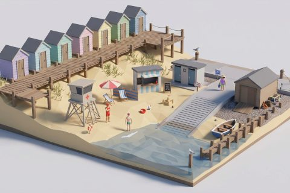

# Coast and Boardwalk

In production, 60 parts so far. Every part below is already free to use.

[Open the kit on Polyfork](https://polyfork.dev/kit/coast-and-boardwalk-d883fd) · [All kits](../README.md#kits)

<table>
<tr>
<td align="center" valign="top" width="25%"> <a href="https://polyfork.dev/asset/amusement-arcade-front-e1caee">Amusement Arcade Front</a> <a href="https://polyfork.dev/cdn/amusement-arcade-front-e1caee.glb">GLB</a> · <a href="https://polyfork.dev/cdn/amusement-arcade-front-e1caee.mjs">module</a></td>
<td align="center" valign="top" width="25%"> <a href="https://polyfork.dev/asset/back-to-back-promenade-8c153b">Back-to-Back Promenade Bench</a> <a href="https://polyfork.dev/cdn/back-to-back-promenade-8c153b.glb">GLB</a> · <a href="https://polyfork.dev/cdn/back-to-back-promenade-8c153b.mjs">module</a></td>
<td align="center" valign="top" width="25%"> <a href="https://polyfork.dev/asset/beach-ball-4b2a9b">Beach Ball</a> <a href="https://polyfork.dev/cdn/beach-ball-4b2a9b.glb">GLB</a> · <a href="https://polyfork.dev/cdn/beach-ball-4b2a9b.mjs">module</a></td>
<td align="center" valign="top" width="25%"> <a href="https://polyfork.dev/asset/beach-bucket-dc52dd">Beach Bucket</a> <a href="https://polyfork.dev/cdn/beach-bucket-dc52dd.glb">GLB</a> · <a href="https://polyfork.dev/cdn/beach-bucket-dc52dd.mjs">module</a></td>
</tr>
<tr>
<td align="center" valign="top" width="25%"> <a href="https://polyfork.dev/asset/beach-cafe-kiosk-9e8f6d">Beach Cafe Kiosk</a> <a href="https://polyfork.dev/cdn/beach-cafe-kiosk-9e8f6d.glb">GLB</a> · <a href="https://polyfork.dev/cdn/beach-cafe-kiosk-9e8f6d.mjs">module</a></td>
<td align="center" valign="top" width="25%"> <a href="https://polyfork.dev/asset/beach-flag-pole-2bf334">Beach Flag Pole</a> <a href="https://polyfork.dev/cdn/beach-flag-pole-2bf334.glb">GLB</a> · <a href="https://polyfork.dev/cdn/beach-flag-pole-2bf334.mjs">module</a></td>
<td align="center" valign="top" width="25%"> <a href="https://polyfork.dev/asset/beach-hut-fc7649">Beach Hut</a> <a href="https://polyfork.dev/cdn/beach-hut-fc7649.glb">GLB</a> · <a href="https://polyfork.dev/cdn/beach-hut-fc7649.mjs">module</a></td>
<td align="center" valign="top" width="25%"> <a href="https://polyfork.dev/asset/beach-parasol-fd4530">Beach Parasol</a> <a href="https://polyfork.dev/cdn/beach-parasol-fd4530.glb">GLB</a> · <a href="https://polyfork.dev/cdn/beach-parasol-fd4530.mjs">module</a></td>
</tr>
<tr>
<td align="center" valign="top" width="25%"> <a href="https://polyfork.dev/asset/beach-shower-post-719ac6">Beach Shower Post</a> <a href="https://polyfork.dev/cdn/beach-shower-post-719ac6.glb">GLB</a> · <a href="https://polyfork.dev/cdn/beach-shower-post-719ac6.mjs">module</a></td>
<td align="center" valign="top" width="25%"> <a href="https://polyfork.dev/asset/beach-towel-adb6c0">Beach Towel</a> <a href="https://polyfork.dev/cdn/beach-towel-adb6c0.glb">GLB</a> · <a href="https://polyfork.dev/cdn/beach-towel-adb6c0.mjs">module</a></td>
<td align="center" valign="top" width="25%"> <a href="https://polyfork.dev/asset/beach-windbreak-090d8c">Beach Windbreak</a> <a href="https://polyfork.dev/cdn/beach-windbreak-090d8c.glb">GLB</a> · <a href="https://polyfork.dev/cdn/beach-windbreak-090d8c.mjs">module</a></td>
<td align="center" valign="top" width="25%"> <a href="https://polyfork.dev/asset/boardwalk-deck-run-c1f678">Boardwalk Deck Run</a> <a href="https://polyfork.dev/cdn/boardwalk-deck-run-c1f678.glb">GLB</a> · <a href="https://polyfork.dev/cdn/boardwalk-deck-run-c1f678.mjs">module</a></td>
</tr>
<tr>
<td align="center" valign="top" width="25%"> <a href="https://polyfork.dev/asset/boardwalk-railing-run-4851f1">Boardwalk Railing Run</a> <a href="https://polyfork.dev/cdn/boardwalk-railing-run-4851f1.glb">GLB</a> · <a href="https://polyfork.dev/cdn/boardwalk-railing-run-4851f1.mjs">module</a></td>
<td align="center" valign="top" width="25%"> <a href="https://polyfork.dev/asset/boat-shed-74c94f">Boat Shed</a> <a href="https://polyfork.dev/cdn/boat-shed-74c94f.glb">GLB</a> · <a href="https://polyfork.dev/cdn/boat-shed-74c94f.mjs">module</a></td>
<td align="center" valign="top" width="25%"> <a href="https://polyfork.dev/asset/bunting-run-2ac207">Bunting Run</a> <a href="https://polyfork.dev/cdn/bunting-run-2ac207.glb">GLB</a> · <a href="https://polyfork.dev/cdn/bunting-run-2ac207.mjs">module</a></td>
<td align="center" valign="top" width="25%"> <a href="https://polyfork.dev/asset/changing-cubicle-row-5bac7f">Changing Cubicle Row</a> <a href="https://polyfork.dev/cdn/changing-cubicle-row-5bac7f.glb">GLB</a> · <a href="https://polyfork.dev/cdn/changing-cubicle-row-5bac7f.mjs">module</a></td>
</tr>
<tr>
<td align="center" valign="top" width="25%"> <a href="https://polyfork.dev/asset/driftwood-log-89a68f">Driftwood Log</a> <a href="https://polyfork.dev/cdn/driftwood-log-89a68f.glb">GLB</a> · <a href="https://polyfork.dev/cdn/driftwood-log-89a68f.mjs">module</a></td>
<td align="center" valign="top" width="25%"> <a href="https://polyfork.dev/asset/dry-soft-sand-tile-4a1df7">Dry Soft Sand Tile</a> <a href="https://polyfork.dev/cdn/dry-soft-sand-tile-4a1df7.glb">GLB</a> · <a href="https://polyfork.dev/cdn/dry-soft-sand-tile-4a1df7.mjs">module</a></td>
<td align="center" valign="top" width="25%"> <a href="https://polyfork.dev/asset/dune-fence-run-120153">Dune Fence Run</a> <a href="https://polyfork.dev/cdn/dune-fence-run-120153.glb">GLB</a> · <a href="https://polyfork.dev/cdn/dune-fence-run-120153.mjs">module</a></td>
<td align="center" valign="top" width="25%"> <a href="https://polyfork.dev/asset/dune-walkover-afa2c0">Dune Walkover</a> <a href="https://polyfork.dev/cdn/dune-walkover-afa2c0.glb">GLB</a> · <a href="https://polyfork.dev/cdn/dune-walkover-afa2c0.mjs">module</a></td>
</tr>
<tr>
<td align="center" valign="top" width="25%"> <a href="https://polyfork.dev/asset/fisherman-in-waders-6dc25e">Fisherman in Waders</a> <a href="https://polyfork.dev/cdn/fisherman-in-waders-6dc25e.glb">GLB</a> · <a href="https://polyfork.dev/cdn/fisherman-in-waders-6dc25e.mjs">module</a></td>
<td align="center" valign="top" width="25%"> <a href="https://polyfork.dev/asset/groyne-run-971623">Groyne Run</a> <a href="https://polyfork.dev/cdn/groyne-run-971623.glb">GLB</a> · <a href="https://polyfork.dev/cdn/groyne-run-971623.mjs">module</a></td>
<td align="center" valign="top" width="25%"> <a href="https://polyfork.dev/asset/herring-gull-55c3da">Herring Gull</a> <a href="https://polyfork.dev/cdn/herring-gull-55c3da.glb">GLB</a> · <a href="https://polyfork.dev/cdn/herring-gull-55c3da.mjs">module</a></td>
<td align="center" valign="top" width="25%"> <a href="https://polyfork.dev/asset/holidaymaker-in-a-sun-2ba5e5">Holidaymaker in a Sun Hat</a> <a href="https://polyfork.dev/cdn/holidaymaker-in-a-sun-2ba5e5.glb">GLB</a> · <a href="https://polyfork.dev/cdn/holidaymaker-in-a-sun-2ba5e5.mjs">module</a></td>
</tr>
<tr>
<td align="center" valign="top" width="25%"> <a href="https://polyfork.dev/asset/ice-cream-kiosk-on-40a568">Ice Cream Kiosk on Wheels</a> <a href="https://polyfork.dev/cdn/ice-cream-kiosk-on-40a568.glb">GLB</a> · <a href="https://polyfork.dev/cdn/ice-cream-kiosk-on-40a568.mjs">module</a></td>
<td align="center" valign="top" width="25%"> <a href="https://polyfork.dev/asset/lifebuoy-on-a-post-57421b">Lifebuoy on a Post</a> <a href="https://polyfork.dev/cdn/lifebuoy-on-a-post-57421b.glb">GLB</a> · <a href="https://polyfork.dev/cdn/lifebuoy-on-a-post-57421b.mjs">module</a></td>
<td align="center" valign="top" width="25%"> <a href="https://polyfork.dev/asset/lifeguard-321302">Lifeguard</a> <a href="https://polyfork.dev/cdn/lifeguard-321302.glb">GLB</a> · <a href="https://polyfork.dev/cdn/lifeguard-321302.mjs">module</a></td>
<td align="center" valign="top" width="25%"> <a href="https://polyfork.dev/asset/lifeguard-tower-183c37">Lifeguard Tower</a> <a href="https://polyfork.dev/cdn/lifeguard-tower-183c37.glb">GLB</a> · <a href="https://polyfork.dev/cdn/lifeguard-tower-183c37.mjs">module</a></td>
</tr>
<tr>
<td align="center" valign="top" width="25%"> <a href="https://polyfork.dev/asset/lobster-pot-stack-d870f0">Lobster Pot Stack</a> <a href="https://polyfork.dev/cdn/lobster-pot-stack-d870f0.glb">GLB</a> · <a href="https://polyfork.dev/cdn/lobster-pot-stack-d870f0.mjs">module</a></td>
<td align="center" valign="top" width="25%"> <a href="https://polyfork.dev/asset/marram-dune-tile-56cdf8">Marram Dune Tile</a> <a href="https://polyfork.dev/cdn/marram-dune-tile-56cdf8.glb">GLB</a> · <a href="https://polyfork.dev/cdn/marram-dune-tile-56cdf8.mjs">module</a></td>
<td align="center" valign="top" width="25%"> <a href="https://polyfork.dev/asset/marram-grass-tuft-8c7a99">Marram Grass Tuft</a> <a href="https://polyfork.dev/cdn/marram-grass-tuft-8c7a99.glb">GLB</a> · <a href="https://polyfork.dev/cdn/marram-grass-tuft-8c7a99.mjs">module</a></td>
<td align="center" valign="top" width="25%"> <a href="https://polyfork.dev/asset/mooring-bollard-2d4bc9">Mooring Bollard</a> <a href="https://polyfork.dev/cdn/mooring-bollard-2d4bc9.glb">GLB</a> · <a href="https://polyfork.dev/cdn/mooring-bollard-2d4bc9.mjs">module</a></td>
</tr>
<tr>
<td align="center" valign="top" width="25%"> <a href="https://polyfork.dev/asset/net-pile-0bd489">Net Pile</a> <a href="https://polyfork.dev/cdn/net-pile-0bd489.glb">GLB</a> · <a href="https://polyfork.dev/cdn/net-pile-0bd489.mjs">module</a></td>
<td align="center" valign="top" width="25%"> <a href="https://polyfork.dev/asset/pier-head-platform-63662b">Pier Head Platform</a> <a href="https://polyfork.dev/cdn/pier-head-platform-63662b.glb">GLB</a> · <a href="https://polyfork.dev/cdn/pier-head-platform-63662b.mjs">module</a></td>
<td align="center" valign="top" width="25%"> <a href="https://polyfork.dev/asset/promenade-bandstand-1a71b5">Promenade Bandstand</a> <a href="https://polyfork.dev/cdn/promenade-bandstand-1a71b5.glb">GLB</a> · <a href="https://polyfork.dev/cdn/promenade-bandstand-1a71b5.mjs">module</a></td>
<td align="center" valign="top" width="25%"> <a href="https://polyfork.dev/asset/promenade-paving-tile-5656ce">Promenade Paving Tile</a> <a href="https://polyfork.dev/cdn/promenade-paving-tile-5656ce.glb">GLB</a> · <a href="https://polyfork.dev/cdn/promenade-paving-tile-5656ce.mjs">module</a></td>
</tr>
<tr>
<td align="center" valign="top" width="25%"> <a href="https://polyfork.dev/asset/promenade-shelter-788f46">Promenade Shelter</a> <a href="https://polyfork.dev/cdn/promenade-shelter-788f46.glb">GLB</a> · <a href="https://polyfork.dev/cdn/promenade-shelter-788f46.mjs">module</a></td>
<td align="center" valign="top" width="25%"> <a href="https://polyfork.dev/asset/rescue-and-paddle-board-79a2a0">Rescue and Paddle Board</a> <a href="https://polyfork.dev/cdn/rescue-and-paddle-board-79a2a0.glb">GLB</a> · <a href="https://polyfork.dev/cdn/rescue-and-paddle-board-79a2a0.mjs">module</a></td>
<td align="center" valign="top" width="25%"> <a href="https://polyfork.dev/asset/rock-armour-revetment-aea1ca">Rock Armour Revetment</a> <a href="https://polyfork.dev/cdn/rock-armour-revetment-aea1ca.glb">GLB</a> · <a href="https://polyfork.dev/cdn/rock-armour-revetment-aea1ca.mjs">module</a></td>
<td align="center" valign="top" width="25%"> <a href="https://polyfork.dev/asset/rock-pool-937f01">Rock Pool</a> <a href="https://polyfork.dev/cdn/rock-pool-937f01.glb">GLB</a> · <a href="https://polyfork.dev/cdn/rock-pool-937f01.mjs">module</a></td>
</tr>
<tr>
<td align="center" valign="top" width="25%"> <a href="https://polyfork.dev/asset/rowing-dinghy-022673">Rowing Dinghy</a> <a href="https://polyfork.dev/cdn/rowing-dinghy-022673.glb">GLB</a> · <a href="https://polyfork.dev/cdn/rowing-dinghy-022673.mjs">module</a></td>
<td align="center" valign="top" width="25%"> <a href="https://polyfork.dev/asset/sandcastle-ddc562">Sandcastle</a> <a href="https://polyfork.dev/cdn/sandcastle-ddc562.glb">GLB</a> · <a href="https://polyfork.dev/cdn/sandcastle-ddc562.mjs">module</a></td>
<td align="center" valign="top" width="25%"> <a href="https://polyfork.dev/asset/sea-holly-clump-ce3bc6">Sea Holly Clump</a> <a href="https://polyfork.dev/cdn/sea-holly-clump-ce3bc6.glb">GLB</a> · <a href="https://polyfork.dev/cdn/sea-holly-clump-ce3bc6.mjs">module</a></td>
<td align="center" valign="top" width="25%"> <a href="https://polyfork.dev/asset/sea-kayak-97b592">Sea Kayak</a> <a href="https://polyfork.dev/cdn/sea-kayak-97b592.glb">GLB</a> · <a href="https://polyfork.dev/cdn/sea-kayak-97b592.mjs">module</a></td>
</tr>
<tr>
<td align="center" valign="top" width="25%"> <a href="https://polyfork.dev/asset/sea-wall-run-91e459">Sea Wall Run</a> <a href="https://polyfork.dev/cdn/sea-wall-run-91e459.glb">GLB</a> · <a href="https://polyfork.dev/cdn/sea-wall-run-91e459.mjs">module</a></td>
<td align="center" valign="top" width="25%"> <a href="https://polyfork.dev/asset/seafront-lamp-post-28bada">Seafront Lamp Post</a> <a href="https://polyfork.dev/cdn/seafront-lamp-post-28bada.glb">GLB</a> · <a href="https://polyfork.dev/cdn/seafront-lamp-post-28bada.mjs">module</a></td>
<td align="center" valign="top" width="25%"> <a href="https://polyfork.dev/asset/seafront-toilet-block-c3f643">Seafront Toilet Block</a> <a href="https://polyfork.dev/cdn/seafront-toilet-block-c3f643.glb">GLB</a> · <a href="https://polyfork.dev/cdn/seafront-toilet-block-c3f643.mjs">module</a></td>
<td align="center" valign="top" width="25%"> <a href="https://polyfork.dev/asset/seafront-wayfinding-post-67fc84">Seafront Wayfinding Post</a> <a href="https://polyfork.dev/cdn/seafront-wayfinding-post-67fc84.glb">GLB</a> · <a href="https://polyfork.dev/cdn/seafront-wayfinding-post-67fc84.mjs">module</a></td>
</tr>
<tr>
<td align="center" valign="top" width="25%"> <a href="https://polyfork.dev/asset/seaweed-drift-line-6566c3">Seaweed Drift Line</a> <a href="https://polyfork.dev/cdn/seaweed-drift-line-6566c3.glb">GLB</a> · <a href="https://polyfork.dev/cdn/seaweed-drift-line-6566c3.mjs">module</a></td>
<td align="center" valign="top" width="25%"> <a href="https://polyfork.dev/asset/shell-scatter-6d36b7">Shell Scatter</a> <a href="https://polyfork.dev/cdn/shell-scatter-6d36b7.glb">GLB</a> · <a href="https://polyfork.dev/cdn/shell-scatter-6d36b7.mjs">module</a></td>
<td align="center" valign="top" width="25%"> <a href="https://polyfork.dev/asset/shingle-tile-fa005e">Shingle Tile</a> <a href="https://polyfork.dev/cdn/shingle-tile-fa005e.glb">GLB</a> · <a href="https://polyfork.dev/cdn/shingle-tile-fa005e.mjs">module</a></td>
<td align="center" valign="top" width="25%"> <a href="https://polyfork.dev/asset/shore-crab-6889f5">Shore Crab</a> <a href="https://polyfork.dev/cdn/shore-crab-6889f5.glb">GLB</a> · <a href="https://polyfork.dev/cdn/shore-crab-6889f5.mjs">module</a></td>
</tr>
<tr>
<td align="center" valign="top" width="25%"> <a href="https://polyfork.dev/asset/slipway-ramp-1e595f">Slipway Ramp</a> <a href="https://polyfork.dev/cdn/slipway-ramp-1e595f.glb">GLB</a> · <a href="https://polyfork.dev/cdn/slipway-ramp-1e595f.mjs">module</a></td>
<td align="center" valign="top" width="25%"> <a href="https://polyfork.dev/asset/small-fishing-boat-4ac0e3">Small Fishing Boat</a> <a href="https://polyfork.dev/cdn/small-fishing-boat-4ac0e3.glb">GLB</a> · <a href="https://polyfork.dev/cdn/small-fishing-boat-4ac0e3.mjs">module</a></td>
<td align="center" valign="top" width="25%"> <a href="https://polyfork.dev/asset/striped-deck-chair-70b506">Striped Deck Chair</a> <a href="https://polyfork.dev/cdn/striped-deck-chair-70b506.glb">GLB</a> · <a href="https://polyfork.dev/cdn/striped-deck-chair-70b506.mjs">module</a></td>
<td align="center" valign="top" width="25%"> <a href="https://polyfork.dev/asset/sun-lounger-2b2603">Sun Lounger</a> <a href="https://polyfork.dev/cdn/sun-lounger-2b2603.glb">GLB</a> · <a href="https://polyfork.dev/cdn/sun-lounger-2b2603.mjs">module</a></td>
</tr>
<tr>
<td align="center" valign="top" width="25%"> <a href="https://polyfork.dev/asset/swimmer-in-a-wetsuit-9fca8f">Swimmer in a Wetsuit</a> <a href="https://polyfork.dev/cdn/swimmer-in-a-wetsuit-9fca8f.glb">GLB</a> · <a href="https://polyfork.dev/cdn/swimmer-in-a-wetsuit-9fca8f.mjs">module</a></td>
<td align="center" valign="top" width="25%"> <a href="https://polyfork.dev/asset/tamarisk-bush-ba4337">Tamarisk Bush</a> <a href="https://polyfork.dev/cdn/tamarisk-bush-ba4337.glb">GLB</a> · <a href="https://polyfork.dev/cdn/tamarisk-bush-ba4337.mjs">module</a></td>
<td align="center" valign="top" width="25%"> <a href="https://polyfork.dev/asset/tide-post-11a866">Tide Post</a> <a href="https://polyfork.dev/cdn/tide-post-11a866.glb">GLB</a> · <a href="https://polyfork.dev/cdn/tide-post-11a866.mjs">module</a></td>
<td align="center" valign="top" width="25%"> <a href="https://polyfork.dev/asset/wet-packed-sand-tile-913ddb">Wet Packed Sand Tile</a> <a href="https://polyfork.dev/cdn/wet-packed-sand-tile-913ddb.glb">GLB</a> · <a href="https://polyfork.dev/cdn/wet-packed-sand-tile-913ddb.mjs">module</a></td>
</tr>
</table>
