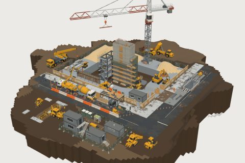

# Construction Site

62 free low-poly parts on one palette and one scale, so everything you combine belongs to the same world.

[Open the kit on Polyfork](https://polyfork.dev/kit/construction-site-9e40b0) · [All kits](../README.md#kits)

<table>
<tr>
<td align="center" valign="top" width="25%"> <a href="https://polyfork.dev/asset/arrow-board-2eea6b">Arrow Board</a> <a href="https://polyfork.dev/cdn/arrow-board-2eea6b.glb">GLB</a> · <a href="https://polyfork.dev/cdn/arrow-board-2eea6b.mjs">module</a></td>
<td align="center" valign="top" width="25%"> <a href="https://polyfork.dev/asset/articulated-dump-truck-ee50f3">Articulated Dump Truck</a> <a href="https://polyfork.dev/cdn/articulated-dump-truck-ee50f3.glb">GLB</a> · <a href="https://polyfork.dev/cdn/articulated-dump-truck-ee50f3.mjs">module</a></td>
<td align="center" valign="top" width="25%"> <a href="https://polyfork.dev/asset/backhoe-loader-66dccb">Backhoe Loader</a> <a href="https://polyfork.dev/cdn/backhoe-loader-66dccb.glb">GLB</a> · <a href="https://polyfork.dev/cdn/backhoe-loader-66dccb.mjs">module</a></td>
<td align="center" valign="top" width="25%"> <a href="https://polyfork.dev/asset/broken-out-road-tile-c9e990">Broken-Out Road Tile</a> <a href="https://polyfork.dev/cdn/broken-out-road-tile-c9e990.glb">GLB</a> · <a href="https://polyfork.dev/cdn/broken-out-road-tile-c9e990.mjs">module</a></td>
</tr>
<tr>
<td align="center" valign="top" width="25%"> <a href="https://polyfork.dev/asset/builder-s-dumpy-bag-89fd1b">Builder&#039;s Dumpy Bag</a> <a href="https://polyfork.dev/cdn/builder-s-dumpy-bag-89fd1b.glb">GLB</a> · <a href="https://polyfork.dev/cdn/builder-s-dumpy-bag-89fd1b.mjs">module</a></td>
<td align="center" valign="top" width="25%"> <a href="https://polyfork.dev/asset/builder-s-skip-191d35">Builder&#039;s Skip</a> <a href="https://polyfork.dev/cdn/builder-s-skip-191d35.glb">GLB</a> · <a href="https://polyfork.dev/cdn/builder-s-skip-191d35.mjs">module</a></td>
<td align="center" valign="top" width="25%"> <a href="https://polyfork.dev/asset/cement-mixer-on-a-8fb979">Cement Mixer on a Stand</a> <a href="https://polyfork.dev/cdn/cement-mixer-on-a-8fb979.glb">GLB</a> · <a href="https://polyfork.dev/cdn/cement-mixer-on-a-8fb979.mjs">module</a></td>
<td align="center" valign="top" width="25%"> <a href="https://polyfork.dev/asset/chain-trencher-215857">Chain Trencher</a> <a href="https://polyfork.dev/cdn/chain-trencher-215857.glb">GLB</a> · <a href="https://polyfork.dev/cdn/chain-trencher-215857.mjs">module</a></td>
</tr>
<tr>
<td align="center" valign="top" width="25%"> <a href="https://polyfork.dev/asset/cherry-picker-38c4af">Cherry Picker</a> <a href="https://polyfork.dev/cdn/cherry-picker-38c4af.glb">GLB</a> · <a href="https://polyfork.dev/cdn/cherry-picker-38c4af.mjs">module</a></td>
<td align="center" valign="top" width="25%"> <a href="https://polyfork.dev/asset/compacted-hardcore-tile-a7a8ee">Compacted Hardcore Tile</a> <a href="https://polyfork.dev/cdn/compacted-hardcore-tile-a7a8ee.glb">GLB</a> · <a href="https://polyfork.dev/cdn/compacted-hardcore-tile-a7a8ee.mjs">module</a></td>
<td align="center" valign="top" width="25%"> <a href="https://polyfork.dev/asset/compactor-plate-e76b28">Compactor Plate</a> <a href="https://polyfork.dev/cdn/compactor-plate-e76b28.glb">GLB</a> · <a href="https://polyfork.dev/cdn/compactor-plate-e76b28.mjs">module</a></td>
<td align="center" valign="top" width="25%"> <a href="https://polyfork.dev/asset/concrete-core-section-39af7c">Concrete Core Section</a> <a href="https://polyfork.dev/cdn/concrete-core-section-39af7c.glb">GLB</a> · <a href="https://polyfork.dev/cdn/concrete-core-section-39af7c.mjs">module</a></td>
</tr>
<tr>
<td align="center" valign="top" width="25%"> <a href="https://polyfork.dev/asset/concrete-mixer-truck-4a8d94">Concrete Mixer Truck</a> <a href="https://polyfork.dev/cdn/concrete-mixer-truck-4a8d94.glb">GLB</a> · <a href="https://polyfork.dev/cdn/concrete-mixer-truck-4a8d94.mjs">module</a></td>
<td align="center" valign="top" width="25%"> <a href="https://polyfork.dev/asset/concrete-pump-c073ef">Concrete Pump</a> <a href="https://polyfork.dev/cdn/concrete-pump-c073ef.glb">GLB</a> · <a href="https://polyfork.dev/cdn/concrete-pump-c073ef.mjs">module</a></td>
<td align="center" valign="top" width="25%"> <a href="https://polyfork.dev/asset/crane-banksman-3994e0">Crane Banksman</a> <a href="https://polyfork.dev/cdn/crane-banksman-3994e0.glb">GLB</a> · <a href="https://polyfork.dev/cdn/crane-banksman-3994e0.mjs">module</a></td>
<td align="center" valign="top" width="25%"> <a href="https://polyfork.dev/asset/crash-barrier-run-b47d1d">Crash Barrier Run</a> <a href="https://polyfork.dev/cdn/crash-barrier-run-b47d1d.glb">GLB</a> · <a href="https://polyfork.dev/cdn/crash-barrier-run-b47d1d.mjs">module</a></td>
</tr>
<tr>
<td align="center" valign="top" width="25%"> <a href="https://polyfork.dev/asset/crawler-bulldozer-b851fb">Crawler Bulldozer</a> <a href="https://polyfork.dev/cdn/crawler-bulldozer-b851fb.glb">GLB</a> · <a href="https://polyfork.dev/cdn/crawler-bulldozer-b851fb.mjs">module</a></td>
<td align="center" valign="top" width="25%"> <a href="https://polyfork.dev/asset/flatbed-delivery-lorry-571458">Flatbed Delivery Lorry</a> <a href="https://polyfork.dev/cdn/flatbed-delivery-lorry-571458.glb">GLB</a> · <a href="https://polyfork.dev/cdn/flatbed-delivery-lorry-571458.mjs">module</a></td>
<td align="center" valign="top" width="25%"> <a href="https://polyfork.dev/asset/formwork-wall-panel-run-52e9f5">Formwork Wall Panel Run</a> <a href="https://polyfork.dev/cdn/formwork-wall-panel-run-52e9f5.glb">GLB</a> · <a href="https://polyfork.dev/cdn/formwork-wall-panel-run-52e9f5.mjs">module</a></td>
<td align="center" valign="top" width="25%"> <a href="https://polyfork.dev/asset/fresh-concrete-slab-tile-66b6a8">Fresh Concrete Slab Tile</a> <a href="https://polyfork.dev/cdn/fresh-concrete-slab-tile-66b6a8.glb">GLB</a> · <a href="https://polyfork.dev/cdn/fresh-concrete-slab-tile-66b6a8.mjs">module</a></td>
</tr>
<tr>
<td align="center" valign="top" width="25%"> <a href="https://polyfork.dev/asset/groundworker-083f5c">Groundworker</a> <a href="https://polyfork.dev/cdn/groundworker-083f5c.glb">GLB</a> · <a href="https://polyfork.dev/cdn/groundworker-083f5c.mjs">module</a></td>
<td align="center" valign="top" width="25%"> <a href="https://polyfork.dev/asset/loading-gantry-34460f">Loading Gantry</a> <a href="https://polyfork.dev/cdn/loading-gantry-34460f.glb">GLB</a> · <a href="https://polyfork.dev/cdn/loading-gantry-34460f.mjs">module</a></td>
<td align="center" valign="top" width="25%"> <a href="https://polyfork.dev/asset/material-pallet-6af263">Material Pallet</a> <a href="https://polyfork.dev/cdn/material-pallet-6af263.glb">GLB</a> · <a href="https://polyfork.dev/cdn/material-pallet-6af263.mjs">module</a></td>
<td align="center" valign="top" width="25%"> <a href="https://polyfork.dev/asset/mesh-site-fence-run-a798a0">Mesh Site Fence Run</a> <a href="https://polyfork.dev/cdn/mesh-site-fence-run-a798a0.glb">GLB</a> · <a href="https://polyfork.dev/cdn/mesh-site-fence-run-a798a0.mjs">module</a></td>
</tr>
<tr>
<td align="center" valign="top" width="25%"> <a href="https://polyfork.dev/asset/metal-deck-floor-plate-6cdd1c">Metal Deck Floor Plate</a> <a href="https://polyfork.dev/cdn/metal-deck-floor-plate-6cdd1c.glb">GLB</a> · <a href="https://polyfork.dev/cdn/metal-deck-floor-plate-6cdd1c.mjs">module</a></td>
<td align="center" valign="top" width="25%"> <a href="https://polyfork.dev/asset/mini-excavator-cbe1ae">Mini Excavator</a> <a href="https://polyfork.dev/cdn/mini-excavator-cbe1ae.glb">GLB</a> · <a href="https://polyfork.dev/cdn/mini-excavator-cbe1ae.mjs">module</a></td>
<td align="center" valign="top" width="25%"> <a href="https://polyfork.dev/asset/mobile-crane-671d3f">Mobile Crane</a> <a href="https://polyfork.dev/cdn/mobile-crane-671d3f.glb">GLB</a> · <a href="https://polyfork.dev/cdn/mobile-crane-671d3f.mjs">module</a></td>
<td align="center" valign="top" width="25%"> <a href="https://polyfork.dev/asset/mud-and-rut-tile-858785">Mud and Rut Tile</a> <a href="https://polyfork.dev/cdn/mud-and-rut-tile-858785.glb">GLB</a> · <a href="https://polyfork.dev/cdn/mud-and-rut-tile-858785.mjs">module</a></td>
</tr>
<tr>
<td align="center" valign="top" width="25%"> <a href="https://polyfork.dev/asset/open-trench-bay-45eddb">Open Trench Bay</a> <a href="https://polyfork.dev/cdn/open-trench-bay-45eddb.glb">GLB</a> · <a href="https://polyfork.dev/cdn/open-trench-bay-45eddb.mjs">module</a></td>
<td align="center" valign="top" width="25%"> <a href="https://polyfork.dev/asset/pedestrian-walkway-tunnel-0b194e">Pedestrian Walkway Tunnel</a> <a href="https://polyfork.dev/cdn/pedestrian-walkway-tunnel-0b194e.glb">GLB</a> · <a href="https://polyfork.dev/cdn/pedestrian-walkway-tunnel-0b194e.mjs">module</a></td>
<td align="center" valign="top" width="25%"> <a href="https://polyfork.dev/asset/portable-toilet-a3f1a2">Portable Toilet</a> <a href="https://polyfork.dev/cdn/portable-toilet-a3f1a2.glb">GLB</a> · <a href="https://polyfork.dev/cdn/portable-toilet-a3f1a2.mjs">module</a></td>
<td align="center" valign="top" width="25%"> <a href="https://polyfork.dev/asset/precast-concrete-stack-8945ac">Precast Concrete Stack</a> <a href="https://polyfork.dev/cdn/precast-concrete-stack-8945ac.glb">GLB</a> · <a href="https://polyfork.dev/cdn/precast-concrete-stack-8945ac.mjs">module</a></td>
</tr>
<tr>
<td align="center" valign="top" width="25%"> <a href="https://polyfork.dev/asset/rebar-assembly-889031">Rebar Assembly</a> <a href="https://polyfork.dev/cdn/rebar-assembly-889031.glb">GLB</a> · <a href="https://polyfork.dev/cdn/rebar-assembly-889031.mjs">module</a></td>
<td align="center" valign="top" width="25%"> <a href="https://polyfork.dev/asset/rigid-site-dumper-224eb0">Rigid Site Dumper</a> <a href="https://polyfork.dev/cdn/rigid-site-dumper-224eb0.glb">GLB</a> · <a href="https://polyfork.dev/cdn/rigid-site-dumper-224eb0.mjs">module</a></td>
<td align="center" valign="top" width="25%"> <a href="https://polyfork.dev/asset/scaffold-bay-4e051b">Scaffold Bay</a> <a href="https://polyfork.dev/cdn/scaffold-bay-4e051b.glb">GLB</a> · <a href="https://polyfork.dev/cdn/scaffold-bay-4e051b.mjs">module</a></td>
<td align="center" valign="top" width="25%"> <a href="https://polyfork.dev/asset/scaffold-material-stack-836dd2">Scaffold Material Stack</a> <a href="https://polyfork.dev/cdn/scaffold-material-stack-836dd2.glb">GLB</a> · <a href="https://polyfork.dev/cdn/scaffold-material-stack-836dd2.mjs">module</a></td>
</tr>
<tr>
<td align="center" valign="top" width="25%"> <a href="https://polyfork.dev/asset/scissor-lift-platform-3eae3f">Scissor Lift Platform</a> <a href="https://polyfork.dev/cdn/scissor-lift-platform-3eae3f.glb">GLB</a> · <a href="https://polyfork.dev/cdn/scissor-lift-platform-3eae3f.mjs">module</a></td>
<td align="center" valign="top" width="25%"> <a href="https://polyfork.dev/asset/site-cabin-e9ee10">Site Cabin</a> <a href="https://polyfork.dev/cdn/site-cabin-e9ee10.glb">GLB</a> · <a href="https://polyfork.dev/cdn/site-cabin-e9ee10.mjs">module</a></td>
<td align="center" valign="top" width="25%"> <a href="https://polyfork.dev/asset/site-generator-298792">Site Generator</a> <a href="https://polyfork.dev/cdn/site-generator-298792.glb">GLB</a> · <a href="https://polyfork.dev/cdn/site-generator-298792.mjs">module</a></td>
<td align="center" valign="top" width="25%"> <a href="https://polyfork.dev/asset/site-hoarding-run-0273b4">Site Hoarding Run</a> <a href="https://polyfork.dev/cdn/site-hoarding-run-0273b4.glb">GLB</a> · <a href="https://polyfork.dev/cdn/site-hoarding-run-0273b4.mjs">module</a></td>
</tr>
<tr>
<td align="center" valign="top" width="25%"> <a href="https://polyfork.dev/asset/site-lighting-tower-674c45">Site Lighting Tower</a> <a href="https://polyfork.dev/cdn/site-lighting-tower-674c45.glb">GLB</a> · <a href="https://polyfork.dev/cdn/site-lighting-tower-674c45.mjs">module</a></td>
<td align="center" valign="top" width="25%"> <a href="https://polyfork.dev/asset/site-manager-d60b95">Site Manager</a> <a href="https://polyfork.dev/cdn/site-manager-d60b95.glb">GLB</a> · <a href="https://polyfork.dev/cdn/site-manager-d60b95.mjs">module</a></td>
<td align="center" valign="top" width="25%"> <a href="https://polyfork.dev/asset/site-safety-sign-board-5408d5">Site Safety Sign Board</a> <a href="https://polyfork.dev/cdn/site-safety-sign-board-5408d5.glb">GLB</a> · <a href="https://polyfork.dev/cdn/site-safety-sign-board-5408d5.mjs">module</a></td>
<td align="center" valign="top" width="25%"> <a href="https://polyfork.dev/asset/site-tool-vault-200e38">Site Tool Vault</a> <a href="https://polyfork.dev/cdn/site-tool-vault-200e38.glb">GLB</a> · <a href="https://polyfork.dev/cdn/site-tool-vault-200e38.mjs">module</a></td>
</tr>
<tr>
<td align="center" valign="top" width="25%"> <a href="https://polyfork.dev/asset/site-traffic-cone-d3ce94">Site Traffic Cone</a> <a href="https://polyfork.dev/cdn/site-traffic-cone-d3ce94.glb">GLB</a> · <a href="https://polyfork.dev/cdn/site-traffic-cone-d3ce94.mjs">module</a></td>
<td align="center" valign="top" width="25%"> <a href="https://polyfork.dev/asset/skid-steer-loader-268f4d">Skid-Steer Loader</a> <a href="https://polyfork.dev/cdn/skid-steer-loader-268f4d.glb">GLB</a> · <a href="https://polyfork.dev/cdn/skid-steer-loader-268f4d.mjs">module</a></td>
<td align="center" valign="top" width="25%"> <a href="https://polyfork.dev/asset/smoking-shelter-7e149f">Smoking Shelter</a> <a href="https://polyfork.dev/cdn/smoking-shelter-7e149f.glb">GLB</a> · <a href="https://polyfork.dev/cdn/smoking-shelter-7e149f.mjs">module</a></td>
<td align="center" valign="top" width="25%"> <a href="https://polyfork.dev/asset/spoil-heap-9aaa11">Spoil Heap</a> <a href="https://polyfork.dev/cdn/spoil-heap-9aaa11.glb">GLB</a> · <a href="https://polyfork.dev/cdn/spoil-heap-9aaa11.mjs">module</a></td>
</tr>
<tr>
<td align="center" valign="top" width="25%"> <a href="https://polyfork.dev/asset/steel-erector-124bef">Steel Erector</a> <a href="https://polyfork.dev/cdn/steel-erector-124bef.glb">GLB</a> · <a href="https://polyfork.dev/cdn/steel-erector-124bef.mjs">module</a></td>
<td align="center" valign="top" width="25%"> <a href="https://polyfork.dev/asset/steel-frame-bay-91d3b6">Steel Frame Bay</a> <a href="https://polyfork.dev/cdn/steel-frame-bay-91d3b6.glb">GLB</a> · <a href="https://polyfork.dev/cdn/steel-frame-bay-91d3b6.mjs">module</a></td>
<td align="center" valign="top" width="25%"> <a href="https://polyfork.dev/asset/surveyor-82e5c7">Surveyor</a> <a href="https://polyfork.dev/cdn/surveyor-82e5c7.glb">GLB</a> · <a href="https://polyfork.dev/cdn/surveyor-82e5c7.mjs">module</a></td>
<td align="center" valign="top" width="25%"> <a href="https://polyfork.dev/asset/tandem-road-roller-f7d8f3">Tandem Road Roller</a> <a href="https://polyfork.dev/cdn/tandem-road-roller-f7d8f3.glb">GLB</a> · <a href="https://polyfork.dev/cdn/tandem-road-roller-f7d8f3.mjs">module</a></td>
</tr>
<tr>
<td align="center" valign="top" width="25%"> <a href="https://polyfork.dev/asset/telehandler-88c668">Telehandler</a> <a href="https://polyfork.dev/cdn/telehandler-88c668.glb">GLB</a> · <a href="https://polyfork.dev/cdn/telehandler-88c668.mjs">module</a></td>
<td align="center" valign="top" width="25%"> <a href="https://polyfork.dev/asset/temporary-traffic-light-04c866">Temporary Traffic Light</a> <a href="https://polyfork.dev/cdn/temporary-traffic-light-04c866.glb">GLB</a> · <a href="https://polyfork.dev/cdn/temporary-traffic-light-04c866.mjs">module</a></td>
<td align="center" valign="top" width="25%"> <a href="https://polyfork.dev/asset/towed-air-compressor-11f9ea">Towed Air Compressor</a> <a href="https://polyfork.dev/cdn/towed-air-compressor-11f9ea.glb">GLB</a> · <a href="https://polyfork.dev/cdn/towed-air-compressor-11f9ea.mjs">module</a></td>
<td align="center" valign="top" width="25%"> <a href="https://polyfork.dev/asset/tower-crane-mast-1784a3">Tower Crane Mast</a> <a href="https://polyfork.dev/cdn/tower-crane-mast-1784a3.glb">GLB</a> · <a href="https://polyfork.dev/cdn/tower-crane-mast-1784a3.mjs">module</a></td>
</tr>
<tr>
<td align="center" valign="top" width="25%"> <a href="https://polyfork.dev/asset/tower-crane-top-d8d9c9">Tower Crane Top</a> <a href="https://polyfork.dev/cdn/tower-crane-top-d8d9c9.glb">GLB</a> · <a href="https://polyfork.dev/cdn/tower-crane-top-d8d9c9.mjs">module</a></td>
<td align="center" valign="top" width="25%"> <a href="https://polyfork.dev/asset/tracked-excavator-8ebd3c">Tracked Excavator</a> <a href="https://polyfork.dev/cdn/tracked-excavator-8ebd3c.glb">GLB</a> · <a href="https://polyfork.dev/cdn/tracked-excavator-8ebd3c.mjs">module</a></td>
<td align="center" valign="top" width="25%"> <a href="https://polyfork.dev/asset/trench-plate-30c3a3">Trench Plate</a> <a href="https://polyfork.dev/cdn/trench-plate-30c3a3.glb">GLB</a> · <a href="https://polyfork.dev/cdn/trench-plate-30c3a3.mjs">module</a></td>
<td align="center" valign="top" width="25%"> <a href="https://polyfork.dev/asset/water-bowser-f6768c">Water Bowser</a> <a href="https://polyfork.dev/cdn/water-bowser-f6768c.glb">GLB</a> · <a href="https://polyfork.dev/cdn/water-bowser-f6768c.mjs">module</a></td>
</tr>
<tr>
<td align="center" valign="top" width="25%"> <a href="https://polyfork.dev/asset/wheel-wash-d1ca0f">Wheel Wash</a> <a href="https://polyfork.dev/cdn/wheel-wash-d1ca0f.glb">GLB</a> · <a href="https://polyfork.dev/cdn/wheel-wash-d1ca0f.mjs">module</a></td>
<td align="center" valign="top" width="25%"> <a href="https://polyfork.dev/asset/wheeled-loader-29dc45">Wheeled Loader</a> <a href="https://polyfork.dev/cdn/wheeled-loader-29dc45.glb">GLB</a> · <a href="https://polyfork.dev/cdn/wheeled-loader-29dc45.mjs">module</a></td>
</tr>
</table>
