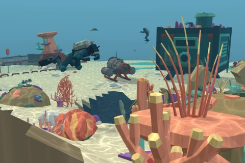

# Coral Reef

54 free low-poly parts on one palette and one scale, so everything you combine belongs to the same world.

[Open the kit on Polyfork](https://polyfork.dev/kit/coral-reef-a7128a) · [All kits](../README.md#kits)

<table>
<tr>
<td align="center" valign="top" width="25%"> <a href="https://polyfork.dev/asset/admiralty-anchor-bd6882">Admiralty Anchor</a> <a href="https://polyfork.dev/cdn/admiralty-anchor-bd6882.glb">GLB</a> · <a href="https://polyfork.dev/cdn/admiralty-anchor-bd6882.mjs">module</a></td>
<td align="center" valign="top" width="25%"> <a href="https://polyfork.dev/asset/anchor-chain-run-d58343">Anchor Chain Run</a> <a href="https://polyfork.dev/cdn/anchor-chain-run-d58343.glb">GLB</a> · <a href="https://polyfork.dev/cdn/anchor-chain-run-d58343.mjs">module</a></td>
<td align="center" valign="top" width="25%"> <a href="https://polyfork.dev/asset/barrel-sponge-ab460c">Barrel Sponge</a> <a href="https://polyfork.dev/cdn/barrel-sponge-ab460c.glb">GLB</a> · <a href="https://polyfork.dev/cdn/barrel-sponge-ab460c.mjs">module</a></td>
<td align="center" valign="top" width="25%"> <a href="https://polyfork.dev/asset/brain-coral-head-7db21a">Brain Coral Head</a> <a href="https://polyfork.dev/cdn/brain-coral-head-7db21a.glb">GLB</a> · <a href="https://polyfork.dev/cdn/brain-coral-head-7db21a.mjs">module</a></td>
</tr>
<tr>
<td align="center" valign="top" width="25%"> <a href="https://polyfork.dev/asset/broad-algae-frond-88a644">Broad Algae Frond</a> <a href="https://polyfork.dev/cdn/broad-algae-frond-88a644.glb">GLB</a> · <a href="https://polyfork.dev/cdn/broad-algae-frond-88a644.mjs">module</a></td>
<td align="center" valign="top" width="25%"> <a href="https://polyfork.dev/asset/clay-amphora-098d94">Clay Amphora</a> <a href="https://polyfork.dev/cdn/clay-amphora-098d94.glb">GLB</a> · <a href="https://polyfork.dev/cdn/clay-amphora-098d94.mjs">module</a></td>
<td align="center" valign="top" width="25%"> <a href="https://polyfork.dev/asset/coral-bommie-772b22">Coral Bommie</a> <a href="https://polyfork.dev/cdn/coral-bommie-772b22.glb">GLB</a> · <a href="https://polyfork.dev/cdn/coral-bommie-772b22.mjs">module</a></td>
<td align="center" valign="top" width="25%"> <a href="https://polyfork.dev/asset/coral-pinnacle-0d9756">Coral Pinnacle</a> <a href="https://polyfork.dev/cdn/coral-pinnacle-0d9756.glb">GLB</a> · <a href="https://polyfork.dev/cdn/coral-pinnacle-0d9756.mjs">module</a></td>
</tr>
<tr>
<td align="center" valign="top" width="25%"> <a href="https://polyfork.dev/asset/coral-reef-terrain-282969">Coral Reef Terrain</a> <a href="https://polyfork.dev/cdn/coral-reef-terrain-282969.glb">GLB</a> · <a href="https://polyfork.dev/cdn/coral-reef-terrain-282969.mjs">module</a></td>
<td align="center" valign="top" width="25%"> <a href="https://polyfork.dev/asset/coral-rubble-seabed-tile-772a1f">Coral Rubble Seabed Tile</a> <a href="https://polyfork.dev/cdn/coral-rubble-seabed-tile-772a1f.glb">GLB</a> · <a href="https://polyfork.dev/cdn/coral-rubble-seabed-tile-772a1f.mjs">module</a></td>
<td align="center" valign="top" width="25%"> <a href="https://polyfork.dev/asset/corroded-drum-fc75cf">Corroded Drum</a> <a href="https://polyfork.dev/cdn/corroded-drum-fc75cf.glb">GLB</a> · <a href="https://polyfork.dev/cdn/corroded-drum-fc75cf.mjs">module</a></td>
<td align="center" valign="top" width="25%"> <a href="https://polyfork.dev/asset/dive-marker-buoy-21beb7">Dive Marker Buoy</a> <a href="https://polyfork.dev/cdn/dive-marker-buoy-21beb7.glb">GLB</a> · <a href="https://polyfork.dev/cdn/dive-marker-buoy-21beb7.mjs">module</a></td>
</tr>
<tr>
<td align="center" valign="top" width="25%"> <a href="https://polyfork.dev/asset/diver-propulsion-vehicle-11d8ef">Diver Propulsion Vehicle</a> <a href="https://polyfork.dev/cdn/diver-propulsion-vehicle-11d8ef.glb">GLB</a> · <a href="https://polyfork.dev/cdn/diver-propulsion-vehicle-11d8ef.mjs">module</a></td>
<td align="center" valign="top" width="25%"> <a href="https://polyfork.dev/asset/encrusted-cargo-crate-ce0760">Encrusted Cargo Crate</a> <a href="https://polyfork.dev/cdn/encrusted-cargo-crate-ce0760.glb">GLB</a> · <a href="https://polyfork.dev/cdn/encrusted-cargo-crate-ce0760.mjs">module</a></td>
<td align="center" valign="top" width="25%"> <a href="https://polyfork.dev/asset/encrusted-reef-boulder-972d95">Encrusted Reef Boulder</a> <a href="https://polyfork.dev/cdn/encrusted-reef-boulder-972d95.glb">GLB</a> · <a href="https://polyfork.dev/cdn/encrusted-reef-boulder-972d95.mjs">module</a></td>
<td align="center" valign="top" width="25%"> <a href="https://polyfork.dev/asset/ghost-net-drape-50890a">Ghost Net Drape</a> <a href="https://polyfork.dev/cdn/ghost-net-drape-50890a.glb">GLB</a> · <a href="https://polyfork.dev/cdn/ghost-net-drape-50890a.mjs">module</a></td>
</tr>
<tr>
<td align="center" valign="top" width="25%"> <a href="https://polyfork.dev/asset/giant-clam-6408ba">Giant Clam</a> <a href="https://polyfork.dev/cdn/giant-clam-6408ba.glb">GLB</a> · <a href="https://polyfork.dev/cdn/giant-clam-6408ba.mjs">module</a></td>
<td align="center" valign="top" width="25%"> <a href="https://polyfork.dev/asset/great-barracuda-8dd12b">Great Barracuda</a> <a href="https://polyfork.dev/cdn/great-barracuda-8dd12b.glb">GLB</a> · <a href="https://polyfork.dev/cdn/great-barracuda-8dd12b.mjs">module</a></td>
<td align="center" valign="top" width="25%"> <a href="https://polyfork.dev/asset/lettuce-coral-e16e43">Lettuce Coral</a> <a href="https://polyfork.dev/cdn/lettuce-coral-e16e43.glb">GLB</a> · <a href="https://polyfork.dev/cdn/lettuce-coral-e16e43.mjs">module</a></td>
<td align="center" valign="top" width="25%"> <a href="https://polyfork.dev/asset/lobster-trap-8a3f07">Lobster Trap</a> <a href="https://polyfork.dev/cdn/lobster-trap-8a3f07.glb">GLB</a> · <a href="https://polyfork.dev/cdn/lobster-trap-8a3f07.mjs">module</a></td>
</tr>
<tr>
<td align="center" valign="top" width="25%"> <a href="https://polyfork.dev/asset/moon-jellyfish-0fa43c">Moon Jellyfish</a> <a href="https://polyfork.dev/cdn/moon-jellyfish-0fa43c.glb">GLB</a> · <a href="https://polyfork.dev/cdn/moon-jellyfish-0fa43c.mjs">module</a></td>
<td align="center" valign="top" width="25%"> <a href="https://polyfork.dev/asset/mooring-block-794549">Mooring Block</a> <a href="https://polyfork.dev/cdn/mooring-block-794549.glb">GLB</a> · <a href="https://polyfork.dev/cdn/mooring-block-794549.mjs">module</a></td>
<td align="center" valign="top" width="25%"> <a href="https://polyfork.dev/asset/moray-eel-26b8b3">Moray Eel</a> <a href="https://polyfork.dev/cdn/moray-eel-26b8b3.glb">GLB</a> · <a href="https://polyfork.dev/cdn/moray-eel-26b8b3.mjs">module</a></td>
<td align="center" valign="top" width="25%"> <a href="https://polyfork.dev/asset/mushroom-coral-a2906e">Mushroom Coral</a> <a href="https://polyfork.dev/cdn/mushroom-coral-a2906e.glb">GLB</a> · <a href="https://polyfork.dev/cdn/mushroom-coral-a2906e.mjs">module</a></td>
</tr>
<tr>
<td align="center" valign="top" width="25%"> <a href="https://polyfork.dev/asset/octopus-1aa810">Octopus</a> <a href="https://polyfork.dev/cdn/octopus-1aa810.glb">GLB</a> · <a href="https://polyfork.dev/cdn/octopus-1aa810.mjs">module</a></td>
<td align="center" valign="top" width="25%"> <a href="https://polyfork.dev/asset/one-person-submarine-0b9d14">One-Person Submarine</a> <a href="https://polyfork.dev/cdn/one-person-submarine-0b9d14.glb">GLB</a> · <a href="https://polyfork.dev/cdn/one-person-submarine-0b9d14.mjs">module</a></td>
<td align="center" valign="top" width="25%"> <a href="https://polyfork.dev/asset/pillar-coral-b6deba">Pillar Coral</a> <a href="https://polyfork.dev/cdn/pillar-coral-b6deba.glb">GLB</a> · <a href="https://polyfork.dev/cdn/pillar-coral-b6deba.mjs">module</a></td>
<td align="center" valign="top" width="25%"> <a href="https://polyfork.dev/asset/reef-crab-0d2639">Reef Crab</a> <a href="https://polyfork.dev/cdn/reef-crab-0d2639.glb">GLB</a> · <a href="https://polyfork.dev/cdn/reef-crab-0d2639.mjs">module</a></td>
</tr>
<tr>
<td align="center" valign="top" width="25%"> <a href="https://polyfork.dev/asset/reef-fish-d35766">Reef Fish</a> <a href="https://polyfork.dev/cdn/reef-fish-d35766.glb">GLB</a> · <a href="https://polyfork.dev/cdn/reef-fish-d35766.mjs">module</a></td>
<td align="center" valign="top" width="25%"> <a href="https://polyfork.dev/asset/reef-grouper-964612">Reef Grouper</a> <a href="https://polyfork.dev/cdn/reef-grouper-964612.glb">GLB</a> · <a href="https://polyfork.dev/cdn/reef-grouper-964612.mjs">module</a></td>
<td align="center" valign="top" width="25%"> <a href="https://polyfork.dev/asset/reef-rock-pavement-tile-879f47">Reef Rock Pavement Tile</a> <a href="https://polyfork.dev/cdn/reef-rock-pavement-tile-879f47.glb">GLB</a> · <a href="https://polyfork.dev/cdn/reef-rock-pavement-tile-879f47.mjs">module</a></td>
<td align="center" valign="top" width="25%"> <a href="https://polyfork.dev/asset/reef-rubble-terrain-blob-df5888">Reef Rubble Terrain Blob</a> <a href="https://polyfork.dev/cdn/reef-rubble-terrain-blob-df5888.glb">GLB</a> · <a href="https://polyfork.dev/cdn/reef-rubble-terrain-blob-df5888.mjs">module</a></td>
</tr>
<tr>
<td align="center" valign="top" width="25%"> <a href="https://polyfork.dev/asset/reef-shark-e486ff">Reef Shark</a> <a href="https://polyfork.dev/cdn/reef-shark-e486ff.glb">GLB</a> · <a href="https://polyfork.dev/cdn/reef-shark-e486ff.mjs">module</a></td>
<td align="center" valign="top" width="25%"> <a href="https://polyfork.dev/asset/reef-swim-through-arch-648930">Reef Swim-Through Arch</a> <a href="https://polyfork.dev/cdn/reef-swim-through-arch-648930.glb">GLB</a> · <a href="https://polyfork.dev/cdn/reef-swim-through-arch-648930.mjs">module</a></td>
<td align="center" valign="top" width="25%"> <a href="https://polyfork.dev/asset/rubble-scatter-decal-61332b">Rubble Scatter Decal</a> <a href="https://polyfork.dev/cdn/rubble-scatter-decal-61332b.glb">GLB</a> · <a href="https://polyfork.dev/cdn/rubble-scatter-decal-61332b.mjs">module</a></td>
<td align="center" valign="top" width="25%"> <a href="https://polyfork.dev/asset/scuba-diver-bdd1c8">Scuba Diver</a> <a href="https://polyfork.dev/cdn/scuba-diver-bdd1c8.glb">GLB</a> · <a href="https://polyfork.dev/cdn/scuba-diver-bdd1c8.mjs">module</a></td>
</tr>
<tr>
<td align="center" valign="top" width="25%"> <a href="https://polyfork.dev/asset/sea-anemone-9c2a94">Sea Anemone</a> <a href="https://polyfork.dev/cdn/sea-anemone-9c2a94.glb">GLB</a> · <a href="https://polyfork.dev/cdn/sea-anemone-9c2a94.mjs">module</a></td>
<td align="center" valign="top" width="25%"> <a href="https://polyfork.dev/asset/sea-fan-bafd49">Sea Fan</a> <a href="https://polyfork.dev/cdn/sea-fan-bafd49.glb">GLB</a> · <a href="https://polyfork.dev/cdn/sea-fan-bafd49.mjs">module</a></td>
<td align="center" valign="top" width="25%"> <a href="https://polyfork.dev/asset/sea-turtle-fbd874">Sea Turtle</a> <a href="https://polyfork.dev/cdn/sea-turtle-fbd874.glb">GLB</a> · <a href="https://polyfork.dev/cdn/sea-turtle-fbd874.mjs">module</a></td>
<td align="center" valign="top" width="25%"> <a href="https://polyfork.dev/asset/sea-urchin-b599d4">Sea Urchin</a> <a href="https://polyfork.dev/cdn/sea-urchin-b599d4.glb">GLB</a> · <a href="https://polyfork.dev/cdn/sea-urchin-b599d4.mjs">module</a></td>
</tr>
<tr>
<td align="center" valign="top" width="25%"> <a href="https://polyfork.dev/asset/sea-whip-e56668">Sea Whip</a> <a href="https://polyfork.dev/cdn/sea-whip-e56668.glb">GLB</a> · <a href="https://polyfork.dev/cdn/sea-whip-e56668.mjs">module</a></td>
<td align="center" valign="top" width="25%"> <a href="https://polyfork.dev/asset/seabed-bubble-vent-cfa541">Seabed Bubble Vent</a> <a href="https://polyfork.dev/cdn/seabed-bubble-vent-cfa541.glb">GLB</a> · <a href="https://polyfork.dev/cdn/seabed-bubble-vent-cfa541.mjs">module</a></td>
<td align="center" valign="top" width="25%"> <a href="https://polyfork.dev/asset/seagrass-tuft-862cc5">Seagrass Tuft</a> <a href="https://polyfork.dev/cdn/seagrass-tuft-862cc5.glb">GLB</a> · <a href="https://polyfork.dev/cdn/seagrass-tuft-862cc5.mjs">module</a></td>
<td align="center" valign="top" width="25%"> <a href="https://polyfork.dev/asset/small-reef-rock-99062d">Small Reef Rock</a> <a href="https://polyfork.dev/cdn/small-reef-rock-99062d.glb">GLB</a> · <a href="https://polyfork.dev/cdn/small-reef-rock-99062d.mjs">module</a></td>
</tr>
<tr>
<td align="center" valign="top" width="25%"> <a href="https://polyfork.dev/asset/soft-coral-tree-450af0">Soft Coral Tree</a> <a href="https://polyfork.dev/cdn/soft-coral-tree-450af0.glb">GLB</a> · <a href="https://polyfork.dev/cdn/soft-coral-tree-450af0.mjs">module</a></td>
<td align="center" valign="top" width="25%"> <a href="https://polyfork.dev/asset/staghorn-coral-422d23">Staghorn Coral</a> <a href="https://polyfork.dev/cdn/staghorn-coral-422d23.glb">GLB</a> · <a href="https://polyfork.dev/cdn/staghorn-coral-422d23.mjs">module</a></td>
<td align="center" valign="top" width="25%"> <a href="https://polyfork.dev/asset/starfish-772749">Starfish</a> <a href="https://polyfork.dev/cdn/starfish-772749.glb">GLB</a> · <a href="https://polyfork.dev/cdn/starfish-772749.mjs">module</a></td>
<td align="center" valign="top" width="25%"> <a href="https://polyfork.dev/asset/steel-wreck-hull-section-b3132a">Steel Wreck Hull Section</a> <a href="https://polyfork.dev/cdn/steel-wreck-hull-section-b3132a.glb">GLB</a> · <a href="https://polyfork.dev/cdn/steel-wreck-hull-section-b3132a.mjs">module</a></td>
</tr>
<tr>
<td align="center" valign="top" width="25%"> <a href="https://polyfork.dev/asset/stingray-1ba637">Stingray</a> <a href="https://polyfork.dev/cdn/stingray-1ba637.glb">GLB</a> · <a href="https://polyfork.dev/cdn/stingray-1ba637.mjs">module</a></td>
<td align="center" valign="top" width="25%"> <a href="https://polyfork.dev/asset/sunken-fishing-boat-061c70">Sunken Fishing Boat</a> <a href="https://polyfork.dev/cdn/sunken-fishing-boat-061c70.glb">GLB</a> · <a href="https://polyfork.dev/cdn/sunken-fishing-boat-061c70.mjs">module</a></td>
<td align="center" valign="top" width="25%"> <a href="https://polyfork.dev/asset/table-coral-193fa6">Table Coral</a> <a href="https://polyfork.dev/cdn/table-coral-193fa6.glb">GLB</a> · <a href="https://polyfork.dev/cdn/table-coral-193fa6.mjs">module</a></td>
<td align="center" valign="top" width="25%"> <a href="https://polyfork.dev/asset/tube-sponge-df576b">Tube Sponge</a> <a href="https://polyfork.dev/cdn/tube-sponge-df576b.glb">GLB</a> · <a href="https://polyfork.dev/cdn/tube-sponge-df576b.mjs">module</a></td>
</tr>
<tr>
<td align="center" valign="top" width="25%"> <a href="https://polyfork.dev/asset/underwater-research-habitat-5d9100">Underwater Research Habitat</a> <a href="https://polyfork.dev/cdn/underwater-research-habitat-5d9100.glb">GLB</a> · <a href="https://polyfork.dev/cdn/underwater-research-habitat-5d9100.mjs">module</a></td>
<td align="center" valign="top" width="25%"> <a href="https://polyfork.dev/asset/wooden-wreck-stern-section-2a2ed4">Wooden Wreck Stern Section</a> <a href="https://polyfork.dev/cdn/wooden-wreck-stern-section-2a2ed4.glb">GLB</a> · <a href="https://polyfork.dev/cdn/wooden-wreck-stern-section-2a2ed4.mjs">module</a></td>
</tr>
</table>
