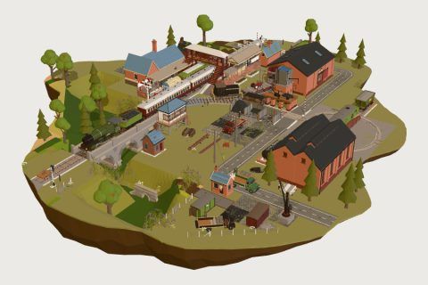

# Countryside Railway

103 free low-poly parts on one palette and one scale, so everything you combine belongs to the same world.

[Open the kit on Polyfork](https://polyfork.dev/kit/countryside-railway-9b4c57) · [All kits](../README.md#kits)

<table>
<tr>
<td align="center" valign="top" width="25%"> <a href="https://polyfork.dev/asset/ballast-heap-2fb138">Ballast Heap</a> <a href="https://polyfork.dev/cdn/ballast-heap-2fb138.glb">GLB</a> · <a href="https://polyfork.dev/cdn/ballast-heap-2fb138.mjs">module</a></td>
<td align="center" valign="top" width="25%"> <a href="https://polyfork.dev/asset/brake-coach-f83456">Brake Coach</a> <a href="https://polyfork.dev/cdn/brake-coach-f83456.glb">GLB</a> · <a href="https://polyfork.dev/cdn/brake-coach-f83456.mjs">module</a></td>
<td align="center" valign="top" width="25%"> <a href="https://polyfork.dev/asset/breakdown-crane-6a67d9">Breakdown Crane</a> <a href="https://polyfork.dev/cdn/breakdown-crane-6a67d9.glb">GLB</a> · <a href="https://polyfork.dev/cdn/breakdown-crane-6a67d9.mjs">module</a></td>
<td align="center" valign="top" width="25%"> <a href="https://polyfork.dev/asset/buffer-stop-4871fc">Buffer Stop</a> <a href="https://polyfork.dev/cdn/buffer-stop-4871fc.glb">GLB</a> · <a href="https://polyfork.dev/cdn/buffer-stop-4871fc.mjs">module</a></td>
</tr>
<tr>
<td align="center" valign="top" width="25%"> <a href="https://polyfork.dev/asset/cattle-dock-6e41e4">Cattle Dock</a> <a href="https://polyfork.dev/cdn/cattle-dock-6e41e4.glb">GLB</a> · <a href="https://polyfork.dev/cdn/cattle-dock-6e41e4.mjs">module</a></td>
<td align="center" valign="top" width="25%"> <a href="https://polyfork.dev/asset/cattle-wagon-0d3070">Cattle Wagon</a> <a href="https://polyfork.dev/cdn/cattle-wagon-0d3070.glb">GLB</a> · <a href="https://polyfork.dev/cdn/cattle-wagon-0d3070.mjs">module</a></td>
<td align="center" valign="top" width="25%"> <a href="https://polyfork.dev/asset/coal-merchant-s-bin-c79aea">Coal Merchant&#039;s Bin</a> <a href="https://polyfork.dev/cdn/coal-merchant-s-bin-c79aea.glb">GLB</a> · <a href="https://polyfork.dev/cdn/coal-merchant-s-bin-c79aea.mjs">module</a></td>
<td align="center" valign="top" width="25%"> <a href="https://polyfork.dev/asset/coal-stage-2789f5">Coal Stage</a> <a href="https://polyfork.dev/cdn/coal-stage-2789f5.glb">GLB</a> · <a href="https://polyfork.dev/cdn/coal-stage-2789f5.mjs">module</a></td>
</tr>
<tr>
<td align="center" valign="top" width="25%"> <a href="https://polyfork.dev/asset/coal-tender-0e3647">Coal Tender</a> <a href="https://polyfork.dev/cdn/coal-tender-0e3647.glb">GLB</a> · <a href="https://polyfork.dev/cdn/coal-tender-0e3647.mjs">module</a></td>
<td align="center" valign="top" width="25%"> <a href="https://polyfork.dev/asset/cobbled-yard-tile-d00544">Cobbled Yard Tile</a> <a href="https://polyfork.dev/cdn/cobbled-yard-tile-d00544.glb">GLB</a> · <a href="https://polyfork.dev/cdn/cobbled-yard-tile-d00544.mjs">module</a></td>
<td align="center" valign="top" width="25%"> <a href="https://polyfork.dev/asset/colour-light-signal-713276">Colour-Light Signal</a> <a href="https://polyfork.dev/cdn/colour-light-signal-713276.glb">GLB</a> · <a href="https://polyfork.dev/cdn/colour-light-signal-713276.mjs">module</a></td>
<td align="center" valign="top" width="25%"> <a href="https://polyfork.dev/asset/country-lane-tile-65e8ee">Country Lane Tile</a> <a href="https://polyfork.dev/cdn/country-lane-tile-65e8ee.glb">GLB</a> · <a href="https://polyfork.dev/cdn/country-lane-tile-65e8ee.mjs">module</a></td>
</tr>
<tr>
<td align="center" valign="top" width="25%"> <a href="https://polyfork.dev/asset/country-station-building-2d8f5e">Country Station Building</a> <a href="https://polyfork.dev/cdn/country-station-building-2d8f5e.glb">GLB</a> · <a href="https://polyfork.dev/cdn/country-station-building-2d8f5e.mjs">module</a></td>
<td align="center" valign="top" width="25%"> <a href="https://polyfork.dev/asset/countryside-railway-terrain-421c5b">Countryside Railway Terrain</a> <a href="https://polyfork.dev/cdn/countryside-railway-terrain-421c5b.glb">GLB</a> · <a href="https://polyfork.dev/cdn/countryside-railway-terrain-421c5b.mjs">module</a></td>
<td align="center" valign="top" width="25%"> <a href="https://polyfork.dev/asset/covered-goods-van-34fce3">Covered Goods Van</a> <a href="https://polyfork.dev/cdn/covered-goods-van-34fce3.glb">GLB</a> · <a href="https://polyfork.dev/cdn/covered-goods-van-34fce3.mjs">module</a></td>
<td align="center" valign="top" width="25%"> <a href="https://polyfork.dev/asset/crossing-gate-50bcee">Crossing Gate</a> <a href="https://polyfork.dev/cdn/crossing-gate-50bcee.glb">GLB</a> · <a href="https://polyfork.dev/cdn/crossing-gate-50bcee.mjs">module</a></td>
</tr>
<tr>
<td align="center" valign="top" width="25%"> <a href="https://polyfork.dev/asset/crossing-keeper-e13207">Crossing Keeper</a> <a href="https://polyfork.dev/cdn/crossing-keeper-e13207.glb">GLB</a> · <a href="https://polyfork.dev/cdn/crossing-keeper-e13207.mjs">module</a></td>
<td align="center" valign="top" width="25%"> <a href="https://polyfork.dev/asset/crossing-keeper-s-cottage-de49a4">Crossing Keeper&#039;s Cottage</a> <a href="https://polyfork.dev/cdn/crossing-keeper-s-cottage-de49a4.glb">GLB</a> · <a href="https://polyfork.dev/cdn/crossing-keeper-s-cottage-de49a4.mjs">module</a></td>
<td align="center" valign="top" width="25%"> <a href="https://polyfork.dev/asset/curved-track-819ec6">Curved Track</a> <a href="https://polyfork.dev/cdn/curved-track-819ec6.glb">GLB</a> · <a href="https://polyfork.dev/cdn/curved-track-819ec6.mjs">module</a></td>
<td align="center" valign="top" width="25%"> <a href="https://polyfork.dev/asset/depot-fuel-tank-55a00e">Depot Fuel Tank</a> <a href="https://polyfork.dev/cdn/depot-fuel-tank-55a00e.glb">GLB</a> · <a href="https://polyfork.dev/cdn/depot-fuel-tank-55a00e.mjs">module</a></td>
</tr>
<tr>
<td align="center" valign="top" width="25%"> <a href="https://polyfork.dev/asset/diamond-crossing-436c20">Diamond Crossing</a> <a href="https://polyfork.dev/cdn/diamond-crossing-436c20.glb">GLB</a> · <a href="https://polyfork.dev/cdn/diamond-crossing-436c20.mjs">module</a></td>
<td align="center" valign="top" width="25%"> <a href="https://polyfork.dev/asset/diesel-shunter-67094b">Diesel Shunter</a> <a href="https://polyfork.dev/cdn/diesel-shunter-67094b.glb">GLB</a> · <a href="https://polyfork.dev/cdn/diesel-shunter-67094b.mjs">module</a></td>
<td align="center" valign="top" width="25%"> <a href="https://polyfork.dev/asset/embankment-culvert-16df7f">Embankment Culvert</a> <a href="https://polyfork.dev/cdn/embankment-culvert-16df7f.glb">GLB</a> · <a href="https://polyfork.dev/cdn/embankment-culvert-16df7f.mjs">module</a></td>
<td align="center" valign="top" width="25%"> <a href="https://polyfork.dev/asset/engine-driver-1ba1e2">Engine Driver</a> <a href="https://polyfork.dev/cdn/engine-driver-1ba1e2.glb">GLB</a> · <a href="https://polyfork.dev/cdn/engine-driver-1ba1e2.mjs">module</a></td>
</tr>
<tr>
<td align="center" valign="top" width="25%"> <a href="https://polyfork.dev/asset/engine-shed-eff627">Engine Shed</a> <a href="https://polyfork.dev/cdn/engine-shed-eff627.glb">GLB</a> · <a href="https://polyfork.dev/cdn/engine-shed-eff627.mjs">module</a></td>
<td align="center" valign="top" width="25%"> <a href="https://polyfork.dev/asset/fireman-96bf23">Fireman</a> <a href="https://polyfork.dev/cdn/fireman-96bf23.glb">GLB</a> · <a href="https://polyfork.dev/cdn/fireman-96bf23.mjs">module</a></td>
<td align="center" valign="top" width="25%"> <a href="https://polyfork.dev/asset/flatbed-wagon-53187a">Flatbed Wagon</a> <a href="https://polyfork.dev/cdn/flatbed-wagon-53187a.glb">GLB</a> · <a href="https://polyfork.dev/cdn/flatbed-wagon-53187a.mjs">module</a></td>
<td align="center" valign="top" width="25%"> <a href="https://polyfork.dev/asset/goods-shed-206be9">Goods Shed</a> <a href="https://polyfork.dev/cdn/goods-shed-206be9.glb">GLB</a> · <a href="https://polyfork.dev/cdn/goods-shed-206be9.mjs">module</a></td>
</tr>
<tr>
<td align="center" valign="top" width="25%"> <a href="https://polyfork.dev/asset/goods-yard-weighbridge-c5c04c">Goods Yard Weighbridge</a> <a href="https://polyfork.dev/cdn/goods-yard-weighbridge-c5c04c.glb">GLB</a> · <a href="https://polyfork.dev/cdn/goods-yard-weighbridge-c5c04c.mjs">module</a></td>
<td align="center" valign="top" width="25%"> <a href="https://polyfork.dev/asset/ground-disc-signal-3d52e9">Ground Disc Signal</a> <a href="https://polyfork.dev/cdn/ground-disc-signal-3d52e9.glb">GLB</a> · <a href="https://polyfork.dev/cdn/ground-disc-signal-3d52e9.mjs">module</a></td>
<td align="center" valign="top" width="25%"> <a href="https://polyfork.dev/asset/guard-bfa819">Guard</a> <a href="https://polyfork.dev/cdn/guard-bfa819.glb">GLB</a> · <a href="https://polyfork.dev/cdn/guard-bfa819.mjs">module</a></td>
<td align="center" valign="top" width="25%"> <a href="https://polyfork.dev/asset/guard-s-van-6231d0">Guard&#039;s Van</a> <a href="https://polyfork.dev/cdn/guard-s-van-6231d0.glb">GLB</a> · <a href="https://polyfork.dev/cdn/guard-s-van-6231d0.mjs">module</a></td>
</tr>
<tr>
<td align="center" valign="top" width="25%"> <a href="https://polyfork.dev/asset/handcar-3e4083">Handcar</a> <a href="https://polyfork.dev/cdn/handcar-3e4083.glb">GLB</a> · <a href="https://polyfork.dev/cdn/handcar-3e4083.mjs">module</a></td>
<td align="center" valign="top" width="25%"> <a href="https://polyfork.dev/asset/hopper-wagon-b4c486">Hopper Wagon</a> <a href="https://polyfork.dev/cdn/hopper-wagon-b4c486.glb">GLB</a> · <a href="https://polyfork.dev/cdn/hopper-wagon-b4c486.mjs">module</a></td>
<td align="center" valign="top" width="25%"> <a href="https://polyfork.dev/asset/incline-track-b10620">Incline Track</a> <a href="https://polyfork.dev/cdn/incline-track-b10620.glb">GLB</a> · <a href="https://polyfork.dev/cdn/incline-track-b10620.mjs">module</a></td>
<td align="center" valign="top" width="25%"> <a href="https://polyfork.dev/asset/level-crossing-37d00b">Level Crossing</a> <a href="https://polyfork.dev/cdn/level-crossing-37d00b.glb">GLB</a> · <a href="https://polyfork.dev/cdn/level-crossing-37d00b.mjs">module</a></td>
</tr>
<tr>
<td align="center" valign="top" width="25%"> <a href="https://polyfork.dev/asset/lineside-buddleia-36cd9a">Lineside Buddleia</a> <a href="https://polyfork.dev/cdn/lineside-buddleia-36cd9a.glb">GLB</a> · <a href="https://polyfork.dev/cdn/lineside-buddleia-36cd9a.mjs">module</a></td>
<td align="center" valign="top" width="25%"> <a href="https://polyfork.dev/asset/lineside-cow-parsley-4a8bfd">Lineside Cow Parsley</a> <a href="https://polyfork.dev/cdn/lineside-cow-parsley-4a8bfd.glb">GLB</a> · <a href="https://polyfork.dev/cdn/lineside-cow-parsley-4a8bfd.mjs">module</a></td>
<td align="center" valign="top" width="25%"> <a href="https://polyfork.dev/asset/lineside-fence-run-3a64f5">Lineside Fence Run</a> <a href="https://polyfork.dev/cdn/lineside-fence-run-3a64f5.glb">GLB</a> · <a href="https://polyfork.dev/cdn/lineside-fence-run-3a64f5.mjs">module</a></td>
<td align="center" valign="top" width="25%"> <a href="https://polyfork.dev/asset/lineside-hut-2b43ff">Lineside Hut</a> <a href="https://polyfork.dev/cdn/lineside-hut-2b43ff.glb">GLB</a> · <a href="https://polyfork.dev/cdn/lineside-hut-2b43ff.mjs">module</a></td>
</tr>
<tr>
<td align="center" valign="top" width="25%"> <a href="https://polyfork.dev/asset/lineside-retaining-wall-run-581cbd">Lineside Retaining Wall Run</a> <a href="https://polyfork.dev/cdn/lineside-retaining-wall-run-581cbd.glb">GLB</a> · <a href="https://polyfork.dev/cdn/lineside-retaining-wall-run-581cbd.mjs">module</a></td>
<td align="center" valign="top" width="25%"> <a href="https://polyfork.dev/asset/lineside-sign-post-7a08b9">Lineside Sign Post</a> <a href="https://polyfork.dev/cdn/lineside-sign-post-7a08b9.glb">GLB</a> · <a href="https://polyfork.dev/cdn/lineside-sign-post-7a08b9.mjs">module</a></td>
<td align="center" valign="top" width="25%"> <a href="https://polyfork.dev/asset/lineside-stile-632da4">Lineside Stile</a> <a href="https://polyfork.dev/cdn/lineside-stile-632da4.glb">GLB</a> · <a href="https://polyfork.dev/cdn/lineside-stile-632da4.mjs">module</a></td>
<td align="center" valign="top" width="25%"> <a href="https://polyfork.dev/asset/lineside-tree-97e02a">Lineside Tree</a> <a href="https://polyfork.dev/cdn/lineside-tree-97e02a.glb">GLB</a> · <a href="https://polyfork.dev/cdn/lineside-tree-97e02a.mjs">module</a></td>
</tr>
<tr>
<td align="center" valign="top" width="25%"> <a href="https://polyfork.dev/asset/loading-gauge-bde2e7">Loading Gauge</a> <a href="https://polyfork.dev/cdn/loading-gauge-bde2e7.glb">GLB</a> · <a href="https://polyfork.dev/cdn/loading-gauge-bde2e7.mjs">module</a></td>
<td align="center" valign="top" width="25%"> <a href="https://polyfork.dev/asset/loco-snowplough-e13d84">Loco Snowplough</a> <a href="https://polyfork.dev/cdn/loco-snowplough-e13d84.glb">GLB</a> · <a href="https://polyfork.dev/cdn/loco-snowplough-e13d84.mjs">module</a></td>
<td align="center" valign="top" width="25%"> <a href="https://polyfork.dev/asset/luggage-trolley-0bb740">Luggage Trolley</a> <a href="https://polyfork.dev/cdn/luggage-trolley-0bb740.glb">GLB</a> · <a href="https://polyfork.dev/cdn/luggage-trolley-0bb740.mjs">module</a></td>
<td align="center" valign="top" width="25%"> <a href="https://polyfork.dev/asset/mainline-diesel-locomotive-33ef97">Mainline Diesel Locomotive</a> <a href="https://polyfork.dev/cdn/mainline-diesel-locomotive-33ef97.glb">GLB</a> · <a href="https://polyfork.dev/cdn/mainline-diesel-locomotive-33ef97.mjs">module</a></td>
</tr>
<tr>
<td align="center" valign="top" width="25%"> <a href="https://polyfork.dev/asset/milk-churn-stand-130fe2">Milk Churn Stand</a> <a href="https://polyfork.dev/cdn/milk-churn-stand-130fe2.glb">GLB</a> · <a href="https://polyfork.dev/cdn/milk-churn-stand-130fe2.mjs">module</a></td>
<td align="center" valign="top" width="25%"> <a href="https://polyfork.dev/asset/open-goods-wagon-998292">Open Goods Wagon</a> <a href="https://polyfork.dev/cdn/open-goods-wagon-998292.glb">GLB</a> · <a href="https://polyfork.dev/cdn/open-goods-wagon-998292.mjs">module</a></td>
<td align="center" valign="top" width="25%"> <a href="https://polyfork.dev/asset/passenger-ac425a">Passenger</a> <a href="https://polyfork.dev/cdn/passenger-ac425a.glb">GLB</a> · <a href="https://polyfork.dev/cdn/passenger-ac425a.mjs">module</a></td>
<td align="center" valign="top" width="25%"> <a href="https://polyfork.dev/asset/passenger-carriage-de9d58">Passenger Carriage</a> <a href="https://polyfork.dev/cdn/passenger-carriage-de9d58.glb">GLB</a> · <a href="https://polyfork.dev/cdn/passenger-carriage-de9d58.mjs">module</a></td>
</tr>
<tr>
<td align="center" valign="top" width="25%"> <a href="https://polyfork.dev/asset/platelayer-47dbe6">Platelayer</a> <a href="https://polyfork.dev/cdn/platelayer-47dbe6.glb">GLB</a> · <a href="https://polyfork.dev/cdn/platelayer-47dbe6.mjs">module</a></td>
<td align="center" valign="top" width="25%"> <a href="https://polyfork.dev/asset/platform-barrow-784665">Platform Barrow</a> <a href="https://polyfork.dev/cdn/platform-barrow-784665.glb">GLB</a> · <a href="https://polyfork.dev/cdn/platform-barrow-784665.mjs">module</a></td>
<td align="center" valign="top" width="25%"> <a href="https://polyfork.dev/asset/platform-bookstall-8598bf">Platform Bookstall</a> <a href="https://polyfork.dev/cdn/platform-bookstall-8598bf.glb">GLB</a> · <a href="https://polyfork.dev/cdn/platform-bookstall-8598bf.mjs">module</a></td>
<td align="center" valign="top" width="25%"> <a href="https://polyfork.dev/asset/platform-canopy-run-bc2275">Platform Canopy Run</a> <a href="https://polyfork.dev/cdn/platform-canopy-run-bc2275.glb">GLB</a> · <a href="https://polyfork.dev/cdn/platform-canopy-run-bc2275.mjs">module</a></td>
</tr>
<tr>
<td align="center" valign="top" width="25%"> <a href="https://polyfork.dev/asset/platform-poster-board-271c7a">Platform Poster Board</a> <a href="https://polyfork.dev/cdn/platform-poster-board-271c7a.glb">GLB</a> · <a href="https://polyfork.dev/cdn/platform-poster-board-271c7a.mjs">module</a></td>
<td align="center" valign="top" width="25%"> <a href="https://polyfork.dev/asset/platform-run-3738d0">Platform Run</a> <a href="https://polyfork.dev/cdn/platform-run-3738d0.glb">GLB</a> · <a href="https://polyfork.dev/cdn/platform-run-3738d0.mjs">module</a></td>
<td align="center" valign="top" width="25%"> <a href="https://polyfork.dev/asset/platform-shelter-9582b6">Platform Shelter</a> <a href="https://polyfork.dev/cdn/platform-shelter-9582b6.glb">GLB</a> · <a href="https://polyfork.dev/cdn/platform-shelter-9582b6.mjs">module</a></td>
<td align="center" valign="top" width="25%"> <a href="https://polyfork.dev/asset/platform-weighing-scale-f43019">Platform Weighing Scale</a> <a href="https://polyfork.dev/cdn/platform-weighing-scale-f43019.glb">GLB</a> · <a href="https://polyfork.dev/cdn/platform-weighing-scale-f43019.mjs">module</a></td>
</tr>
<tr>
<td align="center" valign="top" width="25%"> <a href="https://polyfork.dev/asset/point-lever-5b61ca">Point Lever</a> <a href="https://polyfork.dev/cdn/point-lever-5b61ca.glb">GLB</a> · <a href="https://polyfork.dev/cdn/point-lever-5b61ca.mjs">module</a></td>
<td align="center" valign="top" width="25%"> <a href="https://polyfork.dev/asset/point-rodding-run-92081f">Point Rodding Run</a> <a href="https://polyfork.dev/cdn/point-rodding-run-92081f.glb">GLB</a> · <a href="https://polyfork.dev/cdn/point-rodding-run-92081f.mjs">module</a></td>
<td align="center" valign="top" width="25%"> <a href="https://polyfork.dev/asset/porter-e4e566">Porter</a> <a href="https://polyfork.dev/cdn/porter-e4e566.glb">GLB</a> · <a href="https://polyfork.dev/cdn/porter-e4e566.mjs">module</a></td>
<td align="center" valign="top" width="25%"> <a href="https://polyfork.dev/asset/railbus-e972f3">Railbus</a> <a href="https://polyfork.dev/cdn/railbus-e972f3.glb">GLB</a> · <a href="https://polyfork.dev/cdn/railbus-e972f3.mjs">module</a></td>
</tr>
<tr>
<td align="center" valign="top" width="25%"> <a href="https://polyfork.dev/asset/railway-cartage-lorry-c51950">Railway Cartage Lorry</a> <a href="https://polyfork.dev/cdn/railway-cartage-lorry-c51950.glb">GLB</a> · <a href="https://polyfork.dev/cdn/railway-cartage-lorry-c51950.mjs">module</a></td>
<td align="center" valign="top" width="25%"> <a href="https://polyfork.dev/asset/railway-carter-971897">Railway Carter</a> <a href="https://polyfork.dev/cdn/railway-carter-971897.glb">GLB</a> · <a href="https://polyfork.dev/cdn/railway-carter-971897.mjs">module</a></td>
<td align="center" valign="top" width="25%"> <a href="https://polyfork.dev/asset/railway-container-1cfbbd">Railway Container</a> <a href="https://polyfork.dev/cdn/railway-container-1cfbbd.glb">GLB</a> · <a href="https://polyfork.dev/cdn/railway-container-1cfbbd.mjs">module</a></td>
<td align="center" valign="top" width="25%"> <a href="https://polyfork.dev/asset/railway-telegraph-pole-run-bb9354">Railway Telegraph Pole Run</a> <a href="https://polyfork.dev/cdn/railway-telegraph-pole-run-bb9354.glb">GLB</a> · <a href="https://polyfork.dev/cdn/railway-telegraph-pole-run-bb9354.mjs">module</a></td>
</tr>
<tr>
<td align="center" valign="top" width="25%"> <a href="https://polyfork.dev/asset/road-overbridge-414614">Road Overbridge</a> <a href="https://polyfork.dev/cdn/road-overbridge-414614.glb">GLB</a> · <a href="https://polyfork.dev/cdn/road-overbridge-414614.mjs">module</a></td>
<td align="center" valign="top" width="25%"> <a href="https://polyfork.dev/asset/a-running-in-board-e66b1e">Running-In Board</a> <a href="https://polyfork.dev/cdn/a-running-in-board-e66b1e.glb">GLB</a> · <a href="https://polyfork.dev/cdn/a-running-in-board-e66b1e.mjs">module</a></td>
<td align="center" valign="top" width="25%"> <a href="https://polyfork.dev/asset/sand-drag-siding-790d06">Sand Drag Siding</a> <a href="https://polyfork.dev/cdn/sand-drag-siding-790d06.glb">GLB</a> · <a href="https://polyfork.dev/cdn/sand-drag-siding-790d06.mjs">module</a></td>
<td align="center" valign="top" width="25%"> <a href="https://polyfork.dev/asset/semaphore-signal-cb8968">Semaphore Signal</a> <a href="https://polyfork.dev/cdn/semaphore-signal-cb8968.glb">GLB</a> · <a href="https://polyfork.dev/cdn/semaphore-signal-cb8968.mjs">module</a></td>
</tr>
<tr>
<td align="center" valign="top" width="25%"> <a href="https://polyfork.dev/asset/set-of-points-610126">Set of Points</a> <a href="https://polyfork.dev/cdn/set-of-points-610126.glb">GLB</a> · <a href="https://polyfork.dev/cdn/set-of-points-610126.mjs">module</a></td>
<td align="center" valign="top" width="25%"> <a href="https://polyfork.dev/asset/shunter-f25d24">Shunter</a> <a href="https://polyfork.dev/cdn/shunter-f25d24.glb">GLB</a> · <a href="https://polyfork.dev/cdn/shunter-f25d24.mjs">module</a></td>
<td align="center" valign="top" width="25%"> <a href="https://polyfork.dev/asset/signal-box-f57a2d">Signal Box</a> <a href="https://polyfork.dev/cdn/signal-box-f57a2d.glb">GLB</a> · <a href="https://polyfork.dev/cdn/signal-box-f57a2d.mjs">module</a></td>
<td align="center" valign="top" width="25%"> <a href="https://polyfork.dev/asset/signalman-c561d7">Signalman</a> <a href="https://polyfork.dev/cdn/signalman-c561d7.glb">GLB</a> · <a href="https://polyfork.dev/cdn/signalman-c561d7.mjs">module</a></td>
</tr>
<tr>
<td align="center" valign="top" width="25%"> <a href="https://polyfork.dev/asset/sleeper-stack-67628e">Sleeper Stack</a> <a href="https://polyfork.dev/cdn/sleeper-stack-67628e.glb">GLB</a> · <a href="https://polyfork.dev/cdn/sleeper-stack-67628e.mjs">module</a></td>
<td align="center" valign="top" width="25%"> <a href="https://polyfork.dev/asset/spare-rail-stack-99d443">Spare Rail Stack</a> <a href="https://polyfork.dev/cdn/spare-rail-stack-99d443.glb">GLB</a> · <a href="https://polyfork.dev/cdn/spare-rail-stack-99d443.mjs">module</a></td>
<td align="center" valign="top" width="25%"> <a href="https://polyfork.dev/asset/station-bench-5f56b4">Station Bench</a> <a href="https://polyfork.dev/cdn/station-bench-5f56b4.glb">GLB</a> · <a href="https://polyfork.dev/cdn/station-bench-5f56b4.mjs">module</a></td>
<td align="center" valign="top" width="25%"> <a href="https://polyfork.dev/asset/station-clock-post-eaaf63">Station Clock Post</a> <a href="https://polyfork.dev/cdn/station-clock-post-eaaf63.glb">GLB</a> · <a href="https://polyfork.dev/cdn/station-clock-post-eaaf63.mjs">module</a></td>
</tr>
<tr>
<td align="center" valign="top" width="25%"> <a href="https://polyfork.dev/asset/station-footbridge-dfb6b8">Station Footbridge</a> <a href="https://polyfork.dev/cdn/station-footbridge-dfb6b8.glb">GLB</a> · <a href="https://polyfork.dev/cdn/station-footbridge-dfb6b8.mjs">module</a></td>
<td align="center" valign="top" width="25%"> <a href="https://polyfork.dev/asset/station-garden-bed-d369e3">Station Garden Bed</a> <a href="https://polyfork.dev/cdn/station-garden-bed-d369e3.glb">GLB</a> · <a href="https://polyfork.dev/cdn/station-garden-bed-d369e3.mjs">module</a></td>
<td align="center" valign="top" width="25%"> <a href="https://polyfork.dev/asset/station-lamp-post-7d14dd">Station Lamp Post</a> <a href="https://polyfork.dev/cdn/station-lamp-post-7d14dd.glb">GLB</a> · <a href="https://polyfork.dev/cdn/station-lamp-post-7d14dd.mjs">module</a></td>
<td align="center" valign="top" width="25%"> <a href="https://polyfork.dev/asset/station-master-1d6a0a">Station Master</a> <a href="https://polyfork.dev/cdn/station-master-1d6a0a.glb">GLB</a> · <a href="https://polyfork.dev/cdn/station-master-1d6a0a.mjs">module</a></td>
</tr>
<tr>
<td align="center" valign="top" width="25%"> <a href="https://polyfork.dev/asset/steel-girder-bridge-d80bb4">Steel Girder Bridge</a> <a href="https://polyfork.dev/cdn/steel-girder-bridge-d80bb4.glb">GLB</a> · <a href="https://polyfork.dev/cdn/steel-girder-bridge-d80bb4.mjs">module</a></td>
<td align="center" valign="top" width="25%"> <a href="https://polyfork.dev/asset/stone-viaduct-span-0bd731">Stone Viaduct Span</a> <a href="https://polyfork.dev/cdn/stone-viaduct-span-0bd731.glb">GLB</a> · <a href="https://polyfork.dev/cdn/stone-viaduct-span-0bd731.mjs">module</a></td>
<td align="center" valign="top" width="25%"> <a href="https://polyfork.dev/asset/straight-track-d4cf38">Straight Track</a> <a href="https://polyfork.dev/cdn/straight-track-d4cf38.glb">GLB</a> · <a href="https://polyfork.dev/cdn/straight-track-d4cf38.mjs">module</a></td>
<td align="center" valign="top" width="25%"> <a href="https://polyfork.dev/asset/tank-steam-locomotive-314bb1">Tank Steam Locomotive</a> <a href="https://polyfork.dev/cdn/tank-steam-locomotive-314bb1.glb">GLB</a> · <a href="https://polyfork.dev/cdn/tank-steam-locomotive-314bb1.mjs">module</a></td>
</tr>
<tr>
<td align="center" valign="top" width="25%"> <a href="https://polyfork.dev/asset/tank-wagon-d860fa">Tank Wagon</a> <a href="https://polyfork.dev/cdn/tank-wagon-d860fa.glb">GLB</a> · <a href="https://polyfork.dev/cdn/tank-wagon-d860fa.mjs">module</a></td>
<td align="center" valign="top" width="25%"> <a href="https://polyfork.dev/asset/tender-steam-locomotive-8e2a82">Tender Steam Locomotive</a> <a href="https://polyfork.dev/cdn/tender-steam-locomotive-8e2a82.glb">GLB</a> · <a href="https://polyfork.dev/cdn/tender-steam-locomotive-8e2a82.mjs">module</a></td>
<td align="center" valign="top" width="25%"> <a href="https://polyfork.dev/asset/ticket-office-window-516c59">Ticket Office Window</a> <a href="https://polyfork.dev/cdn/ticket-office-window-516c59.glb">GLB</a> · <a href="https://polyfork.dev/cdn/ticket-office-window-516c59.mjs">module</a></td>
<td align="center" valign="top" width="25%"> <a href="https://polyfork.dev/asset/timber-halt-platform-042fd8">Timber Halt Platform</a> <a href="https://polyfork.dev/cdn/timber-halt-platform-042fd8.glb">GLB</a> · <a href="https://polyfork.dev/cdn/timber-halt-platform-042fd8.mjs">module</a></td>
</tr>
<tr>
<td align="center" valign="top" width="25%"> <a href="https://polyfork.dev/asset/timber-trestle-bridge-c3cd88">Timber Trestle Bridge</a> <a href="https://polyfork.dev/cdn/timber-trestle-bridge-c3cd88.glb">GLB</a> · <a href="https://polyfork.dev/cdn/timber-trestle-bridge-c3cd88.mjs">module</a></td>
<td align="center" valign="top" width="25%"> <a href="https://polyfork.dev/asset/track-maintenance-trolley-50cb76">Track Maintenance Trolley</a> <a href="https://polyfork.dev/cdn/track-maintenance-trolley-50cb76.glb">GLB</a> · <a href="https://polyfork.dev/cdn/track-maintenance-trolley-50cb76.mjs">module</a></td>
<td align="center" valign="top" width="25%"> <a href="https://polyfork.dev/asset/trainspotter-ffd141">Trainspotter</a> <a href="https://polyfork.dev/cdn/trainspotter-ffd141.glb">GLB</a> · <a href="https://polyfork.dev/cdn/trainspotter-ffd141.mjs">module</a></td>
<td align="center" valign="top" width="25%"> <a href="https://polyfork.dev/asset/travelling-trunk-2616ab">Travelling Trunk</a> <a href="https://polyfork.dev/cdn/travelling-trunk-2616ab.glb">GLB</a> · <a href="https://polyfork.dev/cdn/travelling-trunk-2616ab.mjs">module</a></td>
</tr>
<tr>
<td align="center" valign="top" width="25%"> <a href="https://polyfork.dev/asset/tunnel-portal-4ac9f3">Tunnel Portal</a> <a href="https://polyfork.dev/cdn/tunnel-portal-4ac9f3.glb">GLB</a> · <a href="https://polyfork.dev/cdn/tunnel-portal-4ac9f3.mjs">module</a></td>
<td align="center" valign="top" width="25%"> <a href="https://polyfork.dev/asset/turntable-6415d2">Turntable</a> <a href="https://polyfork.dev/cdn/turntable-6415d2.glb">GLB</a> · <a href="https://polyfork.dev/cdn/turntable-6415d2.mjs">module</a></td>
<td align="center" valign="top" width="25%"> <a href="https://polyfork.dev/asset/water-crane-6ab467">Water Crane</a> <a href="https://polyfork.dev/cdn/water-crane-6ab467.glb">GLB</a> · <a href="https://polyfork.dev/cdn/water-crane-6ab467.mjs">module</a></td>
<td align="center" valign="top" width="25%"> <a href="https://polyfork.dev/asset/water-pump-house-121270">Water Pump House</a> <a href="https://polyfork.dev/cdn/water-pump-house-121270.glb">GLB</a> · <a href="https://polyfork.dev/cdn/water-pump-house-121270.mjs">module</a></td>
</tr>
<tr>
<td align="center" valign="top" width="25%"> <a href="https://polyfork.dev/asset/water-tower-dd6200">Water Tower</a> <a href="https://polyfork.dev/cdn/water-tower-dd6200.glb">GLB</a> · <a href="https://polyfork.dev/cdn/water-tower-dd6200.mjs">module</a></td>
<td align="center" valign="top" width="25%"> <a href="https://polyfork.dev/asset/waving-child-dfada0">Waving Child</a> <a href="https://polyfork.dev/cdn/waving-child-dfada0.glb">GLB</a> · <a href="https://polyfork.dev/cdn/waving-child-dfada0.mjs">module</a></td>
<td align="center" valign="top" width="25%"> <a href="https://polyfork.dev/asset/yard-crane-316e4a">Yard Crane</a> <a href="https://polyfork.dev/cdn/yard-crane-316e4a.glb">GLB</a> · <a href="https://polyfork.dev/cdn/yard-crane-316e4a.mjs">module</a></td>
</tr>
</table>
