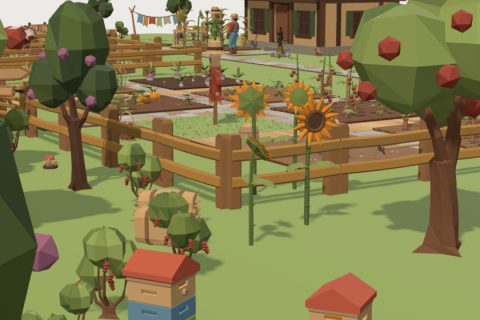

# Cozy Farm

60 free low-poly parts on one palette and one scale, so everything you combine belongs to the same world.

[Open the kit on Polyfork](https://polyfork.dev/kit/cozy-farm-cc979f) · [All kits](../README.md#kits)

<table>
<tr>
<td align="center" valign="top" width="25%"> <a href="https://polyfork.dev/asset/apple-tree-ef0ba0">Apple Tree</a> <a href="https://polyfork.dev/cdn/apple-tree-ef0ba0.glb">GLB</a> · <a href="https://polyfork.dev/cdn/apple-tree-ef0ba0.mjs">module</a></td>
<td align="center" valign="top" width="25%"> <a href="https://polyfork.dev/asset/basket-of-produce-7420cf">Basket of Produce</a> <a href="https://polyfork.dev/cdn/basket-of-produce-7420cf.glb">GLB</a> · <a href="https://polyfork.dev/cdn/basket-of-produce-7420cf.mjs">module</a></td>
<td align="center" valign="top" width="25%"> <a href="https://polyfork.dev/asset/beehive-2e70bf">Beehive</a> <a href="https://polyfork.dev/cdn/beehive-2e70bf.glb">GLB</a> · <a href="https://polyfork.dev/cdn/beehive-2e70bf.mjs">module</a></td>
<td align="center" valign="top" width="25%"> <a href="https://polyfork.dev/asset/berry-bush-ee4812">Berry Bush</a> <a href="https://polyfork.dev/cdn/berry-bush-ee4812.glb">GLB</a> · <a href="https://polyfork.dev/cdn/berry-bush-ee4812.mjs">module</a></td>
</tr>
<tr>
<td align="center" valign="top" width="25%"> <a href="https://polyfork.dev/asset/chicken-e70282">Chicken</a> <a href="https://polyfork.dev/cdn/chicken-e70282.glb">GLB</a> · <a href="https://polyfork.dev/cdn/chicken-e70282.mjs">module</a></td>
<td align="center" valign="top" width="25%"> <a href="https://polyfork.dev/asset/chicken-coop-371f97">Chicken Coop</a> <a href="https://polyfork.dev/cdn/chicken-coop-371f97.glb">GLB</a> · <a href="https://polyfork.dev/cdn/chicken-coop-371f97.mjs">module</a></td>
<td align="center" valign="top" width="25%"> <a href="https://polyfork.dev/asset/clothes-line-ee47e4">Clothes Line</a> <a href="https://polyfork.dev/cdn/clothes-line-ee47e4.glb">GLB</a> · <a href="https://polyfork.dev/cdn/clothes-line-ee47e4.mjs">module</a></td>
<td align="center" valign="top" width="25%"> <a href="https://polyfork.dev/asset/compact-tractor-35b84b">Compact Tractor</a> <a href="https://polyfork.dev/cdn/compact-tractor-35b84b.glb">GLB</a> · <a href="https://polyfork.dev/cdn/compact-tractor-35b84b.mjs">module</a></td>
</tr>
<tr>
<td align="center" valign="top" width="25%"> <a href="https://polyfork.dev/asset/compost-heap-dfec38">Compost Heap</a> <a href="https://polyfork.dev/cdn/compost-heap-dfec38.glb">GLB</a> · <a href="https://polyfork.dev/cdn/compost-heap-dfec38.mjs">module</a></td>
<td align="center" valign="top" width="25%"> <a href="https://polyfork.dev/asset/corn-crop-b71f2f">Corn Crop</a> <a href="https://polyfork.dev/cdn/corn-crop-b71f2f.glb">GLB</a> · <a href="https://polyfork.dev/cdn/corn-crop-b71f2f.mjs">module</a></td>
<td align="center" valign="top" width="25%"> <a href="https://polyfork.dev/asset/cow-c61a66">Cow</a> <a href="https://polyfork.dev/cdn/cow-c61a66.glb">GLB</a> · <a href="https://polyfork.dev/cdn/cow-c61a66.mjs">module</a></td>
<td align="center" valign="top" width="25%"> <a href="https://polyfork.dev/asset/dirt-tile-6f4470">Dirt Tile</a> <a href="https://polyfork.dev/cdn/dirt-tile-6f4470.glb">GLB</a> · <a href="https://polyfork.dev/cdn/dirt-tile-6f4470.mjs">module</a></td>
</tr>
<tr>
<td align="center" valign="top" width="25%"> <a href="https://polyfork.dev/asset/duck-357dc6">Duck</a> <a href="https://polyfork.dev/cdn/duck-357dc6.glb">GLB</a> · <a href="https://polyfork.dev/cdn/duck-357dc6.mjs">module</a></td>
<td align="center" valign="top" width="25%"> <a href="https://polyfork.dev/asset/farm-dog-723730">Farm Dog</a> <a href="https://polyfork.dev/cdn/farm-dog-723730.glb">GLB</a> · <a href="https://polyfork.dev/cdn/farm-dog-723730.mjs">module</a></td>
<td align="center" valign="top" width="25%"> <a href="https://polyfork.dev/asset/farm-gate-8ab320">Farm Gate</a> <a href="https://polyfork.dev/cdn/farm-gate-8ab320.glb">GLB</a> · <a href="https://polyfork.dev/cdn/farm-gate-8ab320.mjs">module</a></td>
<td align="center" valign="top" width="25%"> <a href="https://polyfork.dev/asset/farm-lantern-747dc8">Farm Lantern</a> <a href="https://polyfork.dev/cdn/farm-lantern-747dc8.glb">GLB</a> · <a href="https://polyfork.dev/cdn/farm-lantern-747dc8.mjs">module</a></td>
</tr>
<tr>
<td align="center" valign="top" width="25%"> <a href="https://polyfork.dev/asset/farmer-304a43">Farmer</a> <a href="https://polyfork.dev/cdn/farmer-304a43.glb">GLB</a> · <a href="https://polyfork.dev/cdn/farmer-304a43.mjs">module</a></td>
<td align="center" valign="top" width="25%"> <a href="https://polyfork.dev/asset/feed-sack-c84641">Feed Sack</a> <a href="https://polyfork.dev/cdn/feed-sack-c84641.glb">GLB</a> · <a href="https://polyfork.dev/cdn/feed-sack-c84641.mjs">module</a></td>
<td align="center" valign="top" width="25%"> <a href="https://polyfork.dev/asset/firewood-stack-810f49">Firewood Stack</a> <a href="https://polyfork.dev/cdn/firewood-stack-810f49.glb">GLB</a> · <a href="https://polyfork.dev/cdn/firewood-stack-810f49.mjs">module</a></td>
<td align="center" valign="top" width="25%"> <a href="https://polyfork.dev/asset/flower-bed-708e73">Flower Bed</a> <a href="https://polyfork.dev/cdn/flower-bed-708e73.glb">GLB</a> · <a href="https://polyfork.dev/cdn/flower-bed-708e73.mjs">module</a></td>
</tr>
<tr>
<td align="center" valign="top" width="25%"> <a href="https://polyfork.dev/asset/gabled-farmhouse-c7534f">Gabled Farmhouse</a> <a href="https://polyfork.dev/cdn/gabled-farmhouse-c7534f.glb">GLB</a> · <a href="https://polyfork.dev/cdn/gabled-farmhouse-c7534f.mjs">module</a></td>
<td align="center" valign="top" width="25%"> <a href="https://polyfork.dev/asset/garden-hoe-3974ad">Garden Hoe</a> <a href="https://polyfork.dev/cdn/garden-hoe-3974ad.glb">GLB</a> · <a href="https://polyfork.dev/cdn/garden-hoe-3974ad.mjs">module</a></td>
<td align="center" valign="top" width="25%"> <a href="https://polyfork.dev/asset/garden-rock-7f5d60">Garden Rock</a> <a href="https://polyfork.dev/cdn/garden-rock-7f5d60.glb">GLB</a> · <a href="https://polyfork.dev/cdn/garden-rock-7f5d60.mjs">module</a></td>
<td align="center" valign="top" width="25%"> <a href="https://polyfork.dev/asset/goat-1dedee">Goat</a> <a href="https://polyfork.dev/cdn/goat-1dedee.glb">GLB</a> · <a href="https://polyfork.dev/cdn/goat-1dedee.mjs">module</a></td>
</tr>
<tr>
<td align="center" valign="top" width="25%"> <a href="https://polyfork.dev/asset/grain-silo-58ca67">Grain Silo</a> <a href="https://polyfork.dev/cdn/grain-silo-58ca67.glb">GLB</a> · <a href="https://polyfork.dev/cdn/grain-silo-58ca67.mjs">module</a></td>
<td align="center" valign="top" width="25%"> <a href="https://polyfork.dev/asset/grass-tile-37e1a7">Grass Tile</a> <a href="https://polyfork.dev/cdn/grass-tile-37e1a7.glb">GLB</a> · <a href="https://polyfork.dev/cdn/grass-tile-37e1a7.mjs">module</a></td>
<td align="center" valign="top" width="25%"> <a href="https://polyfork.dev/asset/greenhouse-53ab6d">Greenhouse</a> <a href="https://polyfork.dev/cdn/greenhouse-53ab6d.glb">GLB</a> · <a href="https://polyfork.dev/cdn/greenhouse-53ab6d.mjs">module</a></td>
<td align="center" valign="top" width="25%"> <a href="https://polyfork.dev/asset/hand-water-pump-448037">Hand Water Pump</a> <a href="https://polyfork.dev/cdn/hand-water-pump-448037.glb">GLB</a> · <a href="https://polyfork.dev/cdn/hand-water-pump-448037.mjs">module</a></td>
</tr>
<tr>
<td align="center" valign="top" width="25%"> <a href="https://polyfork.dev/asset/hay-bale-079e8c">Hay Bale</a> <a href="https://polyfork.dev/cdn/hay-bale-079e8c.glb">GLB</a> · <a href="https://polyfork.dev/cdn/hay-bale-079e8c.mjs">module</a></td>
<td align="center" valign="top" width="25%"> <a href="https://polyfork.dev/asset/log-stump-1d65a5">Log Stump</a> <a href="https://polyfork.dev/cdn/log-stump-1d65a5.glb">GLB</a> · <a href="https://polyfork.dev/cdn/log-stump-1d65a5.mjs">module</a></td>
<td align="center" valign="top" width="25%"> <a href="https://polyfork.dev/asset/milk-churn-895735">Milk Churn</a> <a href="https://polyfork.dev/cdn/milk-churn-895735.glb">GLB</a> · <a href="https://polyfork.dev/cdn/milk-churn-895735.mjs">module</a></td>
<td align="center" valign="top" width="25%"> <a href="https://polyfork.dev/asset/mushroom-cluster-f2e3ba">Mushroom Cluster</a> <a href="https://polyfork.dev/cdn/mushroom-cluster-f2e3ba.glb">GLB</a> · <a href="https://polyfork.dev/cdn/mushroom-cluster-f2e3ba.mjs">module</a></td>
</tr>
<tr>
<td align="center" valign="top" width="25%"> <a href="https://polyfork.dev/asset/open-stable-dbf2d5">Open Stable</a> <a href="https://polyfork.dev/cdn/open-stable-dbf2d5.glb">GLB</a> · <a href="https://polyfork.dev/cdn/open-stable-dbf2d5.mjs">module</a></td>
<td align="center" valign="top" width="25%"> <a href="https://polyfork.dev/asset/pig-868bda">Pig</a> <a href="https://polyfork.dev/cdn/pig-868bda.glb">GLB</a> · <a href="https://polyfork.dev/cdn/pig-868bda.mjs">module</a></td>
<td align="center" valign="top" width="25%"> <a href="https://polyfork.dev/asset/plank-walkway-tile-667ff1">Plank Walkway Tile</a> <a href="https://polyfork.dev/cdn/plank-walkway-tile-667ff1.glb">GLB</a> · <a href="https://polyfork.dev/cdn/plank-walkway-tile-667ff1.mjs">module</a></td>
<td align="center" valign="top" width="25%"> <a href="https://polyfork.dev/asset/plum-tree-565179">Plum Tree</a> <a href="https://polyfork.dev/cdn/plum-tree-565179.glb">GLB</a> · <a href="https://polyfork.dev/cdn/plum-tree-565179.mjs">module</a></td>
</tr>
<tr>
<td align="center" valign="top" width="25%"> <a href="https://polyfork.dev/asset/potting-bench-3a85ec">Potting Bench</a> <a href="https://polyfork.dev/cdn/potting-bench-3a85ec.glb">GLB</a> · <a href="https://polyfork.dev/cdn/potting-bench-3a85ec.mjs">module</a></td>
<td align="center" valign="top" width="25%"> <a href="https://polyfork.dev/asset/pumpkin-crop-7de137">Pumpkin Crop</a> <a href="https://polyfork.dev/cdn/pumpkin-crop-7de137.glb">GLB</a> · <a href="https://polyfork.dev/cdn/pumpkin-crop-7de137.mjs">module</a></td>
<td align="center" valign="top" width="25%"> <a href="https://polyfork.dev/asset/red-barn-d41683">Red Barn</a> <a href="https://polyfork.dev/cdn/red-barn-d41683.glb">GLB</a> · <a href="https://polyfork.dev/cdn/red-barn-d41683.mjs">module</a></td>
<td align="center" valign="top" width="25%"> <a href="https://polyfork.dev/asset/roadside-farm-stand-e218ca">Roadside Farm Stand</a> <a href="https://polyfork.dev/cdn/roadside-farm-stand-e218ca.glb">GLB</a> · <a href="https://polyfork.dev/cdn/roadside-farm-stand-e218ca.mjs">module</a></td>
</tr>
<tr>
<td align="center" valign="top" width="25%"> <a href="https://polyfork.dev/asset/scarecrow-334079">Scarecrow</a> <a href="https://polyfork.dev/cdn/scarecrow-334079.glb">GLB</a> · <a href="https://polyfork.dev/cdn/scarecrow-334079.mjs">module</a></td>
<td align="center" valign="top" width="25%"> <a href="https://polyfork.dev/asset/seedling-tray-116925">Seedling Tray</a> <a href="https://polyfork.dev/cdn/seedling-tray-116925.glb">GLB</a> · <a href="https://polyfork.dev/cdn/seedling-tray-116925.mjs">module</a></td>
<td align="center" valign="top" width="25%"> <a href="https://polyfork.dev/asset/sheep-7b0187">Sheep</a> <a href="https://polyfork.dev/cdn/sheep-7b0187.glb">GLB</a> · <a href="https://polyfork.dev/cdn/sheep-7b0187.mjs">module</a></td>
<td align="center" valign="top" width="25%"> <a href="https://polyfork.dev/asset/signpost-0bf523">Signpost</a> <a href="https://polyfork.dev/cdn/signpost-0bf523.glb">GLB</a> · <a href="https://polyfork.dev/cdn/signpost-0bf523.mjs">module</a></td>
</tr>
<tr>
<td align="center" valign="top" width="25%"> <a href="https://polyfork.dev/asset/staked-tomato-crop-588b3d">Staked Tomato Crop</a> <a href="https://polyfork.dev/cdn/staked-tomato-crop-588b3d.glb">GLB</a> · <a href="https://polyfork.dev/cdn/staked-tomato-crop-588b3d.mjs">module</a></td>
<td align="center" valign="top" width="25%"> <a href="https://polyfork.dev/asset/stone-path-tile-f77e6e">Stone Path Tile</a> <a href="https://polyfork.dev/cdn/stone-path-tile-f77e6e.glb">GLB</a> · <a href="https://polyfork.dev/cdn/stone-path-tile-f77e6e.mjs">module</a></td>
<td align="center" valign="top" width="25%"> <a href="https://polyfork.dev/asset/stone-well-b2dfcd">Stone Well</a> <a href="https://polyfork.dev/cdn/stone-well-b2dfcd.glb">GLB</a> · <a href="https://polyfork.dev/cdn/stone-well-b2dfcd.mjs">module</a></td>
<td align="center" valign="top" width="25%"> <a href="https://polyfork.dev/asset/strawberry-crop-6bec33">Strawberry Crop</a> <a href="https://polyfork.dev/cdn/strawberry-crop-6bec33.glb">GLB</a> · <a href="https://polyfork.dev/cdn/strawberry-crop-6bec33.mjs">module</a></td>
</tr>
<tr>
<td align="center" valign="top" width="25%"> <a href="https://polyfork.dev/asset/sunflower-80ce15">Sunflower</a> <a href="https://polyfork.dev/cdn/sunflower-80ce15.glb">GLB</a> · <a href="https://polyfork.dev/cdn/sunflower-80ce15.mjs">module</a></td>
<td align="center" valign="top" width="25%"> <a href="https://polyfork.dev/asset/tilled-soil-tile-d9152e">Tilled Soil Tile</a> <a href="https://polyfork.dev/cdn/tilled-soil-tile-d9152e.glb">GLB</a> · <a href="https://polyfork.dev/cdn/tilled-soil-tile-d9152e.mjs">module</a></td>
<td align="center" valign="top" width="25%"> <a href="https://polyfork.dev/asset/tipping-trailer-061095">Tipping Trailer</a> <a href="https://polyfork.dev/cdn/tipping-trailer-061095.glb">GLB</a> · <a href="https://polyfork.dev/cdn/tipping-trailer-061095.mjs">module</a></td>
<td align="center" valign="top" width="25%"> <a href="https://polyfork.dev/asset/tool-shed-f61f49">Tool Shed</a> <a href="https://polyfork.dev/cdn/tool-shed-f61f49.glb">GLB</a> · <a href="https://polyfork.dev/cdn/tool-shed-f61f49.mjs">module</a></td>
</tr>
<tr>
<td align="center" valign="top" width="25%"> <a href="https://polyfork.dev/asset/turnip-crop-a5b3b7">Turnip Crop</a> <a href="https://polyfork.dev/cdn/turnip-crop-a5b3b7.glb">GLB</a> · <a href="https://polyfork.dev/cdn/turnip-crop-a5b3b7.mjs">module</a></td>
<td align="center" valign="top" width="25%"> <a href="https://polyfork.dev/asset/water-trough-df3ced">Water Trough</a> <a href="https://polyfork.dev/cdn/water-trough-df3ced.glb">GLB</a> · <a href="https://polyfork.dev/cdn/water-trough-df3ced.mjs">module</a></td>
<td align="center" valign="top" width="25%"> <a href="https://polyfork.dev/asset/watering-can-b22758">Watering Can</a> <a href="https://polyfork.dev/cdn/watering-can-b22758.glb">GLB</a> · <a href="https://polyfork.dev/cdn/watering-can-b22758.mjs">module</a></td>
<td align="center" valign="top" width="25%"> <a href="https://polyfork.dev/asset/wheat-crop-7e08e6">Wheat Crop</a> <a href="https://polyfork.dev/cdn/wheat-crop-7e08e6.glb">GLB</a> · <a href="https://polyfork.dev/cdn/wheat-crop-7e08e6.mjs">module</a></td>
</tr>
<tr>
<td align="center" valign="top" width="25%"> <a href="https://polyfork.dev/asset/wheelbarrow-0f8406">Wheelbarrow</a> <a href="https://polyfork.dev/cdn/wheelbarrow-0f8406.glb">GLB</a> · <a href="https://polyfork.dev/cdn/wheelbarrow-0f8406.mjs">module</a></td>
<td align="center" valign="top" width="25%"> <a href="https://polyfork.dev/asset/windpump-tower-1633a9">Windpump Tower</a> <a href="https://polyfork.dev/cdn/windpump-tower-1633a9.glb">GLB</a> · <a href="https://polyfork.dev/cdn/windpump-tower-1633a9.mjs">module</a></td>
<td align="center" valign="top" width="25%"> <a href="https://polyfork.dev/asset/wooden-crate-e46521">Wooden Crate</a> <a href="https://polyfork.dev/cdn/wooden-crate-e46521.glb">GLB</a> · <a href="https://polyfork.dev/cdn/wooden-crate-e46521.mjs">module</a></td>
<td align="center" valign="top" width="25%"> <a href="https://polyfork.dev/asset/wooden-fence-section-d72055">Wooden Fence Section</a> <a href="https://polyfork.dev/cdn/wooden-fence-section-d72055.glb">GLB</a> · <a href="https://polyfork.dev/cdn/wooden-fence-section-d72055.mjs">module</a></td>
</tr>
</table>
