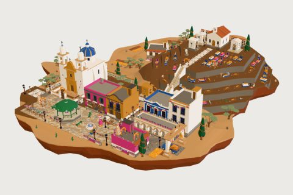

# Día de Muertos kit

62 free low-poly parts on one palette and one scale, so everything you combine belongs to the same world.

[Open the kit on Polyfork](https://polyfork.dev/kit/dia-de-muertos-f2f8f8) · [All kits](../README.md#kits)

<table>
<tr>
<td align="center" valign="top" width="25%"> <a href="https://polyfork.dev/asset/agave-faf53a">Agave</a> <a href="https://polyfork.dev/cdn/agave-faf53a.glb">GLB</a> · <a href="https://polyfork.dev/cdn/agave-faf53a.mjs">module</a></td>
<td align="center" valign="top" width="25%"> <a href="https://polyfork.dev/asset/alebrije-ea2ca0">Alebrije</a> <a href="https://polyfork.dev/cdn/alebrije-ea2ca0.glb">GLB</a> · <a href="https://polyfork.dev/cdn/alebrije-ea2ca0.mjs">module</a></td>
<td align="center" valign="top" width="25%"> <a href="https://polyfork.dev/asset/altar-figurine-908964">Altar Figurine</a> <a href="https://polyfork.dev/cdn/altar-figurine-908964.glb">GLB</a> · <a href="https://polyfork.dev/cdn/altar-figurine-908964.mjs">module</a></td>
<td align="center" valign="top" width="25%"> <a href="https://polyfork.dev/asset/bougainvillea-wall-b67305">Bougainvillea Wall</a> <a href="https://polyfork.dev/cdn/bougainvillea-wall-b67305.glb">GLB</a> · <a href="https://polyfork.dev/cdn/bougainvillea-wall-b67305.mjs">module</a></td>
</tr>
<tr>
<td align="center" valign="top" width="25%"> <a href="https://polyfork.dev/asset/brass-candelabra-89ab76">Brass Candelabra</a> <a href="https://polyfork.dev/cdn/brass-candelabra-89ab76.glb">GLB</a> · <a href="https://polyfork.dev/cdn/brass-candelabra-89ab76.mjs">module</a></td>
<td align="center" valign="top" width="25%"> <a href="https://polyfork.dev/asset/burro-with-marigold-panniers-1f04ab">Burro With Marigold Panniers</a> <a href="https://polyfork.dev/cdn/burro-with-marigold-panniers-1f04ab.glb">GLB</a> · <a href="https://polyfork.dev/cdn/burro-with-marigold-panniers-1f04ab.mjs">module</a></td>
<td align="center" valign="top" width="25%"> <a href="https://polyfork.dev/asset/cantina-table-ef03e3">Cantina Table</a> <a href="https://polyfork.dev/cdn/cantina-table-ef03e3.glb">GLB</a> · <a href="https://polyfork.dev/cdn/cantina-table-ef03e3.mjs">module</a></td>
<td align="center" valign="top" width="25%"> <a href="https://polyfork.dev/asset/cast-iron-plaza-bench-b4096d">Cast-Iron Plaza Bench</a> <a href="https://polyfork.dev/cdn/cast-iron-plaza-bench-b4096d.glb">GLB</a> · <a href="https://polyfork.dev/cdn/cast-iron-plaza-bench-b4096d.mjs">module</a></td>
</tr>
<tr>
<td align="center" valign="top" width="25%"> <a href="https://polyfork.dev/asset/cemetery-gate-6a18fc">Cemetery Gate</a> <a href="https://polyfork.dev/cdn/cemetery-gate-6a18fc.glb">GLB</a> · <a href="https://polyfork.dev/cdn/cemetery-gate-6a18fc.mjs">module</a></td>
<td align="center" valign="top" width="25%"> <a href="https://polyfork.dev/asset/cemetery-gravel-path-tile-d41d0d">Cemetery Gravel Path Tile</a> <a href="https://polyfork.dev/cdn/cemetery-gravel-path-tile-d41d0d.glb">GLB</a> · <a href="https://polyfork.dev/cdn/cemetery-gravel-path-tile-d41d0d.mjs">module</a></td>
<td align="center" valign="top" width="25%"> <a href="https://polyfork.dev/asset/cemetery-wall-run-9c8a94">Cemetery Wall Run</a> <a href="https://polyfork.dev/cdn/cemetery-wall-run-9c8a94.glb">GLB</a> · <a href="https://polyfork.dev/cdn/cemetery-wall-run-9c8a94.mjs">module</a></td>
<td align="center" valign="top" width="25%"> <a href="https://polyfork.dev/asset/cempas-chil-arch-18b848">Cempasúchil Arch</a> <a href="https://polyfork.dev/cdn/cempas-chil-arch-18b848.glb">GLB</a> · <a href="https://polyfork.dev/cdn/cempas-chil-arch-18b848.mjs">module</a></td>
</tr>
<tr>
<td align="center" valign="top" width="25%"> <a href="https://polyfork.dev/asset/cempas-chil-field-plot-4e36ba">Cempasúchil Field Plot Tile</a> <a href="https://polyfork.dev/cdn/cempas-chil-field-plot-4e36ba.glb">GLB</a> · <a href="https://polyfork.dev/cdn/cempas-chil-field-plot-4e36ba.mjs">module</a></td>
<td align="center" valign="top" width="25%"> <a href="https://polyfork.dev/asset/cempas-chil-pot-04c481">Cempasúchil Pot</a> <a href="https://polyfork.dev/cdn/cempas-chil-pot-04c481.glb">GLB</a> · <a href="https://polyfork.dev/cdn/cempas-chil-pot-04c481.mjs">module</a></td>
<td align="center" valign="top" width="25%"> <a href="https://polyfork.dev/asset/child-with-a-painted-b8a19f">Child With A Painted Face</a> <a href="https://polyfork.dev/cdn/child-with-a-painted-b8a19f.glb">GLB</a> · <a href="https://polyfork.dev/cdn/child-with-a-painted-b8a19f.mjs">module</a></td>
<td align="center" valign="top" width="25%"> <a href="https://polyfork.dev/asset/child-s-grave-d45e1a">Child&#039;s Grave</a> <a href="https://polyfork.dev/cdn/child-s-grave-d45e1a.glb">GLB</a> · <a href="https://polyfork.dev/cdn/child-s-grave-d45e1a.mjs">module</a></td>
</tr>
<tr>
<td align="center" valign="top" width="25%"> <a href="https://polyfork.dev/asset/cirio-stand-828e85">Cirio Stand</a> <a href="https://polyfork.dev/cdn/cirio-stand-828e85.glb">GLB</a> · <a href="https://polyfork.dev/cdn/cirio-stand-828e85.mjs">module</a></td>
<td align="center" valign="top" width="25%"> <a href="https://polyfork.dev/asset/cobbled-street-tile-054385">Cobbled Street Tile</a> <a href="https://polyfork.dev/cdn/cobbled-street-tile-054385.glb">GLB</a> · <a href="https://polyfork.dev/cdn/cobbled-street-tile-054385.mjs">module</a></td>
<td align="center" valign="top" width="25%"> <a href="https://polyfork.dev/asset/colonial-house-d6f8fd">Colonial House</a> <a href="https://polyfork.dev/cdn/colonial-house-d6f8fd.glb">GLB</a> · <a href="https://polyfork.dev/cdn/colonial-house-d6f8fd.mjs">module</a></td>
<td align="center" valign="top" width="25%"> <a href="https://polyfork.dev/asset/colonial-lamp-post-eb85f8">Colonial Lamp Post</a> <a href="https://polyfork.dev/cdn/colonial-lamp-post-eb85f8.glb">GLB</a> · <a href="https://polyfork.dev/cdn/colonial-lamp-post-eb85f8.mjs">module</a></td>
</tr>
<tr>
<td align="center" valign="top" width="25%"> <a href="https://polyfork.dev/asset/copal-burner-0b0774">Copal Burner</a> <a href="https://polyfork.dev/cdn/copal-burner-0b0774.glb">GLB</a> · <a href="https://polyfork.dev/cdn/copal-burner-0b0774.mjs">module</a></td>
<td align="center" valign="top" width="25%"> <a href="https://polyfork.dev/asset/d-a-de-muertos-a1cedd">Día de Muertos Terrain</a> <a href="https://polyfork.dev/cdn/d-a-de-muertos-a1cedd.glb">GLB</a> · <a href="https://polyfork.dev/cdn/d-a-de-muertos-a1cedd.mjs">module</a></td>
<td align="center" valign="top" width="25%"> <a href="https://polyfork.dev/asset/el-catr-n-be48ea">El Catrín</a> <a href="https://polyfork.dev/cdn/el-catr-n-be48ea.glb">GLB</a> · <a href="https://polyfork.dev/cdn/el-catr-n-be48ea.mjs">module</a></td>
<td align="center" valign="top" width="25%"> <a href="https://polyfork.dev/asset/elote-cart-a8fb49">Elote Cart</a> <a href="https://polyfork.dev/cdn/elote-cart-a8fb49.glb">GLB</a> · <a href="https://polyfork.dev/cdn/elote-cart-a8fb49.mjs">module</a></td>
</tr>
<tr>
<td align="center" valign="top" width="25%"> <a href="https://polyfork.dev/asset/family-mausoleum-4cc14c">Family Mausoleum</a> <a href="https://polyfork.dev/cdn/family-mausoleum-4cc14c.glb">GLB</a> · <a href="https://polyfork.dev/cdn/family-mausoleum-4cc14c.mjs">module</a></td>
<td align="center" valign="top" width="25%"> <a href="https://polyfork.dev/asset/flower-bicycle-284d0e">Flower Bicycle</a> <a href="https://polyfork.dev/cdn/flower-bicycle-284d0e.glb">GLB</a> · <a href="https://polyfork.dev/cdn/flower-bicycle-284d0e.mjs">module</a></td>
<td align="center" valign="top" width="25%"> <a href="https://polyfork.dev/asset/flower-seller-s-hand-d617f9">Flower Seller&#039;s Hand Cart</a> <a href="https://polyfork.dev/cdn/flower-seller-s-hand-d617f9.glb">GLB</a> · <a href="https://polyfork.dev/cdn/flower-seller-s-hand-d617f9.mjs">module</a></td>
<td align="center" valign="top" width="25%"> <a href="https://polyfork.dev/asset/flower-vendor-bc708b">Flower Vendor</a> <a href="https://polyfork.dev/cdn/flower-vendor-bc708b.glb">GLB</a> · <a href="https://polyfork.dev/cdn/flower-vendor-bc708b.mjs">module</a></td>
</tr>
<tr>
<td align="center" valign="top" width="25%"> <a href="https://polyfork.dev/asset/grandmother-in-a-rebozo-4d5190">Grandmother In A Rebozo</a> <a href="https://polyfork.dev/cdn/grandmother-in-a-rebozo-4d5190.glb">GLB</a> · <a href="https://polyfork.dev/cdn/grandmother-in-a-rebozo-4d5190.mjs">module</a></td>
<td align="center" valign="top" width="25%"> <a href="https://polyfork.dev/asset/grave-cross-95b3e9">Grave Cross</a> <a href="https://polyfork.dev/cdn/grave-cross-95b3e9.glb">GLB</a> · <a href="https://polyfork.dev/cdn/grave-cross-95b3e9.mjs">module</a></td>
<td align="center" valign="top" width="25%"> <a href="https://polyfork.dev/asset/grave-plot-36b895">Grave Plot</a> <a href="https://polyfork.dev/cdn/grave-plot-36b895.glb">GLB</a> · <a href="https://polyfork.dev/cdn/grave-plot-36b895.mjs">module</a></td>
<td align="center" valign="top" width="25%"> <a href="https://polyfork.dev/asset/iron-cemetery-fence-run-cb78a9">Iron Cemetery Fence Run</a> <a href="https://polyfork.dev/cdn/iron-cemetery-fence-run-cb78a9.glb">GLB</a> · <a href="https://polyfork.dev/cdn/iron-cemetery-fence-run-cb78a9.mjs">module</a></td>
</tr>
<tr>
<td align="center" valign="top" width="25%"> <a href="https://polyfork.dev/asset/la-catrina-b427ca">La Catrina</a> <a href="https://polyfork.dev/cdn/la-catrina-b427ca.glb">GLB</a> · <a href="https://polyfork.dev/cdn/la-catrina-b427ca.mjs">module</a></td>
<td align="center" valign="top" width="25%"> <a href="https://polyfork.dev/asset/marigold-pickup-f4b6f9">Marigold Pickup</a> <a href="https://polyfork.dev/cdn/marigold-pickup-f4b6f9.glb">GLB</a> · <a href="https://polyfork.dev/cdn/marigold-pickup-f4b6f9.mjs">module</a></td>
<td align="center" valign="top" width="25%"> <a href="https://polyfork.dev/asset/mercado-stall-6e6ba3">Mercado Stall</a> <a href="https://polyfork.dev/cdn/mercado-stall-6e6ba3.glb">GLB</a> · <a href="https://polyfork.dev/cdn/mercado-stall-6e6ba3.mjs">module</a></td>
<td align="center" valign="top" width="25%"> <a href="https://polyfork.dev/asset/mesquite-tree-bc5141">Mesquite Tree</a> <a href="https://polyfork.dev/cdn/mesquite-tree-bc5141.glb">GLB</a> · <a href="https://polyfork.dev/cdn/mesquite-tree-bc5141.mjs">module</a></td>
</tr>
<tr>
<td align="center" valign="top" width="25%"> <a href="https://polyfork.dev/asset/mojiganga-b12391">Mojiganga</a> <a href="https://polyfork.dev/cdn/mojiganga-b12391.glb">GLB</a> · <a href="https://polyfork.dev/cdn/mojiganga-b12391.mjs">module</a></td>
<td align="center" valign="top" width="25%"> <a href="https://polyfork.dev/asset/nicho-wall-run-4a2672">Nicho Wall Run</a> <a href="https://polyfork.dev/cdn/nicho-wall-run-4a2672.glb">GLB</a> · <a href="https://polyfork.dev/cdn/nicho-wall-run-4a2672.mjs">module</a></td>
<td align="center" valign="top" width="25%"> <a href="https://polyfork.dev/asset/nopal-797b9a">Nopal</a> <a href="https://polyfork.dev/cdn/nopal-797b9a.glb">GLB</a> · <a href="https://polyfork.dev/cdn/nopal-797b9a.mjs">module</a></td>
<td align="center" valign="top" width="25%"> <a href="https://polyfork.dev/asset/ofrenda-offerings-tray-5f3635">Ofrenda Offerings Tray</a> <a href="https://polyfork.dev/cdn/ofrenda-offerings-tray-5f3635.glb">GLB</a> · <a href="https://polyfork.dev/cdn/ofrenda-offerings-tray-5f3635.mjs">module</a></td>
</tr>
<tr>
<td align="center" valign="top" width="25%"> <a href="https://polyfork.dev/asset/ofrenda-portrait-frame-5f8d99">Ofrenda Portrait Frame</a> <a href="https://polyfork.dev/cdn/ofrenda-portrait-frame-5f8d99.glb">GLB</a> · <a href="https://polyfork.dev/cdn/ofrenda-portrait-frame-5f8d99.mjs">module</a></td>
<td align="center" valign="top" width="25%"> <a href="https://polyfork.dev/asset/pan-de-muerto-plate-324b99">Pan de Muerto Plate</a> <a href="https://polyfork.dev/cdn/pan-de-muerto-plate-324b99.glb">GLB</a> · <a href="https://polyfork.dev/cdn/pan-de-muerto-plate-324b99.mjs">module</a></td>
<td align="center" valign="top" width="25%"> <a href="https://polyfork.dev/asset/pante-n-chapel-62dccd">Panteón Chapel</a> <a href="https://polyfork.dev/cdn/pante-n-chapel-62dccd.glb">GLB</a> · <a href="https://polyfork.dev/cdn/pante-n-chapel-62dccd.mjs">module</a></td>
<td align="center" valign="top" width="25%"> <a href="https://polyfork.dev/asset/pante-n-cypress-a667ad">Panteón Cypress</a> <a href="https://polyfork.dev/cdn/pante-n-cypress-a667ad.glb">GLB</a> · <a href="https://polyfork.dev/cdn/pante-n-cypress-a667ad.mjs">module</a></td>
</tr>
<tr>
<td align="center" valign="top" width="25%"> <a href="https://polyfork.dev/asset/pante-n-stair-935b52">Panteón Stair</a> <a href="https://polyfork.dev/cdn/pante-n-stair-935b52.glb">GLB</a> · <a href="https://polyfork.dev/cdn/pante-n-stair-935b52.mjs">module</a></td>
<td align="center" valign="top" width="25%"> <a href="https://polyfork.dev/asset/papel-picado-string-9420a5">Papel Picado String</a> <a href="https://polyfork.dev/cdn/papel-picado-string-9420a5.glb">GLB</a> · <a href="https://polyfork.dev/cdn/papel-picado-string-9420a5.mjs">module</a></td>
<td align="center" valign="top" width="25%"> <a href="https://polyfork.dev/asset/parish-church-543cf8">Parish Church</a> <a href="https://polyfork.dev/cdn/parish-church-543cf8.glb">GLB</a> · <a href="https://polyfork.dev/cdn/parish-church-543cf8.mjs">module</a></td>
<td align="center" valign="top" width="25%"> <a href="https://polyfork.dev/asset/plaza-flagstone-tile-60599f">Plaza Flagstone Tile</a> <a href="https://polyfork.dev/cdn/plaza-flagstone-tile-60599f.glb">GLB</a> · <a href="https://polyfork.dev/cdn/plaza-flagstone-tile-60599f.mjs">module</a></td>
</tr>
<tr>
<td align="center" valign="top" width="25%"> <a href="https://polyfork.dev/asset/plaza-fountain-5a5f6e">Plaza Fountain</a> <a href="https://polyfork.dev/cdn/plaza-fountain-5a5f6e.glb">GLB</a> · <a href="https://polyfork.dev/cdn/plaza-fountain-5a5f6e.mjs">module</a></td>
<td align="center" valign="top" width="25%"> <a href="https://polyfork.dev/asset/plaza-kiosco-4a6c6e">Plaza Kiosco</a> <a href="https://polyfork.dev/cdn/plaza-kiosco-4a6c6e.glb">GLB</a> · <a href="https://polyfork.dev/cdn/plaza-kiosco-4a6c6e.mjs">module</a></td>
<td align="center" valign="top" width="25%"> <a href="https://polyfork.dev/asset/portal-arcade-run-a522b4">Portal Arcade Run</a> <a href="https://polyfork.dev/cdn/portal-arcade-run-a522b4.glb">GLB</a> · <a href="https://polyfork.dev/cdn/portal-arcade-run-a522b4.mjs">module</a></td>
<td align="center" valign="top" width="25%"> <a href="https://polyfork.dev/asset/procession-float-45cf1e">Procession Float</a> <a href="https://polyfork.dev/cdn/procession-float-45cf1e.glb">GLB</a> · <a href="https://polyfork.dev/cdn/procession-float-45cf1e.mjs">module</a></td>
</tr>
<tr>
<td align="center" valign="top" width="25%"> <a href="https://polyfork.dev/asset/roadside-capilla-shrine-c63056">Roadside Capilla Shrine</a> <a href="https://polyfork.dev/cdn/roadside-capilla-shrine-c63056.glb">GLB</a> · <a href="https://polyfork.dev/cdn/roadside-capilla-shrine-c63056.mjs">module</a></td>
<td align="center" valign="top" width="25%"> <a href="https://polyfork.dev/asset/sawdust-carpet-tile-182fbe">Sawdust Carpet Tile</a> <a href="https://polyfork.dev/cdn/sawdust-carpet-tile-182fbe.glb">GLB</a> · <a href="https://polyfork.dev/cdn/sawdust-carpet-tile-182fbe.mjs">module</a></td>
<td align="center" valign="top" width="25%"> <a href="https://polyfork.dev/asset/shopfront-house-43d94d">Shopfront House</a> <a href="https://polyfork.dev/cdn/shopfront-house-43d94d.glb">GLB</a> · <a href="https://polyfork.dev/cdn/shopfront-house-43d94d.mjs">module</a></td>
<td align="center" valign="top" width="25%"> <a href="https://polyfork.dev/asset/skeleton-mariachi-c1b4d5">Skeleton Mariachi</a> <a href="https://polyfork.dev/cdn/skeleton-mariachi-c1b4d5.glb">GLB</a> · <a href="https://polyfork.dev/cdn/skeleton-mariachi-c1b4d5.mjs">module</a></td>
</tr>
<tr>
<td align="center" valign="top" width="25%"> <a href="https://polyfork.dev/asset/stone-grave-angel-6eb6b3">Stone Grave Angel</a> <a href="https://polyfork.dev/cdn/stone-grave-angel-6eb6b3.glb">GLB</a> · <a href="https://polyfork.dev/cdn/stone-grave-angel-6eb6b3.mjs">module</a></td>
<td align="center" valign="top" width="25%"> <a href="https://polyfork.dev/asset/sugar-skull-b5a8b0">Sugar Skull</a> <a href="https://polyfork.dev/cdn/sugar-skull-b5a8b0.glb">GLB</a> · <a href="https://polyfork.dev/cdn/sugar-skull-b5a8b0.mjs">module</a></td>
<td align="center" valign="top" width="25%"> <a href="https://polyfork.dev/asset/tiered-ofrenda-altar-aafd36">Tiered Ofrenda Altar</a> <a href="https://polyfork.dev/cdn/tiered-ofrenda-altar-aafd36.glb">GLB</a> · <a href="https://polyfork.dev/cdn/tiered-ofrenda-altar-aafd36.mjs">module</a></td>
<td align="center" valign="top" width="25%"> <a href="https://polyfork.dev/asset/town-welcome-arch-d2af7d">Town Welcome Arch</a> <a href="https://polyfork.dev/cdn/town-welcome-arch-d2af7d.glb">GLB</a> · <a href="https://polyfork.dev/cdn/town-welcome-arch-d2af7d.mjs">module</a></td>
</tr>
<tr>
<td align="center" valign="top" width="25%"> <a href="https://polyfork.dev/asset/veladoras-cdab5b">Veladoras</a> <a href="https://polyfork.dev/cdn/veladoras-cdab5b.glb">GLB</a> · <a href="https://polyfork.dev/cdn/veladoras-cdab5b.mjs">module</a></td>
<td align="center" valign="top" width="25%"> <a href="https://polyfork.dev/asset/xoloitzcuintli-1cd7c8">Xoloitzcuintli</a> <a href="https://polyfork.dev/cdn/xoloitzcuintli-1cd7c8.glb">GLB</a> · <a href="https://polyfork.dev/cdn/xoloitzcuintli-1cd7c8.mjs">module</a></td>
</tr>
</table>
