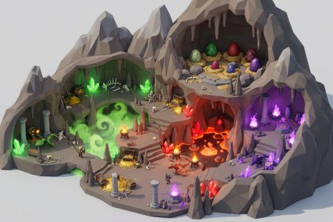

# Dragons Lair

In production, 59 parts so far. Every part below is already free to use.

[Open the kit on Polyfork](https://polyfork.dev/kit/dragons-lair-dark-dragon-782570) · [All kits](../README.md#kits)

<table>
<tr>
<td align="center" valign="top" width="25%"> <a href="https://polyfork.dev/asset/ancient-dragon-skull-7be378">Ancient Dragon Skull</a> <a href="https://polyfork.dev/cdn/ancient-dragon-skull-7be378.glb">GLB</a> · <a href="https://polyfork.dev/cdn/ancient-dragon-skull-7be378.mjs">module</a></td>
<td align="center" valign="top" width="25%"> <a href="https://polyfork.dev/asset/bone-warning-totem-56cf4a">Bone Warning Totem</a> <a href="https://polyfork.dev/cdn/bone-warning-totem-56cf4a.glb">GLB</a> · <a href="https://polyfork.dev/cdn/bone-warning-totem-56cf4a.mjs">module</a></td>
<td align="center" valign="top" width="25%"> <a href="https://polyfork.dev/asset/breath-scorch-mark-73fc72">Breath Scorch Mark</a> <a href="https://polyfork.dev/cdn/breath-scorch-mark-73fc72.glb">GLB</a> · <a href="https://polyfork.dev/cdn/breath-scorch-mark-73fc72.mjs">module</a></td>
<td align="center" valign="top" width="25%"> <a href="https://polyfork.dev/asset/broken-dragon-shackle-624412">Broken Dragon Shackle</a> <a href="https://polyfork.dev/cdn/broken-dragon-shackle-624412.glb">GLB</a> · <a href="https://polyfork.dev/cdn/broken-dragon-shackle-624412.mjs">module</a></td>
</tr>
<tr>
<td align="center" valign="top" width="25%"> <a href="https://polyfork.dev/asset/broken-stone-column-c91287">Broken Stone Column</a> <a href="https://polyfork.dev/cdn/broken-stone-column-c91287.glb">GLB</a> · <a href="https://polyfork.dev/cdn/broken-stone-column-c91287.mjs">module</a></td>
<td align="center" valign="top" width="25%"> <a href="https://polyfork.dev/asset/brood-nest-1d3e6b">Brood Nest</a> <a href="https://polyfork.dev/cdn/brood-nest-1d3e6b.glb">GLB</a> · <a href="https://polyfork.dev/cdn/brood-nest-1d3e6b.mjs">module</a></td>
<td align="center" valign="top" width="25%"> <a href="https://polyfork.dev/asset/brooding-hearthstone-7546be">Brooding Hearthstone</a> <a href="https://polyfork.dev/cdn/brooding-hearthstone-7546be.glb">GLB</a> · <a href="https://polyfork.dev/cdn/brooding-hearthstone-7546be.mjs">module</a></td>
<td align="center" valign="top" width="25%"> <a href="https://polyfork.dev/asset/carved-roost-dais-546bd9">Carved Roost Dais</a> <a href="https://polyfork.dev/cdn/carved-roost-dais-546bd9.glb">GLB</a> · <a href="https://polyfork.dev/cdn/carved-roost-dais-546bd9.mjs">module</a></td>
</tr>
<tr>
<td align="center" valign="top" width="25%"> <a href="https://polyfork.dev/asset/ruined-lair-wall-176561">Cave Rock Wall</a> <a href="https://polyfork.dev/cdn/ruined-lair-wall-176561.glb">GLB</a> · <a href="https://polyfork.dev/cdn/ruined-lair-wall-176561.mjs">module</a></td>
<td align="center" valign="top" width="25%"> <a href="https://polyfork.dev/asset/charred-meat-haunch-be1ea2">Charred Meat Haunch</a> <a href="https://polyfork.dev/cdn/charred-meat-haunch-be1ea2.glb">GLB</a> · <a href="https://polyfork.dev/cdn/charred-meat-haunch-be1ea2.mjs">module</a></td>
<td align="center" valign="top" width="25%"> <a href="https://polyfork.dev/asset/claw-gouge-mark-e33adc">Claw Gouge Mark</a> <a href="https://polyfork.dev/cdn/claw-gouge-mark-e33adc.glb">GLB</a> · <a href="https://polyfork.dev/cdn/claw-gouge-mark-e33adc.mjs">module</a></td>
<td align="center" valign="top" width="25%"> <a href="https://polyfork.dev/asset/claw-scored-boulder-c756f3">Claw-Scored Boulder</a> <a href="https://polyfork.dev/cdn/claw-scored-boulder-c756f3.glb">GLB</a> · <a href="https://polyfork.dev/cdn/claw-scored-boulder-c756f3.mjs">module</a></td>
</tr>
<tr>
<td align="center" valign="top" width="25%"> <a href="https://polyfork.dev/asset/cliff-perch-ledge-afb065">Cliff Perch Ledge</a> <a href="https://polyfork.dev/cdn/cliff-perch-ledge-afb065.glb">GLB</a> · <a href="https://polyfork.dev/cdn/cliff-perch-ledge-afb065.mjs">module</a></td>
<td align="center" valign="top" width="25%"> <a href="https://polyfork.dev/asset/coiled-dragon-pillar-7d526a">Coiled Dragon Pillar</a> <a href="https://polyfork.dev/cdn/coiled-dragon-pillar-7d526a.glb">GLB</a> · <a href="https://polyfork.dev/cdn/coiled-dragon-pillar-7d526a.mjs">module</a></td>
<td align="center" valign="top" width="25%"> <a href="https://polyfork.dev/asset/crystal-dragon-683de4">Crystal Dragon</a> <a href="https://polyfork.dev/cdn/crystal-dragon-683de4.glb">GLB</a> · <a href="https://polyfork.dev/cdn/crystal-dragon-683de4.mjs">module</a></td>
<td align="center" valign="top" width="25%"> <a href="https://polyfork.dev/asset/crystal-dragonling-c14eb9">Crystal Dragonling</a> <a href="https://polyfork.dev/cdn/crystal-dragonling-c14eb9.glb">GLB</a> · <a href="https://polyfork.dev/cdn/crystal-dragonling-c14eb9.mjs">module</a></td>
</tr>
<tr>
<td align="center" valign="top" width="25%"> <a href="https://polyfork.dev/asset/crystal-shard-9e0a83">Crystal Shard</a> <a href="https://polyfork.dev/cdn/crystal-shard-9e0a83.glb">GLB</a> · <a href="https://polyfork.dev/cdn/crystal-shard-9e0a83.mjs">module</a></td>
<td align="center" valign="top" width="25%"> <a href="https://polyfork.dev/asset/crystal-veined-slab-375a56">Crystal-Veined Slab</a> <a href="https://polyfork.dev/cdn/crystal-veined-slab-375a56.glb">GLB</a> · <a href="https://polyfork.dev/cdn/crystal-veined-slab-375a56.mjs">module</a></td>
<td align="center" valign="top" width="25%"> <a href="https://polyfork.dev/asset/dragon-rider-apprentice-dee2cd">Dragon Rider Apprentice</a> <a href="https://polyfork.dev/cdn/dragon-rider-apprentice-dee2cd.glb">GLB</a> · <a href="https://polyfork.dev/cdn/dragon-rider-apprentice-dee2cd.mjs">module</a></td>
<td align="center" valign="top" width="25%"> <a href="https://polyfork.dev/asset/dragon-skeleton-88de43">Dragon Skeleton</a> <a href="https://polyfork.dev/cdn/dragon-skeleton-88de43.glb">GLB</a> · <a href="https://polyfork.dev/cdn/dragon-skeleton-88de43.mjs">module</a></td>
</tr>
<tr>
<td align="center" valign="top" width="25%"> <a href="https://polyfork.dev/asset/dragon-slayer-91ab39">Dragon Slayer</a> <a href="https://polyfork.dev/cdn/dragon-slayer-91ab39.glb">GLB</a> · <a href="https://polyfork.dev/cdn/dragon-slayer-91ab39.mjs">module</a></td>
<td align="center" valign="top" width="25%"> <a href="https://polyfork.dev/asset/dragonfire-brazier-6bc2ce">Dragonfire Brazier</a> <a href="https://polyfork.dev/cdn/dragonfire-brazier-6bc2ce.glb">GLB</a> · <a href="https://polyfork.dev/cdn/dragonfire-brazier-6bc2ce.mjs">module</a></td>
<td align="center" valign="top" width="25%"> <a href="https://polyfork.dev/asset/dragons-lair-terrain-26fac6">Dragons Lair Terrain</a> <a href="https://polyfork.dev/cdn/dragons-lair-terrain-26fac6.glb">GLB</a> · <a href="https://polyfork.dev/cdn/dragons-lair-terrain-26fac6.mjs">module</a></td>
<td align="center" valign="top" width="25%"> <a href="https://polyfork.dev/asset/dragonsbane-thistle-9aaa05">Dragonsbane Thistle</a> <a href="https://polyfork.dev/cdn/dragonsbane-thistle-9aaa05.glb">GLB</a> · <a href="https://polyfork.dev/cdn/dragonsbane-thistle-9aaa05.mjs">module</a></td>
</tr>
<tr>
<td align="center" valign="top" width="25%"> <a href="https://polyfork.dev/asset/egg-poacher-428c56">Egg Poacher</a> <a href="https://polyfork.dev/cdn/egg-poacher-428c56.glb">GLB</a> · <a href="https://polyfork.dev/cdn/egg-poacher-428c56.mjs">module</a></td>
<td align="center" valign="top" width="25%"> <a href="https://polyfork.dev/asset/ember-dragon-egg-0700c7">Ember Dragon Egg</a> <a href="https://polyfork.dev/cdn/ember-dragon-egg-0700c7.glb">GLB</a> · <a href="https://polyfork.dev/cdn/ember-dragon-egg-0700c7.mjs">module</a></td>
<td align="center" valign="top" width="25%"> <a href="https://polyfork.dev/asset/flame-brazier-bbf74a">Flame Brazier</a> <a href="https://polyfork.dev/cdn/flame-brazier-bbf74a.glb">GLB</a> · <a href="https://polyfork.dev/cdn/flame-brazier-bbf74a.mjs">module</a></td>
<td align="center" valign="top" width="25%"> <a href="https://polyfork.dev/asset/geode-boulder-e8091d">Geode Boulder</a> <a href="https://polyfork.dev/cdn/geode-boulder-e8091d.glb">GLB</a> · <a href="https://polyfork.dev/cdn/geode-boulder-e8091d.mjs">module</a></td>
</tr>
<tr>
<td align="center" valign="top" width="25%"> <a href="https://polyfork.dev/asset/geode-dragon-egg-89141e">Geode Dragon Egg</a> <a href="https://polyfork.dev/cdn/geode-dragon-egg-89141e.glb">GLB</a> · <a href="https://polyfork.dev/cdn/geode-dragon-egg-89141e.mjs">module</a></td>
<td align="center" valign="top" width="25%"> <a href="https://polyfork.dev/asset/giant-dragon-rib-0e42d9">Giant Dragon Rib</a> <a href="https://polyfork.dev/cdn/giant-dragon-rib-0e42d9.glb">GLB</a> · <a href="https://polyfork.dev/cdn/giant-dragon-rib-0e42d9.mjs">module</a></td>
<td align="center" valign="top" width="25%"> <a href="https://polyfork.dev/asset/gilded-harp-f32566">Gilded Harp</a> <a href="https://polyfork.dev/cdn/gilded-harp-f32566.glb">GLB</a> · <a href="https://polyfork.dev/cdn/gilded-harp-f32566.mjs">module</a></td>
<td align="center" valign="top" width="25%"> <a href="https://polyfork.dev/asset/lair-crystal-column-877d1a">Glowing Crystal Cluster</a> <a href="https://polyfork.dev/cdn/lair-crystal-column-877d1a.glb">GLB</a> · <a href="https://polyfork.dev/cdn/lair-crystal-column-877d1a.mjs">module</a></td>
</tr>
<tr>
<td align="center" valign="top" width="25%"> <a href="https://polyfork.dev/asset/gold-hoard-mound-d0a2be">Gold Hoard Mound</a> <a href="https://polyfork.dev/cdn/gold-hoard-mound-d0a2be.glb">GLB</a> · <a href="https://polyfork.dev/cdn/gold-hoard-mound-d0a2be.mjs">module</a></td>
<td align="center" valign="top" width="25%"> <a href="https://polyfork.dev/asset/golden-ewer-2fcdec">Golden Ewer</a> <a href="https://polyfork.dev/cdn/golden-ewer-2fcdec.glb">GLB</a> · <a href="https://polyfork.dev/cdn/golden-ewer-2fcdec.mjs">module</a></td>
<td align="center" valign="top" width="25%"> <a href="https://polyfork.dev/asset/green-gas-dragon-2d0ffb">Green Gas Dragon</a> <a href="https://polyfork.dev/cdn/green-gas-dragon-2d0ffb.glb">GLB</a> · <a href="https://polyfork.dev/cdn/green-gas-dragon-2d0ffb.mjs">module</a></td>
<td align="center" valign="top" width="25%"> <a href="https://polyfork.dev/asset/green-gas-dragonling-721336">Green Gas Dragonling</a> <a href="https://polyfork.dev/cdn/green-gas-dragonling-721336.glb">GLB</a> · <a href="https://polyfork.dev/cdn/green-gas-dragonling-721336.mjs">module</a></td>
</tr>
<tr>
<td align="center" valign="top" width="25%"> <a href="https://polyfork.dev/asset/lair-stalagmite-7d4d95">Lair Stalagmite</a> <a href="https://polyfork.dev/cdn/lair-stalagmite-7d4d95.glb">GLB</a> · <a href="https://polyfork.dev/cdn/lair-stalagmite-7d4d95.mjs">module</a></td>
<td align="center" valign="top" width="25%"> <a href="https://polyfork.dev/asset/lair-stone-stair-4e09d5">Lair Stone Stair</a> <a href="https://polyfork.dev/cdn/lair-stone-stair-4e09d5.glb">GLB</a> · <a href="https://polyfork.dev/cdn/lair-stone-stair-4e09d5.mjs">module</a></td>
<td align="center" valign="top" width="25%"> <a href="https://polyfork.dev/asset/looted-gilded-throne-008fc3">Looted Gilded Throne</a> <a href="https://polyfork.dev/cdn/looted-gilded-throne-008fc3.glb">GLB</a> · <a href="https://polyfork.dev/cdn/looted-gilded-throne-008fc3.mjs">module</a></td>
<td align="center" valign="top" width="25%"> <a href="https://polyfork.dev/asset/lost-adventurer-sword-29493c">Lost Adventurer Sword</a> <a href="https://polyfork.dev/cdn/lost-adventurer-sword-29493c.glb">GLB</a> · <a href="https://polyfork.dev/cdn/lost-adventurer-sword-29493c.mjs">module</a></td>
</tr>
<tr>
<td align="center" valign="top" width="25%"> <a href="https://polyfork.dev/asset/miasma-bladder-fungus-3f6439">Miasma Bladder Fungus</a> <a href="https://polyfork.dev/cdn/miasma-bladder-fungus-3f6439.glb">GLB</a> · <a href="https://polyfork.dev/cdn/miasma-bladder-fungus-3f6439.mjs">module</a></td>
<td align="center" valign="top" width="25%"> <a href="https://polyfork.dev/asset/miasma-dragon-egg-4b66e0">Miasma Dragon Egg</a> <a href="https://polyfork.dev/cdn/miasma-dragon-egg-4b66e0.glb">GLB</a> · <a href="https://polyfork.dev/cdn/miasma-dragon-egg-4b66e0.mjs">module</a></td>
<td align="center" valign="top" width="25%"> <a href="https://polyfork.dev/asset/molted-dragon-skin-ceea70">Molted Dragon Skin</a> <a href="https://polyfork.dev/cdn/molted-dragon-skin-ceea70.glb">GLB</a> · <a href="https://polyfork.dev/cdn/molted-dragon-skin-ceea70.mjs">module</a></td>
<td align="center" valign="top" width="25%"> <a href="https://polyfork.dev/asset/obsidian-fang-rock-67e326">Obsidian Fang Rock</a> <a href="https://polyfork.dev/cdn/obsidian-fang-rock-67e326.glb">GLB</a> · <a href="https://polyfork.dev/cdn/obsidian-fang-rock-67e326.mjs">module</a></td>
</tr>
<tr>
<td align="center" valign="top" width="25%"> <a href="https://polyfork.dev/asset/overflowing-treasure-chest-3d6ee0">Overflowing Treasure Chest</a> <a href="https://polyfork.dev/cdn/overflowing-treasure-chest-3d6ee0.glb">GLB</a> · <a href="https://polyfork.dev/cdn/overflowing-treasure-chest-3d6ee0.mjs">module</a></td>
<td align="center" valign="top" width="25%"> <a href="https://polyfork.dev/asset/purple-flame-dragonling-6f5cea">Purple Flame Dragonling</a> <a href="https://polyfork.dev/cdn/purple-flame-dragonling-6f5cea.glb">GLB</a> · <a href="https://polyfork.dev/cdn/purple-flame-dragonling-6f5cea.mjs">module</a></td>
<td align="center" valign="top" width="25%"> <a href="https://polyfork.dev/asset/red-fire-dragon-ef296c">Red Fire Dragon</a> <a href="https://polyfork.dev/cdn/red-fire-dragon-ef296c.glb">GLB</a> · <a href="https://polyfork.dev/cdn/red-fire-dragon-ef296c.mjs">module</a></td>
<td align="center" valign="top" width="25%"> <a href="https://polyfork.dev/asset/red-fire-dragonling-5207c8">Red Fire Dragonling</a> <a href="https://polyfork.dev/cdn/red-fire-dragonling-5207c8.glb">GLB</a> · <a href="https://polyfork.dev/cdn/red-fire-dragonling-5207c8.mjs">module</a></td>
</tr>
<tr>
<td align="center" valign="top" width="25%"> <a href="https://polyfork.dev/asset/scorched-grass-tuft-994376">Scorched Grass Tuft</a> <a href="https://polyfork.dev/cdn/scorched-grass-tuft-994376.glb">GLB</a> · <a href="https://polyfork.dev/cdn/scorched-grass-tuft-994376.mjs">module</a></td>
<td align="center" valign="top" width="25%"> <a href="https://polyfork.dev/asset/scorched-knight-remains-7a9b61">Scorched Knight Remains</a> <a href="https://polyfork.dev/cdn/scorched-knight-remains-7a9b61.glb">GLB</a> · <a href="https://polyfork.dev/cdn/scorched-knight-remains-7a9b61.mjs">module</a></td>
<td align="center" valign="top" width="25%"> <a href="https://polyfork.dev/asset/shed-dragon-scale-d9aeae">Shed Dragon Scale</a> <a href="https://polyfork.dev/cdn/shed-dragon-scale-d9aeae.glb">GLB</a> · <a href="https://polyfork.dev/cdn/shed-dragon-scale-d9aeae.mjs">module</a></td>
<td align="center" valign="top" width="25%"> <a href="https://polyfork.dev/asset/skull-and-bone-scatter-3dea4c">Skull and Bone Scatter</a> <a href="https://polyfork.dev/cdn/skull-and-bone-scatter-3dea4c.glb">GLB</a> · <a href="https://polyfork.dev/cdn/skull-and-bone-scatter-3dea4c.mjs">module</a></td>
</tr>
<tr>
<td align="center" valign="top" width="25%"> <a href="https://polyfork.dev/asset/smouldering-ash-heap-b3243e">Smouldering Ash Heap</a> <a href="https://polyfork.dev/cdn/smouldering-ash-heap-b3243e.glb">GLB</a> · <a href="https://polyfork.dev/cdn/smouldering-ash-heap-b3243e.mjs">module</a></td>
<td align="center" valign="top" width="25%"> <a href="https://polyfork.dev/asset/stalactite-cluster-6cca9a">Stalactite Cluster</a> <a href="https://polyfork.dev/cdn/stalactite-cluster-6cca9a.glb">GLB</a> · <a href="https://polyfork.dev/cdn/stalactite-cluster-6cca9a.mjs">module</a></td>
<td align="center" valign="top" width="25%"> <a href="https://polyfork.dev/asset/tattered-warning-banner-772efa">Tattered Warning Banner</a> <a href="https://polyfork.dev/cdn/tattered-warning-banner-772efa.glb">GLB</a> · <a href="https://polyfork.dev/cdn/tattered-warning-banner-772efa.mjs">module</a></td>
<td align="center" valign="top" width="25%"> <a href="https://polyfork.dev/asset/toxic-fog-bank-60e730">Toxic Fog Bank</a> <a href="https://polyfork.dev/cdn/toxic-fog-bank-60e730.glb">GLB</a> · <a href="https://polyfork.dev/cdn/toxic-fog-bank-60e730.mjs">module</a></td>
</tr>
<tr>
<td align="center" valign="top" width="25%"> <a href="https://polyfork.dev/asset/toxic-gas-vent-db2b8c">Toxic Gas Vent</a> <a href="https://polyfork.dev/cdn/toxic-gas-vent-db2b8c.glb">GLB</a> · <a href="https://polyfork.dev/cdn/toxic-gas-vent-db2b8c.mjs">module</a></td>
<td align="center" valign="top" width="25%"> <a href="https://polyfork.dev/asset/witchfire-bone-pyre-bc43d4">Witchfire Bone Pyre</a> <a href="https://polyfork.dev/cdn/witchfire-bone-pyre-bc43d4.glb">GLB</a> · <a href="https://polyfork.dev/cdn/witchfire-bone-pyre-bc43d4.mjs">module</a></td>
<td align="center" valign="top" width="25%"> <a href="https://polyfork.dev/asset/witchfire-dragon-egg-af4b4b">Witchfire Dragon Egg</a> <a href="https://polyfork.dev/cdn/witchfire-dragon-egg-af4b4b.glb">GLB</a> · <a href="https://polyfork.dev/cdn/witchfire-dragon-egg-af4b4b.mjs">module</a></td>
</tr>
</table>
