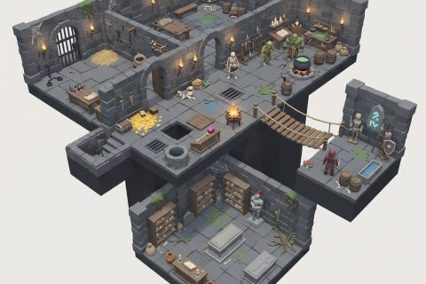

# Dungeon & Crypt

In production, 67 parts so far. Every part below is already free to use.

[Open the kit on Polyfork](https://polyfork.dev/kit/dungeon-crypt-c27d93) · [All kits](../README.md#kits)

<table>
<tr>
<td align="center" valign="top" width="25%"> <a href="https://polyfork.dev/asset/alchemy-workbench-117b73">Alchemy Workbench</a> <a href="https://polyfork.dev/cdn/alchemy-workbench-117b73.glb">GLB</a> · <a href="https://polyfork.dev/cdn/alchemy-workbench-117b73.mjs">module</a></td>
<td align="center" valign="top" width="25%"> <a href="https://polyfork.dev/asset/arming-sword-401972">Arming Sword</a> <a href="https://polyfork.dev/cdn/arming-sword-401972.glb">GLB</a> · <a href="https://polyfork.dev/cdn/arming-sword-401972.mjs">module</a></td>
<td align="center" valign="top" width="25%"> <a href="https://polyfork.dev/asset/armour-stand-3d77c4">Armour Stand</a> <a href="https://polyfork.dev/cdn/armour-stand-3d77c4.glb">GLB</a> · <a href="https://polyfork.dev/cdn/armour-stand-3d77c4.mjs">module</a></td>
<td align="center" valign="top" width="25%"> <a href="https://polyfork.dev/asset/armoured-knight-hero-07121f">Armoured Knight Hero</a> <a href="https://polyfork.dev/cdn/armoured-knight-hero-07121f.glb">GLB</a> · <a href="https://polyfork.dev/cdn/armoured-knight-hero-07121f.mjs">module</a></td>
</tr>
<tr>
<td align="center" valign="top" width="25%"> <a href="https://polyfork.dev/asset/barred-cell-door-571e9c">Barred Cell Door</a> <a href="https://polyfork.dev/cdn/barred-cell-door-571e9c.glb">GLB</a> · <a href="https://polyfork.dev/cdn/barred-cell-door-571e9c.mjs">module</a></td>
<td align="center" valign="top" width="25%"> <a href="https://polyfork.dev/asset/barred-portcullis-2aa444">Barred Portcullis</a> <a href="https://polyfork.dev/cdn/barred-portcullis-2aa444.glb">GLB</a> · <a href="https://polyfork.dev/cdn/barred-portcullis-2aa444.mjs">module</a></td>
<td align="center" valign="top" width="25%"> <a href="https://polyfork.dev/asset/bone-scatter-90313d">Bone Scatter</a> <a href="https://polyfork.dev/cdn/bone-scatter-90313d.glb">GLB</a> · <a href="https://polyfork.dev/cdn/bone-scatter-90313d.mjs">module</a></td>
<td align="center" valign="top" width="25%"> <a href="https://polyfork.dev/asset/bubbling-retort-4f9721">Bubbling Retort</a> <a href="https://polyfork.dev/cdn/bubbling-retort-4f9721.glb">GLB</a> · <a href="https://polyfork.dev/cdn/bubbling-retort-4f9721.mjs">module</a></td>
</tr>
<tr>
<td align="center" valign="top" width="25%"> <a href="https://polyfork.dev/asset/burial-niche-wall-1b937f">Burial Niche Wall</a> <a href="https://polyfork.dev/cdn/burial-niche-wall-1b937f.glb">GLB</a> · <a href="https://polyfork.dev/cdn/burial-niche-wall-1b937f.mjs">module</a></td>
<td align="center" valign="top" width="25%"> <a href="https://polyfork.dev/asset/candle-spike-cluster-d7c566">Candle Spike Cluster</a> <a href="https://polyfork.dev/cdn/candle-spike-cluster-d7c566.glb">GLB</a> · <a href="https://polyfork.dev/cdn/candle-spike-cluster-d7c566.mjs">module</a></td>
<td align="center" valign="top" width="25%"> <a href="https://polyfork.dev/asset/carved-grave-stele-a1359c">Carved Grave Stele</a> <a href="https://polyfork.dev/cdn/carved-grave-stele-a1359c.glb">GLB</a> · <a href="https://polyfork.dev/cdn/carved-grave-stele-a1359c.mjs">module</a></td>
<td align="center" valign="top" width="25%"> <a href="https://polyfork.dev/asset/carved-knight-effigy-900a64">Carved Knight Effigy</a> <a href="https://polyfork.dev/cdn/carved-knight-effigy-900a64.glb">GLB</a> · <a href="https://polyfork.dev/cdn/carved-knight-effigy-900a64.mjs">module</a></td>
</tr>
<tr>
<td align="center" valign="top" width="25%"> <a href="https://polyfork.dev/asset/cauldron-on-coals-ddbab6">Cauldron On Coals</a> <a href="https://polyfork.dev/cdn/cauldron-on-coals-ddbab6.glb">GLB</a> · <a href="https://polyfork.dev/cdn/cauldron-on-coals-ddbab6.mjs">module</a></td>
<td align="center" valign="top" width="25%"> <a href="https://polyfork.dev/asset/chained-book-lectern-381597">Chained Book Lectern</a> <a href="https://polyfork.dev/cdn/chained-book-lectern-381597.glb">GLB</a> · <a href="https://polyfork.dev/cdn/chained-book-lectern-381597.mjs">module</a></td>
<td align="center" valign="top" width="25%"> <a href="https://polyfork.dev/asset/clay-storage-pot-626452">Clay Storage Pot</a> <a href="https://polyfork.dev/cdn/clay-storage-pot-626452.glb">GLB</a> · <a href="https://polyfork.dev/cdn/clay-storage-pot-626452.mjs">module</a></td>
<td align="center" valign="top" width="25%"> <a href="https://polyfork.dev/asset/cobweb-drape-f65d43">Cobweb Drape</a> <a href="https://polyfork.dev/cdn/cobweb-drape-f65d43.glb">GLB</a> · <a href="https://polyfork.dev/cdn/cobweb-drape-f65d43.mjs">module</a></td>
</tr>
<tr>
<td align="center" valign="top" width="25%"> <a href="https://polyfork.dev/asset/crown-a294ce">Crown</a> <a href="https://polyfork.dev/cdn/crown-a294ce.glb">GLB</a> · <a href="https://polyfork.dev/cdn/crown-a294ce.mjs">module</a></td>
<td align="center" valign="top" width="25%"> <a href="https://polyfork.dev/asset/crypt-well-head-d368f3">Crypt Well Head</a> <a href="https://polyfork.dev/cdn/crypt-well-head-d368f3.glb">GLB</a> · <a href="https://polyfork.dev/cdn/crypt-well-head-d368f3.mjs">module</a></td>
<td align="center" valign="top" width="25%"> <a href="https://polyfork.dev/asset/drain-grate-tile-5568d9">Drain Grate Tile</a> <a href="https://polyfork.dev/cdn/drain-grate-tile-5568d9.glb">GLB</a> · <a href="https://polyfork.dev/cdn/drain-grate-tile-5568d9.mjs">module</a></td>
<td align="center" valign="top" width="25%"> <a href="https://polyfork.dev/asset/dungeon-rat-cbb03c">Dungeon Rat</a> <a href="https://polyfork.dev/cdn/dungeon-rat-cbb03c.glb">GLB</a> · <a href="https://polyfork.dev/cdn/dungeon-rat-cbb03c.mjs">module</a></td>
</tr>
<tr>
<td align="center" valign="top" width="25%"> <a href="https://polyfork.dev/asset/dungeon-wall-module-a537b3">Dungeon Wall Module</a> <a href="https://polyfork.dev/cdn/dungeon-wall-module-a537b3.glb">GLB</a> · <a href="https://polyfork.dev/cdn/dungeon-wall-module-a537b3.mjs">module</a></td>
<td align="center" valign="top" width="25%"> <a href="https://polyfork.dev/asset/fallen-ashlar-block-87824e">Fallen Ashlar Block</a> <a href="https://polyfork.dev/cdn/fallen-ashlar-block-87824e.glb">GLB</a> · <a href="https://polyfork.dev/cdn/fallen-ashlar-block-87824e.mjs">module</a></td>
<td align="center" valign="top" width="25%"> <a href="https://polyfork.dev/asset/flagstone-floor-tile-2a04ea">Flagstone Floor Tile</a> <a href="https://polyfork.dev/cdn/flagstone-floor-tile-2a04ea.glb">GLB</a> · <a href="https://polyfork.dev/cdn/flagstone-floor-tile-2a04ea.mjs">module</a></td>
<td align="center" valign="top" width="25%"> <a href="https://polyfork.dev/asset/funerary-urn-688493">Funerary Urn</a> <a href="https://polyfork.dev/cdn/funerary-urn-688493.glb">GLB</a> · <a href="https://polyfork.dev/cdn/funerary-urn-688493.mjs">module</a></td>
</tr>
<tr>
<td align="center" valign="top" width="25%"> <a href="https://polyfork.dev/asset/glowing-rune-stone-5a5558">Glowing Rune Stone</a> <a href="https://polyfork.dev/cdn/glowing-rune-stone-5a5558.glb">GLB</a> · <a href="https://polyfork.dev/cdn/glowing-rune-stone-5a5558.mjs">module</a></td>
<td align="center" valign="top" width="25%"> <a href="https://polyfork.dev/asset/goblet-87c3ba">Goblet</a> <a href="https://polyfork.dev/cdn/goblet-87c3ba.glb">GLB</a> · <a href="https://polyfork.dev/cdn/goblet-87c3ba.mjs">module</a></td>
<td align="center" valign="top" width="25%"> <a href="https://polyfork.dev/asset/goblin-2461c8">Goblin</a> <a href="https://polyfork.dev/cdn/goblin-2461c8.glb">GLB</a> · <a href="https://polyfork.dev/cdn/goblin-2461c8.mjs">module</a></td>
<td align="center" valign="top" width="25%"> <a href="https://polyfork.dev/asset/gold-ingot-8da28a">Gold Ingot</a> <a href="https://polyfork.dev/cdn/gold-ingot-8da28a.glb">GLB</a> · <a href="https://polyfork.dev/cdn/gold-ingot-8da28a.mjs">module</a></td>
</tr>
<tr>
<td align="center" valign="top" width="25%"> <a href="https://polyfork.dev/asset/great-helm-2551bc">Great Helm</a> <a href="https://polyfork.dev/cdn/great-helm-2551bc.glb">GLB</a> · <a href="https://polyfork.dev/cdn/great-helm-2551bc.mjs">module</a></td>
<td align="center" valign="top" width="25%"> <a href="https://polyfork.dev/asset/hand-axe-cee9e7">Hand Axe</a> <a href="https://polyfork.dev/cdn/hand-axe-cee9e7.glb">GLB</a> · <a href="https://polyfork.dev/cdn/hand-axe-cee9e7.mjs">module</a></td>
<td align="center" valign="top" width="25%"> <a href="https://polyfork.dev/asset/heater-shield-c51b76">Heater Shield</a> <a href="https://polyfork.dev/cdn/heater-shield-c51b76.glb">GLB</a> · <a href="https://polyfork.dev/cdn/heater-shield-c51b76.mjs">module</a></td>
<td align="center" valign="top" width="25%"> <a href="https://polyfork.dev/asset/hooded-cultist-8a488f">Hooded Cultist</a> <a href="https://polyfork.dev/cdn/hooded-cultist-8a488f.glb">GLB</a> · <a href="https://polyfork.dev/cdn/hooded-cultist-8a488f.mjs">module</a></td>
</tr>
<tr>
<td align="center" valign="top" width="25%"> <a href="https://polyfork.dev/asset/hooded-lantern-b60021">Hooded Lantern</a> <a href="https://polyfork.dev/cdn/hooded-lantern-b60021.glb">GLB</a> · <a href="https://polyfork.dev/cdn/hooded-lantern-b60021.mjs">module</a></td>
<td align="center" valign="top" width="25%"> <a href="https://polyfork.dev/asset/iron-chandelier-1337dc">Iron Chandelier</a> <a href="https://polyfork.dev/cdn/iron-chandelier-1337dc.glb">GLB</a> · <a href="https://polyfork.dev/cdn/iron-chandelier-1337dc.mjs">module</a></td>
<td align="center" valign="top" width="25%"> <a href="https://polyfork.dev/asset/iron-banded-strongbox-698383">Iron-Banded Strongbox</a> <a href="https://polyfork.dev/cdn/iron-banded-strongbox-698383.glb">GLB</a> · <a href="https://polyfork.dev/cdn/iron-banded-strongbox-698383.mjs">module</a></td>
<td align="center" valign="top" width="25%"> <a href="https://polyfork.dev/asset/iron-bound-door-e0e953">Iron-Bound Door</a> <a href="https://polyfork.dev/cdn/iron-bound-door-e0e953.glb">GLB</a> · <a href="https://polyfork.dev/cdn/iron-bound-door-e0e953.mjs">module</a></td>
</tr>
<tr>
<td align="center" valign="top" width="25%"> <a href="https://polyfork.dev/asset/jewelled-dagger-38f556">Jewelled Dagger</a> <a href="https://polyfork.dev/cdn/jewelled-dagger-38f556.glb">GLB</a> · <a href="https://polyfork.dev/cdn/jewelled-dagger-38f556.mjs">module</a></td>
<td align="center" valign="top" width="25%"> <a href="https://polyfork.dev/asset/loose-faceted-gem-d88a5b">Loose Faceted Gem</a> <a href="https://polyfork.dev/cdn/loose-faceted-gem-d88a5b.glb">GLB</a> · <a href="https://polyfork.dev/cdn/loose-faceted-gem-d88a5b.mjs">module</a></td>
<td align="center" valign="top" width="25%"> <a href="https://polyfork.dev/asset/moss-patch-3ecaf4">Moss Patch</a> <a href="https://polyfork.dev/cdn/moss-patch-3ecaf4.glb">GLB</a> · <a href="https://polyfork.dev/cdn/moss-patch-3ecaf4.mjs">module</a></td>
<td align="center" valign="top" width="25%"> <a href="https://polyfork.dev/asset/mushroom-cluster-18dc1d">Mushroom Cluster</a> <a href="https://polyfork.dev/cdn/mushroom-cluster-18dc1d.glb">GLB</a> · <a href="https://polyfork.dev/cdn/mushroom-cluster-18dc1d.mjs">module</a></td>
</tr>
<tr>
<td align="center" valign="top" width="25%"> <a href="https://polyfork.dev/asset/oak-barrel-b65311">Oak Barrel</a> <a href="https://polyfork.dev/cdn/oak-barrel-b65311.glb">GLB</a> · <a href="https://polyfork.dev/cdn/oak-barrel-b65311.mjs">module</a></td>
<td align="center" valign="top" width="25%"> <a href="https://polyfork.dev/asset/orc-brute-08c6ca">Orc Brute</a> <a href="https://polyfork.dev/cdn/orc-brute-08c6ca.glb">GLB</a> · <a href="https://polyfork.dev/cdn/orc-brute-08c6ca.mjs">module</a></td>
<td align="center" valign="top" width="25%"> <a href="https://polyfork.dev/asset/ossuary-skull-shelf-a8fdf0">Ossuary Skull Shelf</a> <a href="https://polyfork.dev/cdn/ossuary-skull-shelf-a8fdf0.glb">GLB</a> · <a href="https://polyfork.dev/cdn/ossuary-skull-shelf-a8fdf0.mjs">module</a></td>
<td align="center" valign="top" width="25%"> <a href="https://polyfork.dev/asset/potion-bottle-099ad7">Potion Bottle</a> <a href="https://polyfork.dev/cdn/potion-bottle-099ad7.glb">GLB</a> · <a href="https://polyfork.dev/cdn/potion-bottle-099ad7.mjs">module</a></td>
</tr>
<tr>
<td align="center" valign="top" width="25%"> <a href="https://polyfork.dev/asset/root-intrusion-9f1eaa">Root Intrusion</a> <a href="https://polyfork.dev/cdn/root-intrusion-9f1eaa.glb">GLB</a> · <a href="https://polyfork.dev/cdn/root-intrusion-9f1eaa.mjs">module</a></td>
<td align="center" valign="top" width="25%"> <a href="https://polyfork.dev/asset/rope-bridge-span-159f8c">Rope Bridge Span</a> <a href="https://polyfork.dev/cdn/rope-bridge-span-159f8c.glb">GLB</a> · <a href="https://polyfork.dev/cdn/rope-bridge-span-159f8c.mjs">module</a></td>
<td align="center" valign="top" width="25%"> <a href="https://polyfork.dev/asset/scroll-rack-f465dd">Scroll Rack</a> <a href="https://polyfork.dev/cdn/scroll-rack-f465dd.glb">GLB</a> · <a href="https://polyfork.dev/cdn/scroll-rack-f465dd.mjs">module</a></td>
<td align="center" valign="top" width="25%"> <a href="https://polyfork.dev/asset/shambling-ghoul-256f2f">Shambling Ghoul</a> <a href="https://polyfork.dev/cdn/shambling-ghoul-256f2f.glb">GLB</a> · <a href="https://polyfork.dev/cdn/shambling-ghoul-256f2f.mjs">module</a></td>
</tr>
<tr>
<td align="center" valign="top" width="25%"> <a href="https://polyfork.dev/asset/spear-e9824e">Spear</a> <a href="https://polyfork.dev/cdn/spear-e9824e.glb">GLB</a> · <a href="https://polyfork.dev/cdn/spear-e9824e.mjs">module</a></td>
<td align="center" valign="top" width="25%"> <a href="https://polyfork.dev/asset/spilled-coin-pile-caccf6">Spilled Coin Pile</a> <a href="https://polyfork.dev/cdn/spilled-coin-pile-caccf6.glb">GLB</a> · <a href="https://polyfork.dev/cdn/spilled-coin-pile-caccf6.mjs">module</a></td>
<td align="center" valign="top" width="25%"> <a href="https://polyfork.dev/asset/spiral-stair-shaft-80de26">Spiral Stair Shaft</a> <a href="https://polyfork.dev/cdn/spiral-stair-shaft-80de26.glb">GLB</a> · <a href="https://polyfork.dev/cdn/spiral-stair-shaft-80de26.mjs">module</a></td>
<td align="center" valign="top" width="25%"> <a href="https://polyfork.dev/asset/standing-brazier-c9e4ee">Standing Brazier</a> <a href="https://polyfork.dev/cdn/standing-brazier-c9e4ee.glb">GLB</a> · <a href="https://polyfork.dev/cdn/standing-brazier-c9e4ee.mjs">module</a></td>
</tr>
<tr>
<td align="center" valign="top" width="25%"> <a href="https://polyfork.dev/asset/standing-knight-statue-8bdcc9">Standing Knight Statue</a> <a href="https://polyfork.dev/cdn/standing-knight-statue-8bdcc9.glb">GLB</a> · <a href="https://polyfork.dev/cdn/standing-knight-statue-8bdcc9.mjs">module</a></td>
<td align="center" valign="top" width="25%"> <a href="https://polyfork.dev/asset/standing-water-pool-daafcb">Standing Water Pool</a> <a href="https://polyfork.dev/cdn/standing-water-pool-daafcb.glb">GLB</a> · <a href="https://polyfork.dev/cdn/standing-water-pool-daafcb.mjs">module</a></td>
<td align="center" valign="top" width="25%"> <a href="https://polyfork.dev/asset/stone-altar-8f3a0a">Stone Altar</a> <a href="https://polyfork.dev/cdn/stone-altar-8f3a0a.glb">GLB</a> · <a href="https://polyfork.dev/cdn/stone-altar-8f3a0a.mjs">module</a></td>
<td align="center" valign="top" width="25%"> <a href="https://polyfork.dev/asset/stone-sarcophagus-cc96a4">Stone Sarcophagus</a> <a href="https://polyfork.dev/cdn/stone-sarcophagus-cc96a4.glb">GLB</a> · <a href="https://polyfork.dev/cdn/stone-sarcophagus-cc96a4.mjs">module</a></td>
</tr>
<tr>
<td align="center" valign="top" width="25%"> <a href="https://polyfork.dev/asset/stone-stair-flight-d621e2">Stone Stair Flight</a> <a href="https://polyfork.dev/cdn/stone-stair-flight-d621e2.glb">GLB</a> · <a href="https://polyfork.dev/cdn/stone-stair-flight-d621e2.mjs">module</a></td>
<td align="center" valign="top" width="25%"> <a href="https://polyfork.dev/asset/stone-water-trough-aeabaa">Stone Water Trough</a> <a href="https://polyfork.dev/cdn/stone-water-trough-aeabaa.glb">GLB</a> · <a href="https://polyfork.dev/cdn/stone-water-trough-aeabaa.mjs">module</a></td>
<td align="center" valign="top" width="25%"> <a href="https://polyfork.dev/asset/straw-pile-ebd54d">Straw Pile</a> <a href="https://polyfork.dev/cdn/straw-pile-ebd54d.glb">GLB</a> · <a href="https://polyfork.dev/cdn/straw-pile-ebd54d.mjs">module</a></td>
<td align="center" valign="top" width="25%"> <a href="https://polyfork.dev/asset/timber-crate-ba0739">Timber Crate</a> <a href="https://polyfork.dev/cdn/timber-crate-ba0739.glb">GLB</a> · <a href="https://polyfork.dev/cdn/timber-crate-ba0739.mjs">module</a></td>
</tr>
<tr>
<td align="center" valign="top" width="25%"> <a href="https://polyfork.dev/asset/timber-trestle-table-024d88">Timber Trestle Table</a> <a href="https://polyfork.dev/cdn/timber-trestle-table-024d88.glb">GLB</a> · <a href="https://polyfork.dev/cdn/timber-trestle-table-024d88.mjs">module</a></td>
<td align="center" valign="top" width="25%"> <a href="https://polyfork.dev/asset/tomb-slab-ca9895">Tomb Slab</a> <a href="https://polyfork.dev/cdn/tomb-slab-ca9895.glb">GLB</a> · <a href="https://polyfork.dev/cdn/tomb-slab-ca9895.mjs">module</a></td>
<td align="center" valign="top" width="25%"> <a href="https://polyfork.dev/asset/torture-rack-b3f09c">Torture Rack</a> <a href="https://polyfork.dev/cdn/torture-rack-b3f09c.glb">GLB</a> · <a href="https://polyfork.dev/cdn/torture-rack-b3f09c.mjs">module</a></td>
<td align="center" valign="top" width="25%"> <a href="https://polyfork.dev/asset/trapdoor-pit-8d9a78">Trapdoor Pit</a> <a href="https://polyfork.dev/cdn/trapdoor-pit-8d9a78.glb">GLB</a> · <a href="https://polyfork.dev/cdn/trapdoor-pit-8d9a78.mjs">module</a></td>
</tr>
<tr>
<td align="center" valign="top" width="25%"> <a href="https://polyfork.dev/asset/wall-manacle-fitting-e80d3a">Wall Manacle Fitting</a> <a href="https://polyfork.dev/cdn/wall-manacle-fitting-e80d3a.glb">GLB</a> · <a href="https://polyfork.dev/cdn/wall-manacle-fitting-e80d3a.mjs">module</a></td>
<td align="center" valign="top" width="25%"> <a href="https://polyfork.dev/asset/wall-torch-bracket-f5ad14">Wall Torch Bracket</a> <a href="https://polyfork.dev/cdn/wall-torch-bracket-f5ad14.glb">GLB</a> · <a href="https://polyfork.dev/cdn/wall-torch-bracket-f5ad14.mjs">module</a></td>
<td align="center" valign="top" width="25%"> <a href="https://polyfork.dev/asset/weapon-rack-082d7f">Weapon Rack</a> <a href="https://polyfork.dev/cdn/weapon-rack-082d7f.glb">GLB</a> · <a href="https://polyfork.dev/cdn/weapon-rack-082d7f.mjs">module</a></td>
</tr>
</table>
