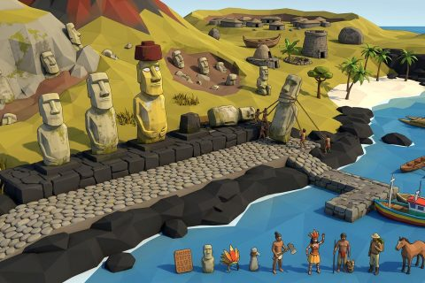

# Easter Island (Rapa Nui)

In production, 59 parts so far. Every part below is already free to use.

[Open the kit on Polyfork](https://polyfork.dev/kit/easter-island-rapa-nui-368e86) · [All kits](../README.md#kits)

<table>
<tr>
<td align="center" valign="top" width="25%"> <a href="https://polyfork.dev/asset/ahu-platform-bay-ffe2b7">Ahu Platform Bay</a> <a href="https://polyfork.dev/cdn/ahu-platform-bay-ffe2b7.glb">GLB</a> · <a href="https://polyfork.dev/cdn/ahu-platform-bay-ffe2b7.mjs">module</a></td>
<td align="center" valign="top" width="25%"> <a href="https://polyfork.dev/asset/anakena-beach-tile-e07759">Anakena Beach Tile</a> <a href="https://polyfork.dev/cdn/anakena-beach-tile-e07759.glb">GLB</a> · <a href="https://polyfork.dev/cdn/anakena-beach-tile-e07759.mjs">module</a></td>
<td align="center" valign="top" width="25%"> <a href="https://polyfork.dev/asset/ao-dance-paddle-8b36c4">Ao Dance Paddle</a> <a href="https://polyfork.dev/cdn/ao-dance-paddle-8b36c4.glb">GLB</a> · <a href="https://polyfork.dev/cdn/ao-dance-paddle-8b36c4.mjs">module</a></td>
<td align="center" valign="top" width="25%"> <a href="https://polyfork.dev/asset/banana-plant-978d7f">Banana Plant</a> <a href="https://polyfork.dev/cdn/banana-plant-978d7f.glb">GLB</a> · <a href="https://polyfork.dev/cdn/banana-plant-978d7f.mjs">module</a></td>
</tr>
<tr>
<td align="center" valign="top" width="25%"> <a href="https://polyfork.dev/asset/basalt-boulder-a1929c">Basalt Boulder</a> <a href="https://polyfork.dev/cdn/basalt-boulder-a1929c.glb">GLB</a> · <a href="https://polyfork.dev/cdn/basalt-boulder-a1929c.mjs">module</a></td>
<td align="center" valign="top" width="25%"> <a href="https://polyfork.dev/asset/basalt-field-wall-run-d0917e">Basalt Field Wall Run</a> <a href="https://polyfork.dev/cdn/basalt-field-wall-run-d0917e.glb">GLB</a> · <a href="https://polyfork.dev/cdn/basalt-field-wall-run-d0917e.mjs">module</a></td>
<td align="center" valign="top" width="25%"> <a href="https://polyfork.dev/asset/black-rock-shoreline-tile-6a090c">Black Rock Shoreline Tile</a> <a href="https://polyfork.dev/cdn/black-rock-shoreline-tile-6a090c.glb">GLB</a> · <a href="https://polyfork.dev/cdn/black-rock-shoreline-tile-6a090c.mjs">module</a></td>
<td align="center" valign="top" width="25%"> <a href="https://polyfork.dev/asset/easter-island-rapa-nui-584f21">Easter Island (Rapa Nui) Terrain</a> <a href="https://polyfork.dev/cdn/easter-island-rapa-nui-584f21.glb">GLB</a> · <a href="https://polyfork.dev/cdn/easter-island-rapa-nui-584f21.mjs">module</a></td>
</tr>
<tr>
<td align="center" valign="top" width="25%"> <a href="https://polyfork.dev/asset/fallen-moai-800fbb">Fallen Moai</a> <a href="https://polyfork.dev/cdn/fallen-moai-800fbb.glb">GLB</a> · <a href="https://polyfork.dev/cdn/fallen-moai-800fbb.mjs">module</a></td>
<td align="center" valign="top" width="25%"> <a href="https://polyfork.dev/asset/feather-headdress-87df5a">Feather Headdress</a> <a href="https://polyfork.dev/cdn/feather-headdress-87df5a.glb">GLB</a> · <a href="https://polyfork.dev/cdn/feather-headdress-87df5a.mjs">module</a></td>
<td align="center" valign="top" width="25%"> <a href="https://polyfork.dev/asset/grassland-tile-875d75">Grassland Tile</a> <a href="https://polyfork.dev/cdn/grassland-tile-875d75.glb">GLB</a> · <a href="https://polyfork.dev/cdn/grassland-tile-875d75.mjs">module</a></td>
<td align="center" valign="top" width="25%"> <a href="https://polyfork.dev/asset/haka-pei-banana-trunk-4f6f3e">Haka Pei Banana-Trunk Sled</a> <a href="https://polyfork.dev/cdn/haka-pei-banana-trunk-4f6f3e.glb">GLB</a> · <a href="https://polyfork.dev/cdn/haka-pei-banana-trunk-4f6f3e.mjs">module</a></td>
</tr>
<tr>
<td align="center" valign="top" width="25%"> <a href="https://polyfork.dev/asset/hanga-roa-fisherman-e56812">Hanga Roa Fisherman</a> <a href="https://polyfork.dev/cdn/hanga-roa-fisherman-e56812.glb">GLB</a> · <a href="https://polyfork.dev/cdn/hanga-roa-fisherman-e56812.mjs">module</a></td>
<td align="center" valign="top" width="25%"> <a href="https://polyfork.dev/asset/hanga-roa-fishing-boat-f09534">Hanga Roa Fishing Boat</a> <a href="https://polyfork.dev/cdn/hanga-roa-fishing-boat-f09534.glb">GLB</a> · <a href="https://polyfork.dev/cdn/hanga-roa-fishing-boat-f09534.mjs">module</a></td>
<td align="center" valign="top" width="25%"> <a href="https://polyfork.dev/asset/harbour-jetty-run-bc1c7c">Harbour Jetty Run</a> <a href="https://polyfork.dev/cdn/harbour-jetty-run-bc1c7c.glb">GLB</a> · <a href="https://polyfork.dev/cdn/harbour-jetty-run-bc1c7c.mjs">module</a></td>
<td align="center" valign="top" width="25%"> <a href="https://polyfork.dev/asset/hare-moa-chicken-house-fb5ed7">Hare Moa Chicken House</a> <a href="https://polyfork.dev/cdn/hare-moa-chicken-house-fb5ed7.glb">GLB</a> · <a href="https://polyfork.dev/cdn/hare-moa-chicken-house-fb5ed7.mjs">module</a></td>
</tr>
<tr>
<td align="center" valign="top" width="25%"> <a href="https://polyfork.dev/asset/hare-paenga-boat-house-8cd4c9">Hare Paenga Boat House</a> <a href="https://polyfork.dev/cdn/hare-paenga-boat-house-8cd4c9.glb">GLB</a> · <a href="https://polyfork.dev/cdn/hare-paenga-boat-house-8cd4c9.mjs">module</a></td>
<td align="center" valign="top" width="25%"> <a href="https://polyfork.dev/asset/hiker-visitor-d10aa5">Hiker Visitor</a> <a href="https://polyfork.dev/cdn/hiker-visitor-d10aa5.glb">GLB</a> · <a href="https://polyfork.dev/cdn/hiker-visitor-d10aa5.mjs">module</a></td>
<td align="center" valign="top" width="25%"> <a href="https://polyfork.dev/asset/hoe-canoe-paddle-2de51a">Hoe Canoe Paddle</a> <a href="https://polyfork.dev/cdn/hoe-canoe-paddle-2de51a.glb">GLB</a> · <a href="https://polyfork.dev/cdn/hoe-canoe-paddle-2de51a.mjs">module</a></td>
<td align="center" valign="top" width="25%"> <a href="https://polyfork.dev/asset/hue-gourd-vessel-47af0f">Hue Gourd Vessel</a> <a href="https://polyfork.dev/cdn/hue-gourd-vessel-47af0f.glb">GLB</a> · <a href="https://polyfork.dev/cdn/hue-gourd-vessel-47af0f.mjs">module</a></td>
</tr>
<tr>
<td align="center" valign="top" width="25%"> <a href="https://polyfork.dev/asset/kete-reed-basket-6ca36c">Kete Reed Basket</a> <a href="https://polyfork.dev/cdn/kete-reed-basket-6ca36c.glb">GLB</a> · <a href="https://polyfork.dev/cdn/kete-reed-basket-6ca36c.mjs">module</a></td>
<td align="center" valign="top" width="25%"> <a href="https://polyfork.dev/asset/lava-field-tile-3ae53c">Lava Field Tile</a> <a href="https://polyfork.dev/cdn/lava-field-tile-3ae53c.glb">GLB</a> · <a href="https://polyfork.dev/cdn/lava-field-tile-3ae53c.mjs">module</a></td>
<td align="center" valign="top" width="25%"> <a href="https://polyfork.dev/asset/mahute-shrub-8df9e6">Mahute Shrub</a> <a href="https://polyfork.dev/cdn/mahute-shrub-8df9e6.glb">GLB</a> · <a href="https://polyfork.dev/cdn/mahute-shrub-8df9e6.mjs">module</a></td>
<td align="center" valign="top" width="25%"> <a href="https://polyfork.dev/asset/manavai-garden-pit-15cede">Manavai Garden Pit</a> <a href="https://polyfork.dev/cdn/manavai-garden-pit-15cede.glb">GLB</a> · <a href="https://polyfork.dev/cdn/manavai-garden-pit-15cede.mjs">module</a></td>
</tr>
<tr>
<td align="center" valign="top" width="25%"> <a href="https://polyfork.dev/asset/mangai-stone-fishhook-389db5">Mangai Stone Fishhook</a> <a href="https://polyfork.dev/cdn/mangai-stone-fishhook-389db5.glb">GLB</a> · <a href="https://polyfork.dev/cdn/mangai-stone-fishhook-389db5.mjs">module</a></td>
<td align="center" valign="top" width="25%"> <a href="https://polyfork.dev/asset/manutara-egg-d257f8">Manutara Egg</a> <a href="https://polyfork.dev/cdn/manutara-egg-d257f8.glb">GLB</a> · <a href="https://polyfork.dev/cdn/manutara-egg-d257f8.mjs">module</a></td>
<td align="center" valign="top" width="25%"> <a href="https://polyfork.dev/asset/mata-a-obsidian-blade-a7e69b">Mata&#039;a Obsidian Blade</a> <a href="https://polyfork.dev/cdn/mata-a-obsidian-blade-a7e69b.glb">GLB</a> · <a href="https://polyfork.dev/cdn/mata-a-obsidian-blade-a7e69b.mjs">module</a></td>
<td align="center" valign="top" width="25%"> <a href="https://polyfork.dev/asset/moai-kavakava-006be0">Moai Kavakava</a> <a href="https://polyfork.dev/cdn/moai-kavakava-006be0.glb">GLB</a> · <a href="https://polyfork.dev/cdn/moai-kavakava-006be0.mjs">module</a></td>
</tr>
<tr>
<td align="center" valign="top" width="25%"> <a href="https://polyfork.dev/asset/orongo-house-run-e35d16">Orongo House Run</a> <a href="https://polyfork.dev/cdn/orongo-house-run-e35d16.glb">GLB</a> · <a href="https://polyfork.dev/cdn/orongo-house-run-e35d16.mjs">module</a></td>
<td align="center" valign="top" width="25%"> <a href="https://polyfork.dev/asset/petroglyph-boulder-7203c3">Petroglyph Boulder</a> <a href="https://polyfork.dev/cdn/petroglyph-boulder-7203c3.glb">GLB</a> · <a href="https://polyfork.dev/cdn/petroglyph-boulder-7203c3.mjs">module</a></td>
<td align="center" valign="top" width="25%"> <a href="https://polyfork.dev/asset/pipi-horeko-cairn-f5db4b">Pipi Horeko Cairn</a> <a href="https://polyfork.dev/cdn/pipi-horeko-cairn-f5db4b.glb">GLB</a> · <a href="https://polyfork.dev/cdn/pipi-horeko-cairn-f5db4b.mjs">module</a></td>
<td align="center" valign="top" width="25%"> <a href="https://polyfork.dev/asset/pora-reed-float-ed9d7e">Pora Reed Float</a> <a href="https://polyfork.dev/cdn/pora-reed-float-ed9d7e.glb">GLB</a> · <a href="https://polyfork.dev/cdn/pora-reed-float-ed9d7e.mjs">module</a></td>
</tr>
<tr>
<td align="center" valign="top" width="25%"> <a href="https://polyfork.dev/asset/poro-paving-tile-2b46ac">Poro Paving Tile</a> <a href="https://polyfork.dev/cdn/poro-paving-tile-2b46ac.glb">GLB</a> · <a href="https://polyfork.dev/cdn/poro-paving-tile-2b46ac.mjs">module</a></td>
<td align="center" valign="top" width="25%"> <a href="https://polyfork.dev/asset/pukao-topknot-359e63">Pukao Topknot</a> <a href="https://polyfork.dev/cdn/pukao-topknot-359e63.glb">GLB</a> · <a href="https://polyfork.dev/cdn/pukao-topknot-359e63.mjs">module</a></td>
<td align="center" valign="top" width="25%"> <a href="https://polyfork.dev/asset/rano-raraku-quarry-head-2a6eea">Rano Raraku Quarry Head</a> <a href="https://polyfork.dev/cdn/rano-raraku-quarry-head-2a6eea.glb">GLB</a> · <a href="https://polyfork.dev/cdn/rano-raraku-quarry-head-2a6eea.mjs">module</a></td>
<td align="center" valign="top" width="25%"> <a href="https://polyfork.dev/asset/red-scoria-rock-35bb9c">Red Scoria Rock</a> <a href="https://polyfork.dev/cdn/red-scoria-rock-35bb9c.glb">GLB</a> · <a href="https://polyfork.dev/cdn/red-scoria-rock-35bb9c.mjs">module</a></td>
</tr>
<tr>
<td align="center" valign="top" width="25%"> <a href="https://polyfork.dev/asset/reed-fire-torch-f7453e">Reed Fire Torch</a> <a href="https://polyfork.dev/cdn/reed-fire-torch-f7453e.glb">GLB</a> · <a href="https://polyfork.dev/cdn/reed-fire-torch-f7453e.mjs">module</a></td>
<td align="center" valign="top" width="25%"> <a href="https://polyfork.dev/asset/reimiro-breast-ornament-86f191">Reimiro Breast Ornament</a> <a href="https://polyfork.dev/cdn/reimiro-breast-ornament-86f191.glb">GLB</a> · <a href="https://polyfork.dev/cdn/reimiro-breast-ornament-86f191.mjs">module</a></td>
<td align="center" valign="top" width="25%"> <a href="https://polyfork.dev/asset/rongorongo-tablet-c90348">Rongorongo Tablet</a> <a href="https://polyfork.dev/cdn/rongorongo-tablet-c90348.glb">GLB</a> · <a href="https://polyfork.dev/cdn/rongorongo-tablet-c90348.mjs">module</a></td>
<td align="center" valign="top" width="25%"> <a href="https://polyfork.dev/asset/single-ahu-262107">Single Ahu</a> <a href="https://polyfork.dev/cdn/single-ahu-262107.glb">GLB</a> · <a href="https://polyfork.dev/cdn/single-ahu-262107.mjs">module</a></td>
</tr>
<tr>
<td align="center" valign="top" width="25%"> <a href="https://polyfork.dev/asset/standing-moai-caa54f">Standing Moai</a> <a href="https://polyfork.dev/cdn/standing-moai-caa54f.glb">GLB</a> · <a href="https://polyfork.dev/cdn/standing-moai-caa54f.mjs">module</a></td>
<td align="center" valign="top" width="25%"> <a href="https://polyfork.dev/asset/sugar-cane-clump-b53666">Sugar Cane Clump</a> <a href="https://polyfork.dev/cdn/sugar-cane-clump-b53666.glb">GLB</a> · <a href="https://polyfork.dev/cdn/sugar-cane-clump-b53666.mjs">module</a></td>
<td align="center" valign="top" width="25%"> <a href="https://polyfork.dev/asset/taheta-stone-basin-336021">Taheta Stone Basin</a> <a href="https://polyfork.dev/cdn/taheta-stone-basin-336021.glb">GLB</a> · <a href="https://polyfork.dev/cdn/taheta-stone-basin-336021.mjs">module</a></td>
<td align="center" valign="top" width="25%"> <a href="https://polyfork.dev/asset/tangata-manu-figure-be4fad">Tangata Manu Figure</a> <a href="https://polyfork.dev/cdn/tangata-manu-figure-be4fad.glb">GLB</a> · <a href="https://polyfork.dev/cdn/tangata-manu-figure-be4fad.mjs">module</a></td>
</tr>
<tr>
<td align="center" valign="top" width="25%"> <a href="https://polyfork.dev/asset/tapati-dancer-5557aa">Tapati Dancer</a> <a href="https://polyfork.dev/cdn/tapati-dancer-5557aa.glb">GLB</a> · <a href="https://polyfork.dev/cdn/tapati-dancer-5557aa.mjs">module</a></td>
<td align="center" valign="top" width="25%"> <a href="https://polyfork.dev/asset/taro-plant-8c0493">Taro Plant</a> <a href="https://polyfork.dev/cdn/taro-plant-8c0493.glb">GLB</a> · <a href="https://polyfork.dev/cdn/taro-plant-8c0493.mjs">module</a></td>
<td align="center" valign="top" width="25%"> <a href="https://polyfork.dev/asset/te-pito-kura-navel-eadfb2">Te Pito Kura Navel Stone</a> <a href="https://polyfork.dev/cdn/te-pito-kura-navel-eadfb2.glb">GLB</a> · <a href="https://polyfork.dev/cdn/te-pito-kura-navel-eadfb2.mjs">module</a></td>
<td align="center" valign="top" width="25%"> <a href="https://polyfork.dev/asset/ti-plant-a7ad06">Ti Plant</a> <a href="https://polyfork.dev/cdn/ti-plant-a7ad06.glb">GLB</a> · <a href="https://polyfork.dev/cdn/ti-plant-a7ad06.mjs">module</a></td>
</tr>
<tr>
<td align="center" valign="top" width="25%"> <a href="https://polyfork.dev/asset/toki-stone-adze-8da079">Toki Stone Adze</a> <a href="https://polyfork.dev/cdn/toki-stone-adze-8da079.glb">GLB</a> · <a href="https://polyfork.dev/cdn/toki-stone-adze-8da079.mjs">module</a></td>
<td align="center" valign="top" width="25%"> <a href="https://polyfork.dev/asset/toromiro-tree-a50794">Toromiro Tree</a> <a href="https://polyfork.dev/cdn/toromiro-tree-a50794.glb">GLB</a> · <a href="https://polyfork.dev/cdn/toromiro-tree-a50794.mjs">module</a></td>
<td align="center" valign="top" width="25%"> <a href="https://polyfork.dev/asset/totora-reed-bed-36d78f">Totora Reed Bed</a> <a href="https://polyfork.dev/cdn/totora-reed-bed-36d78f.glb">GLB</a> · <a href="https://polyfork.dev/cdn/totora-reed-bed-36d78f.mjs">module</a></td>
<td align="center" valign="top" width="25%"> <a href="https://polyfork.dev/asset/tukuturi-kneeling-moai-fad7ef">Tukuturi Kneeling Moai</a> <a href="https://polyfork.dev/cdn/tukuturi-kneeling-moai-fad7ef.glb">GLB</a> · <a href="https://polyfork.dev/cdn/tukuturi-kneeling-moai-fad7ef.mjs">module</a></td>
</tr>
<tr>
<td align="center" valign="top" width="25%"> <a href="https://polyfork.dev/asset/tupa-stone-tower-801c13">Tupa Stone Tower</a> <a href="https://polyfork.dev/cdn/tupa-stone-tower-801c13.glb">GLB</a> · <a href="https://polyfork.dev/cdn/tupa-stone-tower-801c13.mjs">module</a></td>
<td align="center" valign="top" width="25%"> <a href="https://polyfork.dev/asset/ua-staff-4738b4">Ua Staff</a> <a href="https://polyfork.dev/cdn/ua-staff-4738b4.glb">GLB</a> · <a href="https://polyfork.dev/cdn/ua-staff-4738b4.mjs">module</a></td>
<td align="center" valign="top" width="25%"> <a href="https://polyfork.dev/asset/umu-earth-oven-964a69">Umu Earth Oven</a> <a href="https://polyfork.dev/cdn/umu-earth-oven-964a69.glb">GLB</a> · <a href="https://polyfork.dev/cdn/umu-earth-oven-964a69.mjs">module</a></td>
<td align="center" valign="top" width="25%"> <a href="https://polyfork.dev/asset/unfinished-moai-in-the-40da79">Unfinished Moai in the Rock</a> <a href="https://polyfork.dev/cdn/unfinished-moai-in-the-40da79.glb">GLB</a> · <a href="https://polyfork.dev/cdn/unfinished-moai-in-the-40da79.mjs">module</a></td>
</tr>
<tr>
<td align="center" valign="top" width="25%"> <a href="https://polyfork.dev/asset/vaka-ama-outrigger-canoe-2fc79a">Vaka Ama Outrigger Canoe</a> <a href="https://polyfork.dev/cdn/vaka-ama-outrigger-canoe-2fc79a.glb">GLB</a> · <a href="https://polyfork.dev/cdn/vaka-ama-outrigger-canoe-2fc79a.mjs">module</a></td>
<td align="center" valign="top" width="25%"> <a href="https://polyfork.dev/asset/walking-moai-on-ropes-15424b">Walking Moai on Ropes</a> <a href="https://polyfork.dev/cdn/walking-moai-on-ropes-15424b.glb">GLB</a> · <a href="https://polyfork.dev/cdn/walking-moai-on-ropes-15424b.mjs">module</a></td>
<td align="center" valign="top" width="25%"> <a href="https://polyfork.dev/asset/wild-horse-047e93">Wild Horse</a> <a href="https://polyfork.dev/cdn/wild-horse-047e93.glb">GLB</a> · <a href="https://polyfork.dev/cdn/wild-horse-047e93.mjs">module</a></td>
</tr>
</table>
