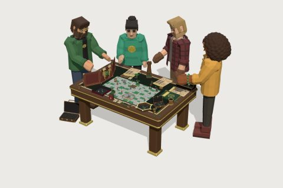

# Emerald Gilded Runes kit

60 free low-poly parts on one palette and one scale, so everything you combine belongs to the same world.

[Open the kit on Polyfork](https://polyfork.dev/kit/emerald-gilded-runes-kit-abfc30) · [All kits](../README.md#kits)

<table>
<tr>
<td align="center" valign="top" width="25%"> <a href="https://polyfork.dev/asset/barbarian-miniature-983b18">Barbarian Miniature</a> <a href="https://polyfork.dev/cdn/barbarian-miniature-983b18.glb">GLB</a> · <a href="https://polyfork.dev/cdn/barbarian-miniature-983b18.mjs">module</a></td>
<td align="center" valign="top" width="25%"> <a href="https://polyfork.dev/asset/bard-miniature-274f82">Bard Miniature</a> <a href="https://polyfork.dev/cdn/bard-miniature-274f82.glb">GLB</a> · <a href="https://polyfork.dev/cdn/bard-miniature-274f82.mjs">module</a></td>
<td align="center" valign="top" width="25%"> <a href="https://polyfork.dev/asset/battle-map-tile-69e0b1">Battle Map Tile</a> <a href="https://polyfork.dev/cdn/battle-map-tile-69e0b1.glb">GLB</a> · <a href="https://polyfork.dev/cdn/battle-map-tile-69e0b1.mjs">module</a></td>
<td align="center" valign="top" width="25%"> <a href="https://polyfork.dev/asset/campaign-journal-18037d">Campaign Journal</a> <a href="https://polyfork.dev/cdn/campaign-journal-18037d.glb">GLB</a> · <a href="https://polyfork.dev/cdn/campaign-journal-18037d.mjs">module</a></td>
</tr>
<tr>
<td align="center" valign="top" width="25%"> <a href="https://polyfork.dev/asset/campaign-map-scroll-d4a382">Campaign Map Scroll</a> <a href="https://polyfork.dev/cdn/campaign-map-scroll-d4a382.glb">GLB</a> · <a href="https://polyfork.dev/cdn/campaign-map-scroll-d4a382.mjs">module</a></td>
<td align="center" valign="top" width="25%"> <a href="https://polyfork.dev/asset/card-deck-box-531a03">Card Deck Box</a> <a href="https://polyfork.dev/cdn/card-deck-box-531a03.glb">GLB</a> · <a href="https://polyfork.dev/cdn/card-deck-box-531a03.mjs">module</a></td>
<td align="center" valign="top" width="25%"> <a href="https://polyfork.dev/asset/character-sheet-b91337">Character Sheet</a> <a href="https://polyfork.dev/cdn/character-sheet-b91337.glb">GLB</a> · <a href="https://polyfork.dev/cdn/character-sheet-b91337.mjs">module</a></td>
<td align="center" valign="top" width="25%"> <a href="https://polyfork.dev/asset/condition-ring-df5a73">Condition Ring</a> <a href="https://polyfork.dev/cdn/condition-ring-df5a73.glb">GLB</a> · <a href="https://polyfork.dev/cdn/condition-ring-df5a73.mjs">module</a></td>
</tr>
<tr>
<td align="center" valign="top" width="25%"> <a href="https://polyfork.dev/asset/core-rulebook-4aedc7">Core Rulebook</a> <a href="https://polyfork.dev/cdn/core-rulebook-4aedc7.glb">GLB</a> · <a href="https://polyfork.dev/cdn/core-rulebook-4aedc7.mjs">module</a></td>
<td align="center" valign="top" width="25%"> <a href="https://polyfork.dev/asset/d10-ten-sided-die-c3b2d7">d10 Ten-Sided Die</a> <a href="https://polyfork.dev/cdn/d10-ten-sided-die-c3b2d7.glb">GLB</a> · <a href="https://polyfork.dev/cdn/d10-ten-sided-die-c3b2d7.mjs">module</a></td>
<td align="center" valign="top" width="25%"> <a href="https://polyfork.dev/asset/d12-twelve-sided-die-20ae99">d12 Twelve-Sided Die</a> <a href="https://polyfork.dev/cdn/d12-twelve-sided-die-20ae99.glb">GLB</a> · <a href="https://polyfork.dev/cdn/d12-twelve-sided-die-20ae99.mjs">module</a></td>
<td align="center" valign="top" width="25%"> <a href="https://polyfork.dev/asset/d20-twenty-sided-die-038f10">d20 Twenty-Sided Die</a> <a href="https://polyfork.dev/cdn/d20-twenty-sided-die-038f10.glb">GLB</a> · <a href="https://polyfork.dev/cdn/d20-twenty-sided-die-038f10.mjs">module</a></td>
</tr>
<tr>
<td align="center" valign="top" width="25%"> <a href="https://polyfork.dev/asset/d4-crystal-shard-die-860fd9">d4 Crystal Shard Die</a> <a href="https://polyfork.dev/cdn/d4-crystal-shard-die-860fd9.glb">GLB</a> · <a href="https://polyfork.dev/cdn/d4-crystal-shard-die-860fd9.mjs">module</a></td>
<td align="center" valign="top" width="25%"> <a href="https://polyfork.dev/asset/d4-pyramid-die-54812c">d4 Pyramid Die</a> <a href="https://polyfork.dev/cdn/d4-pyramid-die-54812c.glb">GLB</a> · <a href="https://polyfork.dev/cdn/d4-pyramid-die-54812c.mjs">module</a></td>
<td align="center" valign="top" width="25%"> <a href="https://polyfork.dev/asset/d6-numeral-die-315b3a">d6 Numeral Die</a> <a href="https://polyfork.dev/cdn/d6-numeral-die-315b3a.glb">GLB</a> · <a href="https://polyfork.dev/cdn/d6-numeral-die-315b3a.mjs">module</a></td>
<td align="center" valign="top" width="25%"> <a href="https://polyfork.dev/asset/d8-eight-sided-die-1901f7">d8 Eight-Sided Die</a> <a href="https://polyfork.dev/cdn/d8-eight-sided-die-1901f7.glb">GLB</a> · <a href="https://polyfork.dev/cdn/d8-eight-sided-die-1901f7.mjs">module</a></td>
</tr>
<tr>
<td align="center" valign="top" width="25%"> <a href="https://polyfork.dev/asset/dice-jail-bee37d">Dice Jail</a> <a href="https://polyfork.dev/cdn/dice-jail-bee37d.glb">GLB</a> · <a href="https://polyfork.dev/cdn/dice-jail-bee37d.mjs">module</a></td>
<td align="center" valign="top" width="25%"> <a href="https://polyfork.dev/asset/dice-tower-652cc1">Dice Tower</a> <a href="https://polyfork.dev/cdn/dice-tower-652cc1.glb">GLB</a> · <a href="https://polyfork.dev/cdn/dice-tower-652cc1.mjs">module</a></td>
<td align="center" valign="top" width="25%"> <a href="https://polyfork.dev/asset/dwarf-cleric-miniature-55dd96">Dwarf Cleric Miniature</a> <a href="https://polyfork.dev/cdn/dwarf-cleric-miniature-55dd96.glb">GLB</a> · <a href="https://polyfork.dev/cdn/dwarf-cleric-miniature-55dd96.mjs">module</a></td>
<td align="center" valign="top" width="25%"> <a href="https://polyfork.dev/asset/elf-ranger-miniature-ea850a">Elf Ranger Miniature</a> <a href="https://polyfork.dev/cdn/elf-ranger-miniature-ea850a.glb">GLB</a> · <a href="https://polyfork.dev/cdn/elf-ranger-miniature-ea850a.mjs">module</a></td>
</tr>
<tr>
<td align="center" valign="top" width="25%"> <a href="https://polyfork.dev/asset/fighter-miniature-b6bcac">Fighter Miniature</a> <a href="https://polyfork.dev/cdn/fighter-miniature-b6bcac.glb">GLB</a> · <a href="https://polyfork.dev/cdn/fighter-miniature-b6bcac.mjs">module</a></td>
<td align="center" valign="top" width="25%"> <a href="https://polyfork.dev/asset/folding-leather-dice-tray-c4ec45">Folding Leather Dice Tray</a> <a href="https://polyfork.dev/cdn/folding-leather-dice-tray-c4ec45.glb">GLB</a> · <a href="https://polyfork.dev/cdn/folding-leather-dice-tray-c4ec45.mjs">module</a></td>
<td align="center" valign="top" width="25%"> <a href="https://polyfork.dev/asset/game-master-2b8912">Game Master</a> <a href="https://polyfork.dev/cdn/game-master-2b8912.glb">GLB</a> · <a href="https://polyfork.dev/cdn/game-master-2b8912.mjs">module</a></td>
<td align="center" valign="top" width="25%"> <a href="https://polyfork.dev/asset/game-master-s-screen-665f62">Game Master&#039;s Screen</a> <a href="https://polyfork.dev/cdn/game-master-s-screen-665f62.glb">GLB</a> · <a href="https://polyfork.dev/cdn/game-master-s-screen-665f62.mjs">module</a></td>
</tr>
<tr>
<td align="center" valign="top" width="25%"> <a href="https://polyfork.dev/asset/gaming-table-5ca9d5">Gaming Table</a> <a href="https://polyfork.dev/cdn/gaming-table-5ca9d5.glb">GLB</a> · <a href="https://polyfork.dev/cdn/gaming-table-5ca9d5.mjs">module</a></td>
<td align="center" valign="top" width="25%"> <a href="https://polyfork.dev/asset/gelatinous-cube-miniature-814caf">Gelatinous Cube Miniature</a> <a href="https://polyfork.dev/cdn/gelatinous-cube-miniature-814caf.glb">GLB</a> · <a href="https://polyfork.dev/cdn/gelatinous-cube-miniature-814caf.mjs">module</a></td>
<td align="center" valign="top" width="25%"> <a href="https://polyfork.dev/asset/graphite-pencil-041893">Graphite Pencil</a> <a href="https://polyfork.dev/cdn/graphite-pencil-041893.glb">GLB</a> · <a href="https://polyfork.dev/cdn/graphite-pencil-041893.mjs">module</a></td>
<td align="center" valign="top" width="25%"> <a href="https://polyfork.dev/asset/green-dragon-miniature-d9e7d4">Green Dragon Miniature</a> <a href="https://polyfork.dev/cdn/green-dragon-miniature-d9e7d4.glb">GLB</a> · <a href="https://polyfork.dev/cdn/green-dragon-miniature-d9e7d4.mjs">module</a></td>
</tr>
<tr>
<td align="center" valign="top" width="25%"> <a href="https://polyfork.dev/asset/hexagonal-dice-tray-883963">Hexagonal Dice Tray</a> <a href="https://polyfork.dev/cdn/hexagonal-dice-tray-883963.glb">GLB</a> · <a href="https://polyfork.dev/cdn/hexagonal-dice-tray-883963.mjs">module</a></td>
<td align="center" valign="top" width="25%"> <a href="https://polyfork.dev/asset/hit-point-dial-1ea3bb">Hit Point Dial</a> <a href="https://polyfork.dev/cdn/hit-point-dial-1ea3bb.glb">GLB</a> · <a href="https://polyfork.dev/cdn/hit-point-dial-1ea3bb.mjs">module</a></td>
<td align="center" valign="top" width="25%"> <a href="https://polyfork.dev/asset/initiative-tent-card-2fe4ff">Initiative Tent Card</a> <a href="https://polyfork.dev/cdn/initiative-tent-card-2fe4ff.glb">GLB</a> · <a href="https://polyfork.dev/cdn/initiative-tent-card-2fe4ff.mjs">module</a></td>
<td align="center" valign="top" width="25%"> <a href="https://polyfork.dev/asset/leather-dice-cup-f99a7e">Leather Dice Cup</a> <a href="https://polyfork.dev/cdn/leather-dice-cup-f99a7e.glb">GLB</a> · <a href="https://polyfork.dev/cdn/leather-dice-cup-f99a7e.mjs">module</a></td>
</tr>
<tr>
<td align="center" valign="top" width="25%"> <a href="https://polyfork.dev/asset/mimic-miniature-f6270f">Mimic Miniature</a> <a href="https://polyfork.dev/cdn/mimic-miniature-f6270f.glb">GLB</a> · <a href="https://polyfork.dev/cdn/mimic-miniature-f6270f.mjs">module</a></td>
<td align="center" valign="top" width="25%"> <a href="https://polyfork.dev/asset/miniature-carry-case-bb894a">Miniature Carry Case</a> <a href="https://polyfork.dev/cdn/miniature-carry-case-bb894a.glb">GLB</a> · <a href="https://polyfork.dev/cdn/miniature-carry-case-bb894a.mjs">module</a></td>
<td align="center" valign="top" width="25%"> <a href="https://polyfork.dev/asset/miniature-detail-brush-5a38ad">Miniature Detail Brush</a> <a href="https://polyfork.dev/cdn/miniature-detail-brush-5a38ad.glb">GLB</a> · <a href="https://polyfork.dev/cdn/miniature-detail-brush-5a38ad.mjs">module</a></td>
<td align="center" valign="top" width="25%"> <a href="https://polyfork.dev/asset/miniature-paint-pot-3cf152">Miniature Paint Pot</a> <a href="https://polyfork.dev/cdn/miniature-paint-pot-3cf152.glb">GLB</a> · <a href="https://polyfork.dev/cdn/miniature-paint-pot-3cf152.mjs">module</a></td>
</tr>
<tr>
<td align="center" valign="top" width="25%"> <a href="https://polyfork.dev/asset/minotaur-miniature-108237">Minotaur Miniature</a> <a href="https://polyfork.dev/cdn/minotaur-miniature-108237.glb">GLB</a> · <a href="https://polyfork.dev/cdn/minotaur-miniature-108237.mjs">module</a></td>
<td align="center" valign="top" width="25%"> <a href="https://polyfork.dev/asset/natural-20-trophy-plinth-c31c9c">Natural 20 Trophy Plinth</a> <a href="https://polyfork.dev/cdn/natural-20-trophy-plinth-c31c9c.glb">GLB</a> · <a href="https://polyfork.dev/cdn/natural-20-trophy-plinth-c31c9c.mjs">module</a></td>
<td align="center" valign="top" width="25%"> <a href="https://polyfork.dev/asset/necromancer-miniature-5bd819">Necromancer Miniature</a> <a href="https://polyfork.dev/cdn/necromancer-miniature-5bd819.glb">GLB</a> · <a href="https://polyfork.dev/cdn/necromancer-miniature-5bd819.mjs">module</a></td>
<td align="center" valign="top" width="25%"> <a href="https://polyfork.dev/asset/owlbear-miniature-0218ce">Owlbear Miniature</a> <a href="https://polyfork.dev/cdn/owlbear-miniature-0218ce.glb">GLB</a> · <a href="https://polyfork.dev/cdn/owlbear-miniature-0218ce.mjs">module</a></td>
</tr>
<tr>
<td align="center" valign="top" width="25%"> <a href="https://polyfork.dev/asset/paladin-miniature-d8fe17">Paladin Miniature</a> <a href="https://polyfork.dev/cdn/paladin-miniature-d8fe17.glb">GLB</a> · <a href="https://polyfork.dev/cdn/paladin-miniature-d8fe17.mjs">module</a></td>
<td align="center" valign="top" width="25%"> <a href="https://polyfork.dev/asset/player-in-a-cardigan-b558c9">Player in a Cardigan</a> <a href="https://polyfork.dev/cdn/player-in-a-cardigan-b558c9.glb">GLB</a> · <a href="https://polyfork.dev/cdn/player-in-a-cardigan-b558c9.mjs">module</a></td>
<td align="center" valign="top" width="25%"> <a href="https://polyfork.dev/asset/player-in-flannel-d0bae4">Player in Flannel</a> <a href="https://polyfork.dev/cdn/player-in-flannel-d0bae4.glb">GLB</a> · <a href="https://polyfork.dev/cdn/player-in-flannel-d0bae4.mjs">module</a></td>
<td align="center" valign="top" width="25%"> <a href="https://polyfork.dev/asset/rogue-miniature-dae5b7">Rogue Miniature</a> <a href="https://polyfork.dev/cdn/rogue-miniature-dae5b7.glb">GLB</a> · <a href="https://polyfork.dev/cdn/rogue-miniature-dae5b7.mjs">module</a></td>
</tr>
<tr>
<td align="center" valign="top" width="25%"> <a href="https://polyfork.dev/asset/sand-timer-6acb1b">Sand Timer</a> <a href="https://polyfork.dev/cdn/sand-timer-6acb1b.glb">GLB</a> · <a href="https://polyfork.dev/cdn/sand-timer-6acb1b.mjs">module</a></td>
<td align="center" valign="top" width="25%"> <a href="https://polyfork.dev/asset/seven-pocket-dice-chest-1e8cb4">Seven-Pocket Dice Chest</a> <a href="https://polyfork.dev/cdn/seven-pocket-dice-chest-1e8cb4.glb">GLB</a> · <a href="https://polyfork.dev/cdn/seven-pocket-dice-chest-1e8cb4.mjs">module</a></td>
<td align="center" valign="top" width="25%"> <a href="https://polyfork.dev/asset/single-die-vault-40dd5a">Single Die Vault</a> <a href="https://polyfork.dev/cdn/single-die-vault-40dd5a.glb">GLB</a> · <a href="https://polyfork.dev/cdn/single-die-vault-40dd5a.mjs">module</a></td>
<td align="center" valign="top" width="25%"> <a href="https://polyfork.dev/asset/spell-area-template-b76082">Spell Area Template</a> <a href="https://polyfork.dev/cdn/spell-area-template-b76082.glb">GLB</a> · <a href="https://polyfork.dev/cdn/spell-area-template-b76082.mjs">module</a></td>
</tr>
<tr>
<td align="center" valign="top" width="25%"> <a href="https://polyfork.dev/asset/spell-card-584e86">Spell Card</a> <a href="https://polyfork.dev/cdn/spell-card-584e86.glb">GLB</a> · <a href="https://polyfork.dev/cdn/spell-card-584e86.mjs">module</a></td>
<td align="center" valign="top" width="25%"> <a href="https://polyfork.dev/asset/spell-effect-marker-f9f911">Spell Effect Marker</a> <a href="https://polyfork.dev/cdn/spell-effect-marker-f9f911.glb">GLB</a> · <a href="https://polyfork.dev/cdn/spell-effect-marker-f9f911.mjs">module</a></td>
<td align="center" valign="top" width="25%"> <a href="https://polyfork.dev/asset/spell-slot-tracker-2314dd">Spell Slot Tracker</a> <a href="https://polyfork.dev/cdn/spell-slot-tracker-2314dd.glb">GLB</a> · <a href="https://polyfork.dev/cdn/spell-slot-tracker-2314dd.mjs">module</a></td>
<td align="center" valign="top" width="25%"> <a href="https://polyfork.dev/asset/stone-golem-miniature-6a84b6">Stone Golem Miniature</a> <a href="https://polyfork.dev/cdn/stone-golem-miniature-6a84b6.glb">GLB</a> · <a href="https://polyfork.dev/cdn/stone-golem-miniature-6a84b6.mjs">module</a></td>
</tr>
<tr>
<td align="center" valign="top" width="25%"> <a href="https://polyfork.dev/asset/teen-player-37865e">Teen Player</a> <a href="https://polyfork.dev/cdn/teen-player-37865e.glb">GLB</a> · <a href="https://polyfork.dev/cdn/teen-player-37865e.mjs">module</a></td>
<td align="center" valign="top" width="25%"> <a href="https://polyfork.dev/asset/tiered-display-riser-4ead78">Tiered Display Riser</a> <a href="https://polyfork.dev/cdn/tiered-display-riser-4ead78.glb">GLB</a> · <a href="https://polyfork.dev/cdn/tiered-display-riser-4ead78.mjs">module</a></td>
<td align="center" valign="top" width="25%"> <a href="https://polyfork.dev/asset/card-standee-9e8044">Toy Figurine</a> <a href="https://polyfork.dev/cdn/card-standee-9e8044.glb">GLB</a> · <a href="https://polyfork.dev/cdn/card-standee-9e8044.mjs">module</a></td>
<td align="center" valign="top" width="25%"> <a href="https://polyfork.dev/asset/velvet-dice-bag-69769c">Velvet Dice Bag</a> <a href="https://polyfork.dev/cdn/velvet-dice-bag-69769c.glb">GLB</a> · <a href="https://polyfork.dev/cdn/velvet-dice-bag-69769c.mjs">module</a></td>
</tr>
<tr>
<td align="center" valign="top" width="25%"> <a href="https://polyfork.dev/asset/velvet-mat-tile-0ccce3">Velvet Mat Tile</a> <a href="https://polyfork.dev/cdn/velvet-mat-tile-0ccce3.glb">GLB</a> · <a href="https://polyfork.dev/cdn/velvet-mat-tile-0ccce3.mjs">module</a></td>
<td align="center" valign="top" width="25%"> <a href="https://polyfork.dev/asset/wet-erase-marker-779cfc">Wet-Erase Marker</a> <a href="https://polyfork.dev/cdn/wet-erase-marker-779cfc.glb">GLB</a> · <a href="https://polyfork.dev/cdn/wet-erase-marker-779cfc.mjs">module</a></td>
<td align="center" valign="top" width="25%"> <a href="https://polyfork.dev/asset/wizard-miniature-032ef6">Wizard Miniature</a> <a href="https://polyfork.dev/cdn/wizard-miniature-032ef6.glb">GLB</a> · <a href="https://polyfork.dev/cdn/wizard-miniature-032ef6.mjs">module</a></td>
<td align="center" valign="top" width="25%"> <a href="https://polyfork.dev/asset/wraith-miniature-3e4524">Wraith Miniature</a> <a href="https://polyfork.dev/cdn/wraith-miniature-3e4524.glb">GLB</a> · <a href="https://polyfork.dev/cdn/wraith-miniature-3e4524.mjs">module</a></td>
</tr>
</table>
