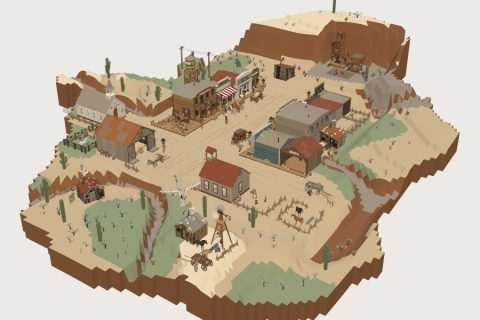

# Frontier Town

61 free low-poly parts on one palette and one scale, so everything you combine belongs to the same world.

[Open the kit on Polyfork](https://polyfork.dev/kit/frontier-town-a0085b) · [All kits](../README.md#kits)

<table>
<tr>
<td align="center" valign="top" width="25%"> <a href="https://polyfork.dev/asset/back-bar-shelf-and-f5f279">Back-Bar Shelf and Mirror</a> <a href="https://polyfork.dev/cdn/back-bar-shelf-and-f5f279.glb">GLB</a> · <a href="https://polyfork.dev/cdn/back-bar-shelf-and-f5f279.mjs">module</a></td>
<td align="center" valign="top" width="25%"> <a href="https://polyfork.dev/asset/bank-414f6b">Bank</a> <a href="https://polyfork.dev/cdn/bank-414f6b.glb">GLB</a> · <a href="https://polyfork.dev/cdn/bank-414f6b.mjs">module</a></td>
<td align="center" valign="top" width="25%"> <a href="https://polyfork.dev/asset/bar-counter-run-ab3b08">Bar Counter Run</a> <a href="https://polyfork.dev/cdn/bar-counter-run-ab3b08.glb">GLB</a> · <a href="https://polyfork.dev/cdn/bar-counter-run-ab3b08.mjs">module</a></td>
<td align="center" valign="top" width="25%"> <a href="https://polyfork.dev/asset/barber-and-bath-house-e0ff5c">Barber and Bath House</a> <a href="https://polyfork.dev/cdn/barber-and-bath-house-e0ff5c.glb">GLB</a> · <a href="https://polyfork.dev/cdn/barber-and-bath-house-e0ff5c.mjs">module</a></td>
</tr>
<tr>
<td align="center" valign="top" width="25%"> <a href="https://polyfork.dev/asset/blacksmith-s-shop-9c5f43">Blacksmith&#039;s Shop</a> <a href="https://polyfork.dev/cdn/blacksmith-s-shop-9c5f43.glb">GLB</a> · <a href="https://polyfork.dev/cdn/blacksmith-s-shop-9c5f43.mjs">module</a></td>
<td align="center" valign="top" width="25%"> <a href="https://polyfork.dev/asset/boardwalk-plank-tile-678e52">Boardwalk Plank Tile</a> <a href="https://polyfork.dev/cdn/boardwalk-plank-tile-678e52.glb">GLB</a> · <a href="https://polyfork.dev/cdn/boardwalk-plank-tile-678e52.mjs">module</a></td>
<td align="center" valign="top" width="25%"> <a href="https://polyfork.dev/asset/boardwalk-run-461f03">Boardwalk Run</a> <a href="https://polyfork.dev/cdn/boardwalk-run-461f03.glb">GLB</a> · <a href="https://polyfork.dev/cdn/boardwalk-run-461f03.mjs">module</a></td>
<td align="center" valign="top" width="25%"> <a href="https://polyfork.dev/asset/buckboard-wagon-59ec16">Buckboard Wagon</a> <a href="https://polyfork.dev/cdn/buckboard-wagon-59ec16.glb">GLB</a> · <a href="https://polyfork.dev/cdn/buckboard-wagon-59ec16.mjs">module</a></td>
</tr>
<tr>
<td align="center" valign="top" width="25%"> <a href="https://polyfork.dev/asset/clapboard-church-03a6f5">Clapboard Church</a> <a href="https://polyfork.dev/cdn/clapboard-church-03a6f5.glb">GLB</a> · <a href="https://polyfork.dev/cdn/clapboard-church-03a6f5.mjs">module</a></td>
<td align="center" valign="top" width="25%"> <a href="https://polyfork.dev/asset/corral-fence-run-163ad7">Corral Fence Run</a> <a href="https://polyfork.dev/cdn/corral-fence-run-163ad7.glb">GLB</a> · <a href="https://polyfork.dev/cdn/corral-fence-run-163ad7.mjs">module</a></td>
<td align="center" valign="top" width="25%"> <a href="https://polyfork.dev/asset/dead-cottonwood-edbde8">Dead Cottonwood</a> <a href="https://polyfork.dev/cdn/dead-cottonwood-edbde8.glb">GLB</a> · <a href="https://polyfork.dev/cdn/dead-cottonwood-edbde8.mjs">module</a></td>
<td align="center" valign="top" width="25%"> <a href="https://polyfork.dev/asset/dirt-street-tile-58f951">Dirt Street Tile</a> <a href="https://polyfork.dev/cdn/dirt-street-tile-58f951.glb">GLB</a> · <a href="https://polyfork.dev/cdn/dirt-street-tile-58f951.mjs">module</a></td>
</tr>
<tr>
<td align="center" valign="top" width="25%"> <a href="https://polyfork.dev/asset/freight-crate-and-sack-f49cbb">Freight Crate and Sack Stack</a> <a href="https://polyfork.dev/cdn/freight-crate-and-sack-f49cbb.glb">GLB</a> · <a href="https://polyfork.dev/cdn/freight-crate-and-sack-f49cbb.mjs">module</a></td>
<td align="center" valign="top" width="25%"> <a href="https://polyfork.dev/asset/frontier-town-terrain-3fdd03">Frontier Town Terrain</a> <a href="https://polyfork.dev/cdn/frontier-town-terrain-3fdd03.glb">GLB</a> · <a href="https://polyfork.dev/cdn/frontier-town-terrain-3fdd03.mjs">module</a></td>
<td align="center" valign="top" width="25%"> <a href="https://polyfork.dev/asset/general-store-a2187a">General Store</a> <a href="https://polyfork.dev/cdn/general-store-a2187a.glb">GLB</a> · <a href="https://polyfork.dev/cdn/general-store-a2187a.mjs">module</a></td>
<td align="center" valign="top" width="25%"> <a href="https://polyfork.dev/asset/gold-pan-on-a-2e9b0a">Gold Pan on a Stand</a> <a href="https://polyfork.dev/cdn/gold-pan-on-a-2e9b0a.glb">GLB</a> · <a href="https://polyfork.dev/cdn/gold-pan-on-a-2e9b0a.mjs">module</a></td>
</tr>
<tr>
<td align="center" valign="top" width="25%"> <a href="https://polyfork.dev/asset/hanging-shop-sign-18d2b0">Hanging Shop Sign</a> <a href="https://polyfork.dev/cdn/hanging-shop-sign-18d2b0.glb">GLB</a> · <a href="https://polyfork.dev/cdn/hanging-shop-sign-18d2b0.mjs">module</a></td>
<td align="center" valign="top" width="25%"> <a href="https://polyfork.dev/asset/hitching-rail-run-fc2f66">Hitching Rail Run</a> <a href="https://polyfork.dev/cdn/hitching-rail-run-fc2f66.glb">GLB</a> · <a href="https://polyfork.dev/cdn/hitching-rail-run-fc2f66.mjs">module</a></td>
<td align="center" valign="top" width="25%"> <a href="https://polyfork.dev/asset/hotel-b43f66">Hotel</a> <a href="https://polyfork.dev/cdn/hotel-b43f66.glb">GLB</a> · <a href="https://polyfork.dev/cdn/hotel-b43f66.mjs">module</a></td>
<td align="center" valign="top" width="25%"> <a href="https://polyfork.dev/asset/livery-stable-c01ee0">Livery Stable</a> <a href="https://polyfork.dev/cdn/livery-stable-c01ee0.glb">GLB</a> · <a href="https://polyfork.dev/cdn/livery-stable-c01ee0.mjs">module</a></td>
</tr>
<tr>
<td align="center" valign="top" width="25%"> <a href="https://polyfork.dev/asset/mine-cart-21d7f0">Mine Cart</a> <a href="https://polyfork.dev/cdn/mine-cart-21d7f0.glb">GLB</a> · <a href="https://polyfork.dev/cdn/mine-cart-21d7f0.mjs">module</a></td>
<td align="center" valign="top" width="25%"> <a href="https://polyfork.dev/asset/mine-headframe-735cf4">Mine Headframe</a> <a href="https://polyfork.dev/cdn/mine-headframe-735cf4.glb">GLB</a> · <a href="https://polyfork.dev/cdn/mine-headframe-735cf4.mjs">module</a></td>
<td align="center" valign="top" width="25%"> <a href="https://polyfork.dev/asset/mine-rail-run-d4404c">Mine Rail Run</a> <a href="https://polyfork.dev/cdn/mine-rail-run-d4404c.glb">GLB</a> · <a href="https://polyfork.dev/cdn/mine-rail-run-d4404c.mjs">module</a></td>
<td align="center" valign="top" width="25%"> <a href="https://polyfork.dev/asset/mine-spoil-gravel-tile-40ae10">Mine Spoil Gravel Tile</a> <a href="https://polyfork.dev/cdn/mine-spoil-gravel-tile-40ae10.glb">GLB</a> · <a href="https://polyfork.dev/cdn/mine-spoil-gravel-tile-40ae10.mjs">module</a></td>
</tr>
<tr>
<td align="center" valign="top" width="25%"> <a href="https://polyfork.dev/asset/miner-s-shack-68b196">Miner&#039;s Shack</a> <a href="https://polyfork.dev/cdn/miner-s-shack-68b196.glb">GLB</a> · <a href="https://polyfork.dev/cdn/miner-s-shack-68b196.mjs">module</a></td>
<td align="center" valign="top" width="25%"> <a href="https://polyfork.dev/asset/one-room-schoolhouse-107ec9">One-Room Schoolhouse</a> <a href="https://polyfork.dev/cdn/one-room-schoolhouse-107ec9.glb">GLB</a> · <a href="https://polyfork.dev/cdn/one-room-schoolhouse-107ec9.mjs">module</a></td>
<td align="center" valign="top" width="25%"> <a href="https://polyfork.dev/asset/ore-barrow-3e2464">Ore Barrow</a> <a href="https://polyfork.dev/cdn/ore-barrow-3e2464.glb">GLB</a> · <a href="https://polyfork.dev/cdn/ore-barrow-3e2464.mjs">module</a></td>
<td align="center" valign="top" width="25%"> <a href="https://polyfork.dev/asset/ore-chute-and-bin-8375ac">Ore Chute and Bin</a> <a href="https://polyfork.dev/cdn/ore-chute-and-bin-8375ac.glb">GLB</a> · <a href="https://polyfork.dev/cdn/ore-chute-and-bin-8375ac.mjs">module</a></td>
</tr>
<tr>
<td align="center" valign="top" width="25%"> <a href="https://polyfork.dev/asset/outlaw-e0fd6a">Outlaw</a> <a href="https://polyfork.dev/cdn/outlaw-e0fd6a.glb">GLB</a> · <a href="https://polyfork.dev/cdn/outlaw-e0fd6a.mjs">module</a></td>
<td align="center" valign="top" width="25%"> <a href="https://polyfork.dev/asset/pack-mule-e55cb8">Pack Mule</a> <a href="https://polyfork.dev/cdn/pack-mule-e55cb8.glb">GLB</a> · <a href="https://polyfork.dev/cdn/pack-mule-e55cb8.mjs">module</a></td>
<td align="center" valign="top" width="25%"> <a href="https://polyfork.dev/asset/plank-trough-baf3d5">Plank Trough</a> <a href="https://polyfork.dev/cdn/plank-trough-baf3d5.glb">GLB</a> · <a href="https://polyfork.dev/cdn/plank-trough-baf3d5.mjs">module</a></td>
<td align="center" valign="top" width="25%"> <a href="https://polyfork.dev/asset/poker-table-cb0492">Poker Table</a> <a href="https://polyfork.dev/cdn/poker-table-cb0492.glb">GLB</a> · <a href="https://polyfork.dev/cdn/poker-table-cb0492.mjs">module</a></td>
</tr>
<tr>
<td align="center" valign="top" width="25%"> <a href="https://polyfork.dev/asset/porch-awning-run-4c0d13">Porch Awning Run</a> <a href="https://polyfork.dev/cdn/porch-awning-run-4c0d13.glb">GLB</a> · <a href="https://polyfork.dev/cdn/porch-awning-run-4c0d13.mjs">module</a></td>
<td align="center" valign="top" width="25%"> <a href="https://polyfork.dev/asset/porch-rocking-chair-89b2d7">Porch Rocking Chair</a> <a href="https://polyfork.dev/cdn/porch-rocking-chair-89b2d7.glb">GLB</a> · <a href="https://polyfork.dev/cdn/porch-rocking-chair-89b2d7.mjs">module</a></td>
<td align="center" valign="top" width="25%"> <a href="https://polyfork.dev/asset/preacher-a49199">Preacher</a> <a href="https://polyfork.dev/cdn/preacher-a49199.glb">GLB</a> · <a href="https://polyfork.dev/cdn/preacher-a49199.mjs">module</a></td>
<td align="center" valign="top" width="25%"> <a href="https://polyfork.dev/asset/prospector-69a481">Prospector</a> <a href="https://polyfork.dev/cdn/prospector-69a481.glb">GLB</a> · <a href="https://polyfork.dev/cdn/prospector-69a481.mjs">module</a></td>
</tr>
<tr>
<td align="center" valign="top" width="25%"> <a href="https://polyfork.dev/asset/saddle-on-a-rack-f034cd">Saddle on a Rack</a> <a href="https://polyfork.dev/cdn/saddle-on-a-rack-f034cd.glb">GLB</a> · <a href="https://polyfork.dev/cdn/saddle-on-a-rack-f034cd.mjs">module</a></td>
<td align="center" valign="top" width="25%"> <a href="https://polyfork.dev/asset/saddled-horse-da86d3">Saddled Horse</a> <a href="https://polyfork.dev/cdn/saddled-horse-da86d3.glb">GLB</a> · <a href="https://polyfork.dev/cdn/saddled-horse-da86d3.mjs">module</a></td>
<td align="center" valign="top" width="25%"> <a href="https://polyfork.dev/asset/sagebrush-700b03">Sagebrush</a> <a href="https://polyfork.dev/cdn/sagebrush-700b03.glb">GLB</a> · <a href="https://polyfork.dev/cdn/sagebrush-700b03.mjs">module</a></td>
<td align="center" valign="top" width="25%"> <a href="https://polyfork.dev/asset/saguaro-cactus-6b27eb">Saguaro Cactus</a> <a href="https://polyfork.dev/cdn/saguaro-cactus-6b27eb.glb">GLB</a> · <a href="https://polyfork.dev/cdn/saguaro-cactus-6b27eb.mjs">module</a></td>
</tr>
<tr>
<td align="center" valign="top" width="25%"> <a href="https://polyfork.dev/asset/saloon-6dda1c">Saloon</a> <a href="https://polyfork.dev/cdn/saloon-6dda1c.glb">GLB</a> · <a href="https://polyfork.dev/cdn/saloon-6dda1c.mjs">module</a></td>
<td align="center" valign="top" width="25%"> <a href="https://polyfork.dev/asset/saloon-keeper-5eed40">Saloon Keeper</a> <a href="https://polyfork.dev/cdn/saloon-keeper-5eed40.glb">GLB</a> · <a href="https://polyfork.dev/cdn/saloon-keeper-5eed40.mjs">module</a></td>
<td align="center" valign="top" width="25%"> <a href="https://polyfork.dev/asset/saloon-upright-piano-4b9c64">Saloon Upright Piano</a> <a href="https://polyfork.dev/cdn/saloon-upright-piano-4b9c64.glb">GLB</a> · <a href="https://polyfork.dev/cdn/saloon-upright-piano-4b9c64.mjs">module</a></td>
<td align="center" valign="top" width="25%"> <a href="https://polyfork.dev/asset/sheriff-986181">Sheriff</a> <a href="https://polyfork.dev/cdn/sheriff-986181.glb">GLB</a> · <a href="https://polyfork.dev/cdn/sheriff-986181.mjs">module</a></td>
</tr>
<tr>
<td align="center" valign="top" width="25%"> <a href="https://polyfork.dev/asset/sheriff-s-office-and-294314">Sheriff&#039;s Office and Jail</a> <a href="https://polyfork.dev/cdn/sheriff-s-office-and-294314.glb">GLB</a> · <a href="https://polyfork.dev/cdn/sheriff-s-office-and-294314.mjs">module</a></td>
<td align="center" valign="top" width="25%"> <a href="https://polyfork.dev/asset/sluice-box-2c2154">Sluice Box</a> <a href="https://polyfork.dev/cdn/sluice-box-2c2154.glb">GLB</a> · <a href="https://polyfork.dev/cdn/sluice-box-2c2154.mjs">module</a></td>
<td align="center" valign="top" width="25%"> <a href="https://polyfork.dev/asset/spittoon-ae840a">Spittoon</a> <a href="https://polyfork.dev/cdn/spittoon-ae840a.glb">GLB</a> · <a href="https://polyfork.dev/cdn/spittoon-ae840a.mjs">module</a></td>
<td align="center" valign="top" width="25%"> <a href="https://polyfork.dev/asset/split-rail-fence-run-87da39">Split-Rail Fence Run</a> <a href="https://polyfork.dev/cdn/split-rail-fence-run-87da39.glb">GLB</a> · <a href="https://polyfork.dev/cdn/split-rail-fence-run-87da39.mjs">module</a></td>
</tr>
<tr>
<td align="center" valign="top" width="25%"> <a href="https://polyfork.dev/asset/stage-and-freight-office-c5a38a">Stage and Freight Office</a> <a href="https://polyfork.dev/cdn/stage-and-freight-office-c5a38a.glb">GLB</a> · <a href="https://polyfork.dev/cdn/stage-and-freight-office-c5a38a.mjs">module</a></td>
<td align="center" valign="top" width="25%"> <a href="https://polyfork.dev/asset/stagecoach-94db88">Stagecoach</a> <a href="https://polyfork.dev/cdn/stagecoach-94db88.glb">GLB</a> · <a href="https://polyfork.dev/cdn/stagecoach-94db88.mjs">module</a></td>
<td align="center" valign="top" width="25%"> <a href="https://polyfork.dev/asset/street-oil-lamp-d246ea">Street Oil Lamp</a> <a href="https://polyfork.dev/cdn/street-oil-lamp-d246ea.glb">GLB</a> · <a href="https://polyfork.dev/cdn/street-oil-lamp-d246ea.mjs">module</a></td>
<td align="center" valign="top" width="25%"> <a href="https://polyfork.dev/asset/telegraph-and-post-office-71d3ff">Telegraph and Post Office</a> <a href="https://polyfork.dev/cdn/telegraph-and-post-office-71d3ff.glb">GLB</a> · <a href="https://polyfork.dev/cdn/telegraph-and-post-office-71d3ff.mjs">module</a></td>
</tr>
<tr>
<td align="center" valign="top" width="25%"> <a href="https://polyfork.dev/asset/telegraph-pole-line-95e382">Telegraph Pole Line</a> <a href="https://polyfork.dev/cdn/telegraph-pole-line-95e382.glb">GLB</a> · <a href="https://polyfork.dev/cdn/telegraph-pole-line-95e382.mjs">module</a></td>
<td align="center" valign="top" width="25%"> <a href="https://polyfork.dev/asset/townswoman-5aa87f">Townswoman</a> <a href="https://polyfork.dev/cdn/townswoman-5aa87f.glb">GLB</a> · <a href="https://polyfork.dev/cdn/townswoman-5aa87f.mjs">module</a></td>
<td align="center" valign="top" width="25%"> <a href="https://polyfork.dev/asset/tumbleweed-2caa1a">Tumbleweed</a> <a href="https://polyfork.dev/cdn/tumbleweed-2caa1a.glb">GLB</a> · <a href="https://polyfork.dev/cdn/tumbleweed-2caa1a.mjs">module</a></td>
<td align="center" valign="top" width="25%"> <a href="https://polyfork.dev/asset/undertaker-s-3e1285">Undertaker&#039;s</a> <a href="https://polyfork.dev/cdn/undertaker-s-3e1285.glb">GLB</a> · <a href="https://polyfork.dev/cdn/undertaker-s-3e1285.mjs">module</a></td>
</tr>
<tr>
<td align="center" valign="top" width="25%"> <a href="https://polyfork.dev/asset/wanted-poster-board-ccbeb1">Wanted Poster Board</a> <a href="https://polyfork.dev/cdn/wanted-poster-board-ccbeb1.glb">GLB</a> · <a href="https://polyfork.dev/cdn/wanted-poster-board-ccbeb1.mjs">module</a></td>
<td align="center" valign="top" width="25%"> <a href="https://polyfork.dev/asset/water-tower-on-a-dbc730">Water Tower on a Trestle</a> <a href="https://polyfork.dev/cdn/water-tower-on-a-dbc730.glb">GLB</a> · <a href="https://polyfork.dev/cdn/water-tower-on-a-dbc730.mjs">module</a></td>
<td align="center" valign="top" width="25%"> <a href="https://polyfork.dev/asset/whiskey-barrel-7bb83f">Whiskey Barrel</a> <a href="https://polyfork.dev/cdn/whiskey-barrel-7bb83f.glb">GLB</a> · <a href="https://polyfork.dev/cdn/whiskey-barrel-7bb83f.mjs">module</a></td>
<td align="center" valign="top" width="25%"> <a href="https://polyfork.dev/asset/whiskey-bottle-and-glass-fa24b4">Whiskey Bottle and Glass Set</a> <a href="https://polyfork.dev/cdn/whiskey-bottle-and-glass-fa24b4.glb">GLB</a> · <a href="https://polyfork.dev/cdn/whiskey-bottle-and-glass-fa24b4.mjs">module</a></td>
</tr>
<tr>
<td align="center" valign="top" width="25%"> <a href="https://polyfork.dev/asset/windmill-pump-2993a4">Windmill Pump</a> <a href="https://polyfork.dev/cdn/windmill-pump-2993a4.glb">GLB</a> · <a href="https://polyfork.dev/cdn/windmill-pump-2993a4.mjs">module</a></td>
</tr>
</table>
