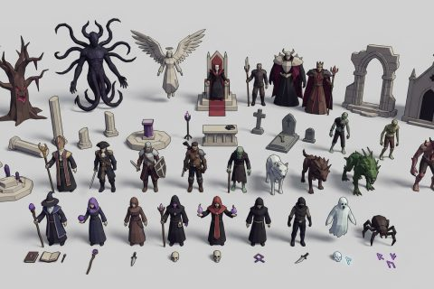

# Grimlight Denizens kit

In production, 38 parts so far. Every part below is already free to use.

[Open the kit on Polyfork](https://polyfork.dev/kit/grimlight-denizens-kit-a6dc02) · [All kits](../README.md#kits)

<table>
<tr>
<td align="center" valign="top" width="25%"> <a href="https://polyfork.dev/asset/root-colossus-2b995e">Amber-Eyed Root Colossus</a> <a href="https://polyfork.dev/cdn/root-colossus-2b995e.glb">GLB</a> · <a href="https://polyfork.dev/cdn/root-colossus-2b995e.mjs">module</a></td>
<td align="center" valign="top" width="25%"> <a href="https://polyfork.dev/asset/undead-pirate-608c9b">Barnacled Ghost Captain</a> <a href="https://polyfork.dev/cdn/undead-pirate-608c9b.glb">GLB</a> · <a href="https://polyfork.dev/cdn/undead-pirate-608c9b.mjs">module</a></td>
<td align="center" valign="top" width="25%"> <a href="https://polyfork.dev/asset/bell-warden-838915">Bell-Helmed Warden</a> <a href="https://polyfork.dev/cdn/bell-warden-838915.glb">GLB</a> · <a href="https://polyfork.dev/cdn/bell-warden-838915.mjs">module</a></td>
<td align="center" valign="top" width="25%"> <a href="https://polyfork.dev/asset/sunken-diver-6e1193">Brass-Helmed Drowned Diver</a> <a href="https://polyfork.dev/cdn/sunken-diver-6e1193.glb">GLB</a> · <a href="https://polyfork.dev/cdn/sunken-diver-6e1193.mjs">module</a></td>
</tr>
<tr>
<td align="center" valign="top" width="25%"> <a href="https://polyfork.dev/asset/volcano-barbarian-31dd2e">Bucket-Horned Scrap Barbarian</a> <a href="https://polyfork.dev/cdn/volcano-barbarian-31dd2e.glb">GLB</a> · <a href="https://polyfork.dev/cdn/volcano-barbarian-31dd2e.mjs">module</a></td>
<td align="center" valign="top" width="25%"> <a href="https://polyfork.dev/asset/fire-cultist-05e52e">Charcoal-Skinned Fire Cultist</a> <a href="https://polyfork.dev/cdn/fire-cultist-05e52e.glb">GLB</a> · <a href="https://polyfork.dev/cdn/fire-cultist-05e52e.mjs">module</a></td>
<td align="center" valign="top" width="25%"> <a href="https://polyfork.dev/asset/spectral-stag-d19dc1">Crystal-Antlered Spectral Stag</a> <a href="https://polyfork.dev/cdn/spectral-stag-d19dc1.glb">GLB</a> · <a href="https://polyfork.dev/cdn/spectral-stag-d19dc1.mjs">module</a></td>
<td align="center" valign="top" width="25%"> <a href="https://polyfork.dev/asset/ember-dog-50b92d">Ember-Cracked Hound</a> <a href="https://polyfork.dev/cdn/ember-dog-50b92d.glb">GLB</a> · <a href="https://polyfork.dev/cdn/ember-dog-50b92d.mjs">module</a></td>
</tr>
<tr>
<td align="center" valign="top" width="25%"> <a href="https://polyfork.dev/asset/cathedral-angel-c97346">Faceless Glass-Winged Angel</a> <a href="https://polyfork.dev/cdn/cathedral-angel-c97346.glb">GLB</a> · <a href="https://polyfork.dev/cdn/cathedral-angel-c97346.mjs">module</a></td>
<td align="center" valign="top" width="25%"> <a href="https://polyfork.dev/asset/deep-dweller-1aedaf">Fish-Eyed Deep Dweller</a> <a href="https://polyfork.dev/cdn/deep-dweller-1aedaf.glb">GLB</a> · <a href="https://polyfork.dev/cdn/deep-dweller-1aedaf.mjs">module</a></td>
<td align="center" valign="top" width="25%"> <a href="https://polyfork.dev/asset/swamp-child-150d0e">Five-Scaled Swamp Child</a> <a href="https://polyfork.dev/cdn/swamp-child-150d0e.glb">GLB</a> · <a href="https://polyfork.dev/cdn/swamp-child-150d0e.mjs">module</a></td>
<td align="center" valign="top" width="25%"> <a href="https://polyfork.dev/asset/swamp-butcher-dd66d1">Hook-Handed Swamp Butcher</a> <a href="https://polyfork.dev/cdn/swamp-butcher-dd66d1.glb">GLB</a> · <a href="https://polyfork.dev/cdn/swamp-butcher-dd66d1.mjs">module</a></td>
</tr>
<tr>
<td align="center" valign="top" width="25%"> <a href="https://polyfork.dev/asset/honey-moth-bede6c">Human-Faced Wax Moth</a> <a href="https://polyfork.dev/cdn/honey-moth-bede6c.glb">GLB</a> · <a href="https://polyfork.dev/cdn/honey-moth-bede6c.mjs">module</a></td>
<td align="center" valign="top" width="25%"> <a href="https://polyfork.dev/asset/forest-witch-63e5f9">Leaf-Shawled Forest Witch</a> <a href="https://polyfork.dev/cdn/forest-witch-63e5f9.glb">GLB</a> · <a href="https://polyfork.dev/cdn/forest-witch-63e5f9.mjs">module</a></td>
<td align="center" valign="top" width="25%"> <a href="https://polyfork.dev/asset/cathedral-statue-36eaad">Living Cathedral Statue</a> <a href="https://polyfork.dev/cdn/cathedral-statue-36eaad.glb">GLB</a> · <a href="https://polyfork.dev/cdn/cathedral-statue-36eaad.mjs">module</a></td>
<td align="center" valign="top" width="25%"> <a href="https://polyfork.dev/asset/angler-one-e18fde">Lure-Headed Angler</a> <a href="https://polyfork.dev/cdn/angler-one-e18fde.glb">GLB</a> · <a href="https://polyfork.dev/cdn/angler-one-e18fde.mjs">module</a></td>
</tr>
<tr>
<td align="center" valign="top" width="25%"> <a href="https://polyfork.dev/asset/hospital-nurse-4099d6">Masked Plague Nurse</a> <a href="https://polyfork.dev/cdn/hospital-nurse-4099d6.glb">GLB</a> · <a href="https://polyfork.dev/cdn/hospital-nurse-4099d6.mjs">module</a></td>
<td align="center" valign="top" width="25%"> <a href="https://polyfork.dev/asset/mushroom-druid-def610">Mushroom-Capped Oracle</a> <a href="https://polyfork.dev/cdn/mushroom-druid-def610.glb">GLB</a> · <a href="https://polyfork.dev/cdn/mushroom-druid-def610.mjs">module</a></td>
<td align="center" valign="top" width="25%"> <a href="https://polyfork.dev/asset/order-judge-3db47a">One-Eyed Seal Judge</a> <a href="https://polyfork.dev/cdn/order-judge-3db47a.glb">GLB</a> · <a href="https://polyfork.dev/cdn/order-judge-3db47a.mjs">module</a></td>
<td align="center" valign="top" width="25%"> <a href="https://polyfork.dev/asset/bat-65af1a">Pale-Eyed Crypt Bat</a> <a href="https://polyfork.dev/cdn/bat-65af1a.glb">GLB</a> · <a href="https://polyfork.dev/cdn/bat-65af1a.mjs">module</a></td>
</tr>
<tr>
<td align="center" valign="top" width="25%"> <a href="https://polyfork.dev/asset/bloom-elemental-bbe733">Petal-Faced Vine Keeper</a> <a href="https://polyfork.dev/cdn/bloom-elemental-bbe733.glb">GLB</a> · <a href="https://polyfork.dev/cdn/bloom-elemental-bbe733.mjs">module</a></td>
<td align="center" valign="top" width="25%"> <a href="https://polyfork.dev/asset/fungus-host-22004a">Pit-Eyed Fungus Host</a> <a href="https://polyfork.dev/cdn/fungus-host-22004a.glb">GLB</a> · <a href="https://polyfork.dev/cdn/fungus-host-22004a.mjs">module</a></td>
<td align="center" valign="top" width="25%"> <a href="https://polyfork.dev/asset/portal-60d5e6">Portal</a> <a href="https://polyfork.dev/cdn/portal-60d5e6.glb">GLB</a> · <a href="https://polyfork.dev/cdn/portal-60d5e6.mjs">module</a></td>
<td align="center" valign="top" width="25%"> <a href="https://polyfork.dev/asset/rat-kobold-d2974f">Rat-Snouted Kobold</a> <a href="https://polyfork.dev/cdn/rat-kobold-d2974f.glb">GLB</a> · <a href="https://polyfork.dev/cdn/rat-kobold-d2974f.mjs">module</a></td>
</tr>
<tr>
<td align="center" valign="top" width="25%"> <a href="https://polyfork.dev/asset/choir-singer-0989af">Sewn-Eyed Choir Boy</a> <a href="https://polyfork.dev/cdn/choir-singer-0989af.glb">GLB</a> · <a href="https://polyfork.dev/cdn/choir-singer-0989af.mjs">module</a></td>
<td align="center" valign="top" width="25%"> <a href="https://polyfork.dev/asset/black-smith-57c9b2">Singe-Bearded Foundry Smith</a> <a href="https://polyfork.dev/cdn/black-smith-57c9b2.glb">GLB</a> · <a href="https://polyfork.dev/cdn/black-smith-57c9b2.mjs">module</a></td>
<td align="center" valign="top" width="25%"> <a href="https://polyfork.dev/asset/bone-warrior-3a0f95">Skull-Helmed Bone Warrior</a> <a href="https://polyfork.dev/cdn/bone-warrior-3a0f95.glb">GLB</a> · <a href="https://polyfork.dev/cdn/bone-warrior-3a0f95.mjs">module</a></td>
<td align="center" valign="top" width="25%"> <a href="https://polyfork.dev/asset/knight-of-the-forge-7e2bee">Slit-Helmed Forge Sealer</a> <a href="https://polyfork.dev/cdn/knight-of-the-forge-7e2bee.glb">GLB</a> · <a href="https://polyfork.dev/cdn/knight-of-the-forge-7e2bee.mjs">module</a></td>
</tr>
<tr>
<td align="center" valign="top" width="25%"> <a href="https://polyfork.dev/asset/ashen-assassin-1ab976">Soot-Wraith Assassin</a> <a href="https://polyfork.dev/cdn/ashen-assassin-1ab976.glb">GLB</a> · <a href="https://polyfork.dev/cdn/ashen-assassin-1ab976.mjs">module</a></td>
<td align="center" valign="top" width="25%"> <a href="https://polyfork.dev/asset/wendigo-hunter-241d5c">Stag-Skull Wendigo Hunter</a> <a href="https://polyfork.dev/cdn/wendigo-hunter-241d5c.glb">GLB</a> · <a href="https://polyfork.dev/cdn/wendigo-hunter-241d5c.mjs">module</a></td>
<td align="center" valign="top" width="25%"> <a href="https://polyfork.dev/asset/starkeeper-6c3760">Starkeeper, the Star-Touched Astronomer</a> <a href="https://polyfork.dev/cdn/starkeeper-6c3760.glb">GLB</a> · <a href="https://polyfork.dev/cdn/starkeeper-6c3760.mjs">module</a></td>
<td align="center" valign="top" width="25%"> <a href="https://polyfork.dev/asset/sea-occultist-36c1b7">Tentacle-Faced Occultist</a> <a href="https://polyfork.dev/cdn/sea-occultist-36c1b7.glb">GLB</a> · <a href="https://polyfork.dev/cdn/sea-occultist-36c1b7.mjs">module</a></td>
</tr>
<tr>
<td align="center" valign="top" width="25%"> <a href="https://polyfork.dev/asset/the-drowned-behemoth-889bd3">The Drowned Behemoth</a> <a href="https://polyfork.dev/cdn/the-drowned-behemoth-889bd3.glb">GLB</a> · <a href="https://polyfork.dev/cdn/the-drowned-behemoth-889bd3.mjs">module</a></td>
<td align="center" valign="top" width="25%"> <a href="https://polyfork.dev/asset/whisperer-f69bce">The Whisperer</a> <a href="https://polyfork.dev/cdn/whisperer-f69bce.glb">GLB</a> · <a href="https://polyfork.dev/cdn/whisperer-f69bce.mjs">module</a></td>
<td align="center" valign="top" width="25%"> <a href="https://polyfork.dev/asset/thorn-boar-669ac9">Thorn-Backed Boar</a> <a href="https://polyfork.dev/cdn/thorn-boar-669ac9.glb">GLB</a> · <a href="https://polyfork.dev/cdn/thorn-boar-669ac9.mjs">module</a></td>
<td align="center" valign="top" width="25%"> <a href="https://polyfork.dev/asset/bog-fiend-cfd54c">Toad-Headed Bog Fiend</a> <a href="https://polyfork.dev/cdn/bog-fiend-cfd54c.glb">GLB</a> · <a href="https://polyfork.dev/cdn/bog-fiend-cfd54c.mjs">module</a></td>
</tr>
<tr>
<td align="center" valign="top" width="25%"> <a href="https://polyfork.dev/asset/varka-5a6264">Varka, the Iron-Fused Smith</a> <a href="https://polyfork.dev/cdn/varka-5a6264.glb">GLB</a> · <a href="https://polyfork.dev/cdn/varka-5a6264.mjs">module</a></td>
<td align="center" valign="top" width="25%"> <a href="https://polyfork.dev/asset/flesh-eater-8401c3">Wide-Jawed Ghoul</a> <a href="https://polyfork.dev/cdn/flesh-eater-8401c3.glb">GLB</a> · <a href="https://polyfork.dev/cdn/flesh-eater-8401c3.mjs">module</a></td>
</tr>
</table>
