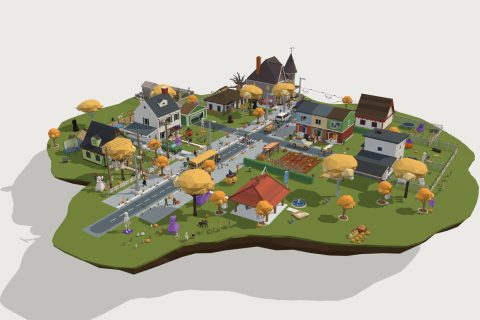

# Halloween Night

61 free low-poly parts on one palette and one scale, so everything you combine belongs to the same world.

[Open the kit on Polyfork](https://polyfork.dev/kit/halloween-night-46ade4) · [All kits](../README.md#kits)

<table>
<tr>
<td align="center" valign="top" width="25%"> <a href="https://polyfork.dev/asset/apple-bobbing-tub-d1872e">Apple Bobbing Tub</a> <a href="https://polyfork.dev/cdn/apple-bobbing-tub-d1872e.glb">GLB</a> · <a href="https://polyfork.dev/cdn/apple-bobbing-tub-d1872e.mjs">module</a></td>
<td align="center" valign="top" width="25%"> <a href="https://polyfork.dev/asset/arched-cemetery-gate-bdca7c">Arched Cemetery Gate</a> <a href="https://polyfork.dev/cdn/arched-cemetery-gate-bdca7c.glb">GLB</a> · <a href="https://polyfork.dev/cdn/arched-cemetery-gate-bdca7c.mjs">module</a></td>
<td align="center" valign="top" width="25%"> <a href="https://polyfork.dev/asset/bare-thorn-bush-91a238">Bare Thorn Bush</a> <a href="https://polyfork.dev/cdn/bare-thorn-bush-91a238.glb">GLB</a> · <a href="https://polyfork.dev/cdn/bare-thorn-bush-91a238.mjs">module</a></td>
<td align="center" valign="top" width="25%"> <a href="https://polyfork.dev/asset/arched-black-cat-407cf6">Black Cat</a> <a href="https://polyfork.dev/cdn/arched-black-cat-407cf6.glb">GLB</a> · <a href="https://polyfork.dev/cdn/arched-black-cat-407cf6.mjs">module</a></td>
</tr>
<tr>
<td align="center" valign="top" width="25%"> <a href="https://polyfork.dev/asset/bubbling-tripod-cauldron-124e15">Bubbling Tripod Cauldron</a> <a href="https://polyfork.dev/cdn/bubbling-tripod-cauldron-124e15.glb">GLB</a> · <a href="https://polyfork.dev/cdn/bubbling-tripod-cauldron-124e15.mjs">module</a></td>
<td align="center" valign="top" width="25%"> <a href="https://polyfork.dev/asset/carved-headstone-09d9f8">Carved Headstone</a> <a href="https://polyfork.dev/cdn/carved-headstone-09d9f8.glb">GLB</a> · <a href="https://polyfork.dev/cdn/carved-headstone-09d9f8.mjs">module</a></td>
<td align="center" valign="top" width="25%"> <a href="https://polyfork.dev/asset/cemetery-fieldstone-wall-run-ab9077">Cemetery Fieldstone Wall Run</a> <a href="https://polyfork.dev/cdn/cemetery-fieldstone-wall-run-ab9077.glb">GLB</a> · <a href="https://polyfork.dev/cdn/cemetery-fieldstone-wall-run-ab9077.mjs">module</a></td>
<td align="center" valign="top" width="25%"> <a href="https://polyfork.dev/asset/cemetery-lantern-post-fed352">Cemetery Lantern Post</a> <a href="https://polyfork.dev/cdn/cemetery-lantern-post-fed352.glb">GLB</a> · <a href="https://polyfork.dev/cdn/cemetery-lantern-post-fed352.mjs">module</a></td>
</tr>
<tr>
<td align="center" valign="top" width="25%"> <a href="https://polyfork.dev/asset/cemetery-lawn-tile-5c12ca">Cemetery Lawn Tile</a> <a href="https://polyfork.dev/cdn/cemetery-lawn-tile-5c12ca.glb">GLB</a> · <a href="https://polyfork.dev/cdn/cemetery-lawn-tile-5c12ca.mjs">module</a></td>
<td align="center" valign="top" width="25%"> <a href="https://polyfork.dev/asset/coffin-prop-d62082">Coffin Prop</a> <a href="https://polyfork.dev/cdn/coffin-prop-d62082.glb">GLB</a> · <a href="https://polyfork.dev/cdn/coffin-prop-d62082.mjs">module</a></td>
<td align="center" valign="top" width="25%"> <a href="https://polyfork.dev/asset/corn-maze-wall-run-22b0da">Corn Maze Wall Run</a> <a href="https://polyfork.dev/cdn/corn-maze-wall-run-22b0da.glb">GLB</a> · <a href="https://polyfork.dev/cdn/corn-maze-wall-run-22b0da.mjs">module</a></td>
<td align="center" valign="top" width="25%"> <a href="https://polyfork.dev/asset/crow-194434">Crow</a> <a href="https://polyfork.dev/cdn/crow-194434.glb">GLB</a> · <a href="https://polyfork.dev/cdn/crow-194434.mjs">module</a></td>
</tr>
<tr>
<td align="center" valign="top" width="25%"> <a href="https://polyfork.dev/asset/family-mausoleum-c2a009">Family Mausoleum</a> <a href="https://polyfork.dev/cdn/family-mausoleum-c2a009.glb">GLB</a> · <a href="https://polyfork.dev/cdn/family-mausoleum-c2a009.mjs">module</a></td>
<td align="center" valign="top" width="25%"> <a href="https://polyfork.dev/asset/foam-yard-gravestone-d64ffc">Foam Yard Gravestone</a> <a href="https://polyfork.dev/cdn/foam-yard-gravestone-d64ffc.glb">GLB</a> · <a href="https://polyfork.dev/cdn/foam-yard-gravestone-d64ffc.mjs">module</a></td>
<td align="center" valign="top" width="25%"> <a href="https://polyfork.dev/asset/giant-yard-inflatable-ff4573">Giant Yard Inflatable</a> <a href="https://polyfork.dev/cdn/giant-yard-inflatable-ff4573.glb">GLB</a> · <a href="https://polyfork.dev/cdn/giant-yard-inflatable-ff4573.mjs">module</a></td>
<td align="center" valign="top" width="25%"> <a href="https://polyfork.dev/asset/giant-yard-skeleton-770f04">Giant Yard Skeleton</a> <a href="https://polyfork.dev/cdn/giant-yard-skeleton-770f04.glb">GLB</a> · <a href="https://polyfork.dev/cdn/giant-yard-skeleton-770f04.mjs">module</a></td>
</tr>
<tr>
<td align="center" valign="top" width="25%"> <a href="https://polyfork.dev/asset/giant-yard-spider-70ddce">Giant Yard Spider</a> <a href="https://polyfork.dev/cdn/giant-yard-spider-70ddce.glb">GLB</a> · <a href="https://polyfork.dev/cdn/giant-yard-spider-70ddce.mjs">module</a></td>
<td align="center" valign="top" width="25%"> <a href="https://polyfork.dev/asset/grave-mound-169ec3">Grave Mound</a> <a href="https://polyfork.dev/cdn/grave-mound-169ec3.glb">GLB</a> · <a href="https://polyfork.dev/cdn/grave-mound-169ec3.mjs">module</a></td>
<td align="center" valign="top" width="25%"> <a href="https://polyfork.dev/asset/halloween-door-wreath-89f677">Halloween Door Wreath</a> <a href="https://polyfork.dev/cdn/halloween-door-wreath-89f677.glb">GLB</a> · <a href="https://polyfork.dev/cdn/halloween-door-wreath-89f677.mjs">module</a></td>
<td align="center" valign="top" width="25%"> <a href="https://polyfork.dev/asset/halloween-night-terrain-e0482b">Halloween Night Terrain</a> <a href="https://polyfork.dev/cdn/halloween-night-terrain-e0482b.glb">GLB</a> · <a href="https://polyfork.dev/cdn/halloween-night-terrain-e0482b.mjs">module</a></td>
</tr>
<tr>
<td align="center" valign="top" width="25%"> <a href="https://polyfork.dev/asset/halloween-yard-scarecrow-cb0ffb">Halloween Yard Scarecrow</a> <a href="https://polyfork.dev/cdn/halloween-yard-scarecrow-cb0ffb.glb">GLB</a> · <a href="https://polyfork.dev/cdn/halloween-yard-scarecrow-cb0ffb.mjs">module</a></td>
<td align="center" valign="top" width="25%"> <a href="https://polyfork.dev/asset/hand-painted-arrow-sign-883df2">Hand-Painted Arrow Sign</a> <a href="https://polyfork.dev/cdn/hand-painted-arrow-sign-883df2.glb">GLB</a> · <a href="https://polyfork.dev/cdn/hand-painted-arrow-sign-883df2.mjs">module</a></td>
<td align="center" valign="top" width="25%"> <a href="https://polyfork.dev/asset/hanging-cheesecloth-ghosts-c569cf">Hanging Cheesecloth Ghosts</a> <a href="https://polyfork.dev/cdn/hanging-cheesecloth-ghosts-c569cf.glb">GLB</a> · <a href="https://polyfork.dev/cdn/hanging-cheesecloth-ghosts-c569cf.mjs">module</a></td>
<td align="center" valign="top" width="25%"> <a href="https://polyfork.dev/asset/haunted-victorian-house-886931">Haunted Victorian House</a> <a href="https://polyfork.dev/cdn/haunted-victorian-house-886931.glb">GLB</a> · <a href="https://polyfork.dev/cdn/haunted-victorian-house-886931.mjs">module</a></td>
</tr>
<tr>
<td align="center" valign="top" width="25%"> <a href="https://polyfork.dev/asset/hayride-wagon-1641de">Hayride Wagon</a> <a href="https://polyfork.dev/cdn/hayride-wagon-1641de.glb">GLB</a> · <a href="https://polyfork.dev/cdn/hayride-wagon-1641de.mjs">module</a></td>
<td align="center" valign="top" width="25%"> <a href="https://polyfork.dev/asset/jack-o-lantern-0b1ddb">Jack-o&#039;-Lantern</a> <a href="https://polyfork.dev/cdn/jack-o-lantern-0b1ddb.glb">GLB</a> · <a href="https://polyfork.dev/cdn/jack-o-lantern-0b1ddb.mjs">module</a></td>
<td align="center" valign="top" width="25%"> <a href="https://polyfork.dev/asset/kid-in-a-bedsheet-f9c403">Kid in a Bedsheet Ghost Costume</a> <a href="https://polyfork.dev/cdn/kid-in-a-bedsheet-f9c403.glb">GLB</a> · <a href="https://polyfork.dev/cdn/kid-in-a-bedsheet-f9c403.mjs">module</a></td>
<td align="center" valign="top" width="25%"> <a href="https://polyfork.dev/asset/kid-in-a-black-2e5f87">Kid in a Black Cat Costume</a> <a href="https://polyfork.dev/cdn/kid-in-a-black-2e5f87.glb">GLB</a> · <a href="https://polyfork.dev/cdn/kid-in-a-black-2e5f87.mjs">module</a></td>
</tr>
<tr>
<td align="center" valign="top" width="25%"> <a href="https://polyfork.dev/asset/kid-in-a-caped-663f11">Kid in a Caped Hero Costume</a> <a href="https://polyfork.dev/cdn/kid-in-a-caped-663f11.glb">GLB</a> · <a href="https://polyfork.dev/cdn/kid-in-a-caped-663f11.mjs">module</a></td>
<td align="center" valign="top" width="25%"><a href="https://polyfork.dev/asset/kid-in-a-cardboard-670f7d">Kid in a Cardboard Robot Costume</a> <a href="https://polyfork.dev/cdn/kid-in-a-cardboard-670f7d.glb">GLB</a> · <a href="https://polyfork.dev/cdn/kid-in-a-cardboard-670f7d.mjs">module</a></td>
<td align="center" valign="top" width="25%"> <a href="https://polyfork.dev/asset/kid-in-a-pumpkin-169f79">Kid in a Pumpkin Costume</a> <a href="https://polyfork.dev/cdn/kid-in-a-pumpkin-169f79.glb">GLB</a> · <a href="https://polyfork.dev/cdn/kid-in-a-pumpkin-169f79.mjs">module</a></td>
<td align="center" valign="top" width="25%"> <a href="https://polyfork.dev/asset/kid-in-a-skeleton-6bb49d">Kid in a Skeleton Suit</a> <a href="https://polyfork.dev/cdn/kid-in-a-skeleton-6bb49d.glb">GLB</a> · <a href="https://polyfork.dev/cdn/kid-in-a-skeleton-6bb49d.mjs">module</a></td>
</tr>
<tr>
<td align="center" valign="top" width="25%"> <a href="https://polyfork.dev/asset/kid-witch-01c770">Kid Witch</a> <a href="https://polyfork.dev/cdn/kid-witch-01c770.glb">GLB</a> · <a href="https://polyfork.dev/cdn/kid-witch-01c770.mjs">module</a></td>
<td align="center" valign="top" width="25%"> <a href="https://polyfork.dev/asset/mossy-stone-steps-1beb4d">Mossy Stone Steps</a> <a href="https://polyfork.dev/cdn/mossy-stone-steps-1beb4d.glb">GLB</a> · <a href="https://polyfork.dev/cdn/mossy-stone-steps-1beb4d.mjs">module</a></td>
<td align="center" valign="top" width="25%"> <a href="https://polyfork.dev/asset/neighbour-handing-out-candy-2c1159">Neighbour Handing Out Candy</a> <a href="https://polyfork.dev/cdn/neighbour-handing-out-candy-2c1159.glb">GLB</a> · <a href="https://polyfork.dev/cdn/neighbour-handing-out-candy-2c1159.mjs">module</a></td>
<td align="center" valign="top" width="25%"> <a href="https://polyfork.dev/asset/orange-and-purple-string-1fbdab">Orange and Purple String Light Run</a> <a href="https://polyfork.dev/cdn/orange-and-purple-string-1fbdab.glb">GLB</a> · <a href="https://polyfork.dev/cdn/orange-and-purple-string-1fbdab.mjs">module</a></td>
</tr>
<tr>
<td align="center" valign="top" width="25%"> <a href="https://polyfork.dev/asset/paper-bag-luminaria-0e8a1a">Paper Bag Luminaria</a> <a href="https://polyfork.dev/cdn/paper-bag-luminaria-0e8a1a.glb">GLB</a> · <a href="https://polyfork.dev/cdn/paper-bag-luminaria-0e8a1a.mjs">module</a></td>
<td align="center" valign="top" width="25%"> <a href="https://polyfork.dev/asset/paper-bat-string-57fe8e">Paper Bat String</a> <a href="https://polyfork.dev/cdn/paper-bat-string-57fe8e.glb">GLB</a> · <a href="https://polyfork.dev/cdn/paper-bat-string-57fe8e.mjs">module</a></td>
<td align="center" valign="top" width="25%"> <a href="https://polyfork.dev/asset/parent-chaperone-79e535">Parent Chaperone</a> <a href="https://polyfork.dev/cdn/parent-chaperone-79e535.glb">GLB</a> · <a href="https://polyfork.dev/cdn/parent-chaperone-79e535.mjs">module</a></td>
<td align="center" valign="top" width="25%"> <a href="https://polyfork.dev/asset/pile-of-wrapped-candy-7fe300">Pile of Wrapped Candy</a> <a href="https://polyfork.dev/cdn/pile-of-wrapped-candy-7fe300.glb">GLB</a> · <a href="https://polyfork.dev/cdn/pile-of-wrapped-candy-7fe300.mjs">module</a></td>
</tr>
<tr>
<td align="center" valign="top" width="25%"> <a href="https://polyfork.dev/asset/please-take-one-candy-2eed38">Please-Take-One Candy Bowl</a> <a href="https://polyfork.dev/cdn/please-take-one-candy-2eed38.glb">GLB</a> · <a href="https://polyfork.dev/cdn/please-take-one-candy-2eed38.mjs">module</a></td>
<td align="center" valign="top" width="25%"> <a href="https://polyfork.dev/asset/plywood-yard-silhouette-9071e1">Plywood Yard Silhouette</a> <a href="https://polyfork.dev/cdn/plywood-yard-silhouette-9071e1.glb">GLB</a> · <a href="https://polyfork.dev/cdn/plywood-yard-silhouette-9071e1.mjs">module</a></td>
<td align="center" valign="top" width="25%"> <a href="https://polyfork.dev/asset/porch-cobweb-drape-6c2f0f">Porch Cobweb Drape</a> <a href="https://polyfork.dev/cdn/porch-cobweb-drape-6c2f0f.glb">GLB</a> · <a href="https://polyfork.dev/cdn/porch-cobweb-drape-6c2f0f.mjs">module</a></td>
<td align="center" valign="top" width="25%"> <a href="https://polyfork.dev/asset/porch-pumpkin-display-bbc997">Porch Pumpkin Display</a> <a href="https://polyfork.dev/cdn/porch-pumpkin-display-bbc997.glb">GLB</a> · <a href="https://polyfork.dev/cdn/porch-pumpkin-display-bbc997.mjs">module</a></td>
</tr>
<tr>
<td align="center" valign="top" width="25%"> <a href="https://polyfork.dev/asset/porch-straw-bale-c47f80">Porch Straw Bale</a> <a href="https://polyfork.dev/cdn/porch-straw-bale-c47f80.glb">GLB</a> · <a href="https://polyfork.dev/cdn/porch-straw-bale-c47f80.mjs">module</a></td>
<td align="center" valign="top" width="25%"> <a href="https://polyfork.dev/asset/potted-autumn-mums-08db8c">Potted Autumn Mums</a> <a href="https://polyfork.dev/cdn/potted-autumn-mums-08db8c.glb">GLB</a> · <a href="https://polyfork.dev/cdn/potted-autumn-mums-08db8c.mjs">module</a></td>
<td align="center" valign="top" width="25%"> <a href="https://polyfork.dev/asset/pumpkin-bin-5177e8">Pumpkin Bin</a> <a href="https://polyfork.dev/cdn/pumpkin-bin-5177e8.glb">GLB</a> · <a href="https://polyfork.dev/cdn/pumpkin-bin-5177e8.mjs">module</a></td>
<td align="center" valign="top" width="25%"> <a href="https://polyfork.dev/asset/pumpkin-patch-farm-stand-5c30be">Pumpkin Patch Farm Stand</a> <a href="https://polyfork.dev/cdn/pumpkin-patch-farm-stand-5c30be.glb">GLB</a> · <a href="https://polyfork.dev/cdn/pumpkin-patch-farm-stand-5c30be.mjs">module</a></td>
</tr>
<tr>
<td align="center" valign="top" width="25%"> <a href="https://polyfork.dev/asset/pumpkin-patch-tile-b5e5de">Pumpkin Patch Tile</a> <a href="https://polyfork.dev/cdn/pumpkin-patch-tile-b5e5de.glb">GLB</a> · <a href="https://polyfork.dev/cdn/pumpkin-patch-tile-b5e5de.mjs">module</a></td>
<td align="center" valign="top" width="25%"> <a href="https://polyfork.dev/asset/pumpkin-stand-keeper-77ced9">Pumpkin Stand Keeper</a> <a href="https://polyfork.dev/cdn/pumpkin-stand-keeper-77ced9.glb">GLB</a> · <a href="https://polyfork.dev/cdn/pumpkin-stand-keeper-77ced9.mjs">module</a></td>
<td align="center" valign="top" width="25%"> <a href="https://polyfork.dev/asset/pumpkin-vine-7f5c9b">Pumpkin Vine</a> <a href="https://polyfork.dev/cdn/pumpkin-vine-7f5c9b.glb">GLB</a> · <a href="https://polyfork.dev/cdn/pumpkin-vine-7f5c9b.mjs">module</a></td>
<td align="center" valign="top" width="25%"> <a href="https://polyfork.dev/asset/skeleton-crawling-out-of-24b6ae">Skeleton Crawling Out of the Lawn</a> <a href="https://polyfork.dev/cdn/skeleton-crawling-out-of-24b6ae.glb">GLB</a> · <a href="https://polyfork.dev/cdn/skeleton-crawling-out-of-24b6ae.mjs">module</a></td>
</tr>
<tr>
<td align="center" valign="top" width="25%"> <a href="https://polyfork.dev/asset/teen-zombie-b5bb27">Teen Zombie</a> <a href="https://polyfork.dev/cdn/teen-zombie-b5bb27.glb">GLB</a> · <a href="https://polyfork.dev/cdn/teen-zombie-b5bb27.mjs">module</a></td>
<td align="center" valign="top" width="25%"> <a href="https://polyfork.dev/asset/tied-corn-stalk-bundle-c1d042">Tied Corn Stalk Bundle</a> <a href="https://polyfork.dev/cdn/tied-corn-stalk-bundle-c1d042.glb">GLB</a> · <a href="https://polyfork.dev/cdn/tied-corn-stalk-bundle-c1d042.mjs">module</a></td>
<td align="center" valign="top" width="25%"> <a href="https://polyfork.dev/asset/twisted-dead-oak-49457b">Twisted Dead Oak</a> <a href="https://polyfork.dev/cdn/twisted-dead-oak-49457b.glb">GLB</a> · <a href="https://polyfork.dev/cdn/twisted-dead-oak-49457b.mjs">module</a></td>
<td align="center" valign="top" width="25%"> <a href="https://polyfork.dev/asset/vintage-hearse-3b2ec1">Vintage Hearse</a> <a href="https://polyfork.dev/cdn/vintage-hearse-3b2ec1.glb">GLB</a> · <a href="https://polyfork.dev/cdn/vintage-hearse-3b2ec1.mjs">module</a></td>
</tr>
<tr>
<td align="center" valign="top" width="25%"> <a href="https://polyfork.dev/asset/weeping-stone-angel-644ce3">Weeping Stone Angel</a> <a href="https://polyfork.dev/cdn/weeping-stone-angel-644ce3.glb">GLB</a> · <a href="https://polyfork.dev/cdn/weeping-stone-angel-644ce3.mjs">module</a></td>
<td align="center" valign="top" width="25%"> <a href="https://polyfork.dev/asset/witch-crashed-into-a-b06bb6">Witch Crashed into a Tree Trunk</a> <a href="https://polyfork.dev/cdn/witch-crashed-into-a-b06bb6.glb">GLB</a> · <a href="https://polyfork.dev/cdn/witch-crashed-into-a-b06bb6.mjs">module</a></td>
<td align="center" valign="top" width="25%"> <a href="https://polyfork.dev/asset/witch-s-broom-ec84c6">Witch&#039;s Broom</a> <a href="https://polyfork.dev/cdn/witch-s-broom-ec84c6.glb">GLB</a> · <a href="https://polyfork.dev/cdn/witch-s-broom-ec84c6.mjs">module</a></td>
<td align="center" valign="top" width="25%"> <a href="https://polyfork.dev/asset/wrought-iron-cemetery-fence-f1a113">Wrought-Iron Cemetery Fence Run</a> <a href="https://polyfork.dev/cdn/wrought-iron-cemetery-fence-f1a113.glb">GLB</a> · <a href="https://polyfork.dev/cdn/wrought-iron-cemetery-fence-f1a113.mjs">module</a></td>
</tr>
<tr>
<td align="center" valign="top" width="25%"> <a href="https://polyfork.dev/asset/yard-fog-machine-1fa049">Yard Fog Machine</a> <a href="https://polyfork.dev/cdn/yard-fog-machine-1fa049.glb">GLB</a> · <a href="https://polyfork.dev/cdn/yard-fog-machine-1fa049.mjs">module</a></td>
</tr>
</table>
