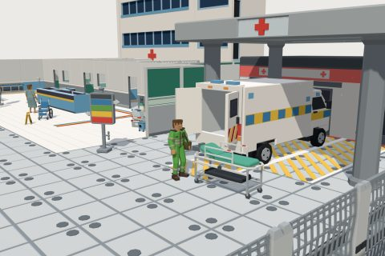

# Hospital kit

57 free low-poly parts on one palette and one scale, so everything you combine belongs to the same world.

[Open the kit on Polyfork](https://polyfork.dev/kit/hospital-kit-2ebfcb) · [All kits](../README.md#kits)

<table>
<tr>
<td align="center" valign="top" width="25%"> <a href="https://polyfork.dev/asset/air-ambulance-helicopter-ed9acc">Air Ambulance Helicopter</a> <a href="https://polyfork.dev/cdn/air-ambulance-helicopter-ed9acc.glb">GLB</a> · <a href="https://polyfork.dev/cdn/air-ambulance-helicopter-ed9acc.mjs">module</a></td>
<td align="center" valign="top" width="25%"> <a href="https://polyfork.dev/asset/ambulance-bay-hatching-decal-106ff2">Ambulance Bay Hatching Decal</a> <a href="https://polyfork.dev/cdn/ambulance-bay-hatching-decal-106ff2.glb">GLB</a> · <a href="https://polyfork.dev/cdn/ambulance-bay-hatching-decal-106ff2.mjs">module</a></td>
<td align="center" valign="top" width="25%"> <a href="https://polyfork.dev/asset/ambulance-van-29919a">Ambulance Van</a> <a href="https://polyfork.dev/cdn/ambulance-van-29919a.glb">GLB</a> · <a href="https://polyfork.dev/cdn/ambulance-van-29919a.mjs">module</a></td>
<td align="center" valign="top" width="25%"> <a href="https://polyfork.dev/asset/anaesthesia-machine-da4f50">Anaesthesia Machine</a> <a href="https://polyfork.dev/cdn/anaesthesia-machine-da4f50.glb">GLB</a> · <a href="https://polyfork.dev/cdn/anaesthesia-machine-da4f50.mjs">module</a></td>
</tr>
<tr>
<td align="center" valign="top" width="25%"> <a href="https://polyfork.dev/asset/bed-head-service-panel-67f6f6">Bed Head Service Panel</a> <a href="https://polyfork.dev/cdn/bed-head-service-panel-67f6f6.glb">GLB</a> · <a href="https://polyfork.dev/cdn/bed-head-service-panel-67f6f6.mjs">module</a></td>
<td align="center" valign="top" width="25%"> <a href="https://polyfork.dev/asset/bedside-locker-0e1723">Bedside Locker</a> <a href="https://polyfork.dev/cdn/bedside-locker-0e1723.glb">GLB</a> · <a href="https://polyfork.dev/cdn/bedside-locker-0e1723.mjs">module</a></td>
<td align="center" valign="top" width="25%"> <a href="https://polyfork.dev/asset/clinic-annexe-0f56d1">Clinic Annexe</a> <a href="https://polyfork.dev/cdn/clinic-annexe-0f56d1.glb">GLB</a> · <a href="https://polyfork.dev/cdn/clinic-annexe-0f56d1.mjs">module</a></td>
<td align="center" valign="top" width="25%"> <a href="https://polyfork.dev/asset/clinical-vinyl-floor-tile-d5e53e">Clinical Vinyl Floor Tile</a> <a href="https://polyfork.dev/cdn/clinical-vinyl-floor-tile-d5e53e.glb">GLB</a> · <a href="https://polyfork.dev/cdn/clinical-vinyl-floor-tile-d5e53e.mjs">module</a></td>
</tr>
<tr>
<td align="center" valign="top" width="25%"> <a href="https://polyfork.dev/asset/clinical-wall-module-935f50">Clinical Wall Module</a> <a href="https://polyfork.dev/cdn/clinical-wall-module-935f50.glb">GLB</a> · <a href="https://polyfork.dev/cdn/clinical-wall-module-935f50.mjs">module</a></td>
<td align="center" valign="top" width="25%"> <a href="https://polyfork.dev/asset/clinical-waste-bin-471ff3">Clinical Waste Bin</a> <a href="https://polyfork.dev/cdn/clinical-waste-bin-471ff3.glb">GLB</a> · <a href="https://polyfork.dev/cdn/clinical-waste-bin-471ff3.mjs">module</a></td>
<td align="center" valign="top" width="25%"> <a href="https://polyfork.dev/asset/clipped-hedge-section-11a067">Clipped Hedge Section</a> <a href="https://polyfork.dev/cdn/clipped-hedge-section-11a067.glb">GLB</a> · <a href="https://polyfork.dev/cdn/clipped-hedge-section-11a067.mjs">module</a></td>
<td align="center" valign="top" width="25%"> <a href="https://polyfork.dev/asset/corridor-handrail-run-cc6555">Corridor Handrail Run</a> <a href="https://polyfork.dev/cdn/corridor-handrail-run-cc6555.glb">GLB</a> · <a href="https://polyfork.dev/cdn/corridor-handrail-run-cc6555.mjs">module</a></td>
</tr>
<tr>
<td align="center" valign="top" width="25%"> <a href="https://polyfork.dev/asset/crash-cart-201b46">Crash Cart</a> <a href="https://polyfork.dev/cdn/crash-cart-201b46.glb">GLB</a> · <a href="https://polyfork.dev/cdn/crash-cart-201b46.mjs">module</a></td>
<td align="center" valign="top" width="25%"> <a href="https://polyfork.dev/asset/ct-scanner-gantry-2032b8">CT Scanner Gantry</a> <a href="https://polyfork.dev/cdn/ct-scanner-gantry-2032b8.glb">GLB</a> · <a href="https://polyfork.dev/cdn/ct-scanner-gantry-2032b8.mjs">module</a></td>
<td align="center" valign="top" width="25%"> <a href="https://polyfork.dev/asset/doctor-d49de0">Doctor</a> <a href="https://polyfork.dev/cdn/doctor-d49de0.glb">GLB</a> · <a href="https://polyfork.dev/cdn/doctor-d49de0.mjs">module</a></td>
<td align="center" valign="top" width="25%"> <a href="https://polyfork.dev/asset/emergency-entrance-block-9e5caf">Emergency Entrance Block</a> <a href="https://polyfork.dev/cdn/emergency-entrance-block-9e5caf.glb">GLB</a> · <a href="https://polyfork.dev/cdn/emergency-entrance-block-9e5caf.mjs">module</a></td>
</tr>
<tr>
<td align="center" valign="top" width="25%"> <a href="https://polyfork.dev/asset/entrance-canopy-8378c5">Entrance Canopy</a> <a href="https://polyfork.dev/cdn/entrance-canopy-8378c5.glb">GLB</a> · <a href="https://polyfork.dev/cdn/entrance-canopy-8378c5.mjs">module</a></td>
<td align="center" valign="top" width="25%"> <a href="https://polyfork.dev/asset/examination-couch-1ab5b9">Examination Couch</a> <a href="https://polyfork.dev/cdn/examination-couch-1ab5b9.glb">GLB</a> · <a href="https://polyfork.dev/cdn/examination-couch-1ab5b9.mjs">module</a></td>
<td align="center" valign="top" width="25%"> <a href="https://polyfork.dev/asset/glazed-partition-module-91d966">Glazed Partition Module</a> <a href="https://polyfork.dev/cdn/glazed-partition-module-91d966.glb">GLB</a> · <a href="https://polyfork.dev/cdn/glazed-partition-module-91d966.mjs">module</a></td>
<td align="center" valign="top" width="25%"> <a href="https://polyfork.dev/asset/hand-sanitiser-dispenser-a48460">Hand Sanitiser Dispenser</a> <a href="https://polyfork.dev/cdn/hand-sanitiser-dispenser-a48460.glb">GLB</a> · <a href="https://polyfork.dev/cdn/hand-sanitiser-dispenser-a48460.mjs">module</a></td>
</tr>
<tr>
<td align="center" valign="top" width="25%"> <a href="https://polyfork.dev/asset/helipad-marking-decal-e697dd">Helipad Marking Decal</a> <a href="https://polyfork.dev/cdn/helipad-marking-decal-e697dd.glb">GLB</a> · <a href="https://polyfork.dev/cdn/helipad-marking-decal-e697dd.mjs">module</a></td>
<td align="center" valign="top" width="25%"> <a href="https://polyfork.dev/asset/hospital-bed-31132d">Hospital Bed</a> <a href="https://polyfork.dev/cdn/hospital-bed-31132d.glb">GLB</a> · <a href="https://polyfork.dev/cdn/hospital-bed-31132d.mjs">module</a></td>
<td align="center" valign="top" width="25%"> <a href="https://polyfork.dev/asset/illuminated-bollard-9af752">Illuminated Bollard</a> <a href="https://polyfork.dev/cdn/illuminated-bollard-9af752.glb">GLB</a> · <a href="https://polyfork.dev/cdn/illuminated-bollard-9af752.mjs">module</a></td>
<td align="center" valign="top" width="25%"> <a href="https://polyfork.dev/asset/instrument-trolley-bb1ff7">Instrument Trolley</a> <a href="https://polyfork.dev/cdn/instrument-trolley-bb1ff7.glb">GLB</a> · <a href="https://polyfork.dev/cdn/instrument-trolley-bb1ff7.mjs">module</a></td>
</tr>
<tr>
<td align="center" valign="top" width="25%"> <a href="https://polyfork.dev/asset/iv-drip-stand-20ab17">IV Drip Stand</a> <a href="https://polyfork.dev/cdn/iv-drip-stand-20ab17.glb">GLB</a> · <a href="https://polyfork.dev/cdn/iv-drip-stand-20ab17.mjs">module</a></td>
<td align="center" valign="top" width="25%"> <a href="https://polyfork.dev/asset/linen-trolley-08a3f6">Linen Trolley</a> <a href="https://polyfork.dev/cdn/linen-trolley-08a3f6.glb">GLB</a> · <a href="https://polyfork.dev/cdn/linen-trolley-08a3f6.mjs">module</a></td>
<td align="center" valign="top" width="25%"> <a href="https://polyfork.dev/asset/medical-gas-cylinder-a2d6a7">Medical Gas Cylinder</a> <a href="https://polyfork.dev/cdn/medical-gas-cylinder-a2d6a7.glb">GLB</a> · <a href="https://polyfork.dev/cdn/medical-gas-cylinder-a2d6a7.mjs">module</a></td>
<td align="center" valign="top" width="25%"> <a href="https://polyfork.dev/asset/medicine-cabinet-a9f13d">Medicine Cabinet</a> <a href="https://polyfork.dev/cdn/medicine-cabinet-a9f13d.glb">GLB</a> · <a href="https://polyfork.dev/cdn/medicine-cabinet-a9f13d.mjs">module</a></td>
</tr>
<tr>
<td align="center" valign="top" width="25%"> <a href="https://polyfork.dev/asset/mesh-fence-panel-11d4e2">Mesh Fence Panel</a> <a href="https://polyfork.dev/cdn/mesh-fence-panel-11d4e2.glb">GLB</a> · <a href="https://polyfork.dev/cdn/mesh-fence-panel-11d4e2.mjs">module</a></td>
<td align="center" valign="top" width="25%"> <a href="https://polyfork.dev/asset/mop-bucket-trolley-ed94e7">Mop Bucket Trolley</a> <a href="https://polyfork.dev/cdn/mop-bucket-trolley-ed94e7.glb">GLB</a> · <a href="https://polyfork.dev/cdn/mop-bucket-trolley-ed94e7.mjs">module</a></td>
<td align="center" valign="top" width="25%"> <a href="https://polyfork.dev/asset/multi-storey-ward-block-2bac82">Multi-Storey Ward Block</a> <a href="https://polyfork.dev/cdn/multi-storey-ward-block-2bac82.glb">GLB</a> · <a href="https://polyfork.dev/cdn/multi-storey-ward-block-2bac82.mjs">module</a></td>
<td align="center" valign="top" width="25%"> <a href="https://polyfork.dev/asset/neonatal-incubator-28de34">Neonatal Incubator</a> <a href="https://polyfork.dev/cdn/neonatal-incubator-28de34.glb">GLB</a> · <a href="https://polyfork.dev/cdn/neonatal-incubator-28de34.mjs">module</a></td>
</tr>
<tr>
<td align="center" valign="top" width="25%"> <a href="https://polyfork.dev/asset/operating-table-af1a83">Operating Table</a> <a href="https://polyfork.dev/cdn/operating-table-af1a83.glb">GLB</a> · <a href="https://polyfork.dev/cdn/operating-table-af1a83.mjs">module</a></td>
<td align="center" valign="top" width="25%"> <a href="https://polyfork.dev/asset/overbed-table-7409a5">Overbed Table</a> <a href="https://polyfork.dev/cdn/overbed-table-7409a5.glb">GLB</a> · <a href="https://polyfork.dev/cdn/overbed-table-7409a5.mjs">module</a></td>
<td align="center" valign="top" width="25%"> <a href="https://polyfork.dev/asset/paramedic-b0f358">Paramedic</a> <a href="https://polyfork.dev/cdn/paramedic-b0f358.glb">GLB</a> · <a href="https://polyfork.dev/cdn/paramedic-b0f358.mjs">module</a></td>
<td align="center" valign="top" width="25%"> <a href="https://polyfork.dev/asset/patient-in-gown-fdab75">Patient In Gown</a> <a href="https://polyfork.dev/cdn/patient-in-gown-fdab75.glb">GLB</a> · <a href="https://polyfork.dev/cdn/patient-in-gown-fdab75.mjs">module</a></td>
</tr>
<tr>
<td align="center" valign="top" width="25%"> <a href="https://polyfork.dev/asset/patient-trolley-5a44d6">Patient Trolley</a> <a href="https://polyfork.dev/cdn/patient-trolley-5a44d6.glb">GLB</a> · <a href="https://polyfork.dev/cdn/patient-trolley-5a44d6.mjs">module</a></td>
<td align="center" valign="top" width="25%"> <a href="https://polyfork.dev/asset/precast-paving-tile-967791">Precast Paving Tile</a> <a href="https://polyfork.dev/cdn/precast-paving-tile-967791.glb">GLB</a> · <a href="https://polyfork.dev/cdn/precast-paving-tile-967791.mjs">module</a></td>
<td align="center" valign="top" width="25%"> <a href="https://polyfork.dev/asset/privacy-curtain-panel-1e1593">Privacy Curtain Panel</a> <a href="https://polyfork.dev/cdn/privacy-curtain-panel-1e1593.glb">GLB</a> · <a href="https://polyfork.dev/cdn/privacy-curtain-panel-1e1593.mjs">module</a></td>
<td align="center" valign="top" width="25%"> <a href="https://polyfork.dev/asset/reception-desk-3d6913">Reception Desk</a> <a href="https://polyfork.dev/cdn/reception-desk-3d6913.glb">GLB</a> · <a href="https://polyfork.dev/cdn/reception-desk-3d6913.mjs">module</a></td>
</tr>
<tr>
<td align="center" valign="top" width="25%"> <a href="https://polyfork.dev/asset/rooftop-helipad-deck-24e53c">Rooftop Helipad Deck</a> <a href="https://polyfork.dev/cdn/rooftop-helipad-deck-24e53c.glb">GLB</a> · <a href="https://polyfork.dev/cdn/rooftop-helipad-deck-24e53c.mjs">module</a></td>
<td align="center" valign="top" width="25%"> <a href="https://polyfork.dev/asset/scrub-sink-station-3cefec">Scrub Sink Station</a> <a href="https://polyfork.dev/cdn/scrub-sink-station-3cefec.glb">GLB</a> · <a href="https://polyfork.dev/cdn/scrub-sink-station-3cefec.mjs">module</a></td>
<td align="center" valign="top" width="25%"> <a href="https://polyfork.dev/asset/sharps-bin-7f5587">Sharps Bin</a> <a href="https://polyfork.dev/cdn/sharps-bin-7f5587.glb">GLB</a> · <a href="https://polyfork.dev/cdn/sharps-bin-7f5587.mjs">module</a></td>
<td align="center" valign="top" width="25%"> <a href="https://polyfork.dev/asset/stackable-supply-tote-eca42d">Stackable Supply Tote</a> <a href="https://polyfork.dev/cdn/stackable-supply-tote-eca42d.glb">GLB</a> · <a href="https://polyfork.dev/cdn/stackable-supply-tote-eca42d.mjs">module</a></td>
</tr>
<tr>
<td align="center" valign="top" width="25%"> <a href="https://polyfork.dev/asset/stair-and-lift-core-a13dd9">Stair And Lift Core</a> <a href="https://polyfork.dev/cdn/stair-and-lift-core-a13dd9.glb">GLB</a> · <a href="https://polyfork.dev/cdn/stair-and-lift-core-a13dd9.mjs">module</a></td>
<td align="center" valign="top" width="25%"> <a href="https://polyfork.dev/asset/standby-generator-enclosure-9d48f6">Standby Generator Enclosure</a> <a href="https://polyfork.dev/cdn/standby-generator-enclosure-9d48f6.glb">GLB</a> · <a href="https://polyfork.dev/cdn/standby-generator-enclosure-9d48f6.mjs">module</a></td>
<td align="center" valign="top" width="25%"> <a href="https://polyfork.dev/asset/supply-shelving-rack-ae446a">Supply Shelving Rack</a> <a href="https://polyfork.dev/cdn/supply-shelving-rack-ae446a.glb">GLB</a> · <a href="https://polyfork.dev/cdn/supply-shelving-rack-ae446a.mjs">module</a></td>
<td align="center" valign="top" width="25%"> <a href="https://polyfork.dev/asset/surgeon-in-scrubs-4f1360">Surgeon In Scrubs</a> <a href="https://polyfork.dev/cdn/surgeon-in-scrubs-4f1360.glb">GLB</a> · <a href="https://polyfork.dev/cdn/surgeon-in-scrubs-4f1360.mjs">module</a></td>
</tr>
<tr>
<td align="center" valign="top" width="25%"> <a href="https://polyfork.dev/asset/surgical-light-7628dd">Surgical Light</a> <a href="https://polyfork.dev/cdn/surgical-light-7628dd.glb">GLB</a> · <a href="https://polyfork.dev/cdn/surgical-light-7628dd.mjs">module</a></td>
<td align="center" valign="top" width="25%"> <a href="https://polyfork.dev/asset/suspended-ceiling-grid-panel-ea01a3">Suspended Ceiling Grid Panel</a> <a href="https://polyfork.dev/cdn/suspended-ceiling-grid-panel-ea01a3.glb">GLB</a> · <a href="https://polyfork.dev/cdn/suspended-ceiling-grid-panel-ea01a3.mjs">module</a></td>
<td align="center" valign="top" width="25%"> <a href="https://polyfork.dev/asset/vital-signs-monitor-632560">Vital Signs Monitor</a> <a href="https://polyfork.dev/cdn/vital-signs-monitor-632560.glb">GLB</a> · <a href="https://polyfork.dev/cdn/vital-signs-monitor-632560.mjs">module</a></td>
<td align="center" valign="top" width="25%"> <a href="https://polyfork.dev/asset/waiting-room-chair-5e20cc">Waiting Room Chair</a> <a href="https://polyfork.dev/cdn/waiting-room-chair-5e20cc.glb">GLB</a> · <a href="https://polyfork.dev/cdn/waiting-room-chair-5e20cc.mjs">module</a></td>
</tr>
<tr>
<td align="center" valign="top" width="25%"> <a href="https://polyfork.dev/asset/ward-nurse-84b61d">Ward Nurse</a> <a href="https://polyfork.dev/cdn/ward-nurse-84b61d.glb">GLB</a> · <a href="https://polyfork.dev/cdn/ward-nurse-84b61d.mjs">module</a></td>
<td align="center" valign="top" width="25%"> <a href="https://polyfork.dev/asset/wayfinding-stripe-decal-017b76">Wayfinding Stripe Decal</a> <a href="https://polyfork.dev/cdn/wayfinding-stripe-decal-017b76.glb">GLB</a> · <a href="https://polyfork.dev/cdn/wayfinding-stripe-decal-017b76.mjs">module</a></td>
<td align="center" valign="top" width="25%"> <a href="https://polyfork.dev/asset/wayfinding-totem-sign-dbb4be">Wayfinding Totem Sign</a> <a href="https://polyfork.dev/cdn/wayfinding-totem-sign-dbb4be.glb">GLB</a> · <a href="https://polyfork.dev/cdn/wayfinding-totem-sign-dbb4be.mjs">module</a></td>
<td align="center" valign="top" width="25%"> <a href="https://polyfork.dev/asset/wet-floor-sign-d39967">Wet Floor Sign</a> <a href="https://polyfork.dev/cdn/wet-floor-sign-d39967.glb">GLB</a> · <a href="https://polyfork.dev/cdn/wet-floor-sign-d39967.mjs">module</a></td>
</tr>
<tr>
<td align="center" valign="top" width="25%"> <a href="https://polyfork.dev/asset/wheelchair-0584dc">Wheelchair</a> <a href="https://polyfork.dev/cdn/wheelchair-0584dc.glb">GLB</a> · <a href="https://polyfork.dev/cdn/wheelchair-0584dc.mjs">module</a></td>
</tr>
</table>
