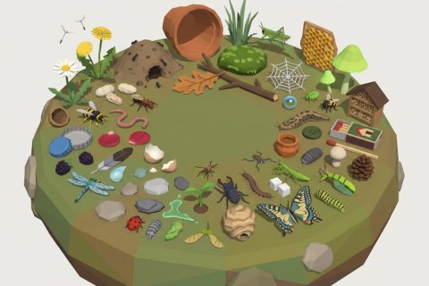

# Insect World kit

In production, 58 parts so far. Every part below is already free to use.

[Open the kit on Polyfork](https://polyfork.dev/kit/insect-world-e44b9f) · [All kits](../README.md#kits)

<table>
<tr>
<td align="center" valign="top" width="25%"> <a href="https://polyfork.dev/asset/acorn-cup-0ed13c">Acorn Cup</a> <a href="https://polyfork.dev/cdn/acorn-cup-0ed13c.glb">GLB</a> · <a href="https://polyfork.dev/cdn/acorn-cup-0ed13c.mjs">module</a></td>
<td align="center" valign="top" width="25%"> <a href="https://polyfork.dev/asset/ant-nest-chamber-6b786b">Ant Nest Chamber</a> <a href="https://polyfork.dev/cdn/ant-nest-chamber-6b786b.glb">GLB</a> · <a href="https://polyfork.dev/cdn/ant-nest-chamber-6b786b.mjs">module</a></td>
<td align="center" valign="top" width="25%"> <a href="https://polyfork.dev/asset/ant-nest-entrance-mound-f6136c">Ant Nest Entrance Mound</a> <a href="https://polyfork.dev/cdn/ant-nest-entrance-mound-f6136c.glb">GLB</a> · <a href="https://polyfork.dev/cdn/ant-nest-entrance-mound-f6136c.mjs">module</a></td>
<td align="center" valign="top" width="25%"> <a href="https://polyfork.dev/asset/ant-pupa-cocoon-3e6ebd">Ant Pupa Cocoon</a> <a href="https://polyfork.dev/cdn/ant-pupa-cocoon-3e6ebd.glb">GLB</a> · <a href="https://polyfork.dev/cdn/ant-pupa-cocoon-3e6ebd.mjs">module</a></td>
</tr>
<tr>
<td align="center" valign="top" width="25%"> <a href="https://polyfork.dev/asset/ant-queen-adff77">Ant Queen</a> <a href="https://polyfork.dev/cdn/ant-queen-adff77.glb">GLB</a> · <a href="https://polyfork.dev/cdn/ant-queen-adff77.mjs">module</a></td>
<td align="center" valign="top" width="25%"> <a href="https://polyfork.dev/asset/ant-tunnel-run-e4ce23">Ant Tunnel Run</a> <a href="https://polyfork.dev/cdn/ant-tunnel-run-e4ce23.glb">GLB</a> · <a href="https://polyfork.dev/cdn/ant-tunnel-run-e4ce23.mjs">module</a></td>
<td align="center" valign="top" width="25%"> <a href="https://polyfork.dev/asset/bottle-cap-cd96db">Bottle Cap</a> <a href="https://polyfork.dev/cdn/bottle-cap-cd96db.glb">GLB</a> · <a href="https://polyfork.dev/cdn/bottle-cap-cd96db.mjs">module</a></td>
<td align="center" valign="top" width="25%"> <a href="https://polyfork.dev/asset/bumblebee-queen-bc756f">Bumblebee Queen</a> <a href="https://polyfork.dev/cdn/bumblebee-queen-bc756f.glb">GLB</a> · <a href="https://polyfork.dev/cdn/bumblebee-queen-bc756f.mjs">module</a></td>
</tr>
<tr>
<td align="center" valign="top" width="25%"> <a href="https://polyfork.dev/asset/common-daisy-6b2004">Common Daisy</a> <a href="https://polyfork.dev/cdn/common-daisy-6b2004.glb">GLB</a> · <a href="https://polyfork.dev/cdn/common-daisy-6b2004.mjs">module</a></td>
<td align="center" valign="top" width="25%"> <a href="https://polyfork.dev/asset/common-wasp-12dab4">Common Wasp</a> <a href="https://polyfork.dev/cdn/common-wasp-12dab4.glb">GLB</a> · <a href="https://polyfork.dev/cdn/common-wasp-12dab4.mjs">module</a></td>
<td align="center" valign="top" width="25%"> <a href="https://polyfork.dev/asset/dandelion-ff19ee">Dandelion</a> <a href="https://polyfork.dev/cdn/dandelion-ff19ee.glb">GLB</a> · <a href="https://polyfork.dev/cdn/dandelion-ff19ee.mjs">module</a></td>
<td align="center" valign="top" width="25%"> <a href="https://polyfork.dev/asset/dandelion-seed-c6a8b7">Dandelion Seed</a> <a href="https://polyfork.dev/cdn/dandelion-seed-c6a8b7.glb">GLB</a> · <a href="https://polyfork.dev/cdn/dandelion-seed-c6a8b7.mjs">module</a></td>
</tr>
<tr>
<td align="center" valign="top" width="25%"> <a href="https://polyfork.dev/asset/dewdrop-18a51f">Dewdrop</a> <a href="https://polyfork.dev/cdn/dewdrop-18a51f.glb">GLB</a> · <a href="https://polyfork.dev/cdn/dewdrop-18a51f.mjs">module</a></td>
<td align="center" valign="top" width="25%"> <a href="https://polyfork.dev/asset/earthworm-4a0bde">Earthworm</a> <a href="https://polyfork.dev/cdn/earthworm-4a0bde.glb">GLB</a> · <a href="https://polyfork.dev/cdn/earthworm-4a0bde.mjs">module</a></td>
<td align="center" valign="top" width="25%"> <a href="https://polyfork.dev/asset/eggshell-half-d30a1c">Eggshell Half</a> <a href="https://polyfork.dev/cdn/eggshell-half-d30a1c.glb">GLB</a> · <a href="https://polyfork.dev/cdn/eggshell-half-d30a1c.mjs">module</a></td>
<td align="center" valign="top" width="25%"> <a href="https://polyfork.dev/asset/fallen-bird-feather-ffbc11">Fallen Bird Feather</a> <a href="https://polyfork.dev/cdn/fallen-bird-feather-ffbc11.glb">GLB</a> · <a href="https://polyfork.dev/cdn/fallen-bird-feather-ffbc11.mjs">module</a></td>
</tr>
<tr>
<td align="center" valign="top" width="25%"> <a href="https://polyfork.dev/asset/fallen-blackberry-27dc5a">Fallen Blackberry</a> <a href="https://polyfork.dev/cdn/fallen-blackberry-27dc5a.glb">GLB</a> · <a href="https://polyfork.dev/cdn/fallen-blackberry-27dc5a.mjs">module</a></td>
<td align="center" valign="top" width="25%"> <a href="https://polyfork.dev/asset/fallen-oak-leaf-5b15fe">Fallen Oak Leaf</a> <a href="https://polyfork.dev/cdn/fallen-oak-leaf-5b15fe.glb">GLB</a> · <a href="https://polyfork.dev/cdn/fallen-oak-leaf-5b15fe.mjs">module</a></td>
<td align="center" valign="top" width="25%"> <a href="https://polyfork.dev/asset/fallen-rose-petal-8b0c24">Fallen Rose Petal</a> <a href="https://polyfork.dev/cdn/fallen-rose-petal-8b0c24.glb">GLB</a> · <a href="https://polyfork.dev/cdn/fallen-rose-petal-8b0c24.mjs">module</a></td>
<td align="center" valign="top" width="25%"> <a href="https://polyfork.dev/asset/fallen-twig-4c64de">Fallen Twig</a> <a href="https://polyfork.dev/cdn/fallen-twig-4c64de.glb">GLB</a> · <a href="https://polyfork.dev/cdn/fallen-twig-4c64de.mjs">module</a></td>
</tr>
<tr>
<td align="center" valign="top" width="25%"> <a href="https://polyfork.dev/asset/firefly-d4ad7b">Firefly</a> <a href="https://polyfork.dev/cdn/firefly-d4ad7b.glb">GLB</a> · <a href="https://polyfork.dev/cdn/firefly-d4ad7b.mjs">module</a></td>
<td align="center" valign="top" width="25%"> <a href="https://polyfork.dev/asset/garden-orb-weaver-b32844">Garden Orb-Weaver</a> <a href="https://polyfork.dev/cdn/garden-orb-weaver-b32844.glb">GLB</a> · <a href="https://polyfork.dev/cdn/garden-orb-weaver-b32844.mjs">module</a></td>
<td align="center" valign="top" width="25%"> <a href="https://polyfork.dev/asset/glass-marble-4772bb">Glass Marble</a> <a href="https://polyfork.dev/cdn/glass-marble-4772bb.glb">GLB</a> · <a href="https://polyfork.dev/cdn/glass-marble-4772bb.mjs">module</a></td>
<td align="center" valign="top" width="25%"> <a href="https://polyfork.dev/asset/glowing-bonnet-mushroom-13f518">Glowing Bonnet Mushroom</a> <a href="https://polyfork.dev/cdn/glowing-bonnet-mushroom-13f518.glb">GLB</a> · <a href="https://polyfork.dev/cdn/glowing-bonnet-mushroom-13f518.mjs">module</a></td>
</tr>
<tr>
<td align="center" valign="top" width="25%"> <a href="https://polyfork.dev/asset/green-aphid-43ca9a">Green Aphid</a> <a href="https://polyfork.dev/cdn/green-aphid-43ca9a.glb">GLB</a> · <a href="https://polyfork.dev/cdn/green-aphid-43ca9a.mjs">module</a></td>
<td align="center" valign="top" width="25%"> <a href="https://polyfork.dev/asset/honeybee-2e4557">Honeybee</a> <a href="https://polyfork.dev/cdn/honeybee-2e4557.glb">GLB</a> · <a href="https://polyfork.dev/cdn/honeybee-2e4557.mjs">module</a></td>
<td align="center" valign="top" width="25%"> <a href="https://polyfork.dev/asset/insect-hotel-14d870">Insect Hotel</a> <a href="https://polyfork.dev/cdn/insect-hotel-14d870.glb">GLB</a> · <a href="https://polyfork.dev/cdn/insect-hotel-14d870.mjs">module</a></td>
<td align="center" valign="top" width="25%"> <a href="https://polyfork.dev/asset/leopard-slug-c37619">Leopard Slug</a> <a href="https://polyfork.dev/cdn/leopard-slug-c37619.glb">GLB</a> · <a href="https://polyfork.dev/cdn/leopard-slug-c37619.mjs">module</a></td>
</tr>
<tr>
<td align="center" valign="top" width="25%"> <a href="https://polyfork.dev/asset/lost-button-46f22a">Lost Button</a> <a href="https://polyfork.dev/cdn/lost-button-46f22a.glb">GLB</a> · <a href="https://polyfork.dev/cdn/lost-button-46f22a.mjs">module</a></td>
<td align="center" valign="top" width="25%"> <a href="https://polyfork.dev/asset/matchbox-house-2d2689">Matchbox House</a> <a href="https://polyfork.dev/cdn/matchbox-house-2d2689.glb">GLB</a> · <a href="https://polyfork.dev/cdn/matchbox-house-2d2689.mjs">module</a></td>
<td align="center" valign="top" width="25%"> <a href="https://polyfork.dev/asset/matchstick-b3147f">Matchstick</a> <a href="https://polyfork.dev/cdn/matchstick-b3147f.glb">GLB</a> · <a href="https://polyfork.dev/cdn/matchstick-b3147f.mjs">module</a></td>
<td align="center" valign="top" width="25%"> <a href="https://polyfork.dev/asset/meadow-grass-plant-7085e0">Meadow Grass Plant</a> <a href="https://polyfork.dev/cdn/meadow-grass-plant-7085e0.glb">GLB</a> · <a href="https://polyfork.dev/cdn/meadow-grass-plant-7085e0.mjs">module</a></td>
</tr>
<tr>
<td align="center" valign="top" width="25%"> <a href="https://polyfork.dev/asset/meadow-grasshopper-44b0dd">Meadow Grasshopper</a> <a href="https://polyfork.dev/cdn/meadow-grasshopper-44b0dd.glb">GLB</a> · <a href="https://polyfork.dev/cdn/meadow-grasshopper-44b0dd.mjs">module</a></td>
<td align="center" valign="top" width="25%"> <a href="https://polyfork.dev/asset/moss-cushion-2eabef">Moss Cushion</a> <a href="https://polyfork.dev/cdn/moss-cushion-2eabef.glb">GLB</a> · <a href="https://polyfork.dev/cdn/moss-cushion-2eabef.mjs">module</a></td>
<td align="center" valign="top" width="25%"> <a href="https://polyfork.dev/asset/orb-web-133aba">Orb Web</a> <a href="https://polyfork.dev/cdn/orb-web-133aba.glb">GLB</a> · <a href="https://polyfork.dev/cdn/orb-web-133aba.mjs">module</a></td>
<td align="center" valign="top" width="25%"> <a href="https://polyfork.dev/asset/pill-woodlouse-24f147">Pill Woodlouse</a> <a href="https://polyfork.dev/cdn/pill-woodlouse-24f147.glb">GLB</a> · <a href="https://polyfork.dev/cdn/pill-woodlouse-24f147.mjs">module</a></td>
</tr>
<tr>
<td align="center" valign="top" width="25%"> <a href="https://polyfork.dev/asset/pine-cone-e36f37">Pine Cone</a> <a href="https://polyfork.dev/cdn/pine-cone-e36f37.glb">GLB</a> · <a href="https://polyfork.dev/cdn/pine-cone-e36f37.mjs">module</a></td>
<td align="center" valign="top" width="25%"> <a href="https://polyfork.dev/asset/pond-skater-bba548">Pond Skater</a> <a href="https://polyfork.dev/cdn/pond-skater-bba548.glb">GLB</a> · <a href="https://polyfork.dev/cdn/pond-skater-bba548.mjs">module</a></td>
<td align="center" valign="top" width="25%"> <a href="https://polyfork.dev/asset/potter-wasp-pot-8ebfee">Potter Wasp Pot</a> <a href="https://polyfork.dev/cdn/potter-wasp-pot-8ebfee.glb">GLB</a> · <a href="https://polyfork.dev/cdn/potter-wasp-pot-8ebfee.mjs">module</a></td>
<td align="center" valign="top" width="25%"> <a href="https://polyfork.dev/asset/praying-mantis-3f697f">Praying Mantis</a> <a href="https://polyfork.dev/cdn/praying-mantis-3f697f.glb">GLB</a> · <a href="https://polyfork.dev/cdn/praying-mantis-3f697f.mjs">module</a></td>
</tr>
<tr>
<td align="center" valign="top" width="25%"> <a href="https://polyfork.dev/asset/puffball-mushroom-3b1324">Puffball Mushroom</a> <a href="https://polyfork.dev/cdn/puffball-mushroom-3b1324.glb">GLB</a> · <a href="https://polyfork.dev/cdn/puffball-mushroom-3b1324.mjs">module</a></td>
<td align="center" valign="top" width="25%"> <a href="https://polyfork.dev/asset/quartz-pebble-path-stone-23c014">Quartz Pebble Path Stone</a> <a href="https://polyfork.dev/cdn/quartz-pebble-path-stone-23c014.glb">GLB</a> · <a href="https://polyfork.dev/cdn/quartz-pebble-path-stone-23c014.mjs">module</a></td>
<td align="center" valign="top" width="25%"> <a href="https://polyfork.dev/asset/seven-spot-ladybird-f286a4">Seven-Spot Ladybird</a> <a href="https://polyfork.dev/cdn/seven-spot-ladybird-f286a4.glb">GLB</a> · <a href="https://polyfork.dev/cdn/seven-spot-ladybird-f286a4.mjs">module</a></td>
<td align="center" valign="top" width="25%"> <a href="https://polyfork.dev/asset/slate-flake-path-stone-514513">Slate Flake Path Stone</a> <a href="https://polyfork.dev/cdn/slate-flake-path-stone-514513.glb">GLB</a> · <a href="https://polyfork.dev/cdn/slate-flake-path-stone-514513.mjs">module</a></td>
</tr>
<tr>
<td align="center" valign="top" width="25%"> <a href="https://polyfork.dev/asset/slime-trail-decal-fa8b01">Slime Trail Decal</a> <a href="https://polyfork.dev/cdn/slime-trail-decal-fa8b01.glb">GLB</a> · <a href="https://polyfork.dev/cdn/slime-trail-decal-fa8b01.mjs">module</a></td>
<td align="center" valign="top" width="25%"> <a href="https://polyfork.dev/asset/sprouting-seedling-e0b9f1">Sprouting Seedling</a> <a href="https://polyfork.dev/cdn/sprouting-seedling-e0b9f1.glb">GLB</a> · <a href="https://polyfork.dev/cdn/sprouting-seedling-e0b9f1.mjs">module</a></td>
<td align="center" valign="top" width="25%"> <a href="https://polyfork.dev/asset/stag-beetle-906c6e">Stag Beetle</a> <a href="https://polyfork.dev/cdn/stag-beetle-906c6e.glb">GLB</a> · <a href="https://polyfork.dev/cdn/stag-beetle-906c6e.mjs">module</a></td>
<td align="center" valign="top" width="25%"> <a href="https://polyfork.dev/asset/stone-centipede-bd5ec1">Stone Centipede</a> <a href="https://polyfork.dev/cdn/stone-centipede-bd5ec1.glb">GLB</a> · <a href="https://polyfork.dev/cdn/stone-centipede-bd5ec1.mjs">module</a></td>
</tr>
<tr>
<td align="center" valign="top" width="25%"> <a href="https://polyfork.dev/asset/sugar-cube-4a50a5">Sugar Cube</a> <a href="https://polyfork.dev/cdn/sugar-cube-4a50a5.glb">GLB</a> · <a href="https://polyfork.dev/cdn/sugar-cube-4a50a5.mjs">module</a></td>
<td align="center" valign="top" width="25%"> <a href="https://polyfork.dev/asset/sunflower-seed-b4fbbd">Sunflower Seed</a> <a href="https://polyfork.dev/cdn/sunflower-seed-b4fbbd.glb">GLB</a> · <a href="https://polyfork.dev/cdn/sunflower-seed-b4fbbd.mjs">module</a></td>
<td align="center" valign="top" width="25%"> <a href="https://polyfork.dev/asset/swallowtail-caterpillar-a414da">Swallowtail Caterpillar</a> <a href="https://polyfork.dev/cdn/swallowtail-caterpillar-a414da.glb">GLB</a> · <a href="https://polyfork.dev/cdn/swallowtail-caterpillar-a414da.mjs">module</a></td>
<td align="center" valign="top" width="25%"> <a href="https://polyfork.dev/asset/swallowtail-chrysalis-bde444">Swallowtail Chrysalis</a> <a href="https://polyfork.dev/cdn/swallowtail-chrysalis-bde444.glb">GLB</a> · <a href="https://polyfork.dev/cdn/swallowtail-chrysalis-bde444.mjs">module</a></td>
</tr>
<tr>
<td align="center" valign="top" width="25%"> <a href="https://polyfork.dev/asset/sycamore-seed-24e5a2">Sycamore Seed</a> <a href="https://polyfork.dev/cdn/sycamore-seed-24e5a2.glb">GLB</a> · <a href="https://polyfork.dev/cdn/sycamore-seed-24e5a2.mjs">module</a></td>
<td align="center" valign="top" width="25%"> <a href="https://polyfork.dev/asset/upturned-clay-flowerpot-de9221">Upturned Clay Flowerpot</a> <a href="https://polyfork.dev/cdn/upturned-clay-flowerpot-de9221.glb">GLB</a> · <a href="https://polyfork.dev/cdn/upturned-clay-flowerpot-de9221.mjs">module</a></td>
<td align="center" valign="top" width="25%"> <a href="https://polyfork.dev/asset/wasp-paper-nest-68a6c0">Wasp Paper Nest</a> <a href="https://polyfork.dev/cdn/wasp-paper-nest-68a6c0.glb">GLB</a> · <a href="https://polyfork.dev/cdn/wasp-paper-nest-68a6c0.mjs">module</a></td>
<td align="center" valign="top" width="25%"> <a href="https://polyfork.dev/asset/white-clover-plant-6ed185">White Clover Plant</a> <a href="https://polyfork.dev/cdn/white-clover-plant-6ed185.glb">GLB</a> · <a href="https://polyfork.dev/cdn/white-clover-plant-6ed185.mjs">module</a></td>
</tr>
<tr>
<td align="center" valign="top" width="25%"> <a href="https://polyfork.dev/asset/wild-honeycomb-panel-877542">Wild Honeycomb Panel</a> <a href="https://polyfork.dev/cdn/wild-honeycomb-panel-877542.glb">GLB</a> · <a href="https://polyfork.dev/cdn/wild-honeycomb-panel-877542.mjs">module</a></td>
<td align="center" valign="top" width="25%"> <a href="https://polyfork.dev/asset/wood-ant-bae1f1">Wood Ant</a> <a href="https://polyfork.dev/cdn/wood-ant-bae1f1.glb">GLB</a> · <a href="https://polyfork.dev/cdn/wood-ant-bae1f1.mjs">module</a></td>
</tr>
</table>
