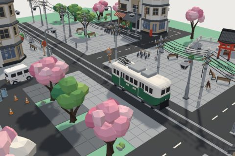

# Little Tokyo kit

57 free low-poly parts on one palette and one scale, so everything you combine belongs to the same world.

[Open the kit on Polyfork](https://polyfork.dev/kit/japanese-suburban-city-street-baa482) · [All kits](../README.md#kits)

<table>
<tr>
<td align="center" valign="top" width="25%"> <a href="https://polyfork.dev/asset/air-con-unit-9fadc2">Air-Con Unit</a> <a href="https://polyfork.dev/cdn/air-con-unit-9fadc2.glb">GLB</a> · <a href="https://polyfork.dev/cdn/air-con-unit-9fadc2.mjs">module</a></td>
<td align="center" valign="top" width="25%"> <a href="https://polyfork.dev/asset/alley-bar-hut-3e41f8">Alley Bar Hut</a> <a href="https://polyfork.dev/cdn/alley-bar-hut-3e41f8.glb">GLB</a> · <a href="https://polyfork.dev/cdn/alley-bar-hut-3e41f8.mjs">module</a></td>
<td align="center" valign="top" width="25%"> <a href="https://polyfork.dev/asset/alley-concrete-tile-56117b">Alley Concrete Tile</a> <a href="https://polyfork.dev/cdn/alley-concrete-tile-56117b.glb">GLB</a> · <a href="https://polyfork.dev/cdn/alley-concrete-tile-56117b.mjs">module</a></td>
<td align="center" valign="top" width="25%"> <a href="https://polyfork.dev/asset/amusement-parlour-7eb45f">Amusement Parlour</a> <a href="https://polyfork.dev/cdn/amusement-parlour-7eb45f.glb">GLB</a> · <a href="https://polyfork.dev/cdn/amusement-parlour-7eb45f.mjs">module</a></td>
</tr>
<tr>
<td align="center" valign="top" width="25%"> <a href="https://polyfork.dev/asset/apartment-block-6445af">Apartment Block</a> <a href="https://polyfork.dev/cdn/apartment-block-6445af.glb">GLB</a> · <a href="https://polyfork.dev/cdn/apartment-block-6445af.mjs">module</a></td>
<td align="center" valign="top" width="25%"> <a href="https://polyfork.dev/asset/asphalt-road-tile-f6593c">Asphalt Road Tile</a> <a href="https://polyfork.dev/cdn/asphalt-road-tile-f6593c.glb">GLB</a> · <a href="https://polyfork.dev/cdn/asphalt-road-tile-f6593c.mjs">module</a></td>
<td align="center" valign="top" width="25%"> <a href="https://polyfork.dev/asset/bathhouse-4ac41a">Bathhouse</a> <a href="https://polyfork.dev/cdn/bathhouse-4ac41a.glb">GLB</a> · <a href="https://polyfork.dev/cdn/bathhouse-4ac41a.mjs">module</a></td>
<td align="center" valign="top" width="25%"> <a href="https://polyfork.dev/asset/beverage-crate-c195c9">Beverage Crate</a> <a href="https://polyfork.dev/cdn/beverage-crate-c195c9.glb">GLB</a> · <a href="https://polyfork.dev/cdn/beverage-crate-c195c9.mjs">module</a></td>
</tr>
<tr>
<td align="center" valign="top" width="25%"> <a href="https://polyfork.dev/asset/bicycle-parking-rack-282058">Bicycle Parking Rack</a> <a href="https://polyfork.dev/cdn/bicycle-parking-rack-282058.glb">GLB</a> · <a href="https://polyfork.dev/cdn/bicycle-parking-rack-282058.mjs">module</a></td>
<td align="center" valign="top" width="25%"> <a href="https://polyfork.dev/asset/cherry-blossom-tree-3f7ab7">Cherry Blossom Tree</a> <a href="https://polyfork.dev/cdn/cherry-blossom-tree-3f7ab7.glb">GLB</a> · <a href="https://polyfork.dev/cdn/cherry-blossom-tree-3f7ab7.mjs">module</a></td>
<td align="center" valign="top" width="25%"> <a href="https://polyfork.dev/asset/city-bicycle-5b67d1">City Bicycle</a> <a href="https://polyfork.dev/cdn/city-bicycle-5b67d1.glb">GLB</a> · <a href="https://polyfork.dev/cdn/city-bicycle-5b67d1.mjs">module</a></td>
<td align="center" valign="top" width="25%"> <a href="https://polyfork.dev/asset/city-taxi-eefa91">City Taxi</a> <a href="https://polyfork.dev/cdn/city-taxi-eefa91.glb">GLB</a> · <a href="https://polyfork.dev/cdn/city-taxi-eefa91.mjs">module</a></td>
</tr>
<tr>
<td align="center" valign="top" width="25%"> <a href="https://polyfork.dev/asset/city-tram-0d092d">City Tram</a> <a href="https://polyfork.dev/cdn/city-tram-0d092d.glb">GLB</a> · <a href="https://polyfork.dev/cdn/city-tram-0d092d.mjs">module</a></td>
<td align="center" valign="top" width="25%"> <a href="https://polyfork.dev/asset/concrete-block-wall-02c715">Concrete Block Wall</a> <a href="https://polyfork.dev/cdn/concrete-block-wall-02c715.glb">GLB</a> · <a href="https://polyfork.dev/cdn/concrete-block-wall-02c715.mjs">module</a></td>
<td align="center" valign="top" width="25%"> <a href="https://polyfork.dev/asset/convenience-store-c30e1d">Convenience Store</a> <a href="https://polyfork.dev/cdn/convenience-store-c30e1d.glb">GLB</a> · <a href="https://polyfork.dev/cdn/convenience-store-c30e1d.mjs">module</a></td>
<td align="center" valign="top" width="25%"> <a href="https://polyfork.dev/asset/convex-traffic-mirror-a64d15">Convex Traffic Mirror</a> <a href="https://polyfork.dev/cdn/convex-traffic-mirror-a64d15.glb">GLB</a> · <a href="https://polyfork.dev/cdn/convex-traffic-mirror-a64d15.mjs">module</a></td>
</tr>
<tr>
<td align="center" valign="top" width="25%"> <a href="https://polyfork.dev/asset/corner-shophouse-ad15c2">Corner Shophouse</a> <a href="https://polyfork.dev/cdn/corner-shophouse-ad15c2.glb">GLB</a> · <a href="https://polyfork.dev/cdn/corner-shophouse-ad15c2.mjs">module</a></td>
<td align="center" valign="top" width="25%"> <a href="https://polyfork.dev/asset/delivery-moped-1aa2ce">Delivery Moped</a> <a href="https://polyfork.dev/cdn/delivery-moped-1aa2ce.glb">GLB</a> · <a href="https://polyfork.dev/cdn/delivery-moped-1aa2ce.mjs">module</a></td>
<td align="center" valign="top" width="25%"> <a href="https://polyfork.dev/asset/external-staircase-89f471">External Staircase</a> <a href="https://polyfork.dev/cdn/external-staircase-89f471.glb">GLB</a> · <a href="https://polyfork.dev/cdn/external-staircase-89f471.mjs">module</a></td>
<td align="center" valign="top" width="25%"> <a href="https://polyfork.dev/asset/fabric-awning-4d6acc">Fabric Awning</a> <a href="https://polyfork.dev/cdn/fabric-awning-4d6acc.glb">GLB</a> · <a href="https://polyfork.dev/cdn/fabric-awning-4d6acc.mjs">module</a></td>
</tr>
<tr>
<td align="center" valign="top" width="25%"> <a href="https://polyfork.dev/asset/flower-planter-550bfb">Flower Planter</a> <a href="https://polyfork.dev/cdn/flower-planter-550bfb.glb">GLB</a> · <a href="https://polyfork.dev/cdn/flower-planter-550bfb.mjs">module</a></td>
<td align="center" valign="top" width="25%"> <a href="https://polyfork.dev/asset/garden-rock-2d3b51">Garden Rock</a> <a href="https://polyfork.dev/cdn/garden-rock-2d3b51.glb">GLB</a> · <a href="https://polyfork.dev/cdn/garden-rock-2d3b51.mjs">module</a></td>
<td align="center" valign="top" width="25%"> <a href="https://polyfork.dev/asset/guardian-lion-statue-5bde18">Guardian Lion Statue</a> <a href="https://polyfork.dev/cdn/guardian-lion-statue-5bde18.glb">GLB</a> · <a href="https://polyfork.dev/cdn/guardian-lion-statue-5bde18.mjs">module</a></td>
<td align="center" valign="top" width="25%"> <a href="https://polyfork.dev/asset/guardrail-section-68c3c4">Guardrail Section</a> <a href="https://polyfork.dev/cdn/guardrail-section-68c3c4.glb">GLB</a> · <a href="https://polyfork.dev/cdn/guardrail-section-68c3c4.mjs">module</a></td>
</tr>
<tr>
<td align="center" valign="top" width="25%"> <a href="https://polyfork.dev/asset/kei-van-211ed5">Kei Van</a> <a href="https://polyfork.dev/cdn/kei-van-211ed5.glb">GLB</a> · <a href="https://polyfork.dev/cdn/kei-van-211ed5.mjs">module</a></td>
<td align="center" valign="top" width="25%"> <a href="https://polyfork.dev/asset/meter-box-1e6e42">Meter Box</a> <a href="https://polyfork.dev/cdn/meter-box-1e6e42.glb">GLB</a> · <a href="https://polyfork.dev/cdn/meter-box-1e6e42.mjs">module</a></td>
<td align="center" valign="top" width="25%"> <a href="https://polyfork.dev/asset/noren-curtain-7b9e53">Noren Curtain</a> <a href="https://polyfork.dev/cdn/noren-curtain-7b9e53.glb">GLB</a> · <a href="https://polyfork.dev/cdn/noren-curtain-7b9e53.mjs">module</a></td>
<td align="center" valign="top" width="25%"> <a href="https://polyfork.dev/asset/offering-box-c85bd3">Offering Box</a> <a href="https://polyfork.dev/cdn/offering-box-c85bd3.glb">GLB</a> · <a href="https://polyfork.dev/cdn/offering-box-c85bd3.mjs">module</a></td>
</tr>
<tr>
<td align="center" valign="top" width="25%"> <a href="https://polyfork.dev/asset/paper-lantern-3387e9">Paper Lantern</a> <a href="https://polyfork.dev/cdn/paper-lantern-3387e9.glb">GLB</a> · <a href="https://polyfork.dev/cdn/paper-lantern-3387e9.mjs">module</a></td>
<td align="center" valign="top" width="25%"> <a href="https://polyfork.dev/asset/pavement-tile-8a9740">Pavement Tile</a> <a href="https://polyfork.dev/cdn/pavement-tile-8a9740.glb">GLB</a> · <a href="https://polyfork.dev/cdn/pavement-tile-8a9740.mjs">module</a></td>
<td align="center" valign="top" width="25%"> <a href="https://polyfork.dev/asset/plastic-drum-da992f">Plastic Drum</a> <a href="https://polyfork.dev/cdn/plastic-drum-da992f.glb">GLB</a> · <a href="https://polyfork.dev/cdn/plastic-drum-da992f.mjs">module</a></td>
<td align="center" valign="top" width="25%"> <a href="https://polyfork.dev/asset/potted-shrub-43bd21">Potted Shrub</a> <a href="https://polyfork.dev/cdn/potted-shrub-43bd21.glb">GLB</a> · <a href="https://polyfork.dev/cdn/potted-shrub-43bd21.mjs">module</a></td>
</tr>
<tr>
<td align="center" valign="top" width="25%"> <a href="https://polyfork.dev/asset/purification-basin-93d3e5">Purification Basin</a> <a href="https://polyfork.dev/cdn/purification-basin-93d3e5.glb">GLB</a> · <a href="https://polyfork.dev/cdn/purification-basin-93d3e5.mjs">module</a></td>
<td align="center" valign="top" width="25%"> <a href="https://polyfork.dev/asset/ramen-yatai-stall-53974b">Ramen Yatai Stall</a> <a href="https://polyfork.dev/cdn/ramen-yatai-stall-53974b.glb">GLB</a> · <a href="https://polyfork.dev/cdn/ramen-yatai-stall-53974b.mjs">module</a></td>
<td align="center" valign="top" width="25%"> <a href="https://polyfork.dev/asset/red-post-box-f12045">Red Post Box</a> <a href="https://polyfork.dev/cdn/red-post-box-f12045.glb">GLB</a> · <a href="https://polyfork.dev/cdn/red-post-box-f12045.mjs">module</a></td>
<td align="center" valign="top" width="25%"> <a href="https://polyfork.dev/asset/roller-shutter-c58b4f">Roller Shutter</a> <a href="https://polyfork.dev/cdn/roller-shutter-c58b4f.glb">GLB</a> · <a href="https://polyfork.dev/cdn/roller-shutter-c58b4f.mjs">module</a></td>
</tr>
<tr>
<td align="center" valign="top" width="25%"> <a href="https://polyfork.dev/asset/salaryman-commuter-4170c1">Salaryman Commuter</a> <a href="https://polyfork.dev/cdn/salaryman-commuter-4170c1.glb">GLB</a> · <a href="https://polyfork.dev/cdn/salaryman-commuter-4170c1.mjs">module</a></td>
<td align="center" valign="top" width="25%"> <a href="https://polyfork.dev/asset/sandwich-board-sign-cb5e7c">Sandwich Board Sign</a> <a href="https://polyfork.dev/cdn/sandwich-board-sign-cb5e7c.glb">GLB</a> · <a href="https://polyfork.dev/cdn/sandwich-board-sign-cb5e7c.mjs">module</a></td>
<td align="center" valign="top" width="25%"> <a href="https://polyfork.dev/asset/school-student-385134">School Student</a> <a href="https://polyfork.dev/cdn/school-student-385134.glb">GLB</a> · <a href="https://polyfork.dev/cdn/school-student-385134.mjs">module</a></td>
<td align="center" valign="top" width="25%"> <a href="https://polyfork.dev/asset/shopkeeper-be5547">Shopkeeper</a> <a href="https://polyfork.dev/cdn/shopkeeper-be5547.glb">GLB</a> · <a href="https://polyfork.dev/cdn/shopkeeper-be5547.mjs">module</a></td>
</tr>
<tr>
<td align="center" valign="top" width="25%"> <a href="https://polyfork.dev/asset/small-shrine-hall-cb8b25">Small Shrine Hall</a> <a href="https://polyfork.dev/cdn/small-shrine-hall-cb8b25.glb">GLB</a> · <a href="https://polyfork.dev/cdn/small-shrine-hall-cb8b25.mjs">module</a></td>
<td align="center" valign="top" width="25%"> <a href="https://polyfork.dev/asset/stone-fence-panel-56d138">Stone Fence Panel</a> <a href="https://polyfork.dev/cdn/stone-fence-panel-56d138.glb">GLB</a> · <a href="https://polyfork.dev/cdn/stone-fence-panel-56d138.mjs">module</a></td>
<td align="center" valign="top" width="25%"> <a href="https://polyfork.dev/asset/stone-lantern-d56d0a">Stone Lantern</a> <a href="https://polyfork.dev/cdn/stone-lantern-d56d0a.glb">GLB</a> · <a href="https://polyfork.dev/cdn/stone-lantern-d56d0a.mjs">module</a></td>
<td align="center" valign="top" width="25%"> <a href="https://polyfork.dev/asset/street-bin-770173">Street Bin</a> <a href="https://polyfork.dev/cdn/street-bin-770173.glb">GLB</a> · <a href="https://polyfork.dev/cdn/street-bin-770173.mjs">module</a></td>
</tr>
<tr>
<td align="center" valign="top" width="25%"> <a href="https://polyfork.dev/asset/street-lamp-29f365">Street Lamp</a> <a href="https://polyfork.dev/cdn/street-lamp-29f365.glb">GLB</a> · <a href="https://polyfork.dev/cdn/street-lamp-29f365.mjs">module</a></td>
<td align="center" valign="top" width="25%"> <a href="https://polyfork.dev/asset/three-storey-shophouse-2f6378">Three-Storey Shophouse</a> <a href="https://polyfork.dev/cdn/three-storey-shophouse-2f6378.glb">GLB</a> · <a href="https://polyfork.dev/cdn/three-storey-shophouse-2f6378.mjs">module</a></td>
<td align="center" valign="top" width="25%"> <a href="https://polyfork.dev/asset/tiled-roof-section-6f1121">Tiled Roof Section</a> <a href="https://polyfork.dev/cdn/tiled-roof-section-6f1121.glb">GLB</a> · <a href="https://polyfork.dev/cdn/tiled-roof-section-6f1121.mjs">module</a></td>
<td align="center" valign="top" width="25%"> <a href="https://polyfork.dev/asset/torii-gate-402f30">Torii Gate</a> <a href="https://polyfork.dev/cdn/torii-gate-402f30.glb">GLB</a> · <a href="https://polyfork.dev/cdn/torii-gate-402f30.mjs">module</a></td>
</tr>
<tr>
<td align="center" valign="top" width="25%"> <a href="https://polyfork.dev/asset/traffic-cone-247748">Traffic Cone</a> <a href="https://polyfork.dev/cdn/traffic-cone-247748.glb">GLB</a> · <a href="https://polyfork.dev/cdn/traffic-cone-247748.mjs">module</a></td>
<td align="center" valign="top" width="25%"> <a href="https://polyfork.dev/asset/traffic-signal-2a517e">Traffic Signal</a> <a href="https://polyfork.dev/cdn/traffic-signal-2a517e.glb">GLB</a> · <a href="https://polyfork.dev/cdn/traffic-signal-2a517e.mjs">module</a></td>
<td align="center" valign="top" width="25%"> <a href="https://polyfork.dev/asset/tram-track-tile-f3c69a">Tram Track Tile</a> <a href="https://polyfork.dev/cdn/tram-track-tile-f3c69a.glb">GLB</a> · <a href="https://polyfork.dev/cdn/tram-track-tile-f3c69a.mjs">module</a></td>
<td align="center" valign="top" width="25%"> <a href="https://polyfork.dev/asset/two-storey-shophouse-183790">Two-Storey Shophouse</a> <a href="https://polyfork.dev/cdn/two-storey-shophouse-183790.glb">GLB</a> · <a href="https://polyfork.dev/cdn/two-storey-shophouse-183790.mjs">module</a></td>
</tr>
<tr>
<td align="center" valign="top" width="25%"> <a href="https://polyfork.dev/asset/utility-pole-574130">Utility Pole</a> <a href="https://polyfork.dev/cdn/utility-pole-574130.glb">GLB</a> · <a href="https://polyfork.dev/cdn/utility-pole-574130.mjs">module</a></td>
<td align="center" valign="top" width="25%"> <a href="https://polyfork.dev/asset/vending-machine-471c29">Vending Machine</a> <a href="https://polyfork.dev/cdn/vending-machine-471c29.glb">GLB</a> · <a href="https://polyfork.dev/cdn/vending-machine-471c29.mjs">module</a></td>
<td align="center" valign="top" width="25%"> <a href="https://polyfork.dev/asset/vertical-kanji-signboard-cc5162">Vertical Kanji Signboard</a> <a href="https://polyfork.dev/cdn/vertical-kanji-signboard-cc5162.glb">GLB</a> · <a href="https://polyfork.dev/cdn/vertical-kanji-signboard-cc5162.mjs">module</a></td>
<td align="center" valign="top" width="25%"> <a href="https://polyfork.dev/asset/wide-shophouse-089f20">Wide Shophouse</a> <a href="https://polyfork.dev/cdn/wide-shophouse-089f20.glb">GLB</a> · <a href="https://polyfork.dev/cdn/wide-shophouse-089f20.mjs">module</a></td>
</tr>
<tr>
<td align="center" valign="top" width="25%"> <a href="https://polyfork.dev/asset/wooden-bench-661da4">Wooden Bench</a> <a href="https://polyfork.dev/cdn/wooden-bench-661da4.glb">GLB</a> · <a href="https://polyfork.dev/cdn/wooden-bench-661da4.mjs">module</a></td>
</tr>
</table>
