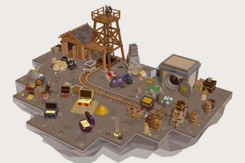

# Loot & Lode kit

67 free low-poly parts on one palette and one scale, so everything you combine belongs to the same world.

[Open the kit on Polyfork](https://polyfork.dev/kit/loot-lode-kit-63191e) · [All kits](../README.md#kits)

<table>
<tr>
<td align="center" valign="top" width="25%"> <a href="https://polyfork.dev/asset/amethyst-ore-deposit-02d55d">Amethyst Ore Deposit</a> <a href="https://polyfork.dev/cdn/amethyst-ore-deposit-02d55d.glb">GLB</a> · <a href="https://polyfork.dev/cdn/amethyst-ore-deposit-02d55d.mjs">module</a></td>
<td align="center" valign="top" width="25%"> <a href="https://polyfork.dev/asset/chest-dais-d2bc39">Chest Dais</a> <a href="https://polyfork.dev/cdn/chest-dais-d2bc39.glb">GLB</a> · <a href="https://polyfork.dev/cdn/chest-dais-d2bc39.mjs">module</a></td>
<td align="center" valign="top" width="25%"> <a href="https://polyfork.dev/asset/chest-key-458007">Chest Key</a> <a href="https://polyfork.dev/cdn/chest-key-458007.glb">GLB</a> · <a href="https://polyfork.dev/cdn/chest-key-458007.mjs">module</a></td>
<td align="center" valign="top" width="25%"> <a href="https://polyfork.dev/asset/chest-padlock-7dc32e">Chest Padlock</a> <a href="https://polyfork.dev/cdn/chest-padlock-7dc32e.glb">GLB</a> · <a href="https://polyfork.dev/cdn/chest-padlock-7dc32e.mjs">module</a></td>
</tr>
<tr>
<td align="center" valign="top" width="25%"> <a href="https://polyfork.dev/asset/coal-lump-8a35e7">Coal Lump</a> <a href="https://polyfork.dev/cdn/coal-lump-8a35e7.glb">GLB</a> · <a href="https://polyfork.dev/cdn/coal-lump-8a35e7.mjs">module</a></td>
<td align="center" valign="top" width="25%"> <a href="https://polyfork.dev/asset/coal-seam-deposit-1577c4">Coal Seam Deposit</a> <a href="https://polyfork.dev/cdn/coal-seam-deposit-1577c4.glb">GLB</a> · <a href="https://polyfork.dev/cdn/coal-seam-deposit-1577c4.mjs">module</a></td>
<td align="center" valign="top" width="25%"> <a href="https://polyfork.dev/asset/coin-hoard-heap-07b6e4">Coin Hoard Heap</a> <a href="https://polyfork.dev/cdn/coin-hoard-heap-07b6e4.glb">GLB</a> · <a href="https://polyfork.dev/cdn/coin-hoard-heap-07b6e4.mjs">module</a></td>
<td align="center" valign="top" width="25%"> <a href="https://polyfork.dev/asset/copper-coin-b4ebbb">Copper Coin</a> <a href="https://polyfork.dev/cdn/copper-coin-b4ebbb.glb">GLB</a> · <a href="https://polyfork.dev/cdn/copper-coin-b4ebbb.mjs">module</a></td>
</tr>
<tr>
<td align="center" valign="top" width="25%"> <a href="https://polyfork.dev/asset/copper-ingot-7f0a20">Copper Ingot</a> <a href="https://polyfork.dev/cdn/copper-ingot-7f0a20.glb">GLB</a> · <a href="https://polyfork.dev/cdn/copper-ingot-7f0a20.mjs">module</a></td>
<td align="center" valign="top" width="25%"> <a href="https://polyfork.dev/asset/copper-ore-chunk-258509">Copper Ore Chunk</a> <a href="https://polyfork.dev/cdn/copper-ore-chunk-258509.glb">GLB</a> · <a href="https://polyfork.dev/cdn/copper-ore-chunk-258509.mjs">module</a></td>
<td align="center" valign="top" width="25%"> <a href="https://polyfork.dev/asset/copper-ore-deposit-d5e58b">Copper Ore Deposit</a> <a href="https://polyfork.dev/cdn/copper-ore-deposit-d5e58b.glb">GLB</a> · <a href="https://polyfork.dev/cdn/copper-ore-deposit-d5e58b.mjs">module</a></td>
<td align="center" valign="top" width="25%"> <a href="https://polyfork.dev/asset/cut-amethyst-494337">Cut Amethyst</a> <a href="https://polyfork.dev/cdn/cut-amethyst-494337.glb">GLB</a> · <a href="https://polyfork.dev/cdn/cut-amethyst-494337.mjs">module</a></td>
</tr>
<tr>
<td align="center" valign="top" width="25%"> <a href="https://polyfork.dev/asset/cut-diamond-1fd38b">Cut Diamond</a> <a href="https://polyfork.dev/cdn/cut-diamond-1fd38b.glb">GLB</a> · <a href="https://polyfork.dev/cdn/cut-diamond-1fd38b.mjs">module</a></td>
<td align="center" valign="top" width="25%"> <a href="https://polyfork.dev/asset/cut-emerald-74d180">Cut Emerald</a> <a href="https://polyfork.dev/cdn/cut-emerald-74d180.glb">GLB</a> · <a href="https://polyfork.dev/cdn/cut-emerald-74d180.mjs">module</a></td>
<td align="center" valign="top" width="25%"> <a href="https://polyfork.dev/asset/cut-ruby-3ded3a">Cut Ruby</a> <a href="https://polyfork.dev/cdn/cut-ruby-3ded3a.glb">GLB</a> · <a href="https://polyfork.dev/cdn/cut-ruby-3ded3a.mjs">module</a></td>
<td align="center" valign="top" width="25%"> <a href="https://polyfork.dev/asset/cut-sapphire-04ba83">Cut Sapphire</a> <a href="https://polyfork.dev/cdn/cut-sapphire-04ba83.glb">GLB</a> · <a href="https://polyfork.dev/cdn/cut-sapphire-04ba83.mjs">module</a></td>
</tr>
<tr>
<td align="center" valign="top" width="25%"> <a href="https://polyfork.dev/asset/diamond-ore-deposit-4dafd4">Diamond Ore Deposit</a> <a href="https://polyfork.dev/cdn/diamond-ore-deposit-4dafd4.glb">GLB</a> · <a href="https://polyfork.dev/cdn/diamond-ore-deposit-4dafd4.mjs">module</a></td>
<td align="center" valign="top" width="25%"> <a href="https://polyfork.dev/asset/emerald-ore-deposit-4f0566">Emerald Ore Deposit</a> <a href="https://polyfork.dev/cdn/emerald-ore-deposit-4f0566.glb">GLB</a> · <a href="https://polyfork.dev/cdn/emerald-ore-deposit-4f0566.mjs">module</a></td>
<td align="center" valign="top" width="25%"> <a href="https://polyfork.dev/asset/gacha-capsule-3863ce">Gacha Capsule</a> <a href="https://polyfork.dev/cdn/gacha-capsule-3863ce.glb">GLB</a> · <a href="https://polyfork.dev/cdn/gacha-capsule-3863ce.mjs">module</a></td>
<td align="center" valign="top" width="25%"> <a href="https://polyfork.dev/asset/gem-chip-heap-573355">Gem Chip Heap</a> <a href="https://polyfork.dev/cdn/gem-chip-heap-573355.glb">GLB</a> · <a href="https://polyfork.dev/cdn/gem-chip-heap-573355.mjs">module</a></td>
</tr>
<tr>
<td align="center" valign="top" width="25%"> <a href="https://polyfork.dev/asset/gem-display-cushion-024541">Gem Display Cushion</a> <a href="https://polyfork.dev/cdn/gem-display-cushion-024541.glb">GLB</a> · <a href="https://polyfork.dev/cdn/gem-display-cushion-024541.mjs">module</a></td>
<td align="center" valign="top" width="25%"> <a href="https://polyfork.dev/asset/gold-balance-scale-66497b">Gold Balance Scale</a> <a href="https://polyfork.dev/cdn/gold-balance-scale-66497b.glb">GLB</a> · <a href="https://polyfork.dev/cdn/gold-balance-scale-66497b.mjs">module</a></td>
<td align="center" valign="top" width="25%"> <a href="https://polyfork.dev/asset/gold-coin-29afc1">Gold Coin</a> <a href="https://polyfork.dev/cdn/gold-coin-29afc1.glb">GLB</a> · <a href="https://polyfork.dev/cdn/gold-coin-29afc1.mjs">module</a></td>
<td align="center" valign="top" width="25%"> <a href="https://polyfork.dev/asset/gold-coin-stack-a9ef52">Gold Coin Stack</a> <a href="https://polyfork.dev/cdn/gold-coin-stack-a9ef52.glb">GLB</a> · <a href="https://polyfork.dev/cdn/gold-coin-stack-a9ef52.mjs">module</a></td>
</tr>
<tr>
<td align="center" valign="top" width="25%"> <a href="https://polyfork.dev/asset/gold-ingot-85e62e">Gold Ingot</a> <a href="https://polyfork.dev/cdn/gold-ingot-85e62e.glb">GLB</a> · <a href="https://polyfork.dev/cdn/gold-ingot-85e62e.mjs">module</a></td>
<td align="center" valign="top" width="25%"> <a href="https://polyfork.dev/asset/gold-nugget-ccd143">Gold Nugget</a> <a href="https://polyfork.dev/cdn/gold-nugget-ccd143.glb">GLB</a> · <a href="https://polyfork.dev/cdn/gold-nugget-ccd143.mjs">module</a></td>
<td align="center" valign="top" width="25%"> <a href="https://polyfork.dev/asset/gold-ore-chunk-6f1d9e">Gold Ore Chunk</a> <a href="https://polyfork.dev/cdn/gold-ore-chunk-6f1d9e.glb">GLB</a> · <a href="https://polyfork.dev/cdn/gold-ore-chunk-6f1d9e.mjs">module</a></td>
<td align="center" valign="top" width="25%"> <a href="https://polyfork.dev/asset/gold-ore-deposit-9965a4">Gold Ore Deposit</a> <a href="https://polyfork.dev/cdn/gold-ore-deposit-9965a4.glb">GLB</a> · <a href="https://polyfork.dev/cdn/gold-ore-deposit-9965a4.mjs">module</a></td>
</tr>
<tr>
<td align="center" valign="top" width="25%"> <a href="https://polyfork.dev/asset/gold-pan-fdb5ed">Gold Pan</a> <a href="https://polyfork.dev/cdn/gold-pan-fdb5ed.glb">GLB</a> · <a href="https://polyfork.dev/cdn/gold-pan-fdb5ed.mjs">module</a></td>
<td align="center" valign="top" width="25%"> <a href="https://polyfork.dev/asset/ingot-mould-413a2c">Ingot Mould</a> <a href="https://polyfork.dev/cdn/ingot-mould-413a2c.glb">GLB</a> · <a href="https://polyfork.dev/cdn/ingot-mould-413a2c.mjs">module</a></td>
<td align="center" valign="top" width="25%"> <a href="https://polyfork.dev/asset/ingot-stack-73e1e8">Ingot Stack</a> <a href="https://polyfork.dev/cdn/ingot-stack-73e1e8.glb">GLB</a> · <a href="https://polyfork.dev/cdn/ingot-stack-73e1e8.mjs">module</a></td>
<td align="center" valign="top" width="25%"> <a href="https://polyfork.dev/asset/iron-ingot-36697d">Iron Ingot</a> <a href="https://polyfork.dev/cdn/iron-ingot-36697d.glb">GLB</a> · <a href="https://polyfork.dev/cdn/iron-ingot-36697d.mjs">module</a></td>
</tr>
<tr>
<td align="center" valign="top" width="25%"> <a href="https://polyfork.dev/asset/iron-ore-chunk-1df386">Iron Ore Chunk</a> <a href="https://polyfork.dev/cdn/iron-ore-chunk-1df386.glb">GLB</a> · <a href="https://polyfork.dev/cdn/iron-ore-chunk-1df386.mjs">module</a></td>
<td align="center" valign="top" width="25%"> <a href="https://polyfork.dev/asset/iron-ore-deposit-577b67">Iron Ore Deposit</a> <a href="https://polyfork.dev/cdn/iron-ore-deposit-577b67.glb">GLB</a> · <a href="https://polyfork.dev/cdn/iron-ore-deposit-577b67.mjs">module</a></td>
<td align="center" valign="top" width="25%"> <a href="https://polyfork.dev/asset/iron-vault-safe-8b8f29">Iron Vault Safe</a> <a href="https://polyfork.dev/cdn/iron-vault-safe-8b8f29.glb">GLB</a> · <a href="https://polyfork.dev/cdn/iron-vault-safe-8b8f29.mjs">module</a></td>
<td align="center" valign="top" width="25%"> <a href="https://polyfork.dev/asset/jewel-casket-975ecc">Jewel Casket</a> <a href="https://polyfork.dev/cdn/jewel-casket-975ecc.glb">GLB</a> · <a href="https://polyfork.dev/cdn/jewel-casket-975ecc.mjs">module</a></td>
</tr>
<tr>
<td align="center" valign="top" width="25%"> <a href="https://polyfork.dev/asset/loot-crate-23dd3b">Loot Crate</a> <a href="https://polyfork.dev/cdn/loot-crate-23dd3b.glb">GLB</a> · <a href="https://polyfork.dev/cdn/loot-crate-23dd3b.mjs">module</a></td>
<td align="center" valign="top" width="25%"> <a href="https://polyfork.dev/asset/loot-drop-beam-c19e42">Loot Drop Beam</a> <a href="https://polyfork.dev/cdn/loot-drop-beam-c19e42.glb">GLB</a> · <a href="https://polyfork.dev/cdn/loot-drop-beam-c19e42.mjs">module</a></td>
<td align="center" valign="top" width="25%"> <a href="https://polyfork.dev/asset/loot-sack-4762f5">Loot Sack</a> <a href="https://polyfork.dev/cdn/loot-sack-4762f5.glb">GLB</a> · <a href="https://polyfork.dev/cdn/loot-sack-4762f5.mjs">module</a></td>
<td align="center" valign="top" width="25%"> <a href="https://polyfork.dev/asset/mimic-chest-57e440">Mimic Chest</a> <a href="https://polyfork.dev/cdn/mimic-chest-57e440.glb">GLB</a> · <a href="https://polyfork.dev/cdn/mimic-chest-57e440.mjs">module</a></td>
</tr>
<tr>
<td align="center" valign="top" width="25%"> <a href="https://polyfork.dev/asset/mine-cart-94bd76">Mine Cart</a> <a href="https://polyfork.dev/cdn/mine-cart-94bd76.glb">GLB</a> · <a href="https://polyfork.dev/cdn/mine-cart-94bd76.mjs">module</a></td>
<td align="center" valign="top" width="25%"> <a href="https://polyfork.dev/asset/mine-floor-tile-4caf1f">Mine Floor Tile</a> <a href="https://polyfork.dev/cdn/mine-floor-tile-4caf1f.glb">GLB</a> · <a href="https://polyfork.dev/cdn/mine-floor-tile-4caf1f.mjs">module</a></td>
<td align="center" valign="top" width="25%"> <a href="https://polyfork.dev/asset/mine-headframe-de1ad0">Mine Headframe</a> <a href="https://polyfork.dev/cdn/mine-headframe-de1ad0.glb">GLB</a> · <a href="https://polyfork.dev/cdn/mine-headframe-de1ad0.mjs">module</a></td>
<td align="center" valign="top" width="25%"> <a href="https://polyfork.dev/asset/mine-rail-track-9532dd">Mine Rail Track</a> <a href="https://polyfork.dev/cdn/mine-rail-track-9532dd.glb">GLB</a> · <a href="https://polyfork.dev/cdn/mine-rail-track-9532dd.mjs">module</a></td>
</tr>
<tr>
<td align="center" valign="top" width="25%"> <a href="https://polyfork.dev/asset/mine-shack-fce075">Mine Shack</a> <a href="https://polyfork.dev/cdn/mine-shack-fce075.glb">GLB</a> · <a href="https://polyfork.dev/cdn/mine-shack-fce075.mjs">module</a></td>
<td align="center" valign="top" width="25%"> <a href="https://polyfork.dev/asset/miner-lantern-c13511">Miner Lantern</a> <a href="https://polyfork.dev/cdn/miner-lantern-c13511.glb">GLB</a> · <a href="https://polyfork.dev/cdn/miner-lantern-c13511.mjs">module</a></td>
<td align="center" valign="top" width="25%"> <a href="https://polyfork.dev/asset/mining-pickaxe-90bdf6">Mining Pickaxe</a> <a href="https://polyfork.dev/cdn/mining-pickaxe-90bdf6.glb">GLB</a> · <a href="https://polyfork.dev/cdn/mining-pickaxe-90bdf6.mjs">module</a></td>
<td align="center" valign="top" width="25%"> <a href="https://polyfork.dev/asset/mining-shovel-44b6d0">Mining Shovel</a> <a href="https://polyfork.dev/cdn/mining-shovel-44b6d0.glb">GLB</a> · <a href="https://polyfork.dev/cdn/mining-shovel-44b6d0.mjs">module</a></td>
</tr>
<tr>
<td align="center" valign="top" width="25%"> <a href="https://polyfork.dev/asset/ore-sack-996ddf">Ore Sack</a> <a href="https://polyfork.dev/cdn/ore-sack-996ddf.glb">GLB</a> · <a href="https://polyfork.dev/cdn/ore-sack-996ddf.mjs">module</a></td>
<td align="center" valign="top" width="25%"> <a href="https://polyfork.dev/asset/rough-amethyst-point-0c6186">Rough Amethyst Point</a> <a href="https://polyfork.dev/cdn/rough-amethyst-point-0c6186.glb">GLB</a> · <a href="https://polyfork.dev/cdn/rough-amethyst-point-0c6186.mjs">module</a></td>
<td align="center" valign="top" width="25%"> <a href="https://polyfork.dev/asset/rough-diamond-fecf28">Rough Diamond</a> <a href="https://polyfork.dev/cdn/rough-diamond-fecf28.glb">GLB</a> · <a href="https://polyfork.dev/cdn/rough-diamond-fecf28.mjs">module</a></td>
<td align="center" valign="top" width="25%"> <a href="https://polyfork.dev/asset/rough-emerald-bf6f88">Rough Emerald</a> <a href="https://polyfork.dev/cdn/rough-emerald-bf6f88.glb">GLB</a> · <a href="https://polyfork.dev/cdn/rough-emerald-bf6f88.mjs">module</a></td>
</tr>
<tr>
<td align="center" valign="top" width="25%"> <a href="https://polyfork.dev/asset/rough-ruby-486f22">Rough Ruby</a> <a href="https://polyfork.dev/cdn/rough-ruby-486f22.glb">GLB</a> · <a href="https://polyfork.dev/cdn/rough-ruby-486f22.mjs">module</a></td>
<td align="center" valign="top" width="25%"> <a href="https://polyfork.dev/asset/rough-sapphire-fb25c7">Rough Sapphire</a> <a href="https://polyfork.dev/cdn/rough-sapphire-fb25c7.glb">GLB</a> · <a href="https://polyfork.dev/cdn/rough-sapphire-fb25c7.mjs">module</a></td>
<td align="center" valign="top" width="25%"> <a href="https://polyfork.dev/asset/ruby-ore-deposit-ea3bd8">Ruby Ore Deposit</a> <a href="https://polyfork.dev/cdn/ruby-ore-deposit-ea3bd8.glb">GLB</a> · <a href="https://polyfork.dev/cdn/ruby-ore-deposit-ea3bd8.mjs">module</a></td>
<td align="center" valign="top" width="25%"> <a href="https://polyfork.dev/asset/sapphire-ore-deposit-f8a71a">Sapphire Ore Deposit</a> <a href="https://polyfork.dev/cdn/sapphire-ore-deposit-f8a71a.glb">GLB</a> · <a href="https://polyfork.dev/cdn/sapphire-ore-deposit-f8a71a.mjs">module</a></td>
</tr>
<tr>
<td align="center" valign="top" width="25%"> <a href="https://polyfork.dev/asset/silver-coin-64ab27">Silver Coin</a> <a href="https://polyfork.dev/cdn/silver-coin-64ab27.glb">GLB</a> · <a href="https://polyfork.dev/cdn/silver-coin-64ab27.mjs">module</a></td>
<td align="center" valign="top" width="25%"> <a href="https://polyfork.dev/asset/silver-ingot-4f0336">Silver Ingot</a> <a href="https://polyfork.dev/cdn/silver-ingot-4f0336.glb">GLB</a> · <a href="https://polyfork.dev/cdn/silver-ingot-4f0336.mjs">module</a></td>
<td align="center" valign="top" width="25%"> <a href="https://polyfork.dev/asset/silver-ore-chunk-1e440c">Silver Ore Chunk</a> <a href="https://polyfork.dev/cdn/silver-ore-chunk-1e440c.glb">GLB</a> · <a href="https://polyfork.dev/cdn/silver-ore-chunk-1e440c.mjs">module</a></td>
<td align="center" valign="top" width="25%"> <a href="https://polyfork.dev/asset/silver-ore-deposit-57f7c3">Silver Ore Deposit</a> <a href="https://polyfork.dev/cdn/silver-ore-deposit-57f7c3.glb">GLB</a> · <a href="https://polyfork.dev/cdn/silver-ore-deposit-57f7c3.mjs">module</a></td>
</tr>
<tr>
<td align="center" valign="top" width="25%"> <a href="https://polyfork.dev/asset/smelting-crucible-94d1dc">Smelting Crucible</a> <a href="https://polyfork.dev/cdn/smelting-crucible-94d1dc.glb">GLB</a> · <a href="https://polyfork.dev/cdn/smelting-crucible-94d1dc.mjs">module</a></td>
<td align="center" valign="top" width="25%"> <a href="https://polyfork.dev/asset/smelting-furnace-3209f1">Smelting Furnace</a> <a href="https://polyfork.dev/cdn/smelting-furnace-3209f1.glb">GLB</a> · <a href="https://polyfork.dev/cdn/smelting-furnace-3209f1.mjs">module</a></td>
<td align="center" valign="top" width="25%"> <a href="https://polyfork.dev/asset/strapped-bullion-bundle-26de2d">Strapped Bullion Bundle</a> <a href="https://polyfork.dev/cdn/strapped-bullion-bundle-26de2d.glb">GLB</a> · <a href="https://polyfork.dev/cdn/strapped-bullion-bundle-26de2d.mjs">module</a></td>
<td align="center" valign="top" width="25%"> <a href="https://polyfork.dev/asset/timber-shaft-frame-87f96b">Timber Shaft Frame</a> <a href="https://polyfork.dev/cdn/timber-shaft-frame-87f96b.glb">GLB</a> · <a href="https://polyfork.dev/cdn/timber-shaft-frame-87f96b.mjs">module</a></td>
</tr>
<tr>
<td align="center" valign="top" width="25%"> <a href="https://polyfork.dev/asset/legendary-chest-4abed4">Treasure Chest</a> <a href="https://polyfork.dev/cdn/legendary-chest-4abed4.glb">GLB</a> · <a href="https://polyfork.dev/cdn/legendary-chest-4abed4.mjs">module</a></td>
<td align="center" valign="top" width="25%"> <a href="https://polyfork.dev/asset/vault-strongroom-d2c032">Vault Strongroom</a> <a href="https://polyfork.dev/cdn/vault-strongroom-d2c032.glb">GLB</a> · <a href="https://polyfork.dev/cdn/vault-strongroom-d2c032.mjs">module</a></td>
<td align="center" valign="top" width="25%"> <a href="https://polyfork.dev/asset/wooden-barrel-6afab0">Wooden Barrel</a> <a href="https://polyfork.dev/cdn/wooden-barrel-6afab0.glb">GLB</a> · <a href="https://polyfork.dev/cdn/wooden-barrel-6afab0.mjs">module</a></td>
</tr>
</table>
