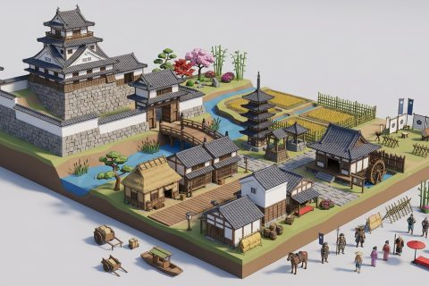

# Medieval Japan

In production, 60 parts so far. Every part below is already free to use.

[Open the kit on Polyfork](https://polyfork.dev/kit/medieval-japan-cb01ad) · [All kits](../README.md#kits)

<table>
<tr>
<td align="center" valign="top" width="25%"> <a href="https://polyfork.dev/asset/andon-floor-lantern-b1b7ea">Andon Floor Lantern</a> <a href="https://polyfork.dev/cdn/andon-floor-lantern-b1b7ea.glb">GLB</a> · <a href="https://polyfork.dev/cdn/andon-floor-lantern-b1b7ea.mjs">module</a></td>
<td align="center" valign="top" width="25%"> <a href="https://polyfork.dev/asset/ashigaru-foot-soldier-806707">Ashigaru Foot Soldier</a> <a href="https://polyfork.dev/cdn/ashigaru-foot-soldier-806707.glb">GLB</a> · <a href="https://polyfork.dev/cdn/ashigaru-foot-soldier-806707.mjs">module</a></td>
<td align="center" valign="top" width="25%"> <a href="https://polyfork.dev/asset/azalea-bush-7bb14d">Azalea Bush</a> <a href="https://polyfork.dev/cdn/azalea-bush-7bb14d.glb">GLB</a> · <a href="https://polyfork.dev/cdn/azalea-bush-7bb14d.mjs">module</a></td>
<td align="center" valign="top" width="25%"> <a href="https://polyfork.dev/asset/bamboo-stalk-e4d362">Bamboo Stalk</a> <a href="https://polyfork.dev/cdn/bamboo-stalk-e4d362.glb">GLB</a> · <a href="https://polyfork.dev/cdn/bamboo-stalk-e4d362.mjs">module</a></td>
</tr>
<tr>
<td align="center" valign="top" width="25%"> <a href="https://polyfork.dev/asset/bangasa-paper-umbrella-402f7b">Bangasa Paper Umbrella</a> <a href="https://polyfork.dev/cdn/bangasa-paper-umbrella-402f7b.glb">GLB</a> · <a href="https://polyfork.dev/cdn/bangasa-paper-umbrella-402f7b.mjs">module</a></td>
<td align="center" valign="top" width="25%"> <a href="https://polyfork.dev/asset/boardwalk-street-tile-6782fd">Boardwalk Street Tile</a> <a href="https://polyfork.dev/cdn/boardwalk-street-tile-6782fd.glb">GLB</a> · <a href="https://polyfork.dev/cdn/boardwalk-street-tile-6782fd.mjs">module</a></td>
<td align="center" valign="top" width="25%"> <a href="https://polyfork.dev/asset/buddhist-monk-39f498">Buddhist Monk</a> <a href="https://polyfork.dev/cdn/buddhist-monk-39f498.glb">GLB</a> · <a href="https://polyfork.dev/cdn/buddhist-monk-39f498.mjs">module</a></td>
<td align="center" valign="top" width="25%"> <a href="https://polyfork.dev/asset/buddhist-temple-hall-f0aa09">Buddhist Temple Hall</a> <a href="https://polyfork.dev/cdn/buddhist-temple-hall-f0aa09.glb">GLB</a> · <a href="https://polyfork.dev/cdn/buddhist-temple-hall-f0aa09.mjs">module</a></td>
</tr>
<tr>
<td align="center" valign="top" width="25%"> <a href="https://polyfork.dev/asset/castle-gatehouse-4ed5c6">Castle Gatehouse</a> <a href="https://polyfork.dev/cdn/castle-gatehouse-4ed5c6.glb">GLB</a> · <a href="https://polyfork.dev/cdn/castle-gatehouse-4ed5c6.mjs">module</a></td>
<td align="center" valign="top" width="25%"> <a href="https://polyfork.dev/asset/cherry-tree-a710a9">Cherry Tree</a> <a href="https://polyfork.dev/cdn/cherry-tree-a710a9.glb">GLB</a> · <a href="https://polyfork.dev/cdn/cherry-tree-a710a9.mjs">module</a></td>
<td align="center" valign="top" width="25%"> <a href="https://polyfork.dev/asset/commander-s-camp-stool-d7fa4c">Commander&#039;s Camp Stool</a> <a href="https://polyfork.dev/cdn/commander-s-camp-stool-d7fa4c.glb">GLB</a> · <a href="https://polyfork.dev/cdn/commander-s-camp-stool-d7fa4c.mjs">module</a></td>
<td align="center" valign="top" width="25%"> <a href="https://polyfork.dev/asset/corner-yagura-turret-950468">Corner Yagura Turret</a> <a href="https://polyfork.dev/cdn/corner-yagura-turret-950468.glb">GLB</a> · <a href="https://polyfork.dev/cdn/corner-yagura-turret-950468.mjs">module</a></td>
</tr>
<tr>
<td align="center" valign="top" width="25%"> <a href="https://polyfork.dev/asset/daihachiguruma-hand-cart-c026f3">Daihachiguruma Hand Cart</a> <a href="https://polyfork.dev/cdn/daihachiguruma-hand-cart-c026f3.glb">GLB</a> · <a href="https://polyfork.dev/cdn/daihachiguruma-hand-cart-c026f3.mjs">module</a></td>
<td align="center" valign="top" width="25%"> <a href="https://polyfork.dev/asset/daimyo-lord-78364a">Daimyo Lord</a> <a href="https://polyfork.dev/cdn/daimyo-lord-78364a.glb">GLB</a> · <a href="https://polyfork.dev/cdn/daimyo-lord-78364a.mjs">module</a></td>
<td align="center" valign="top" width="25%"> <a href="https://polyfork.dev/asset/dobei-plaster-wall-b75823">Dobei Plaster Wall</a> <a href="https://polyfork.dev/cdn/dobei-plaster-wall-b75823.glb">GLB</a> · <a href="https://polyfork.dev/cdn/dobei-plaster-wall-b75823.mjs">module</a></td>
<td align="center" valign="top" width="25%"> <a href="https://polyfork.dev/asset/farmer-363820">Farmer</a> <a href="https://polyfork.dev/cdn/farmer-363820.glb">GLB</a> · <a href="https://polyfork.dev/cdn/farmer-363820.mjs">module</a></td>
</tr>
<tr>
<td align="center" valign="top" width="25%"> <a href="https://polyfork.dev/asset/field-barricade-a646b9">Field Barricade</a> <a href="https://polyfork.dev/cdn/field-barricade-a646b9.glb">GLB</a> · <a href="https://polyfork.dev/cdn/field-barricade-a646b9.mjs">module</a></td>
<td align="center" valign="top" width="25%"> <a href="https://polyfork.dev/asset/fire-lookout-tower-714fa1">Fire Lookout Tower</a> <a href="https://polyfork.dev/cdn/fire-lookout-tower-714fa1.glb">GLB</a> · <a href="https://polyfork.dev/cdn/fire-lookout-tower-714fa1.mjs">module</a></td>
<td align="center" valign="top" width="25%"> <a href="https://polyfork.dev/asset/flat-river-boat-6bac37">Flat River Boat</a> <a href="https://polyfork.dev/cdn/flat-river-boat-6bac37.glb">GLB</a> · <a href="https://polyfork.dev/cdn/flat-river-boat-6bac37.mjs">module</a></td>
<td align="center" valign="top" width="25%"> <a href="https://polyfork.dev/asset/hasa-rice-drying-rack-d545bc">Hasa Rice Drying Rack</a> <a href="https://polyfork.dev/cdn/hasa-rice-drying-rack-d545bc.glb">GLB</a> · <a href="https://polyfork.dev/cdn/hasa-rice-drying-rack-d545bc.mjs">module</a></td>
</tr>
<tr>
<td align="center" valign="top" width="25%"> <a href="https://polyfork.dev/asset/horse-tether-rail-b26462">Horse Tether Rail</a> <a href="https://polyfork.dev/cdn/horse-tether-rail-b26462.glb">GLB</a> · <a href="https://polyfork.dev/cdn/horse-tether-rail-b26462.mjs">module</a></td>
<td align="center" valign="top" width="25%"> <a href="https://polyfork.dev/asset/ishigaki-stone-wall-255b7e">Ishigaki Stone Wall</a> <a href="https://polyfork.dev/cdn/ishigaki-stone-wall-255b7e.glb">GLB</a> · <a href="https://polyfork.dev/cdn/ishigaki-stone-wall-255b7e.mjs">module</a></td>
<td align="center" valign="top" width="25%"> <a href="https://polyfork.dev/asset/japanese-maple-d2fb29">Japanese Maple</a> <a href="https://polyfork.dev/cdn/japanese-maple-d2fb29.glb">GLB</a> · <a href="https://polyfork.dev/cdn/japanese-maple-d2fb29.mjs">module</a></td>
<td align="center" valign="top" width="25%"> <a href="https://polyfork.dev/asset/jinmaku-camp-curtain-8efdbe">Jinmaku Camp Curtain</a> <a href="https://polyfork.dev/cdn/jinmaku-camp-curtain-8efdbe.glb">GLB</a> · <a href="https://polyfork.dev/cdn/jinmaku-camp-curtain-8efdbe.mjs">module</a></td>
</tr>
<tr>
<td align="center" valign="top" width="25%"> <a href="https://polyfork.dev/asset/kagaribi-fire-basket-d28c11">Kagaribi Fire Basket</a> <a href="https://polyfork.dev/cdn/kagaribi-fire-basket-d28c11.glb">GLB</a> · <a href="https://polyfork.dev/cdn/kagaribi-fire-basket-d28c11.mjs">module</a></td>
<td align="center" valign="top" width="25%"> <a href="https://polyfork.dev/asset/kago-palanquin-f1b341">Kago Palanquin</a> <a href="https://polyfork.dev/cdn/kago-palanquin-f1b341.glb">GLB</a> · <a href="https://polyfork.dev/cdn/kago-palanquin-f1b341.mjs">module</a></td>
<td align="center" valign="top" width="25%"> <a href="https://polyfork.dev/asset/katana-in-scabbard-4b6ffb">Katana In Scabbard</a> <a href="https://polyfork.dev/cdn/katana-in-scabbard-4b6ffb.glb">GLB</a> · <a href="https://polyfork.dev/cdn/katana-in-scabbard-4b6ffb.mjs">module</a></td>
<td align="center" valign="top" width="25%"> <a href="https://polyfork.dev/asset/komodaru-sake-barrel-c5199a">Komodaru Sake Barrel</a> <a href="https://polyfork.dev/cdn/komodaru-sake-barrel-c5199a.glb">GLB</a> · <a href="https://polyfork.dev/cdn/komodaru-sake-barrel-c5199a.mjs">module</a></td>
</tr>
<tr>
<td align="center" valign="top" width="25%"> <a href="https://polyfork.dev/asset/kosatsu-notice-board-c9d276">Kosatsu Notice Board</a> <a href="https://polyfork.dev/cdn/kosatsu-notice-board-c9d276.glb">GLB</a> · <a href="https://polyfork.dev/cdn/kosatsu-notice-board-c9d276.mjs">module</a></td>
<td align="center" valign="top" width="25%"> <a href="https://polyfork.dev/asset/kura-storehouse-5c9631">Kura Storehouse</a> <a href="https://polyfork.dev/cdn/kura-storehouse-5c9631.glb">GLB</a> · <a href="https://polyfork.dev/cdn/kura-storehouse-5c9631.mjs">module</a></td>
<td align="center" valign="top" width="25%"> <a href="https://polyfork.dev/asset/machiya-townhouse-8ef64e">Machiya Townhouse</a> <a href="https://polyfork.dev/cdn/machiya-townhouse-8ef64e.glb">GLB</a> · <a href="https://polyfork.dev/cdn/machiya-townhouse-8ef64e.mjs">module</a></td>
<td align="center" valign="top" width="25%"> <a href="https://polyfork.dev/asset/medieval-japan-terrain-1e0bee">Medieval Japan Terrain</a> <a href="https://polyfork.dev/cdn/medieval-japan-terrain-1e0bee.glb">GLB</a> · <a href="https://polyfork.dev/cdn/medieval-japan-terrain-1e0bee.mjs">module</a></td>
</tr>
<tr>
<td align="center" valign="top" width="25%"> <a href="https://polyfork.dev/asset/minka-farmhouse-680475">Minka Farmhouse</a> <a href="https://polyfork.dev/cdn/minka-farmhouse-680475.glb">GLB</a> · <a href="https://polyfork.dev/cdn/minka-farmhouse-680475.mjs">module</a></td>
<td align="center" valign="top" width="25%"> <a href="https://polyfork.dev/asset/moat-bridge-4fbcd9">Moat Bridge</a> <a href="https://polyfork.dev/cdn/moat-bridge-4fbcd9.glb">GLB</a> · <a href="https://polyfork.dev/cdn/moat-bridge-4fbcd9.mjs">module</a></td>
<td align="center" valign="top" width="25%"> <a href="https://polyfork.dev/asset/moat-reed-clump-dd6b60">Moat Reed Clump</a> <a href="https://polyfork.dev/cdn/moat-reed-clump-dd6b60.glb">GLB</a> · <a href="https://polyfork.dev/cdn/moat-reed-clump-dd6b60.mjs">module</a></td>
<td align="center" valign="top" width="25%"> <a href="https://polyfork.dev/asset/nobori-banner-ae4d88">Nobori Banner</a> <a href="https://polyfork.dev/cdn/nobori-banner-ae4d88.glb">GLB</a> · <a href="https://polyfork.dev/cdn/nobori-banner-ae4d88.mjs">module</a></td>
</tr>
<tr>
<td align="center" valign="top" width="25%"> <a href="https://polyfork.dev/asset/open-front-teahouse-c7dd18">Open-Front Teahouse</a> <a href="https://polyfork.dev/cdn/open-front-teahouse-c7dd18.glb">GLB</a> · <a href="https://polyfork.dev/cdn/open-front-teahouse-c7dd18.mjs">module</a></td>
<td align="center" valign="top" width="25%"> <a href="https://polyfork.dev/asset/ox-cart-9c857f">Ox Cart</a> <a href="https://polyfork.dev/cdn/ox-cart-9c857f.glb">GLB</a> · <a href="https://polyfork.dev/cdn/ox-cart-9c857f.mjs">module</a></td>
<td align="center" valign="top" width="25%"> <a href="https://polyfork.dev/asset/rice-paddy-tile-dc727e">Rice Paddy Tile</a> <a href="https://polyfork.dev/cdn/rice-paddy-tile-dc727e.glb">GLB</a> · <a href="https://polyfork.dev/cdn/rice-paddy-tile-dc727e.mjs">module</a></td>
<td align="center" valign="top" width="25%"> <a href="https://polyfork.dev/asset/roofed-well-43a2fc">Roofed Well</a> <a href="https://polyfork.dev/cdn/roofed-well-43a2fc.glb">GLB</a> · <a href="https://polyfork.dev/cdn/roofed-well-43a2fc.mjs">module</a></td>
</tr>
<tr>
<td align="center" valign="top" width="25%"> <a href="https://polyfork.dev/asset/samurai-warrior-f2ebbe">Samurai Warrior</a> <a href="https://polyfork.dev/cdn/samurai-warrior-f2ebbe.glb">GLB</a> · <a href="https://polyfork.dev/cdn/samurai-warrior-f2ebbe.mjs">module</a></td>
<td align="center" valign="top" width="25%"> <a href="https://polyfork.dev/asset/sculpted-pine-e45d4f">Sculpted Pine</a> <a href="https://polyfork.dev/cdn/sculpted-pine-e45d4f.glb">GLB</a> · <a href="https://polyfork.dev/cdn/sculpted-pine-e45d4f.mjs">module</a></td>
<td align="center" valign="top" width="25%"> <a href="https://polyfork.dev/asset/stone-paving-tile-5af0d1">Stone Paving Tile</a> <a href="https://polyfork.dev/cdn/stone-paving-tile-5af0d1.glb">GLB</a> · <a href="https://polyfork.dev/cdn/stone-paving-tile-5af0d1.mjs">module</a></td>
<td align="center" valign="top" width="25%"> <a href="https://polyfork.dev/asset/stream-water-wheel-ea2d68">Stream Water Wheel</a> <a href="https://polyfork.dev/cdn/stream-water-wheel-ea2d68.glb">GLB</a> · <a href="https://polyfork.dev/cdn/stream-water-wheel-ea2d68.mjs">module</a></td>
</tr>
<tr>
<td align="center" valign="top" width="25%"> <a href="https://polyfork.dev/asset/takegaki-bamboo-fence-c6718b">Takegaki Bamboo Fence</a> <a href="https://polyfork.dev/cdn/takegaki-bamboo-fence-c6718b.glb">GLB</a> · <a href="https://polyfork.dev/cdn/takegaki-bamboo-fence-c6718b.mjs">module</a></td>
<td align="center" valign="top" width="25%"> <a href="https://polyfork.dev/asset/tanegashima-matchlock-7d21b2">Tanegashima Matchlock</a> <a href="https://polyfork.dev/cdn/tanegashima-matchlock-7d21b2.glb">GLB</a> · <a href="https://polyfork.dev/cdn/tanegashima-matchlock-7d21b2.mjs">module</a></td>
<td align="center" valign="top" width="25%"> <a href="https://polyfork.dev/asset/tate-standing-shield-e5513e">Tate Standing Shield</a> <a href="https://polyfork.dev/cdn/tate-standing-shield-e5513e.glb">GLB</a> · <a href="https://polyfork.dev/cdn/tate-standing-shield-e5513e.mjs">module</a></td>
<td align="center" valign="top" width="25%"> <a href="https://polyfork.dev/asset/teahouse-bench-6b34e1">Teahouse Bench</a> <a href="https://polyfork.dev/cdn/teahouse-bench-6b34e1.glb">GLB</a> · <a href="https://polyfork.dev/cdn/teahouse-bench-6b34e1.mjs">module</a></td>
</tr>
<tr>
<td align="center" valign="top" width="25%"> <a href="https://polyfork.dev/asset/temple-bell-tower-745387">Temple Bell Tower</a> <a href="https://polyfork.dev/cdn/temple-bell-tower-745387.glb">GLB</a> · <a href="https://polyfork.dev/cdn/temple-bell-tower-745387.mjs">module</a></td>
<td align="center" valign="top" width="25%"> <a href="https://polyfork.dev/asset/tenshu-keep-2ff636">Tenshu Keep</a> <a href="https://polyfork.dev/cdn/tenshu-keep-2ff636.glb">GLB</a> · <a href="https://polyfork.dev/cdn/tenshu-keep-2ff636.mjs">module</a></td>
<td align="center" valign="top" width="25%"> <a href="https://polyfork.dev/asset/terrace-stone-stair-494ef8">Terrace Stone Stair</a> <a href="https://polyfork.dev/cdn/terrace-stone-stair-494ef8.glb">GLB</a> · <a href="https://polyfork.dev/cdn/terrace-stone-stair-494ef8.mjs">module</a></td>
<td align="center" valign="top" width="25%"> <a href="https://polyfork.dev/asset/tiered-pagoda-f4ade0">Tiered Pagoda</a> <a href="https://polyfork.dev/cdn/tiered-pagoda-f4ade0.glb">GLB</a> · <a href="https://polyfork.dev/cdn/tiered-pagoda-f4ade0.mjs">module</a></td>
</tr>
<tr>
<td align="center" valign="top" width="25%"> <a href="https://polyfork.dev/asset/townswoman-5ca8b5">Townswoman</a> <a href="https://polyfork.dev/cdn/townswoman-5ca8b5.glb">GLB</a> · <a href="https://polyfork.dev/cdn/townswoman-5ca8b5.mjs">module</a></td>
<td align="center" valign="top" width="25%"> <a href="https://polyfork.dev/asset/tsukubai-stone-basin-677586">Tsukubai Stone Basin</a> <a href="https://polyfork.dev/cdn/tsukubai-stone-basin-677586.glb">GLB</a> · <a href="https://polyfork.dev/cdn/tsukubai-stone-basin-677586.mjs">module</a></td>
<td align="center" valign="top" width="25%"> <a href="https://polyfork.dev/asset/war-drum-on-stand-cbb91a">War Drum On Stand</a> <a href="https://polyfork.dev/cdn/war-drum-on-stand-cbb91a.glb">GLB</a> · <a href="https://polyfork.dev/cdn/war-drum-on-stand-cbb91a.mjs">module</a></td>
<td align="center" valign="top" width="25%"> <a href="https://polyfork.dev/asset/wooden-palisade-d4f4db">Wooden Palisade</a> <a href="https://polyfork.dev/cdn/wooden-palisade-d4f4db.glb">GLB</a> · <a href="https://polyfork.dev/cdn/wooden-palisade-d4f4db.mjs">module</a></td>
</tr>
<tr>
<td align="center" valign="top" width="25%"> <a href="https://polyfork.dev/asset/wooden-teoke-bucket-e65f35">Wooden Teoke Bucket</a> <a href="https://polyfork.dev/cdn/wooden-teoke-bucket-e65f35.glb">GLB</a> · <a href="https://polyfork.dev/cdn/wooden-teoke-bucket-e65f35.mjs">module</a></td>
<td align="center" valign="top" width="25%"> <a href="https://polyfork.dev/asset/yari-spear-e72c1f">Yari Spear</a> <a href="https://polyfork.dev/cdn/yari-spear-e72c1f.glb">GLB</a> · <a href="https://polyfork.dev/cdn/yari-spear-e72c1f.mjs">module</a></td>
<td align="center" valign="top" width="25%"> <a href="https://polyfork.dev/asset/yoroi-armour-stand-25f9a2">Yoroi Armour Stand</a> <a href="https://polyfork.dev/cdn/yoroi-armour-stand-25f9a2.glb">GLB</a> · <a href="https://polyfork.dev/cdn/yoroi-armour-stand-25f9a2.mjs">module</a></td>
<td align="center" valign="top" width="25%"> <a href="https://polyfork.dev/asset/yumi-bow-and-quiver-e30b4a">Yumi Bow And Quiver</a> <a href="https://polyfork.dev/cdn/yumi-bow-and-quiver-e30b4a.glb">GLB</a> · <a href="https://polyfork.dev/cdn/yumi-bow-and-quiver-e30b4a.mjs">module</a></td>
</tr>
</table>
