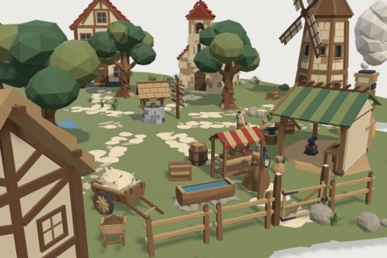

# Medieval Village Kit

60 free low-poly parts on one palette and one scale, so everything you combine belongs to the same world.

[Open the kit on Polyfork](https://polyfork.dev/kit/medieval-village-kit-ca0b43) · [All kits](../README.md#kits)

<table>
<tr>
<td align="center" valign="top" width="25%"> <a href="https://polyfork.dev/asset/anvil-1286cb">Anvil</a> <a href="https://polyfork.dev/cdn/anvil-1286cb.glb">GLB</a> · <a href="https://polyfork.dev/cdn/anvil-1286cb.mjs">module</a></td>
<td align="center" valign="top" width="25%"> <a href="https://polyfork.dev/asset/barrel-aadc94">Barrel</a> <a href="https://polyfork.dev/cdn/barrel-aadc94.glb">GLB</a> · <a href="https://polyfork.dev/cdn/barrel-aadc94.mjs">module</a></td>
<td align="center" valign="top" width="25%"> <a href="https://polyfork.dev/asset/blacksmith-forge-09fa85">Blacksmith Forge</a> <a href="https://polyfork.dev/cdn/blacksmith-forge-09fa85.glb">GLB</a> · <a href="https://polyfork.dev/cdn/blacksmith-forge-09fa85.mjs">module</a></td>
<td align="center" valign="top" width="25%"> <a href="https://polyfork.dev/asset/bush-8bb596">Bush</a> <a href="https://polyfork.dev/cdn/bush-8bb596.glb">GLB</a> · <a href="https://polyfork.dev/cdn/bush-8bb596.mjs">module</a></td>
</tr>
<tr>
<td align="center" valign="top" width="25%"> <a href="https://polyfork.dev/asset/clay-bread-oven-860b06">Clay Bread Oven</a> <a href="https://polyfork.dev/cdn/clay-bread-oven-860b06.glb">GLB</a> · <a href="https://polyfork.dev/cdn/clay-bread-oven-860b06.mjs">module</a></td>
<td align="center" valign="top" width="25%"> <a href="https://polyfork.dev/asset/dirt-ground-tile-da4a60">Dirt Ground Tile</a> <a href="https://polyfork.dev/cdn/dirt-ground-tile-da4a60.glb">GLB</a> · <a href="https://polyfork.dev/cdn/dirt-ground-tile-da4a60.mjs">module</a></td>
<td align="center" valign="top" width="25%"> <a href="https://polyfork.dev/asset/dirt-terrain-blob-7227e6">Dirt Terrain Blob</a> <a href="https://polyfork.dev/cdn/dirt-terrain-blob-7227e6.glb">GLB</a> · <a href="https://polyfork.dev/cdn/dirt-terrain-blob-7227e6.mjs">module</a></td>
<td align="center" valign="top" width="25%"> <a href="https://polyfork.dev/asset/draft-horse-519160">Draft Horse</a> <a href="https://polyfork.dev/cdn/draft-horse-519160.glb">GLB</a> · <a href="https://polyfork.dev/cdn/draft-horse-519160.mjs">module</a></td>
</tr>
<tr>
<td align="center" valign="top" width="25%"> <a href="https://polyfork.dev/asset/flower-planter-500ed2">Flower Planter</a> <a href="https://polyfork.dev/cdn/flower-planter-500ed2.glb">GLB</a> · <a href="https://polyfork.dev/cdn/flower-planter-500ed2.mjs">module</a></td>
<td align="center" valign="top" width="25%"> <a href="https://polyfork.dev/asset/four-wheel-wagon-adb946">Four-Wheel Wagon</a> <a href="https://polyfork.dev/cdn/four-wheel-wagon-adb946.glb">GLB</a> · <a href="https://polyfork.dev/cdn/four-wheel-wagon-adb946.mjs">module</a></td>
<td align="center" valign="top" width="25%"> <a href="https://polyfork.dev/asset/gable-roof-section-0394a8">Gable Roof Section</a> <a href="https://polyfork.dev/cdn/gable-roof-section-0394a8.glb">GLB</a> · <a href="https://polyfork.dev/cdn/gable-roof-section-0394a8.mjs">module</a></td>
<td align="center" valign="top" width="25%"> <a href="https://polyfork.dev/asset/grain-sack-401d96">Grain Sack</a> <a href="https://polyfork.dev/cdn/grain-sack-401d96.glb">GLB</a> · <a href="https://polyfork.dev/cdn/grain-sack-401d96.mjs">module</a></td>
</tr>
<tr>
<td align="center" valign="top" width="25%"> <a href="https://polyfork.dev/asset/grass-ground-tile-131ec0">Grass Ground Tile</a> <a href="https://polyfork.dev/cdn/grass-ground-tile-131ec0.glb">GLB</a> · <a href="https://polyfork.dev/cdn/grass-ground-tile-131ec0.mjs">module</a></td>
<td align="center" valign="top" width="25%"> <a href="https://polyfork.dev/asset/grass-terrain-blob-389daa">Grass Terrain Blob</a> <a href="https://polyfork.dev/cdn/grass-terrain-blob-389daa.glb">GLB</a> · <a href="https://polyfork.dev/cdn/grass-terrain-blob-389daa.mjs">module</a></td>
<td align="center" valign="top" width="25%"> <a href="https://polyfork.dev/asset/grass-tuft-5ccff0">Grass Tuft</a> <a href="https://polyfork.dev/cdn/grass-tuft-5ccff0.glb">GLB</a> · <a href="https://polyfork.dev/cdn/grass-tuft-5ccff0.mjs">module</a></td>
<td align="center" valign="top" width="25%"> <a href="https://polyfork.dev/asset/haystack-77b0dd">Haystack</a> <a href="https://polyfork.dev/cdn/haystack-77b0dd.glb">GLB</a> · <a href="https://polyfork.dev/cdn/haystack-77b0dd.mjs">module</a></td>
</tr>
<tr>
<td align="center" valign="top" width="25%"> <a href="https://polyfork.dev/asset/hip-roof-corner-section-91a58f">Hip Roof Corner Section</a> <a href="https://polyfork.dev/cdn/hip-roof-corner-section-91a58f.glb">GLB</a> · <a href="https://polyfork.dev/cdn/hip-roof-corner-section-91a58f.mjs">module</a></td>
<td align="center" valign="top" width="25%"> <a href="https://polyfork.dev/asset/horse-plough-85a82e">Horse Plough</a> <a href="https://polyfork.dev/cdn/horse-plough-85a82e.glb">GLB</a> · <a href="https://polyfork.dev/cdn/horse-plough-85a82e.mjs">module</a></td>
<td align="center" valign="top" width="25%"> <a href="https://polyfork.dev/asset/lamp-post-c9e409">Lamp Post</a> <a href="https://polyfork.dev/cdn/lamp-post-c9e409.glb">GLB</a> · <a href="https://polyfork.dev/cdn/lamp-post-c9e409.mjs">module</a></td>
<td align="center" valign="top" width="25%"> <a href="https://polyfork.dev/asset/low-stone-wall-8a8ea3">Low Stone Wall</a> <a href="https://polyfork.dev/cdn/low-stone-wall-8a8ea3.glb">GLB</a> · <a href="https://polyfork.dev/cdn/low-stone-wall-8a8ea3.mjs">module</a></td>
</tr>
<tr>
<td align="center" valign="top" width="25%"> <a href="https://polyfork.dev/asset/villager-40255c">Male Villager</a> <a href="https://polyfork.dev/cdn/villager-40255c.glb">GLB</a> · <a href="https://polyfork.dev/cdn/villager-40255c.mjs">module</a></td>
<td align="center" valign="top" width="25%"> <a href="https://polyfork.dev/asset/market-stall-94937d">Market Stall</a> <a href="https://polyfork.dev/cdn/market-stall-94937d.glb">GLB</a> · <a href="https://polyfork.dev/cdn/market-stall-94937d.mjs">module</a></td>
<td align="center" valign="top" width="25%"> <a href="https://polyfork.dev/asset/medieval-village-terrain-60051b">Medieval Village Terrain</a> <a href="https://polyfork.dev/cdn/medieval-village-terrain-60051b.glb">GLB</a> · <a href="https://polyfork.dev/cdn/medieval-village-terrain-60051b.mjs">module</a></td>
<td align="center" valign="top" width="25%"> <a href="https://polyfork.dev/asset/merchant-6f606b">Merchant</a> <a href="https://polyfork.dev/cdn/merchant-6f606b.glb">GLB</a> · <a href="https://polyfork.dev/cdn/merchant-6f606b.mjs">module</a></td>
</tr>
<tr>
<td align="center" valign="top" width="25%"> <a href="https://polyfork.dev/asset/oak-tree-50ee7c">Oak Tree</a> <a href="https://polyfork.dev/cdn/oak-tree-50ee7c.glb">GLB</a> · <a href="https://polyfork.dev/cdn/oak-tree-50ee7c.mjs">module</a></td>
<td align="center" valign="top" width="25%"> <a href="https://polyfork.dev/asset/orchard-apple-tree-b21f85">Orchard Apple Tree</a> <a href="https://polyfork.dev/cdn/orchard-apple-tree-b21f85.glb">GLB</a> · <a href="https://polyfork.dev/cdn/orchard-apple-tree-b21f85.mjs">module</a></td>
<td align="center" valign="top" width="25%"> <a href="https://polyfork.dev/asset/path-stone-a-aead48">Path Stone A</a> <a href="https://polyfork.dev/cdn/path-stone-a-aead48.glb">GLB</a> · <a href="https://polyfork.dev/cdn/path-stone-a-aead48.mjs">module</a></td>
<td align="center" valign="top" width="25%"> <a href="https://polyfork.dev/asset/path-stone-b-6ed75c">Path Stone B</a> <a href="https://polyfork.dev/cdn/path-stone-b-6ed75c.glb">GLB</a> · <a href="https://polyfork.dev/cdn/path-stone-b-6ed75c.mjs">module</a></td>
</tr>
<tr>
<td align="center" valign="top" width="25%"> <a href="https://polyfork.dev/asset/quench-barrel-0c78fd">Quench Barrel</a> <a href="https://polyfork.dev/cdn/quench-barrel-0c78fd.glb">GLB</a> · <a href="https://polyfork.dev/cdn/quench-barrel-0c78fd.mjs">module</a></td>
<td align="center" valign="top" width="25%"> <a href="https://polyfork.dev/asset/signpost-8287c3">Signpost</a> <a href="https://polyfork.dev/cdn/signpost-8287c3.glb">GLB</a> · <a href="https://polyfork.dev/cdn/signpost-8287c3.mjs">module</a></td>
<td align="center" valign="top" width="25%"> <a href="https://polyfork.dev/asset/small-rock-d43710">Small Rock</a> <a href="https://polyfork.dev/cdn/small-rock-d43710.glb">GLB</a> · <a href="https://polyfork.dev/cdn/small-rock-d43710.mjs">module</a></td>
<td align="center" valign="top" width="25%"> <a href="https://polyfork.dev/asset/stilted-granary-3e7d7d">Stilted Granary</a> <a href="https://polyfork.dev/cdn/stilted-granary-3e7d7d.glb">GLB</a> · <a href="https://polyfork.dev/cdn/stilted-granary-3e7d7d.mjs">module</a></td>
</tr>
<tr>
<td align="center" valign="top" width="25%"> <a href="https://polyfork.dev/asset/stone-chapel-03e774">Stone Chapel</a> <a href="https://polyfork.dev/cdn/stone-chapel-03e774.glb">GLB</a> · <a href="https://polyfork.dev/cdn/stone-chapel-03e774.mjs">module</a></td>
<td align="center" valign="top" width="25%"> <a href="https://polyfork.dev/asset/thatched-cottage-0e63f5">Thatched Cottage</a> <a href="https://polyfork.dev/cdn/thatched-cottage-0e63f5.glb">GLB</a> · <a href="https://polyfork.dev/cdn/thatched-cottage-0e63f5.mjs">module</a></td>
<td align="center" valign="top" width="25%"> <a href="https://polyfork.dev/asset/timber-barn-90b3ce">Timber Barn</a> <a href="https://polyfork.dev/cdn/timber-barn-90b3ce.glb">GLB</a> · <a href="https://polyfork.dev/cdn/timber-barn-90b3ce.mjs">module</a></td>
<td align="center" valign="top" width="25%"> <a href="https://polyfork.dev/asset/tradesman-1707b9">Tradesman</a> <a href="https://polyfork.dev/cdn/tradesman-1707b9.glb">GLB</a> · <a href="https://polyfork.dev/cdn/tradesman-1707b9.mjs">module</a></td>
</tr>
<tr>
<td align="center" valign="top" width="25%"> <a href="https://polyfork.dev/asset/tree-stump-8c0513">Tree Stump</a> <a href="https://polyfork.dev/cdn/tree-stump-8c0513.glb">GLB</a> · <a href="https://polyfork.dev/cdn/tree-stump-8c0513.mjs">module</a></td>
<td align="center" valign="top" width="25%"> <a href="https://polyfork.dev/asset/two-story-house-40f6dc">Two-Story House</a> <a href="https://polyfork.dev/cdn/two-story-house-40f6dc.glb">GLB</a> · <a href="https://polyfork.dev/cdn/two-story-house-40f6dc.mjs">module</a></td>
<td align="center" valign="top" width="25%"> <a href="https://polyfork.dev/asset/village-chicken-9ba715">Village Chicken</a> <a href="https://polyfork.dev/cdn/village-chicken-9ba715.glb">GLB</a> · <a href="https://polyfork.dev/cdn/village-chicken-9ba715.mjs">module</a></td>
<td align="center" valign="top" width="25%"> <a href="https://polyfork.dev/asset/village-gatehouse-181a9e">Village Gatehouse</a> <a href="https://polyfork.dev/cdn/village-gatehouse-181a9e.glb">GLB</a> · <a href="https://polyfork.dev/cdn/village-gatehouse-181a9e.mjs">module</a></td>
</tr>
<tr>
<td align="center" valign="top" width="25%"> <a href="https://polyfork.dev/asset/village-guard-5f0f6f">Village Guard</a> <a href="https://polyfork.dev/cdn/village-guard-5f0f6f.glb">GLB</a> · <a href="https://polyfork.dev/cdn/village-guard-5f0f6f.mjs">module</a></td>
<td align="center" valign="top" width="25%"> <a href="https://polyfork.dev/asset/village-tavern-4e94e3">Village Tavern</a> <a href="https://polyfork.dev/cdn/village-tavern-4e94e3.glb">GLB</a> · <a href="https://polyfork.dev/cdn/village-tavern-4e94e3.mjs">module</a></td>
<td align="center" valign="top" width="25%"> <a href="https://polyfork.dev/asset/village-well-f8e361">Village Well</a> <a href="https://polyfork.dev/cdn/village-well-f8e361.glb">GLB</a> · <a href="https://polyfork.dev/cdn/village-well-f8e361.mjs">module</a></td>
<td align="center" valign="top" width="25%"> <a href="https://polyfork.dev/asset/wall-corner-7d4e04">Wall Corner</a> <a href="https://polyfork.dev/cdn/wall-corner-7d4e04.glb">GLB</a> · <a href="https://polyfork.dev/cdn/wall-corner-7d4e04.mjs">module</a></td>
</tr>
<tr>
<td align="center" valign="top" width="25%"> <a href="https://polyfork.dev/asset/wall-module-b92556">Wall Module</a> <a href="https://polyfork.dev/cdn/wall-module-b92556.glb">GLB</a> · <a href="https://polyfork.dev/cdn/wall-module-b92556.mjs">module</a></td>
<td align="center" valign="top" width="25%"> <a href="https://polyfork.dev/asset/wall-torch-sconce-6ddb52">Wall Torch Sconce</a> <a href="https://polyfork.dev/cdn/wall-torch-sconce-6ddb52.glb">GLB</a> · <a href="https://polyfork.dev/cdn/wall-torch-sconce-6ddb52.mjs">module</a></td>
<td align="center" valign="top" width="25%"> <a href="https://polyfork.dev/asset/wall-with-door-f936e9">Wall with Door</a> <a href="https://polyfork.dev/cdn/wall-with-door-f936e9.glb">GLB</a> · <a href="https://polyfork.dev/cdn/wall-with-door-f936e9.mjs">module</a></td>
<td align="center" valign="top" width="25%"> <a href="https://polyfork.dev/asset/wall-with-window-6dad8f">Wall with Window</a> <a href="https://polyfork.dev/cdn/wall-with-window-6dad8f.glb">GLB</a> · <a href="https://polyfork.dev/cdn/wall-with-window-6dad8f.mjs">module</a></td>
</tr>
<tr>
<td align="center" valign="top" width="25%"> <a href="https://polyfork.dev/asset/watchtower-140f78">Watchtower</a> <a href="https://polyfork.dev/cdn/watchtower-140f78.glb">GLB</a> · <a href="https://polyfork.dev/cdn/watchtower-140f78.mjs">module</a></td>
<td align="center" valign="top" width="25%"> <a href="https://polyfork.dev/asset/water-blob-e2cdf2">Water Blob</a> <a href="https://polyfork.dev/cdn/water-blob-e2cdf2.glb">GLB</a> · <a href="https://polyfork.dev/cdn/water-blob-e2cdf2.mjs">module</a></td>
<td align="center" valign="top" width="25%"> <a href="https://polyfork.dev/asset/water-mill-b31972">Water Mill</a> <a href="https://polyfork.dev/cdn/water-mill-b31972.glb">GLB</a> · <a href="https://polyfork.dev/cdn/water-mill-b31972.mjs">module</a></td>
<td align="center" valign="top" width="25%"> <a href="https://polyfork.dev/asset/water-trough-318ee1">Water Trough</a> <a href="https://polyfork.dev/cdn/water-trough-318ee1.glb">GLB</a> · <a href="https://polyfork.dev/cdn/water-trough-318ee1.mjs">module</a></td>
</tr>
<tr>
<td align="center" valign="top" width="25%"> <a href="https://polyfork.dev/asset/wheat-plant-7f29a1">Wheat Plant</a> <a href="https://polyfork.dev/cdn/wheat-plant-7f29a1.glb">GLB</a> · <a href="https://polyfork.dev/cdn/wheat-plant-7f29a1.mjs">module</a></td>
<td align="center" valign="top" width="25%"> <a href="https://polyfork.dev/asset/wheelbarrow-13f422">Wheelbarrow</a> <a href="https://polyfork.dev/cdn/wheelbarrow-13f422.glb">GLB</a> · <a href="https://polyfork.dev/cdn/wheelbarrow-13f422.mjs">module</a></td>
<td align="center" valign="top" width="25%"> <a href="https://polyfork.dev/asset/windmill-3aad49">Windmill</a> <a href="https://polyfork.dev/cdn/windmill-3aad49.glb">GLB</a> · <a href="https://polyfork.dev/cdn/windmill-3aad49.mjs">module</a></td>
<td align="center" valign="top" width="25%"> <a href="https://polyfork.dev/asset/wooden-bridge-9d2308">Wooden Bridge</a> <a href="https://polyfork.dev/cdn/wooden-bridge-9d2308.glb">GLB</a> · <a href="https://polyfork.dev/cdn/wooden-bridge-9d2308.mjs">module</a></td>
</tr>
<tr>
<td align="center" valign="top" width="25%"> <a href="https://polyfork.dev/asset/wooden-cart-bf83d8">Wooden Cart</a> <a href="https://polyfork.dev/cdn/wooden-cart-bf83d8.glb">GLB</a> · <a href="https://polyfork.dev/cdn/wooden-cart-bf83d8.mjs">module</a></td>
<td align="center" valign="top" width="25%"> <a href="https://polyfork.dev/asset/wooden-crate-b9c96a">Wooden Crate</a> <a href="https://polyfork.dev/cdn/wooden-crate-b9c96a.glb">GLB</a> · <a href="https://polyfork.dev/cdn/wooden-crate-b9c96a.mjs">module</a></td>
<td align="center" valign="top" width="25%"> <a href="https://polyfork.dev/asset/wooden-fence-3d8ee7">Wooden Fence</a> <a href="https://polyfork.dev/cdn/wooden-fence-3d8ee7.glb">GLB</a> · <a href="https://polyfork.dev/cdn/wooden-fence-3d8ee7.mjs">module</a></td>
<td align="center" valign="top" width="25%"> <a href="https://polyfork.dev/asset/wooden-gate-0e001c">Wooden Gate</a> <a href="https://polyfork.dev/cdn/wooden-gate-0e001c.glb">GLB</a> · <a href="https://polyfork.dev/cdn/wooden-gate-0e001c.mjs">module</a></td>
</tr>
</table>
