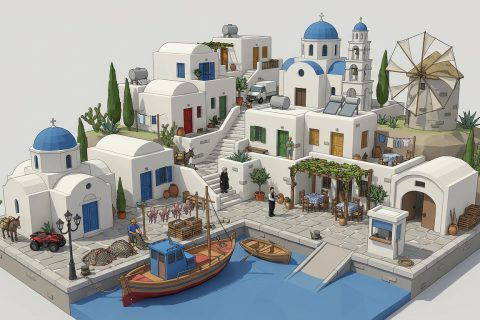

# Mediterranean Island Village

In production, 3 parts so far. Every part below is already free to use.

[Open the kit on Polyfork](https://polyfork.dev/kit/mediterranean-island-village-4ac936) · [All kits](../README.md#kits)

<table>
<tr>
<td align="center" valign="top" width="25%"> <a href="https://polyfork.dev/asset/arched-passage-56393e">Arched Passage</a> <a href="https://polyfork.dev/cdn/arched-passage-56393e.glb">GLB</a> · <a href="https://polyfork.dev/cdn/arched-passage-56393e.mjs">module</a></td>
<td align="center" valign="top" width="25%"> <a href="https://polyfork.dev/asset/basil-pot-125949">Basil Pot</a> <a href="https://polyfork.dev/cdn/basil-pot-125949.glb">GLB</a> · <a href="https://polyfork.dev/cdn/basil-pot-125949.mjs">module</a></td>
<td align="center" valign="top" width="25%"> <a href="https://polyfork.dev/asset/boathouse-cf20e6">Boathouse</a> <a href="https://polyfork.dev/cdn/boathouse-cf20e6.glb">GLB</a> · <a href="https://polyfork.dev/cdn/boathouse-cf20e6.mjs">module</a></td>
</tr>
</table>
