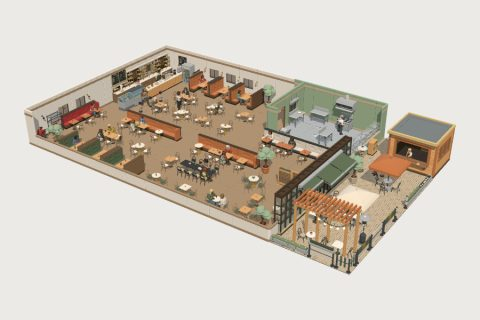

# Modern Restaurant Cafe kit

60 free low-poly parts on one palette and one scale, so everything you combine belongs to the same world.

[Open the kit on Polyfork](https://polyfork.dev/kit/modern-restaurant-cafe-01ea4c) · [All kits](../README.md#kits)

<table>
<tr>
<td align="center" valign="top" width="25%"> <a href="https://polyfork.dev/asset/back-bar-shelf-unit-11ab89">Back Bar Shelf Unit</a> <a href="https://polyfork.dev/cdn/back-bar-shelf-unit-11ab89.glb">GLB</a> · <a href="https://polyfork.dev/cdn/back-bar-shelf-unit-11ab89.mjs">module</a></td>
<td align="center" valign="top" width="25%"> <a href="https://polyfork.dev/asset/banquette-bench-run-8e972f">Banquette Bench Run</a> <a href="https://polyfork.dev/cdn/banquette-bench-run-8e972f.glb">GLB</a> · <a href="https://polyfork.dev/cdn/banquette-bench-run-8e972f.mjs">module</a></td>
<td align="center" valign="top" width="25%"> <a href="https://polyfork.dev/asset/barista-505240">Barista</a> <a href="https://polyfork.dev/cdn/barista-505240.glb">GLB</a> · <a href="https://polyfork.dev/cdn/barista-505240.mjs">module</a></td>
<td align="center" valign="top" width="25%"> <a href="https://polyfork.dev/asset/batch-brew-urn-f54a3b">Batch Brew Urn</a> <a href="https://polyfork.dev/cdn/batch-brew-urn-f54a3b.glb">GLB</a> · <a href="https://polyfork.dev/cdn/batch-brew-urn-f54a3b.mjs">module</a></td>
</tr>
<tr>
<td align="center" valign="top" width="25%"> <a href="https://polyfork.dev/asset/bistro-chair-7c354d">Bistro Chair</a> <a href="https://polyfork.dev/cdn/bistro-chair-7c354d.glb">GLB</a> · <a href="https://polyfork.dev/cdn/bistro-chair-7c354d.mjs">module</a></td>
<td align="center" valign="top" width="25%"> <a href="https://polyfork.dev/asset/bistro-table-877a6d">Bistro Table</a> <a href="https://polyfork.dev/cdn/bistro-table-877a6d.glb">GLB</a> · <a href="https://polyfork.dev/cdn/bistro-table-877a6d.mjs">module</a></td>
<td align="center" valign="top" width="25%"> <a href="https://polyfork.dev/asset/booth-divider-screen-08f696">Booth Divider Screen</a> <a href="https://polyfork.dev/cdn/booth-divider-screen-08f696.glb">GLB</a> · <a href="https://polyfork.dev/cdn/booth-divider-screen-08f696.mjs">module</a></td>
<td align="center" valign="top" width="25%"> <a href="https://polyfork.dev/asset/bus-tub-trolley-a37f63">Bus Tub Trolley</a> <a href="https://polyfork.dev/cdn/bus-tub-trolley-a37f63.glb">GLB</a> · <a href="https://polyfork.dev/cdn/bus-tub-trolley-a37f63.mjs">module</a></td>
</tr>
<tr>
<td align="center" valign="top" width="25%"> <a href="https://polyfork.dev/asset/cafe-customer-ca7e8e">Cafe Customer</a> <a href="https://polyfork.dev/cdn/cafe-customer-ca7e8e.glb">GLB</a> · <a href="https://polyfork.dev/cdn/cafe-customer-ca7e8e.mjs">module</a></td>
<td align="center" valign="top" width="25%"> <a href="https://polyfork.dev/asset/cafe-encaustic-floor-tile-7b0bc4">Cafe Encaustic Floor Tile</a> <a href="https://polyfork.dev/cdn/cafe-encaustic-floor-tile-7b0bc4.glb">GLB</a> · <a href="https://polyfork.dev/cdn/cafe-encaustic-floor-tile-7b0bc4.mjs">module</a></td>
<td align="center" valign="top" width="25%"> <a href="https://polyfork.dev/asset/cafe-parasol-61a313">Cafe Parasol</a> <a href="https://polyfork.dev/cdn/cafe-parasol-61a313.glb">GLB</a> · <a href="https://polyfork.dev/cdn/cafe-parasol-61a313.mjs">module</a></td>
<td align="center" valign="top" width="25%"> <a href="https://polyfork.dev/asset/cafe-storefront-unit-443728">Cafe Storefront Unit</a> <a href="https://polyfork.dev/cdn/cafe-storefront-unit-443728.glb">GLB</a> · <a href="https://polyfork.dev/cdn/cafe-storefront-unit-443728.mjs">module</a></td>
</tr>
<tr>
<td align="center" valign="top" width="25%"> <a href="https://polyfork.dev/asset/cafe-wall-sconce-1ee40b">Cafe Wall Sconce</a> <a href="https://polyfork.dev/cdn/cafe-wall-sconce-1ee40b.glb">GLB</a> · <a href="https://polyfork.dev/cdn/cafe-wall-sconce-1ee40b.mjs">module</a></td>
<td align="center" valign="top" width="25%"> <a href="https://polyfork.dev/asset/cake-stand-ee7396">Cake Stand</a> <a href="https://polyfork.dev/cdn/cake-stand-ee7396.glb">GLB</a> · <a href="https://polyfork.dev/cdn/cake-stand-ee7396.mjs">module</a></td>
<td align="center" valign="top" width="25%"> <a href="https://polyfork.dev/asset/chalkboard-menu-board-a24d9d">Chalkboard Menu Board</a> <a href="https://polyfork.dev/cdn/chalkboard-menu-board-a24d9d.glb">GLB</a> · <a href="https://polyfork.dev/cdn/chalkboard-menu-board-a24d9d.mjs">module</a></td>
<td align="center" valign="top" width="25%"> <a href="https://polyfork.dev/asset/coffee-grinder-6f962a">Coffee Grinder</a> <a href="https://polyfork.dev/cdn/coffee-grinder-6f962a.glb">GLB</a> · <a href="https://polyfork.dev/cdn/coffee-grinder-6f962a.mjs">module</a></td>
</tr>
<tr>
<td align="center" valign="top" width="25%"> <a href="https://polyfork.dev/asset/coffee-kiosk-406d3e">Coffee Kiosk</a> <a href="https://polyfork.dev/cdn/coffee-kiosk-406d3e.glb">GLB</a> · <a href="https://polyfork.dev/cdn/coffee-kiosk-406d3e.mjs">module</a></td>
<td align="center" valign="top" width="25%"> <a href="https://polyfork.dev/asset/commercial-range-a3b2d8">Commercial Range</a> <a href="https://polyfork.dev/cdn/commercial-range-a3b2d8.glb">GLB</a> · <a href="https://polyfork.dev/cdn/commercial-range-a3b2d8.mjs">module</a></td>
<td align="center" valign="top" width="25%"> <a href="https://polyfork.dev/asset/condiment-caddy-500e44">Condiment Caddy</a> <a href="https://polyfork.dev/cdn/condiment-caddy-500e44.glb">GLB</a> · <a href="https://polyfork.dev/cdn/condiment-caddy-500e44.mjs">module</a></td>
<td align="center" valign="top" width="25%"> <a href="https://polyfork.dev/asset/corner-restaurant-unit-d85304">Corner Restaurant Unit</a> <a href="https://polyfork.dev/cdn/corner-restaurant-unit-d85304.glb">GLB</a> · <a href="https://polyfork.dev/cdn/corner-restaurant-unit-d85304.mjs">module</a></td>
</tr>
<tr>
<td align="center" valign="top" width="25%"> <a href="https://polyfork.dev/asset/espresso-machine-a2db84">Espresso Machine</a> <a href="https://polyfork.dev/cdn/espresso-machine-a2db84.glb">GLB</a> · <a href="https://polyfork.dev/cdn/espresso-machine-a2db84.mjs">module</a></td>
<td align="center" valign="top" width="25%"> <a href="https://polyfork.dev/asset/festoon-light-run-45629f">Festoon Light Run</a> <a href="https://polyfork.dev/cdn/festoon-light-run-45629f.glb">GLB</a> · <a href="https://polyfork.dev/cdn/festoon-light-run-45629f.mjs">module</a></td>
<td align="center" valign="top" width="25%"> <a href="https://polyfork.dev/asset/gelato-display-freezer-07eb8f">Gelato Display Freezer</a> <a href="https://polyfork.dev/cdn/gelato-display-freezer-07eb8f.glb">GLB</a> · <a href="https://polyfork.dev/cdn/gelato-display-freezer-07eb8f.mjs">module</a></td>
<td align="center" valign="top" width="25%"> <a href="https://polyfork.dev/asset/glass-door-drinks-fridge-21f077">Glass-Door Drinks Fridge</a> <a href="https://polyfork.dev/cdn/glass-door-drinks-fridge-21f077.glb">GLB</a> · <a href="https://polyfork.dev/cdn/glass-door-drinks-fridge-21f077.mjs">module</a></td>
</tr>
<tr>
<td align="center" valign="top" width="25%"> <a href="https://polyfork.dev/asset/glazed-shopfront-screen-ecd5d3">Glazed Shopfront Screen</a> <a href="https://polyfork.dev/cdn/glazed-shopfront-screen-ecd5d3.glb">GLB</a> · <a href="https://polyfork.dev/cdn/glazed-shopfront-screen-ecd5d3.mjs">module</a></td>
<td align="center" valign="top" width="25%"> <a href="https://polyfork.dev/asset/hanging-plant-basket-66a002">Hanging Plant Basket</a> <a href="https://polyfork.dev/cdn/hanging-plant-basket-66a002.glb">GLB</a> · <a href="https://polyfork.dev/cdn/hanging-plant-basket-66a002.mjs">module</a></td>
<td align="center" valign="top" width="25%"> <a href="https://polyfork.dev/asset/interior-partition-wall-aa00ff">Interior Partition Wall</a> <a href="https://polyfork.dev/cdn/interior-partition-wall-aa00ff.glb">GLB</a> · <a href="https://polyfork.dev/cdn/interior-partition-wall-aa00ff.mjs">module</a></td>
<td align="center" valign="top" width="25%"> <a href="https://polyfork.dev/asset/kitchen-extraction-canopy-94df44">Kitchen Extraction Canopy</a> <a href="https://polyfork.dev/cdn/kitchen-extraction-canopy-94df44.glb">GLB</a> · <a href="https://polyfork.dev/cdn/kitchen-extraction-canopy-94df44.mjs">module</a></td>
</tr>
<tr>
<td align="center" valign="top" width="25%"> <a href="https://polyfork.dev/asset/kitchen-resin-floor-tile-4c2150">Kitchen Resin Floor Tile</a> <a href="https://polyfork.dev/cdn/kitchen-resin-floor-tile-4c2150.glb">GLB</a> · <a href="https://polyfork.dev/cdn/kitchen-resin-floor-tile-4c2150.mjs">module</a></td>
<td align="center" valign="top" width="25%"> <a href="https://polyfork.dev/asset/landscape-pebble-0dc027">Landscape Pebble</a> <a href="https://polyfork.dev/cdn/landscape-pebble-0dc027.glb">GLB</a> · <a href="https://polyfork.dev/cdn/landscape-pebble-0dc027.mjs">module</a></td>
<td align="center" valign="top" width="25%"> <a href="https://polyfork.dev/asset/milk-steaming-pitcher-4757b5">Milk Steaming Pitcher</a> <a href="https://polyfork.dev/cdn/milk-steaming-pitcher-4757b5.glb">GLB</a> · <a href="https://polyfork.dev/cdn/milk-steaming-pitcher-4757b5.mjs">module</a></td>
<td align="center" valign="top" width="25%"> <a href="https://polyfork.dev/asset/neon-window-sign-92a889">Neon Window Sign</a> <a href="https://polyfork.dev/cdn/neon-window-sign-92a889.glb">GLB</a> · <a href="https://polyfork.dev/cdn/neon-window-sign-92a889.mjs">module</a></td>
</tr>
<tr>
<td align="center" valign="top" width="25%"> <a href="https://polyfork.dev/asset/pass-heat-lamp-c79dc8">Pass Heat Lamp</a> <a href="https://polyfork.dev/cdn/pass-heat-lamp-c79dc8.glb">GLB</a> · <a href="https://polyfork.dev/cdn/pass-heat-lamp-c79dc8.mjs">module</a></td>
<td align="center" valign="top" width="25%"> <a href="https://polyfork.dev/asset/pastry-display-case-8bcce5">Pastry Display Case</a> <a href="https://polyfork.dev/cdn/pastry-display-case-8bcce5.glb">GLB</a> · <a href="https://polyfork.dev/cdn/pastry-display-case-8bcce5.mjs">module</a></td>
<td align="center" valign="top" width="25%"> <a href="https://polyfork.dev/asset/patio-heater-1559f3">Patio Heater</a> <a href="https://polyfork.dev/cdn/patio-heater-1559f3.glb">GLB</a> · <a href="https://polyfork.dev/cdn/patio-heater-1559f3.mjs">module</a></td>
<td align="center" valign="top" width="25%"> <a href="https://polyfork.dev/asset/pergola-bay-module-1ad452">Pergola Bay Module</a> <a href="https://polyfork.dev/cdn/pergola-bay-module-1ad452.glb">GLB</a> · <a href="https://polyfork.dev/cdn/pergola-bay-module-1ad452.mjs">module</a></td>
</tr>
<tr>
<td align="center" valign="top" width="25%"> <a href="https://polyfork.dev/asset/planter-trough-divider-1b0ead">Planter Trough Divider</a> <a href="https://polyfork.dev/cdn/planter-trough-divider-1b0ead.glb">GLB</a> · <a href="https://polyfork.dev/cdn/planter-trough-divider-1b0ead.mjs">module</a></td>
<td align="center" valign="top" width="25%"> <a href="https://polyfork.dev/asset/pos-terminal-f1273c">POS Terminal</a> <a href="https://polyfork.dev/cdn/pos-terminal-f1273c.glb">GLB</a> · <a href="https://polyfork.dev/cdn/pos-terminal-f1273c.mjs">module</a></td>
<td align="center" valign="top" width="25%"> <a href="https://polyfork.dev/asset/poseur-table-1736f4">Poseur Table</a> <a href="https://polyfork.dev/cdn/poseur-table-1736f4.glb">GLB</a> · <a href="https://polyfork.dev/cdn/poseur-table-1736f4.mjs">module</a></td>
<td align="center" valign="top" width="25%"> <a href="https://polyfork.dev/asset/potted-olive-tree-7eee05">Potted Olive Tree</a> <a href="https://polyfork.dev/cdn/potted-olive-tree-7eee05.glb">GLB</a> · <a href="https://polyfork.dev/cdn/potted-olive-tree-7eee05.mjs">module</a></td>
</tr>
<tr>
<td align="center" valign="top" width="25%"> <a href="https://polyfork.dev/asset/queue-belt-post-912b7e">Queue Belt Post</a> <a href="https://polyfork.dev/cdn/queue-belt-post-912b7e.glb">GLB</a> · <a href="https://polyfork.dev/cdn/queue-belt-post-912b7e.mjs">module</a></td>
<td align="center" valign="top" width="25%"> <a href="https://polyfork.dev/asset/restaurant-highchair-ef6224">Restaurant Highchair</a> <a href="https://polyfork.dev/cdn/restaurant-highchair-ef6224.glb">GLB</a> · <a href="https://polyfork.dev/cdn/restaurant-highchair-ef6224.mjs">module</a></td>
<td align="center" valign="top" width="25%"> <a href="https://polyfork.dev/asset/retractable-box-awning-85d8dd">Retractable Box Awning</a> <a href="https://polyfork.dev/cdn/retractable-box-awning-85d8dd.glb">GLB</a> · <a href="https://polyfork.dev/cdn/retractable-box-awning-85d8dd.mjs">module</a></td>
<td align="center" valign="top" width="25%"> <a href="https://polyfork.dev/asset/service-counter-module-3072ff">Service Counter Module</a> <a href="https://polyfork.dev/cdn/service-counter-module-3072ff.glb">GLB</a> · <a href="https://polyfork.dev/cdn/service-counter-module-3072ff.mjs">module</a></td>
</tr>
<tr>
<td align="center" valign="top" width="25%"> <a href="https://polyfork.dev/asset/serving-tray-a1cf27">Serving Tray</a> <a href="https://polyfork.dev/cdn/serving-tray-a1cf27.glb">GLB</a> · <a href="https://polyfork.dev/cdn/serving-tray-a1cf27.mjs">module</a></td>
<td align="center" valign="top" width="25%"> <a href="https://polyfork.dev/asset/shop-coffee-roaster-c6a2b5">Shop Coffee Roaster</a> <a href="https://polyfork.dev/cdn/shop-coffee-roaster-c6a2b5.glb">GLB</a> · <a href="https://polyfork.dev/cdn/shop-coffee-roaster-c6a2b5.mjs">module</a></td>
<td align="center" valign="top" width="25%"> <a href="https://polyfork.dev/asset/stainless-prep-table-5254d2">Stainless Prep Table</a> <a href="https://polyfork.dev/cdn/stainless-prep-table-5254d2.glb">GLB</a> · <a href="https://polyfork.dev/cdn/stainless-prep-table-5254d2.mjs">module</a></td>
<td align="center" valign="top" width="25%"> <a href="https://polyfork.dev/asset/stemmed-wine-glass-a4f002">Stemmed Wine Glass</a> <a href="https://polyfork.dev/cdn/stemmed-wine-glass-a4f002.glb">GLB</a> · <a href="https://polyfork.dev/cdn/stemmed-wine-glass-a4f002.mjs">module</a></td>
</tr>
<tr>
<td align="center" valign="top" width="25%"> <a href="https://polyfork.dev/asset/table-candle-lantern-a7b5af">Table Candle Lantern</a> <a href="https://polyfork.dev/cdn/table-candle-lantern-a7b5af.glb">GLB</a> · <a href="https://polyfork.dev/cdn/table-candle-lantern-a7b5af.mjs">module</a></td>
<td align="center" valign="top" width="25%"> <a href="https://polyfork.dev/asset/table-herb-pot-3c0cf4">Table Herb Pot</a> <a href="https://polyfork.dev/cdn/table-herb-pot-3c0cf4.glb">GLB</a> · <a href="https://polyfork.dev/cdn/table-herb-pot-3c0cf4.mjs">module</a></td>
<td align="center" valign="top" width="25%"> <a href="https://polyfork.dev/asset/table-menu-holder-1a61dc">Table Menu Holder</a> <a href="https://polyfork.dev/cdn/table-menu-holder-1a61dc.glb">GLB</a> · <a href="https://polyfork.dev/cdn/table-menu-holder-1a61dc.mjs">module</a></td>
<td align="center" valign="top" width="25%"> <a href="https://polyfork.dev/asset/takeaway-coffee-cup-1fd6dd">Takeaway Coffee Cup</a> <a href="https://polyfork.dev/cdn/takeaway-coffee-cup-1fd6dd.glb">GLB</a> · <a href="https://polyfork.dev/cdn/takeaway-coffee-cup-1fd6dd.mjs">module</a></td>
</tr>
<tr>
<td align="center" valign="top" width="25%"> <a href="https://polyfork.dev/asset/terrace-barrier-set-30dd76">Terrace Barrier Set</a> <a href="https://polyfork.dev/cdn/terrace-barrier-set-30dd76.glb">GLB</a> · <a href="https://polyfork.dev/cdn/terrace-barrier-set-30dd76.mjs">module</a></td>
<td align="center" valign="top" width="25%"> <a href="https://polyfork.dev/asset/terrace-boundary-decal-daaa9e">Terrace Boundary Decal</a> <a href="https://polyfork.dev/cdn/terrace-boundary-decal-daaa9e.glb">GLB</a> · <a href="https://polyfork.dev/cdn/terrace-boundary-decal-daaa9e.mjs">module</a></td>
<td align="center" valign="top" width="25%"> <a href="https://polyfork.dev/asset/timber-deck-tile-39324d">Timber Deck Tile</a> <a href="https://polyfork.dev/cdn/timber-deck-tile-39324d.glb">GLB</a> · <a href="https://polyfork.dev/cdn/timber-deck-tile-39324d.mjs">module</a></td>
<td align="center" valign="top" width="25%"> <a href="https://polyfork.dev/asset/waiter-73dab1">Waiter</a> <a href="https://polyfork.dev/cdn/waiter-73dab1.glb">GLB</a> · <a href="https://polyfork.dev/cdn/waiter-73dab1.mjs">module</a></td>
</tr>
<tr>
<td align="center" valign="top" width="25%"> <a href="https://polyfork.dev/asset/waste-sorting-station-adeefd">Waste Sorting Station</a> <a href="https://polyfork.dev/cdn/waste-sorting-station-adeefd.glb">GLB</a> · <a href="https://polyfork.dev/cdn/waste-sorting-station-adeefd.mjs">module</a></td>
<td align="center" valign="top" width="25%"> <a href="https://polyfork.dev/asset/water-carafe-6f1774">Water Carafe</a> <a href="https://polyfork.dev/cdn/water-carafe-6f1774.glb">GLB</a> · <a href="https://polyfork.dev/cdn/water-carafe-6f1774.mjs">module</a></td>
<td align="center" valign="top" width="25%"> <a href="https://polyfork.dev/asset/wine-bottle-75a822">Wine Bottle</a> <a href="https://polyfork.dev/cdn/wine-bottle-75a822.glb">GLB</a> · <a href="https://polyfork.dev/cdn/wine-bottle-75a822.mjs">module</a></td>
<td align="center" valign="top" width="25%"> <a href="https://polyfork.dev/asset/wire-shelving-rack-799aec">Wire Shelving Rack</a> <a href="https://polyfork.dev/cdn/wire-shelving-rack-799aec.glb">GLB</a> · <a href="https://polyfork.dev/cdn/wire-shelving-rack-799aec.mjs">module</a></td>
</tr>
</table>
