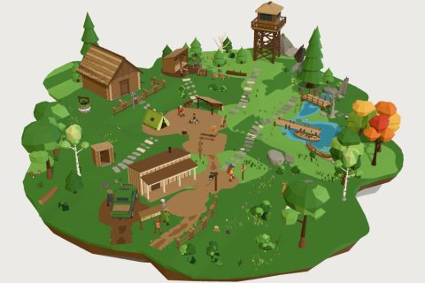

# Nature & Forest Kit

59 free low-poly parts on one palette and one scale, so everything you combine belongs to the same world.

[Open the kit on Polyfork](https://polyfork.dev/kit/nature-forest-kit-f29d6a) · [All kits](../README.md#kits)

<table>
<tr>
<td align="center" valign="top" width="25%"> <a href="https://polyfork.dev/asset/birch-tree-181b33">Birch Tree</a> <a href="https://polyfork.dev/cdn/birch-tree-181b33.glb">GLB</a> · <a href="https://polyfork.dev/cdn/birch-tree-181b33.mjs">module</a></td>
<td align="center" valign="top" width="25%"> <a href="https://polyfork.dev/asset/birdhouse-post-66d6c1">Birdhouse Post</a> <a href="https://polyfork.dev/cdn/birdhouse-post-66d6c1.glb">GLB</a> · <a href="https://polyfork.dev/cdn/birdhouse-post-66d6c1.mjs">module</a></td>
<td align="center" valign="top" width="25%"> <a href="https://polyfork.dev/asset/black-bear-adbdc7">Black Bear</a> <a href="https://polyfork.dev/cdn/black-bear-adbdc7.glb">GLB</a> · <a href="https://polyfork.dev/cdn/black-bear-adbdc7.mjs">module</a></td>
<td align="center" valign="top" width="25%"> <a href="https://polyfork.dev/asset/broadleaf-oak-997c22">Broadleaf Oak</a> <a href="https://polyfork.dev/cdn/broadleaf-oak-997c22.glb">GLB</a> · <a href="https://polyfork.dev/cdn/broadleaf-oak-997c22.mjs">module</a></td>
</tr>
<tr>
<td align="center" valign="top" width="25%"> <a href="https://polyfork.dev/asset/camp-tent-3c5c89">Camp Tent</a> <a href="https://polyfork.dev/cdn/camp-tent-3c5c89.glb">GLB</a> · <a href="https://polyfork.dev/cdn/camp-tent-3c5c89.mjs">module</a></td>
<td align="center" valign="top" width="25%"> <a href="https://polyfork.dev/asset/campfire-cook-tripod-d95a1e">Campfire Cook Tripod</a> <a href="https://polyfork.dev/cdn/campfire-cook-tripod-d95a1e.glb">GLB</a> · <a href="https://polyfork.dev/cdn/campfire-cook-tripod-d95a1e.mjs">module</a></td>
<td align="center" valign="top" width="25%"> <a href="https://polyfork.dev/asset/campsite-picnic-table-361d51">Campsite Picnic Table</a> <a href="https://polyfork.dev/cdn/campsite-picnic-table-361d51.glb">GLB</a> · <a href="https://polyfork.dev/cdn/campsite-picnic-table-361d51.mjs">module</a></td>
<td align="center" valign="top" width="25%"> <a href="https://polyfork.dev/asset/cattail-reed-6abbb3">Cattail Reed</a> <a href="https://polyfork.dev/cdn/cattail-reed-6abbb3.glb">GLB</a> · <a href="https://polyfork.dev/cdn/cattail-reed-6abbb3.mjs">module</a></td>
</tr>
<tr>
<td align="center" valign="top" width="25%"> <a href="https://polyfork.dev/asset/chopping-block-073b5e">Chopping Block</a> <a href="https://polyfork.dev/cdn/chopping-block-073b5e.glb">GLB</a> · <a href="https://polyfork.dev/cdn/chopping-block-073b5e.mjs">module</a></td>
<td align="center" valign="top" width="25%"> <a href="https://polyfork.dev/asset/dead-tree-6795fa">Dead Tree</a> <a href="https://polyfork.dev/cdn/dead-tree-6795fa.glb">GLB</a> · <a href="https://polyfork.dev/cdn/dead-tree-6795fa.mjs">module</a></td>
<td align="center" valign="top" width="25%"> <a href="https://polyfork.dev/asset/dirt-terrain-blob-94e829">Dirt Terrain Blob</a> <a href="https://polyfork.dev/cdn/dirt-terrain-blob-94e829.glb">GLB</a> · <a href="https://polyfork.dev/cdn/dirt-terrain-blob-94e829.mjs">module</a></td>
<td align="center" valign="top" width="25%"> <a href="https://polyfork.dev/asset/dirt-trail-strip-1be7a6">Dirt Trail Strip</a> <a href="https://polyfork.dev/cdn/dirt-trail-strip-1be7a6.glb">GLB</a> · <a href="https://polyfork.dev/cdn/dirt-trail-strip-1be7a6.mjs">module</a></td>
</tr>
<tr>
<td align="center" valign="top" width="25%"> <a href="https://polyfork.dev/asset/dock-platform-section-b36e7c">Dock Platform Section</a> <a href="https://polyfork.dev/cdn/dock-platform-section-b36e7c.glb">GLB</a> · <a href="https://polyfork.dev/cdn/dock-platform-section-b36e7c.mjs">module</a></td>
<td align="center" valign="top" width="25%"> <a href="https://polyfork.dev/asset/fallen-log-1685fb">Fallen Log</a> <a href="https://polyfork.dev/cdn/fallen-log-1685fb.glb">GLB</a> · <a href="https://polyfork.dev/cdn/fallen-log-1685fb.mjs">module</a></td>
<td align="center" valign="top" width="25%"> <a href="https://polyfork.dev/asset/fern-plant-1559b8">Fern Plant</a> <a href="https://polyfork.dev/cdn/fern-plant-1559b8.glb">GLB</a> · <a href="https://polyfork.dev/cdn/fern-plant-1559b8.mjs">module</a></td>
<td align="center" valign="top" width="25%"> <a href="https://polyfork.dev/asset/fire-lookout-tower-75a129">Fire Lookout Tower</a> <a href="https://polyfork.dev/cdn/fire-lookout-tower-75a129.glb">GLB</a> · <a href="https://polyfork.dev/cdn/fire-lookout-tower-75a129.mjs">module</a></td>
</tr>
<tr>
<td align="center" valign="top" width="25%"> <a href="https://polyfork.dev/asset/firewood-stack-8a2899">Firewood Stack</a> <a href="https://polyfork.dev/cdn/firewood-stack-8a2899.glb">GLB</a> · <a href="https://polyfork.dev/cdn/firewood-stack-8a2899.mjs">module</a></td>
<td align="center" valign="top" width="25%"> <a href="https://polyfork.dev/asset/forest-deer-fe648d">Forest Deer</a> <a href="https://polyfork.dev/cdn/forest-deer-fe648d.glb">GLB</a> · <a href="https://polyfork.dev/cdn/forest-deer-fe648d.mjs">module</a></td>
<td align="center" valign="top" width="25%"> <a href="https://polyfork.dev/asset/forest-outhouse-e968d1">Forest Outhouse</a> <a href="https://polyfork.dev/cdn/forest-outhouse-e968d1.glb">GLB</a> · <a href="https://polyfork.dev/cdn/forest-outhouse-e968d1.mjs">module</a></td>
<td align="center" valign="top" width="25%"> <a href="https://polyfork.dev/asset/forest-rabbit-ea2da0">Forest Rabbit</a> <a href="https://polyfork.dev/cdn/forest-rabbit-ea2da0.glb">GLB</a> · <a href="https://polyfork.dev/cdn/forest-rabbit-ea2da0.mjs">module</a></td>
</tr>
<tr>
<td align="center" valign="top" width="25%"> <a href="https://polyfork.dev/asset/forest-ranger-6906b0">Forest Ranger</a> <a href="https://polyfork.dev/cdn/forest-ranger-6906b0.glb">GLB</a> · <a href="https://polyfork.dev/cdn/forest-ranger-6906b0.mjs">module</a></td>
<td align="center" valign="top" width="25%"> <a href="https://polyfork.dev/asset/grass-terrain-blob-c4f709">Grass Terrain Blob</a> <a href="https://polyfork.dev/cdn/grass-terrain-blob-c4f709.glb">GLB</a> · <a href="https://polyfork.dev/cdn/grass-terrain-blob-c4f709.mjs">module</a></td>
<td align="center" valign="top" width="25%"> <a href="https://polyfork.dev/asset/grass-tuft-a40a08">Grass Tuft</a> <a href="https://polyfork.dev/cdn/grass-tuft-a40a08.glb">GLB</a> · <a href="https://polyfork.dev/cdn/grass-tuft-a40a08.mjs">module</a></td>
<td align="center" valign="top" width="25%"> <a href="https://polyfork.dev/asset/hiker-3d1a41">Hiker</a> <a href="https://polyfork.dev/cdn/hiker-3d1a41.glb">GLB</a> · <a href="https://polyfork.dev/cdn/hiker-3d1a41.mjs">module</a></td>
</tr>
<tr>
<td align="center" valign="top" width="25%"> <a href="https://polyfork.dev/asset/lantern-post-f47665">Lantern Post</a> <a href="https://polyfork.dev/cdn/lantern-post-f47665.glb">GLB</a> · <a href="https://polyfork.dev/cdn/lantern-post-f47665.mjs">module</a></td>
<td align="center" valign="top" width="25%"> <a href="https://polyfork.dev/asset/large-boulder-a29b99">Large Boulder</a> <a href="https://polyfork.dev/cdn/large-boulder-a29b99.glb">GLB</a> · <a href="https://polyfork.dev/cdn/large-boulder-a29b99.mjs">module</a></td>
<td align="center" valign="top" width="25%"> <a href="https://polyfork.dev/asset/lean-to-shelter-f0709f">Lean-To Shelter</a> <a href="https://polyfork.dev/cdn/lean-to-shelter-f0709f.glb">GLB</a> · <a href="https://polyfork.dev/cdn/lean-to-shelter-f0709f.mjs">module</a></td>
<td align="center" valign="top" width="25%"> <a href="https://polyfork.dev/asset/lily-pad-86edbb">Lily Pad</a> <a href="https://polyfork.dev/cdn/lily-pad-86edbb.glb">GLB</a> · <a href="https://polyfork.dev/cdn/lily-pad-86edbb.mjs">module</a></td>
</tr>
<tr>
<td align="center" valign="top" width="25%"> <a href="https://polyfork.dev/asset/log-cabin-4fac3b">Log Cabin</a> <a href="https://polyfork.dev/cdn/log-cabin-4fac3b.glb">GLB</a> · <a href="https://polyfork.dev/cdn/log-cabin-4fac3b.mjs">module</a></td>
<td align="center" valign="top" width="25%"> <a href="https://polyfork.dev/asset/log-plank-bridge-a5f74f">Log Plank Bridge</a> <a href="https://polyfork.dev/cdn/log-plank-bridge-a5f74f.glb">GLB</a> · <a href="https://polyfork.dev/cdn/log-plank-bridge-a5f74f.mjs">module</a></td>
<td align="center" valign="top" width="25%"> <a href="https://polyfork.dev/asset/maple-tree-65fa12">Maple Tree</a> <a href="https://polyfork.dev/cdn/maple-tree-65fa12.glb">GLB</a> · <a href="https://polyfork.dev/cdn/maple-tree-65fa12.mjs">module</a></td>
<td align="center" valign="top" width="25%"> <a href="https://polyfork.dev/asset/medium-rock-e08405">Medium Rock</a> <a href="https://polyfork.dev/cdn/medium-rock-e08405.glb">GLB</a> · <a href="https://polyfork.dev/cdn/medium-rock-e08405.mjs">module</a></td>
</tr>
<tr>
<td align="center" valign="top" width="25%"> <a href="https://polyfork.dev/asset/nature-forest-terrain-0e61f0">Nature &amp; Forest Terrain</a> <a href="https://polyfork.dev/cdn/nature-forest-terrain-0e61f0.glb">GLB</a> · <a href="https://polyfork.dev/cdn/nature-forest-terrain-0e61f0.mjs">module</a></td>
<td align="center" valign="top" width="25%"> <a href="https://polyfork.dev/asset/open-woodshed-050a0a">Open Woodshed</a> <a href="https://polyfork.dev/cdn/open-woodshed-050a0a.glb">GLB</a> · <a href="https://polyfork.dev/cdn/open-woodshed-050a0a.mjs">module</a></td>
<td align="center" valign="top" width="25%"> <a href="https://polyfork.dev/asset/ranger-pickup-truck-97057d">Ranger Pickup Truck</a> <a href="https://polyfork.dev/cdn/ranger-pickup-truck-97057d.glb">GLB</a> · <a href="https://polyfork.dev/cdn/ranger-pickup-truck-97057d.mjs">module</a></td>
<td align="center" valign="top" width="25%"> <a href="https://polyfork.dev/asset/ranger-station-ef6407">Ranger Station</a> <a href="https://polyfork.dev/cdn/ranger-station-ef6407.glb">GLB</a> · <a href="https://polyfork.dev/cdn/ranger-station-ef6407.mjs">module</a></td>
</tr>
<tr>
<td align="center" valign="top" width="25%"> <a href="https://polyfork.dev/asset/red-fox-5c3bc0">Red Fox</a> <a href="https://polyfork.dev/cdn/red-fox-5c3bc0.glb">GLB</a> · <a href="https://polyfork.dev/cdn/red-fox-5c3bc0.mjs">module</a></td>
<td align="center" valign="top" width="25%"> <a href="https://polyfork.dev/asset/rock-spire-13819c">Rock Spire</a> <a href="https://polyfork.dev/cdn/rock-spire-13819c.glb">GLB</a> · <a href="https://polyfork.dev/cdn/rock-spire-13819c.mjs">module</a></td>
<td align="center" valign="top" width="25%"> <a href="https://polyfork.dev/asset/round-bush-cd2ac0">Round Bush</a> <a href="https://polyfork.dev/cdn/round-bush-cd2ac0.glb">GLB</a> · <a href="https://polyfork.dev/cdn/round-bush-cd2ac0.mjs">module</a></td>
<td align="center" valign="top" width="25%"> <a href="https://polyfork.dev/asset/round-path-stone-4130f3">Round Path Stone</a> <a href="https://polyfork.dev/cdn/round-path-stone-4130f3.glb">GLB</a> · <a href="https://polyfork.dev/cdn/round-path-stone-4130f3.mjs">module</a></td>
</tr>
<tr>
<td align="center" valign="top" width="25%"> <a href="https://polyfork.dev/asset/slab-path-stone-e526f7">Slab Path Stone</a> <a href="https://polyfork.dev/cdn/slab-path-stone-e526f7.glb">GLB</a> · <a href="https://polyfork.dev/cdn/slab-path-stone-e526f7.mjs">module</a></td>
<td align="center" valign="top" width="25%"> <a href="https://polyfork.dev/asset/small-rock-db33a7">Small Rock</a> <a href="https://polyfork.dev/cdn/small-rock-db33a7.glb">GLB</a> · <a href="https://polyfork.dev/cdn/small-rock-db33a7.mjs">module</a></td>
<td align="center" valign="top" width="25%"> <a href="https://polyfork.dev/asset/stone-fire-pit-4136b0">Stone Fire Pit</a> <a href="https://polyfork.dev/cdn/stone-fire-pit-4136b0.glb">GLB</a> · <a href="https://polyfork.dev/cdn/stone-fire-pit-4136b0.mjs">module</a></td>
<td align="center" valign="top" width="25%"> <a href="https://polyfork.dev/asset/stone-well-2b4717">Stone Well</a> <a href="https://polyfork.dev/cdn/stone-well-2b4717.glb">GLB</a> · <a href="https://polyfork.dev/cdn/stone-well-2b4717.mjs">module</a></td>
</tr>
<tr>
<td align="center" valign="top" width="25%"> <a href="https://polyfork.dev/asset/tall-pine-tree-ab4108">Tall Pine Tree</a> <a href="https://polyfork.dev/cdn/tall-pine-tree-ab4108.glb">GLB</a> · <a href="https://polyfork.dev/cdn/tall-pine-tree-ab4108.mjs">module</a></td>
<td align="center" valign="top" width="25%"> <a href="https://polyfork.dev/asset/toadstool-257a4a">Toadstool</a> <a href="https://polyfork.dev/cdn/toadstool-257a4a.glb">GLB</a> · <a href="https://polyfork.dev/cdn/toadstool-257a4a.mjs">module</a></td>
<td align="center" valign="top" width="25%"> <a href="https://polyfork.dev/asset/trail-map-kiosk-be8618">Trail Map Kiosk</a> <a href="https://polyfork.dev/cdn/trail-map-kiosk-be8618.glb">GLB</a> · <a href="https://polyfork.dev/cdn/trail-map-kiosk-be8618.mjs">module</a></td>
<td align="center" valign="top" width="25%"> <a href="https://polyfork.dev/asset/trail-signpost-bd29a7">Trail Signpost</a> <a href="https://polyfork.dev/cdn/trail-signpost-bd29a7.glb">GLB</a> · <a href="https://polyfork.dev/cdn/trail-signpost-bd29a7.mjs">module</a></td>
</tr>
<tr>
<td align="center" valign="top" width="25%"> <a href="https://polyfork.dev/asset/tree-stump-ec3f48">Tree Stump</a> <a href="https://polyfork.dev/cdn/tree-stump-ec3f48.glb">GLB</a> · <a href="https://polyfork.dev/cdn/tree-stump-ec3f48.mjs">module</a></td>
<td align="center" valign="top" width="25%"> <a href="https://polyfork.dev/asset/water-blob-f266b8">Water Blob</a> <a href="https://polyfork.dev/cdn/water-blob-f266b8.glb">GLB</a> · <a href="https://polyfork.dev/cdn/water-blob-f266b8.mjs">module</a></td>
<td align="center" valign="top" width="25%"> <a href="https://polyfork.dev/asset/wildflower-68d3a1">Wildflower</a> <a href="https://polyfork.dev/cdn/wildflower-68d3a1.glb">GLB</a> · <a href="https://polyfork.dev/cdn/wildflower-68d3a1.mjs">module</a></td>
<td align="center" valign="top" width="25%"> <a href="https://polyfork.dev/asset/wooden-barrel-ab50ca">Wooden Barrel</a> <a href="https://polyfork.dev/cdn/wooden-barrel-ab50ca.glb">GLB</a> · <a href="https://polyfork.dev/cdn/wooden-barrel-ab50ca.mjs">module</a></td>
</tr>
<tr>
<td align="center" valign="top" width="25%"> <a href="https://polyfork.dev/asset/wooden-bench-02e2c8">Wooden Bench</a> <a href="https://polyfork.dev/cdn/wooden-bench-02e2c8.glb">GLB</a> · <a href="https://polyfork.dev/cdn/wooden-bench-02e2c8.mjs">module</a></td>
<td align="center" valign="top" width="25%"> <a href="https://polyfork.dev/asset/wooden-canoe-1d00c5">Wooden Canoe</a> <a href="https://polyfork.dev/cdn/wooden-canoe-1d00c5.glb">GLB</a> · <a href="https://polyfork.dev/cdn/wooden-canoe-1d00c5.mjs">module</a></td>
<td align="center" valign="top" width="25%"> <a href="https://polyfork.dev/asset/wooden-fence-gate-a8735f">Wooden Fence Gate</a> <a href="https://polyfork.dev/cdn/wooden-fence-gate-a8735f.glb">GLB</a> · <a href="https://polyfork.dev/cdn/wooden-fence-gate-a8735f.mjs">module</a></td>
<td align="center" valign="top" width="25%"> <a href="https://polyfork.dev/asset/wooden-fence-section-5f04b7">Wooden Fence Section</a> <a href="https://polyfork.dev/cdn/wooden-fence-section-5f04b7.glb">GLB</a> · <a href="https://polyfork.dev/cdn/wooden-fence-section-5f04b7.mjs">module</a></td>
</tr>
<tr>
<td align="center" valign="top" width="25%"> <a href="https://polyfork.dev/asset/wooden-hand-cart-3ae5b5">Wooden Hand Cart</a> <a href="https://polyfork.dev/cdn/wooden-hand-cart-3ae5b5.glb">GLB</a> · <a href="https://polyfork.dev/cdn/wooden-hand-cart-3ae5b5.mjs">module</a></td>
<td align="center" valign="top" width="25%"> <a href="https://polyfork.dev/asset/wooden-rowboat-916981">Wooden Rowboat</a> <a href="https://polyfork.dev/cdn/wooden-rowboat-916981.glb">GLB</a> · <a href="https://polyfork.dev/cdn/wooden-rowboat-916981.mjs">module</a></td>
<td align="center" valign="top" width="25%"> <a href="https://polyfork.dev/asset/young-pine-0d7695">Young Pine</a> <a href="https://polyfork.dev/cdn/young-pine-0d7695.glb">GLB</a> · <a href="https://polyfork.dev/cdn/young-pine-0d7695.mjs">module</a></td>
</tr>
</table>
