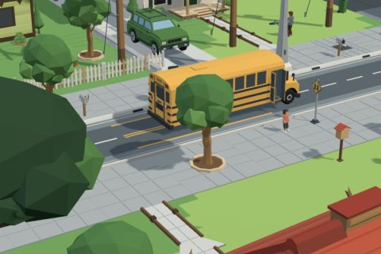

# Neighborhood Pathways kit

61 free low-poly parts on one palette and one scale, so everything you combine belongs to the same world.

[Open the kit on Polyfork](https://polyfork.dev/kit/neighborhood-pathways-kit-a992cf) · [All kits](../README.md#kits)

<table>
<tr>
<td align="center" valign="top" width="25%"> <a href="https://polyfork.dev/asset/above-ground-pool-95b23e">Above-Ground Pool</a> <a href="https://polyfork.dev/cdn/above-ground-pool-95b23e.glb">GLB</a> · <a href="https://polyfork.dev/cdn/above-ground-pool-95b23e.mjs">module</a></td>
<td align="center" valign="top" width="25%"> <a href="https://polyfork.dev/asset/backyard-barbecue-grill-84d4ef">Backyard Barbecue Grill</a> <a href="https://polyfork.dev/cdn/backyard-barbecue-grill-84d4ef.glb">GLB</a> · <a href="https://polyfork.dev/cdn/backyard-barbecue-grill-84d4ef.mjs">module</a></td>
<td align="center" valign="top" width="25%"> <a href="https://polyfork.dev/asset/backyard-deck-module-17ae3a">Backyard Deck Module</a> <a href="https://polyfork.dev/cdn/backyard-deck-module-17ae3a.glb">GLB</a> · <a href="https://polyfork.dev/cdn/backyard-deck-module-17ae3a.mjs">module</a></td>
<td align="center" valign="top" width="25%"> <a href="https://polyfork.dev/asset/backyard-doghouse-50a492">Backyard Doghouse</a> <a href="https://polyfork.dev/cdn/backyard-doghouse-50a492.glb">GLB</a> · <a href="https://polyfork.dev/cdn/backyard-doghouse-50a492.mjs">module</a></td>
</tr>
<tr>
<td align="center" valign="top" width="25%"> <a href="https://polyfork.dev/asset/backyard-garden-shed-38d79f">Backyard Garden Shed</a> <a href="https://polyfork.dev/cdn/backyard-garden-shed-38d79f.glb">GLB</a> · <a href="https://polyfork.dev/cdn/backyard-garden-shed-38d79f.mjs">module</a></td>
<td align="center" valign="top" width="25%"> <a href="https://polyfork.dev/asset/backyard-swing-set-38637e">Backyard Swing Set</a> <a href="https://polyfork.dev/cdn/backyard-swing-set-38637e.glb">GLB</a> · <a href="https://polyfork.dev/cdn/backyard-swing-set-38637e.mjs">module</a></td>
<td align="center" valign="top" width="25%"> <a href="https://polyfork.dev/asset/backyard-trampoline-2779ec">Backyard Trampoline</a> <a href="https://polyfork.dev/cdn/backyard-trampoline-2779ec.glb">GLB</a> · <a href="https://polyfork.dev/cdn/backyard-trampoline-2779ec.mjs">module</a></td>
<td align="center" valign="top" width="25%"> <a href="https://polyfork.dev/asset/board-privacy-fence-run-319bef">Board Privacy Fence Run</a> <a href="https://polyfork.dev/cdn/board-privacy-fence-run-319bef.glb">GLB</a> · <a href="https://polyfork.dev/cdn/board-privacy-fence-run-319bef.mjs">module</a></td>
</tr>
<tr>
<td align="center" valign="top" width="25%"> <a href="https://polyfork.dev/asset/broad-canopy-shade-tree-e7c4a2">Broad Canopy Shade Tree</a> <a href="https://polyfork.dev/cdn/broad-canopy-shade-tree-e7c4a2.glb">GLB</a> · <a href="https://polyfork.dev/cdn/broad-canopy-shade-tree-e7c4a2.mjs">module</a></td>
<td align="center" valign="top" width="25%"> <a href="https://polyfork.dev/asset/chain-link-fence-run-6c3d68">Chain-Link Fence Run</a> <a href="https://polyfork.dev/cdn/chain-link-fence-run-6c3d68.glb">GLB</a> · <a href="https://polyfork.dev/cdn/chain-link-fence-run-6c3d68.mjs">module</a></td>
<td align="center" valign="top" width="25%"> <a href="https://polyfork.dev/asset/clipped-boundary-hedge-run-c9027b">Clipped Boundary Hedge Run</a> <a href="https://polyfork.dev/cdn/clipped-boundary-hedge-run-c9027b.glb">GLB</a> · <a href="https://polyfork.dev/cdn/clipped-boundary-hedge-run-c9027b.mjs">module</a></td>
<td align="center" valign="top" width="25%"> <a href="https://polyfork.dev/asset/cobra-head-street-light-3e25b8">Cobra-Head Street Light</a> <a href="https://polyfork.dev/cdn/cobra-head-street-light-3e25b8.glb">GLB</a> · <a href="https://polyfork.dev/cdn/cobra-head-street-light-3e25b8.mjs">module</a></td>
</tr>
<tr>
<td align="center" valign="top" width="25%"> <a href="https://polyfork.dev/asset/columnar-evergreen-shrub-35a00b">Columnar Evergreen Shrub</a> <a href="https://polyfork.dev/cdn/columnar-evergreen-shrub-35a00b.glb">GLB</a> · <a href="https://polyfork.dev/cdn/columnar-evergreen-shrub-35a00b.mjs">module</a></td>
<td align="center" valign="top" width="25%"> <a href="https://polyfork.dev/asset/curbside-mailbox-0e0736">Curbside Mailbox</a> <a href="https://polyfork.dev/cdn/curbside-mailbox-0e0736.glb">GLB</a> · <a href="https://polyfork.dev/cdn/curbside-mailbox-0e0736.mjs">module</a></td>
<td align="center" valign="top" width="25%"> <a href="https://polyfork.dev/asset/detached-garage-38a178">Detached Garage</a> <a href="https://polyfork.dev/cdn/detached-garage-38a178.glb">GLB</a> · <a href="https://polyfork.dev/cdn/detached-garage-38a178.mjs">module</a></td>
<td align="center" valign="top" width="25%"> <a href="https://polyfork.dev/asset/driveway-basketball-hoop-40deb7">Driveway Basketball Hoop</a> <a href="https://polyfork.dev/cdn/driveway-basketball-hoop-40deb7.glb">GLB</a> · <a href="https://polyfork.dev/cdn/driveway-basketball-hoop-40deb7.mjs">module</a></td>
</tr>
<tr>
<td align="center" valign="top" width="25%"> <a href="https://polyfork.dev/asset/driveway-slab-tile-eb40ac">Driveway Slab Tile</a> <a href="https://polyfork.dev/cdn/driveway-slab-tile-eb40ac.glb">GLB</a> · <a href="https://polyfork.dev/cdn/driveway-slab-tile-eb40ac.mjs">module</a></td>
<td align="center" valign="top" width="25%"> <a href="https://polyfork.dev/asset/family-crossover-suv-42027f">Family Crossover SUV</a> <a href="https://polyfork.dev/cdn/family-crossover-suv-42027f.glb">GLB</a> · <a href="https://polyfork.dev/cdn/family-crossover-suv-42027f.mjs">module</a></td>
<td align="center" valign="top" width="25%"> <a href="https://polyfork.dev/asset/family-minivan-924de0">Family Minivan</a> <a href="https://polyfork.dev/cdn/family-minivan-924de0.glb">GLB</a> · <a href="https://polyfork.dev/cdn/family-minivan-924de0.mjs">module</a></td>
<td align="center" valign="top" width="25%"> <a href="https://polyfork.dev/asset/folding-lawn-chair-b7ddbe">Folding Lawn Chair</a> <a href="https://polyfork.dev/cdn/folding-lawn-chair-b7ddbe.glb">GLB</a> · <a href="https://polyfork.dev/cdn/folding-lawn-chair-b7ddbe.mjs">module</a></td>
</tr>
<tr>
<td align="center" valign="top" width="25%"> <a href="https://polyfork.dev/asset/front-porch-bay-module-6c7864">Front Porch Bay Module</a> <a href="https://polyfork.dev/cdn/front-porch-bay-module-6c7864.glb">GLB</a> · <a href="https://polyfork.dev/cdn/front-porch-bay-module-6c7864.mjs">module</a></td>
<td align="center" valign="top" width="25%"> <a href="https://polyfork.dev/asset/front-walk-path-run-03f90b">Front Walk Path Run</a> <a href="https://polyfork.dev/cdn/front-walk-path-run-03f90b.glb">GLB</a> · <a href="https://polyfork.dev/cdn/front-walk-path-run-03f90b.mjs">module</a></td>
<td align="center" valign="top" width="25%"> <a href="https://polyfork.dev/asset/garden-birdbath-9671de">Garden Birdbath</a> <a href="https://polyfork.dev/cdn/garden-birdbath-9671de.glb">GLB</a> · <a href="https://polyfork.dev/cdn/garden-birdbath-9671de.mjs">module</a></td>
<td align="center" valign="top" width="25%"> <a href="https://polyfork.dev/asset/hvac-condenser-unit-a41b8d">HVAC Condenser Unit</a> <a href="https://polyfork.dev/cdn/hvac-condenser-unit-a41b8d.glb">GLB</a> · <a href="https://polyfork.dev/cdn/hvac-condenser-unit-a41b8d.mjs">module</a></td>
</tr>
<tr>
<td align="center" valign="top" width="25%"> <a href="https://polyfork.dev/asset/kerb-storm-drain-inlet-c721db">Kerb Storm Drain Inlet</a> <a href="https://polyfork.dev/cdn/kerb-storm-drain-inlet-c721db.glb">GLB</a> · <a href="https://polyfork.dev/cdn/kerb-storm-drain-inlet-c721db.mjs">module</a></td>
<td align="center" valign="top" width="25%"> <a href="https://polyfork.dev/asset/kid-s-bmx-bike-cec43e">Kid&#039;s BMX Bike</a> <a href="https://polyfork.dev/cdn/kid-s-bmx-bike-cec43e.glb">GLB</a> · <a href="https://polyfork.dev/cdn/kid-s-bmx-bike-cec43e.mjs">module</a></td>
<td align="center" valign="top" width="25%"> <a href="https://polyfork.dev/asset/landscape-block-retaining-wall-2732a2">Landscape Block Retaining Wall</a> <a href="https://polyfork.dev/cdn/landscape-block-retaining-wall-2732a2.glb">GLB</a> · <a href="https://polyfork.dev/cdn/landscape-block-retaining-wall-2732a2.mjs">module</a></td>
<td align="center" valign="top" width="25%"> <a href="https://polyfork.dev/asset/little-free-library-post-755dd2">Little Free Library Post</a> <a href="https://polyfork.dev/cdn/little-free-library-post-755dd2.glb">GLB</a> · <a href="https://polyfork.dev/cdn/little-free-library-post-755dd2.mjs">module</a></td>
</tr>
<tr>
<td align="center" valign="top" width="25%"> <a href="https://polyfork.dev/asset/neighborhood-child-8cc5ac">Neighborhood Child</a> <a href="https://polyfork.dev/cdn/neighborhood-child-8cc5ac.glb">GLB</a> · <a href="https://polyfork.dev/cdn/neighborhood-child-8cc5ac.mjs">module</a></td>
<td align="center" valign="top" width="25%"> <a href="https://polyfork.dev/asset/neighborhood-pathways-terrain-3dfd16">Neighborhood Pathways Terrain</a> <a href="https://polyfork.dev/cdn/neighborhood-pathways-terrain-3dfd16.glb">GLB</a> · <a href="https://polyfork.dev/cdn/neighborhood-pathways-terrain-3dfd16.mjs">module</a></td>
<td align="center" valign="top" width="25%"> <a href="https://polyfork.dev/asset/open-carport-c16151">Open Carport</a> <a href="https://polyfork.dev/cdn/open-carport-c16151.glb">GLB</a> · <a href="https://polyfork.dev/cdn/open-carport-c16151.mjs">module</a></td>
<td align="center" valign="top" width="25%"> <a href="https://polyfork.dev/asset/ornamental-front-yard-tree-c6781a">Ornamental Front-Yard Tree</a> <a href="https://polyfork.dev/cdn/ornamental-front-yard-tree-c6781a.glb">GLB</a> · <a href="https://polyfork.dev/cdn/ornamental-front-yard-tree-c6781a.mjs">module</a></td>
</tr>
<tr>
<td align="center" valign="top" width="25%"> <a href="https://polyfork.dev/asset/park-drinking-fountain-b1c25b">Park Drinking Fountain</a> <a href="https://polyfork.dev/cdn/park-drinking-fountain-b1c25b.glb">GLB</a> · <a href="https://polyfork.dev/cdn/park-drinking-fountain-b1c25b.mjs">module</a></td>
<td align="center" valign="top" width="25%"> <a href="https://polyfork.dev/asset/park-picnic-shelter-9548a3">Park Picnic Shelter</a> <a href="https://polyfork.dev/cdn/park-picnic-shelter-9548a3.glb">GLB</a> · <a href="https://polyfork.dev/cdn/park-picnic-shelter-9548a3.mjs">module</a></td>
<td align="center" valign="top" width="25%"> <a href="https://polyfork.dev/asset/picket-fence-run-9310c1">Picket Fence Run</a> <a href="https://polyfork.dev/cdn/picket-fence-run-9310c1.glb">GLB</a> · <a href="https://polyfork.dev/cdn/picket-fence-run-9310c1.mjs">module</a></td>
<td align="center" valign="top" width="25%"> <a href="https://polyfork.dev/asset/playground-roundabout-e4d43b">Playground Roundabout</a> <a href="https://polyfork.dev/cdn/playground-roundabout-e4d43b.glb">GLB</a> · <a href="https://polyfork.dev/cdn/playground-roundabout-e4d43b.mjs">module</a></td>
</tr>
<tr>
<td align="center" valign="top" width="25%"> <a href="https://polyfork.dev/asset/playground-slide-8b764c">Playground Slide</a> <a href="https://polyfork.dev/cdn/playground-slide-8b764c.glb">GLB</a> · <a href="https://polyfork.dev/cdn/playground-slide-8b764c.mjs">module</a></td>
<td align="center" valign="top" width="25%"> <a href="https://polyfork.dev/asset/porch-front-cottage-620c29">Porch-Front Cottage</a> <a href="https://polyfork.dev/cdn/porch-front-cottage-620c29.glb">GLB</a> · <a href="https://polyfork.dev/cdn/porch-front-cottage-620c29.mjs">module</a></td>
<td align="center" valign="top" width="25%"> <a href="https://polyfork.dev/asset/push-lawn-mower-3fea08">Push Lawn Mower</a> <a href="https://polyfork.dev/cdn/push-lawn-mower-3fea08.glb">GLB</a> · <a href="https://polyfork.dev/cdn/push-lawn-mower-3fea08.mjs">module</a></td>
<td align="center" valign="top" width="25%"> <a href="https://polyfork.dev/asset/raked-leaf-pile-a0d860">Raked Leaf Pile</a> <a href="https://polyfork.dev/cdn/raked-leaf-pile-a0d860.glb">GLB</a> · <a href="https://polyfork.dev/cdn/raked-leaf-pile-a0d860.mjs">module</a></td>
</tr>
<tr>
<td align="center" valign="top" width="25%"> <a href="https://polyfork.dev/asset/residential-street-tile-f07dda">Residential Street Tile</a> <a href="https://polyfork.dev/cdn/residential-street-tile-f07dda.glb">GLB</a> · <a href="https://polyfork.dev/cdn/residential-street-tile-f07dda.mjs">module</a></td>
<td align="center" valign="top" width="25%"> <a href="https://polyfork.dev/asset/riding-lawn-tractor-09e93c">Riding Lawn Tractor</a> <a href="https://polyfork.dev/cdn/riding-lawn-tractor-09e93c.glb">GLB</a> · <a href="https://polyfork.dev/cdn/riding-lawn-tractor-09e93c.mjs">module</a></td>
<td align="center" valign="top" width="25%"> <a href="https://polyfork.dev/asset/roll-out-wheelie-bin-3b540e">Roll-Out Wheelie Bin</a> <a href="https://polyfork.dev/cdn/roll-out-wheelie-bin-3b540e.glb">GLB</a> · <a href="https://polyfork.dev/cdn/roll-out-wheelie-bin-3b540e.mjs">module</a></td>
<td align="center" valign="top" width="25%"> <a href="https://polyfork.dev/asset/rolled-kerb-run-3e8bc3">Rolled Kerb Run</a> <a href="https://polyfork.dev/cdn/rolled-kerb-run-3e8bc3.glb">GLB</a> · <a href="https://polyfork.dev/cdn/rolled-kerb-run-3e8bc3.mjs">module</a></td>
</tr>
<tr>
<td align="center" valign="top" width="25%"> <a href="https://polyfork.dev/asset/sandbox-224517">Sandbox</a> <a href="https://polyfork.dev/cdn/sandbox-224517.glb">GLB</a> · <a href="https://polyfork.dev/cdn/sandbox-224517.mjs">module</a></td>
<td align="center" valign="top" width="25%"> <a href="https://polyfork.dev/asset/sidewalk-slab-tile-428214">Sidewalk Slab Tile</a> <a href="https://polyfork.dev/cdn/sidewalk-slab-tile-428214.glb">GLB</a> · <a href="https://polyfork.dev/cdn/sidewalk-slab-tile-428214.mjs">module</a></td>
<td align="center" valign="top" width="25%"> <a href="https://polyfork.dev/asset/single-storey-ranch-house-3880ea">Single-Storey Ranch House</a> <a href="https://polyfork.dev/cdn/single-storey-ranch-house-3880ea.glb">GLB</a> · <a href="https://polyfork.dev/cdn/single-storey-ranch-house-3880ea.mjs">module</a></td>
<td align="center" valign="top" width="25%"> <a href="https://polyfork.dev/asset/skateboard-667a82">Skateboard</a> <a href="https://polyfork.dev/cdn/skateboard-667a82.glb">GLB</a> · <a href="https://polyfork.dev/cdn/skateboard-667a82.mjs">module</a></td>
</tr>
<tr>
<td align="center" valign="top" width="25%"> <a href="https://polyfork.dev/asset/split-level-house-40fe1a">Split-Level House</a> <a href="https://polyfork.dev/cdn/split-level-house-40fe1a.glb">GLB</a> · <a href="https://polyfork.dev/cdn/split-level-house-40fe1a.mjs">module</a></td>
<td align="center" valign="top" width="25%"> <a href="https://polyfork.dev/asset/spring-rider-c8b8d8">Spring Rider</a> <a href="https://polyfork.dev/cdn/spring-rider-c8b8d8.glb">GLB</a> · <a href="https://polyfork.dev/cdn/spring-rider-c8b8d8.mjs">module</a></td>
<td align="center" valign="top" width="25%"> <a href="https://polyfork.dev/asset/street-sign-post-c621b4">Street Sign Post</a> <a href="https://polyfork.dev/cdn/street-sign-post-c621b4.glb">GLB</a> · <a href="https://polyfork.dev/cdn/street-sign-post-c621b4.mjs">module</a></td>
<td align="center" valign="top" width="25%"> <a href="https://polyfork.dev/asset/suburban-pickup-truck-d15ea2">Suburban Pickup Truck</a> <a href="https://polyfork.dev/cdn/suburban-pickup-truck-d15ea2.glb">GLB</a> · <a href="https://polyfork.dev/cdn/suburban-pickup-truck-d15ea2.mjs">module</a></td>
</tr>
<tr>
<td align="center" valign="top" width="25%"> <a href="https://polyfork.dev/asset/suburban-resident-a9db9c">Suburban Resident</a> <a href="https://polyfork.dev/cdn/suburban-resident-a9db9c.glb">GLB</a> · <a href="https://polyfork.dev/cdn/suburban-resident-a9db9c.mjs">module</a></td>
<td align="center" valign="top" width="25%"> <a href="https://polyfork.dev/asset/teeter-totter-ee9c62">Teeter Totter</a> <a href="https://polyfork.dev/cdn/teeter-totter-ee9c62.glb">GLB</a> · <a href="https://polyfork.dev/cdn/teeter-totter-ee9c62.mjs">module</a></td>
<td align="center" valign="top" width="25%"> <a href="https://polyfork.dev/asset/timber-utility-pole-a93693">Timber Utility Pole</a> <a href="https://polyfork.dev/cdn/timber-utility-pole-a93693.glb">GLB</a> · <a href="https://polyfork.dev/cdn/timber-utility-pole-a93693.mjs">module</a></td>
<td align="center" valign="top" width="25%"> <a href="https://polyfork.dev/asset/townhouse-row-unit-b9544b">Townhouse Row Unit</a> <a href="https://polyfork.dev/cdn/townhouse-row-unit-b9544b.glb">GLB</a> · <a href="https://polyfork.dev/cdn/townhouse-row-unit-b9544b.mjs">module</a></td>
</tr>
<tr>
<td align="center" valign="top" width="25%"> <a href="https://polyfork.dev/asset/trimmed-foundation-shrub-616ce0">Trimmed Foundation Shrub</a> <a href="https://polyfork.dev/cdn/trimmed-foundation-shrub-616ce0.glb">GLB</a> · <a href="https://polyfork.dev/cdn/trimmed-foundation-shrub-616ce0.mjs">module</a></td>
<td align="center" valign="top" width="25%"> <a href="https://polyfork.dev/asset/two-storey-family-house-c63c4a">Two-Storey Family House</a> <a href="https://polyfork.dev/cdn/two-storey-family-house-c63c4a.glb">GLB</a> · <a href="https://polyfork.dev/cdn/two-storey-family-house-c63c4a.mjs">module</a></td>
<td align="center" valign="top" width="25%"> <a href="https://polyfork.dev/asset/yard-fence-gate-bay-eb6a30">Yard Fence Gate Bay</a> <a href="https://polyfork.dev/cdn/yard-fence-gate-bay-eb6a30.glb">GLB</a> · <a href="https://polyfork.dev/cdn/yard-fence-gate-bay-eb6a30.mjs">module</a></td>
<td align="center" valign="top" width="25%"> <a href="https://polyfork.dev/asset/yard-sign-f1882f">Yard Sign</a> <a href="https://polyfork.dev/cdn/yard-sign-f1882f.glb">GLB</a> · <a href="https://polyfork.dev/cdn/yard-sign-f1882f.mjs">module</a></td>
</tr>
<tr>
<td align="center" valign="top" width="25%"> <a href="https://polyfork.dev/asset/yellow-school-bus-0fd3b6">Yellow School Bus</a> <a href="https://polyfork.dev/cdn/yellow-school-bus-0fd3b6.glb">GLB</a> · <a href="https://polyfork.dev/cdn/yellow-school-bus-0fd3b6.mjs">module</a></td>
</tr>
</table>
