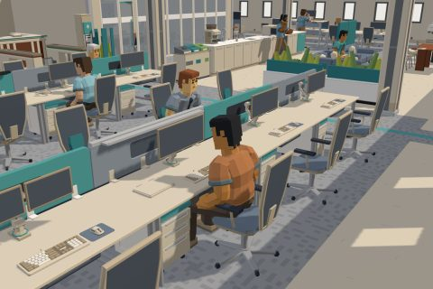

# Office

60 free low-poly parts on one palette and one scale, so everything you combine belongs to the same world.

[Open the kit on Polyfork](https://polyfork.dev/kit/office-794453) · [All kits](../README.md#kits)

<table>
<tr>
<td align="center" valign="top" width="25%"> <a href="https://polyfork.dev/asset/access-control-speedgate-19705e">Access Control Speedgate</a> <a href="https://polyfork.dev/cdn/access-control-speedgate-19705e.glb">GLB</a> · <a href="https://polyfork.dev/cdn/access-control-speedgate-19705e.mjs">module</a></td>
<td align="center" valign="top" width="25%"> <a href="https://polyfork.dev/asset/acoustic-ceiling-baffle-fa3c11">Acoustic Ceiling Baffle</a> <a href="https://polyfork.dev/cdn/acoustic-ceiling-baffle-fa3c11.glb">GLB</a> · <a href="https://polyfork.dev/cdn/acoustic-ceiling-baffle-fa3c11.mjs">module</a></td>
<td align="center" valign="top" width="25%"> <a href="https://polyfork.dev/asset/acoustic-phone-booth-11b8bc">Acoustic Phone Booth</a> <a href="https://polyfork.dev/cdn/acoustic-phone-booth-11b8bc.glb">GLB</a> · <a href="https://polyfork.dev/cdn/acoustic-phone-booth-11b8bc.mjs">module</a></td>
<td align="center" valign="top" width="25%"> <a href="https://polyfork.dev/asset/acoustic-planter-divider-3e9130">Acoustic Planter Divider</a> <a href="https://polyfork.dev/cdn/acoustic-planter-divider-3e9130.glb">GLB</a> · <a href="https://polyfork.dev/cdn/acoustic-planter-divider-3e9130.mjs">module</a></td>
</tr>
<tr>
<td align="center" valign="top" width="25%"> <a href="https://polyfork.dev/asset/bench-desk-module-23c16f">Bench Desk Module</a> <a href="https://polyfork.dev/cdn/bench-desk-module-23c16f.glb">GLB</a> · <a href="https://polyfork.dev/cdn/bench-desk-module-23c16f.mjs">module</a></td>
<td align="center" valign="top" width="25%"> <a href="https://polyfork.dev/asset/boardroom-table-d5d666">Boardroom Table</a> <a href="https://polyfork.dev/cdn/boardroom-table-d5d666.glb">GLB</a> · <a href="https://polyfork.dev/cdn/boardroom-table-d5d666.mjs">module</a></td>
<td align="center" valign="top" width="25%"> <a href="https://polyfork.dev/asset/boiling-water-tap-e594db">Boiling Water Tap</a> <a href="https://polyfork.dev/cdn/boiling-water-tap-e594db.glb">GLB</a> · <a href="https://polyfork.dev/cdn/boiling-water-tap-e594db.mjs">module</a></td>
<td align="center" valign="top" width="25%"> <a href="https://polyfork.dev/asset/breakout-sofa-module-1bb15e">Breakout Sofa Module</a> <a href="https://polyfork.dev/cdn/breakout-sofa-module-1bb15e.glb">GLB</a> · <a href="https://polyfork.dev/cdn/breakout-sofa-module-1bb15e.mjs">module</a></td>
</tr>
<tr>
<td align="center" valign="top" width="25%"> <a href="https://polyfork.dev/asset/cable-spaghetti-bundle-d670a1">Cable Spaghetti Bundle</a> <a href="https://polyfork.dev/cdn/cable-spaghetti-bundle-d670a1.glb">GLB</a> · <a href="https://polyfork.dev/cdn/cable-spaghetti-bundle-d670a1.mjs">module</a></td>
<td align="center" valign="top" width="25%"> <a href="https://polyfork.dev/asset/call-headset-a95887">Call Headset</a> <a href="https://polyfork.dev/cdn/call-headset-a95887.glb">GLB</a> · <a href="https://polyfork.dev/cdn/call-headset-a95887.mjs">module</a></td>
<td align="center" valign="top" width="25%"> <a href="https://polyfork.dev/asset/cardboard-delivery-box-59cc68">Cardboard Delivery Box</a> <a href="https://polyfork.dev/cdn/cardboard-delivery-box-59cc68.glb">GLB</a> · <a href="https://polyfork.dev/cdn/cardboard-delivery-box-59cc68.mjs">module</a></td>
<td align="center" valign="top" width="25%"> <a href="https://polyfork.dev/asset/coat-rack-57bbbc">Coat Rack</a> <a href="https://polyfork.dev/cdn/coat-rack-57bbbc.glb">GLB</a> · <a href="https://polyfork.dev/cdn/coat-rack-57bbbc.mjs">module</a></td>
</tr>
<tr>
<td align="center" valign="top" width="25%"> <a href="https://polyfork.dev/asset/conference-camera-bar-419e10">Conference Camera Bar</a> <a href="https://polyfork.dev/cdn/conference-camera-bar-419e10.glb">GLB</a> · <a href="https://polyfork.dev/cdn/conference-camera-bar-419e10.mjs">module</a></td>
<td align="center" valign="top" width="25%"> <a href="https://polyfork.dev/asset/demountable-partition-run-cc608c">Demountable Partition Run</a> <a href="https://polyfork.dev/cdn/demountable-partition-run-cc608c.glb">GLB</a> · <a href="https://polyfork.dev/cdn/demountable-partition-run-cc608c.mjs">module</a></td>
<td align="center" valign="top" width="25%"> <a href="https://polyfork.dev/asset/desk-keyboard-6cd4d9">Desk Keyboard</a> <a href="https://polyfork.dev/cdn/desk-keyboard-6cd4d9.glb">GLB</a> · <a href="https://polyfork.dev/cdn/desk-keyboard-6cd4d9.mjs">module</a></td>
<td align="center" valign="top" width="25%"> <a href="https://polyfork.dev/asset/desk-mouse-2c7d42">Desk Mouse</a> <a href="https://polyfork.dev/cdn/desk-mouse-2c7d42.glb">GLB</a> · <a href="https://polyfork.dev/cdn/desk-mouse-2c7d42.mjs">module</a></td>
</tr>
<tr>
<td align="center" valign="top" width="25%"> <a href="https://polyfork.dev/asset/fabric-desk-screen-36a274">Fabric Desk Screen</a> <a href="https://polyfork.dev/cdn/fabric-desk-screen-36a274.glb">GLB</a> · <a href="https://polyfork.dev/cdn/fabric-desk-screen-36a274.mjs">module</a></td>
<td align="center" valign="top" width="25%"> <a href="https://polyfork.dev/asset/fire-door-set-5a3cca">Fire Door Set</a> <a href="https://polyfork.dev/cdn/fire-door-set-5a3cca.glb">GLB</a> · <a href="https://polyfork.dev/cdn/fire-door-set-5a3cca.mjs">module</a></td>
<td align="center" valign="top" width="25%"> <a href="https://polyfork.dev/asset/fire-extinguisher-95dca1">Fire Extinguisher</a> <a href="https://polyfork.dev/cdn/fire-extinguisher-95dca1.glb">GLB</a> · <a href="https://polyfork.dev/cdn/fire-extinguisher-95dca1.mjs">module</a></td>
<td align="center" valign="top" width="25%"> <a href="https://polyfork.dev/asset/flipchart-easel-6d1844">Flipchart Easel</a> <a href="https://polyfork.dev/cdn/flipchart-easel-6d1844.glb">GLB</a> · <a href="https://polyfork.dev/cdn/flipchart-easel-6d1844.mjs">module</a></td>
</tr>
<tr>
<td align="center" valign="top" width="25%"> <a href="https://polyfork.dev/asset/glazed-partition-system-2f150f">Glazed Partition System</a> <a href="https://polyfork.dev/cdn/glazed-partition-system-2f150f.glb">GLB</a> · <a href="https://polyfork.dev/cdn/glazed-partition-system-2f150f.mjs">module</a></td>
<td align="center" valign="top" width="25%"> <a href="https://polyfork.dev/asset/huddle-booth-4d63e7">Huddle Booth</a> <a href="https://polyfork.dev/cdn/huddle-booth-4d63e7.glb">GLB</a> · <a href="https://polyfork.dev/cdn/huddle-booth-4d63e7.mjs">module</a></td>
<td align="center" valign="top" width="25%"> <a href="https://polyfork.dev/asset/illuminated-exit-sign-23becd">Illuminated Exit Sign</a> <a href="https://polyfork.dev/cdn/illuminated-exit-sign-23becd.glb">GLB</a> · <a href="https://polyfork.dev/cdn/illuminated-exit-sign-23becd.mjs">module</a></td>
<td align="center" valign="top" width="25%"> <a href="https://polyfork.dev/asset/lanyard-and-badge-941f5a">Lanyard And Badge</a> <a href="https://polyfork.dev/cdn/lanyard-and-badge-941f5a.glb">GLB</a> · <a href="https://polyfork.dev/cdn/lanyard-and-badge-941f5a.mjs">module</a></td>
</tr>
<tr>
<td align="center" valign="top" width="25%"> <a href="https://polyfork.dev/asset/laptop-e775ba">Laptop</a> <a href="https://polyfork.dev/cdn/laptop-e775ba.glb">GLB</a> · <a href="https://polyfork.dev/cdn/laptop-e775ba.mjs">module</a></td>
<td align="center" valign="top" width="25%"> <a href="https://polyfork.dev/asset/lift-landing-door-0e2c02">Lift Landing Door</a> <a href="https://polyfork.dev/cdn/lift-landing-door-0e2c02.glb">GLB</a> · <a href="https://polyfork.dev/cdn/lift-landing-door-0e2c02.mjs">module</a></td>
<td align="center" valign="top" width="25%"> <a href="https://polyfork.dev/asset/locker-bank-cdcd9d">Locker Bank</a> <a href="https://polyfork.dev/cdn/locker-bank-cdcd9d.glb">GLB</a> · <a href="https://polyfork.dev/cdn/locker-bank-cdcd9d.mjs">module</a></td>
<td align="center" valign="top" width="25%"> <a href="https://polyfork.dev/asset/meeting-chair-731ce0">Meeting Chair</a> <a href="https://polyfork.dev/cdn/meeting-chair-731ce0.glb">GLB</a> · <a href="https://polyfork.dev/cdn/meeting-chair-731ce0.mjs">module</a></td>
</tr>
<tr>
<td align="center" valign="top" width="25%"> <a href="https://polyfork.dev/asset/meeting-room-display-fddfc3">Meeting Room Display</a> <a href="https://polyfork.dev/cdn/meeting-room-display-fddfc3.glb">GLB</a> · <a href="https://polyfork.dev/cdn/meeting-room-display-fddfc3.mjs">module</a></td>
<td align="center" valign="top" width="25%"> <a href="https://polyfork.dev/asset/microwave-oven-7f60d4">Microwave Oven</a> <a href="https://polyfork.dev/cdn/microwave-oven-7f60d4.glb">GLB</a> · <a href="https://polyfork.dev/cdn/microwave-oven-7f60d4.mjs">module</a></td>
<td align="center" valign="top" width="25%"> <a href="https://polyfork.dev/asset/monitor-arm-609448">Monitor Arm</a> <a href="https://polyfork.dev/cdn/monitor-arm-609448.glb">GLB</a> · <a href="https://polyfork.dev/cdn/monitor-arm-609448.mjs">module</a></td>
<td align="center" valign="top" width="25%"> <a href="https://polyfork.dev/asset/multifunction-printer-3aa70b">Multifunction Printer</a> <a href="https://polyfork.dev/cdn/multifunction-printer-3aa70b.glb">GLB</a> · <a href="https://polyfork.dev/cdn/multifunction-printer-3aa70b.mjs">module</a></td>
</tr>
<tr>
<td align="center" valign="top" width="25%"> <a href="https://polyfork.dev/asset/office-carpet-tile-99d407">Office Carpet Tile</a> <a href="https://polyfork.dev/cdn/office-carpet-tile-99d407.glb">GLB</a> · <a href="https://polyfork.dev/cdn/office-carpet-tile-99d407.mjs">module</a></td>
<td align="center" valign="top" width="25%"> <a href="https://polyfork.dev/asset/office-coffee-machine-9da5e6">Office Coffee Machine</a> <a href="https://polyfork.dev/cdn/office-coffee-machine-9da5e6.glb">GLB</a> · <a href="https://polyfork.dev/cdn/office-coffee-machine-9da5e6.mjs">module</a></td>
<td align="center" valign="top" width="25%"> <a href="https://polyfork.dev/asset/office-directory-totem-619d45">Office Directory Totem</a> <a href="https://polyfork.dev/cdn/office-directory-totem-619d45.glb">GLB</a> · <a href="https://polyfork.dev/cdn/office-directory-totem-619d45.mjs">module</a></td>
<td align="center" valign="top" width="25%"> <a href="https://polyfork.dev/asset/office-mug-8afee0">Office Mug</a> <a href="https://polyfork.dev/cdn/office-mug-8afee0.glb">GLB</a> · <a href="https://polyfork.dev/cdn/office-mug-8afee0.mjs">module</a></td>
</tr>
<tr>
<td align="center" valign="top" width="25%"> <a href="https://polyfork.dev/asset/paper-shredder-5366a6">Paper Shredder</a> <a href="https://polyfork.dev/cdn/paper-shredder-5366a6.glb">GLB</a> · <a href="https://polyfork.dev/cdn/paper-shredder-5366a6.mjs">module</a></td>
<td align="center" valign="top" width="25%"> <a href="https://polyfork.dev/asset/paper-stack-713359">Paper Stack</a> <a href="https://polyfork.dev/cdn/paper-stack-713359.glb">GLB</a> · <a href="https://polyfork.dev/cdn/paper-stack-713359.mjs">module</a></td>
<td align="center" valign="top" width="25%"> <a href="https://polyfork.dev/asset/pedestal-drawer-unit-cbeab3">Pedestal Drawer Unit</a> <a href="https://polyfork.dev/cdn/pedestal-drawer-unit-cbeab3.glb">GLB</a> · <a href="https://polyfork.dev/cdn/pedestal-drawer-unit-cbeab3.mjs">module</a></td>
<td align="center" valign="top" width="25%"> <a href="https://polyfork.dev/asset/raised-access-floor-tile-5b3174">Raised Access Floor Tile</a> <a href="https://polyfork.dev/cdn/raised-access-floor-tile-5b3174.glb">GLB</a> · <a href="https://polyfork.dev/cdn/raised-access-floor-tile-5b3174.mjs">module</a></td>
</tr>
<tr>
<td align="center" valign="top" width="25%"> <a href="https://polyfork.dev/asset/reception-counter-module-7a9c01">Reception Counter Module</a> <a href="https://polyfork.dev/cdn/reception-counter-module-7a9c01.glb">GLB</a> · <a href="https://polyfork.dev/cdn/reception-counter-module-7a9c01.mjs">module</a></td>
<td align="center" valign="top" width="25%"> <a href="https://polyfork.dev/asset/recessed-floor-box-018add">Recessed Floor Box</a> <a href="https://polyfork.dev/cdn/recessed-floor-box-018add.glb">GLB</a> · <a href="https://polyfork.dev/cdn/recessed-floor-box-018add.mjs">module</a></td>
<td align="center" valign="top" width="25%"> <a href="https://polyfork.dev/asset/seated-office-worker-854671">Seated Office Worker</a> <a href="https://polyfork.dev/cdn/seated-office-worker-854671.glb">GLB</a> · <a href="https://polyfork.dev/cdn/seated-office-worker-854671.mjs">module</a></td>
<td align="center" valign="top" width="25%"> <a href="https://polyfork.dev/asset/sit-stand-desk-3ff7b8">Sit-Stand Desk</a> <a href="https://polyfork.dev/cdn/sit-stand-desk-3ff7b8.glb">GLB</a> · <a href="https://polyfork.dev/cdn/sit-stand-desk-3ff7b8.mjs">module</a></td>
</tr>
<tr>
<td align="center" valign="top" width="25%"> <a href="https://polyfork.dev/asset/small-server-rack-8ae0a4">Small Server Rack</a> <a href="https://polyfork.dev/cdn/small-server-rack-8ae0a4.glb">GLB</a> · <a href="https://polyfork.dev/cdn/small-server-rack-8ae0a4.mjs">module</a></td>
<td align="center" valign="top" width="25%"> <a href="https://polyfork.dev/asset/speakerphone-puck-e3eb0d">Speakerphone Puck</a> <a href="https://polyfork.dev/cdn/speakerphone-puck-e3eb0d.glb">GLB</a> · <a href="https://polyfork.dev/cdn/speakerphone-puck-e3eb0d.mjs">module</a></td>
<td align="center" valign="top" width="25%"> <a href="https://polyfork.dev/asset/standing-worker-on-a-8a0f9a">Standing Worker On A Call</a> <a href="https://polyfork.dev/cdn/standing-worker-on-a-8a0f9a.glb">GLB</a> · <a href="https://polyfork.dev/cdn/standing-worker-on-a-8a0f9a.mjs">module</a></td>
<td align="center" valign="top" width="25%"> <a href="https://polyfork.dev/asset/sticky-note-patch-009df5">Sticky Note Patch</a> <a href="https://polyfork.dev/cdn/sticky-note-patch-009df5.glb">GLB</a> · <a href="https://polyfork.dev/cdn/sticky-note-patch-009df5.mjs">module</a></td>
</tr>
<tr>
<td align="center" valign="top" width="25%"> <a href="https://polyfork.dev/asset/structural-column-casing-bc5956">Structural Column Casing</a> <a href="https://polyfork.dev/cdn/structural-column-casing-bc5956.glb">GLB</a> · <a href="https://polyfork.dev/cdn/structural-column-casing-bc5956.mjs">module</a></td>
<td align="center" valign="top" width="25%"> <a href="https://polyfork.dev/asset/suspended-ceiling-tile-018d2e">Suspended Ceiling Tile</a> <a href="https://polyfork.dev/cdn/suspended-ceiling-tile-018d2e.glb">GLB</a> · <a href="https://polyfork.dev/cdn/suspended-ceiling-tile-018d2e.mjs">module</a></td>
<td align="center" valign="top" width="25%"> <a href="https://polyfork.dev/asset/tambour-storage-cupboard-cebe40">Tambour Storage Cupboard</a> <a href="https://polyfork.dev/cdn/tambour-storage-cupboard-cebe40.glb">GLB</a> · <a href="https://polyfork.dev/cdn/tambour-storage-cupboard-cebe40.mjs">module</a></td>
<td align="center" valign="top" width="25%"> <a href="https://polyfork.dev/asset/task-chair-ccd944">Task Chair</a> <a href="https://polyfork.dev/cdn/task-chair-ccd944.glb">GLB</a> · <a href="https://polyfork.dev/cdn/task-chair-ccd944.mjs">module</a></td>
</tr>
<tr>
<td align="center" valign="top" width="25%"> <a href="https://polyfork.dev/asset/tea-point-counter-module-1ad43e">Tea Point Counter Module</a> <a href="https://polyfork.dev/cdn/tea-point-counter-module-1ad43e.glb">GLB</a> · <a href="https://polyfork.dev/cdn/tea-point-counter-module-1ad43e.mjs">module</a></td>
<td align="center" valign="top" width="25%"> <a href="https://polyfork.dev/asset/three-stream-recycling-station-14da24">Three-Stream Recycling Station</a> <a href="https://polyfork.dev/cdn/three-stream-recycling-station-14da24.glb">GLB</a> · <a href="https://polyfork.dev/cdn/three-stream-recycling-station-14da24.mjs">module</a></td>
<td align="center" valign="top" width="25%"> <a href="https://polyfork.dev/asset/under-desk-cable-tray-4ae73d">Under-Desk Cable Tray</a> <a href="https://polyfork.dev/cdn/under-desk-cable-tray-4ae73d.glb">GLB</a> · <a href="https://polyfork.dev/cdn/under-desk-cable-tray-4ae73d.mjs">module</a></td>
<td align="center" valign="top" width="25%"> <a href="https://polyfork.dev/asset/visitor-with-badge-1005a3">Visitor With Badge</a> <a href="https://polyfork.dev/cdn/visitor-with-badge-1005a3.glb">GLB</a> · <a href="https://polyfork.dev/cdn/visitor-with-badge-1005a3.mjs">module</a></td>
</tr>
<tr>
<td align="center" valign="top" width="25%"> <a href="https://polyfork.dev/asset/wall-clock-05f8ff">Wall Clock</a> <a href="https://polyfork.dev/cdn/wall-clock-05f8ff.glb">GLB</a> · <a href="https://polyfork.dev/cdn/wall-clock-05f8ff.mjs">module</a></td>
<td align="center" valign="top" width="25%"> <a href="https://polyfork.dev/asset/wall-first-aid-box-7ffc6c">Wall First Aid Box</a> <a href="https://polyfork.dev/cdn/wall-first-aid-box-7ffc6c.glb">GLB</a> · <a href="https://polyfork.dev/cdn/wall-first-aid-box-7ffc6c.mjs">module</a></td>
<td align="center" valign="top" width="25%"> <a href="https://polyfork.dev/asset/wastepaper-bin-8f76b5">Wastepaper Bin</a> <a href="https://polyfork.dev/cdn/wastepaper-bin-8f76b5.glb">GLB</a> · <a href="https://polyfork.dev/cdn/wastepaper-bin-8f76b5.mjs">module</a></td>
<td align="center" valign="top" width="25%"> <a href="https://polyfork.dev/asset/whiteboard-ea98f7">Whiteboard</a> <a href="https://polyfork.dev/cdn/whiteboard-ea98f7.glb">GLB</a> · <a href="https://polyfork.dev/cdn/whiteboard-ea98f7.mjs">module</a></td>
</tr>
</table>
