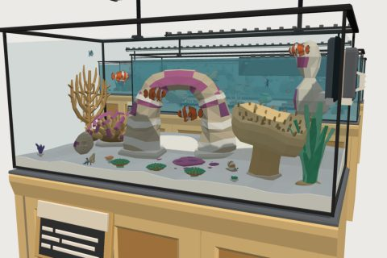

# Office Reefscape kit

60 free low-poly parts on one palette and one scale, so everything you combine belongs to the same world.

[Open the kit on Polyfork](https://polyfork.dev/kit/office-reefscape-kit-1afd7c) · [All kits](../README.md#kits)

<table>
<tr>
<td align="center" valign="top" width="25%"> <a href="https://polyfork.dev/asset/aquarium-heater-d58214">Aquarium Heater</a> <a href="https://polyfork.dev/cdn/aquarium-heater-d58214.glb">GLB</a> · <a href="https://polyfork.dev/cdn/aquarium-heater-d58214.mjs">module</a></td>
<td align="center" valign="top" width="25%"> <a href="https://polyfork.dev/asset/aquarium-plumbing-run-4be588">Aquarium Plumbing Run</a> <a href="https://polyfork.dev/cdn/aquarium-plumbing-run-4be588.glb">GLB</a> · <a href="https://polyfork.dev/cdn/aquarium-plumbing-run-4be588.mjs">module</a></td>
<td align="center" valign="top" width="25%"> <a href="https://polyfork.dev/asset/aquarium-service-technician-b1fc4f">Aquarium Service Technician</a> <a href="https://polyfork.dev/cdn/aquarium-service-technician-b1fc4f.glb">GLB</a> · <a href="https://polyfork.dev/cdn/aquarium-service-technician-b1fc4f.mjs">module</a></td>
<td align="center" valign="top" width="25%"> <a href="https://polyfork.dev/asset/aquascape-rock-arch-48bf5e">Aquascape Rock Arch</a> <a href="https://polyfork.dev/cdn/aquascape-rock-arch-48bf5e.glb">GLB</a> · <a href="https://polyfork.dev/cdn/aquascape-rock-arch-48bf5e.mjs">module</a></td>
</tr>
<tr>
<td align="center" valign="top" width="25%"> <a href="https://polyfork.dev/asset/banggai-cardinalfish-21f6fc">Banggai Cardinalfish</a> <a href="https://polyfork.dev/cdn/banggai-cardinalfish-21f6fc.glb">GLB</a> · <a href="https://polyfork.dev/cdn/banggai-cardinalfish-21f6fc.mjs">module</a></td>
<td align="center" valign="top" width="25%"> <a href="https://polyfork.dev/asset/blond-oak-sump-cabinet-4d3d2f">Blond Oak Sump Cabinet</a> <a href="https://polyfork.dev/cdn/blond-oak-sump-cabinet-4d3d2f.glb">GLB</a> · <a href="https://polyfork.dev/cdn/blond-oak-sump-cabinet-4d3d2f.mjs">module</a></td>
<td align="center" valign="top" width="25%"> <a href="https://polyfork.dev/asset/blue-linckia-starfish-e07dd3">Blue Linckia Starfish</a> <a href="https://polyfork.dev/cdn/blue-linckia-starfish-e07dd3.glb">GLB</a> · <a href="https://polyfork.dev/cdn/blue-linckia-starfish-e07dd3.mjs">module</a></td>
<td align="center" valign="top" width="25%"> <a href="https://polyfork.dev/asset/blue-tang-1959bd">Blue Tang</a> <a href="https://polyfork.dev/cdn/blue-tang-1959bd.glb">GLB</a> · <a href="https://polyfork.dev/cdn/blue-tang-1959bd.mjs">module</a></td>
</tr>
<tr>
<td align="center" valign="top" width="25%"> <a href="https://polyfork.dev/asset/blue-leg-hermit-crab-ce7b41">Blue-Leg Hermit Crab</a> <a href="https://polyfork.dev/cdn/blue-leg-hermit-crab-ce7b41.glb">GLB</a> · <a href="https://polyfork.dev/cdn/blue-leg-hermit-crab-ce7b41.mjs">module</a></td>
<td align="center" valign="top" width="25%"> <a href="https://polyfork.dev/asset/bubble-tip-anemone-eab5d3">Bubble-Tip Anemone</a> <a href="https://polyfork.dev/cdn/bubble-tip-anemone-eab5d3.glb">GLB</a> · <a href="https://polyfork.dev/cdn/bubble-tip-anemone-eab5d3.mjs">module</a></td>
<td align="center" valign="top" width="25%"> <a href="https://polyfork.dev/asset/chromis-shoal-cde0d8">Chromis Shoal</a> <a href="https://polyfork.dev/cdn/chromis-shoal-cde0d8.glb">GLB</a> · <a href="https://polyfork.dev/cdn/chromis-shoal-cde0d8.mjs">module</a></td>
<td align="center" valign="top" width="25%"> <a href="https://polyfork.dev/asset/cleaner-wrasse-4fc1e2">Cleaner Wrasse</a> <a href="https://polyfork.dev/cdn/cleaner-wrasse-4fc1e2.glb">GLB</a> · <a href="https://polyfork.dev/cdn/cleaner-wrasse-4fc1e2.mjs">module</a></td>
</tr>
<tr>
<td align="center" valign="top" width="25%"> <a href="https://polyfork.dev/asset/clownfish-5b44ff">Clownfish</a> <a href="https://polyfork.dev/cdn/clownfish-5b44ff.glb">GLB</a> · <a href="https://polyfork.dev/cdn/clownfish-5b44ff.mjs">module</a></td>
<td align="center" valign="top" width="25%"> <a href="https://polyfork.dev/asset/coast-to-coast-overflow-2f9bd9">Coast-To-Coast Overflow Weir</a> <a href="https://polyfork.dev/cdn/coast-to-coast-overflow-2f9bd9.glb">GLB</a> · <a href="https://polyfork.dev/cdn/coast-to-coast-overflow-2f9bd9.mjs">module</a></td>
<td align="center" valign="top" width="25%"> <a href="https://polyfork.dev/asset/coral-frag-plug-700f7d">Coral Frag Plug</a> <a href="https://polyfork.dev/cdn/coral-frag-plug-700f7d.glb">GLB</a> · <a href="https://polyfork.dev/cdn/coral-frag-plug-700f7d.mjs">module</a></td>
<td align="center" valign="top" width="25%"> <a href="https://polyfork.dev/asset/coral-frag-rack-a0e7f9">Coral Frag Rack</a> <a href="https://polyfork.dev/cdn/coral-frag-rack-a0e7f9.glb">GLB</a> · <a href="https://polyfork.dev/cdn/coral-frag-rack-a0e7f9.mjs">module</a></td>
</tr>
<tr>
<td align="center" valign="top" width="25%"> <a href="https://polyfork.dev/asset/coralline-encrusting-patch-9c403a">Coralline Encrusting Patch</a> <a href="https://polyfork.dev/cdn/coralline-encrusting-patch-9c403a.glb">GLB</a> · <a href="https://polyfork.dev/cdn/coralline-encrusting-patch-9c403a.mjs">module</a></td>
<td align="center" valign="top" width="25%"> <a href="https://polyfork.dev/asset/feather-duster-worm-f510b0">Feather Duster Worm</a> <a href="https://polyfork.dev/cdn/feather-duster-worm-f510b0.glb">GLB</a> · <a href="https://polyfork.dev/cdn/feather-duster-worm-f510b0.mjs">module</a></td>
<td align="center" valign="top" width="25%"> <a href="https://polyfork.dev/asset/finger-leather-coral-a1ce23">Finger Leather Coral</a> <a href="https://polyfork.dev/cdn/finger-leather-coral-a1ce23.glb">GLB</a> · <a href="https://polyfork.dev/cdn/finger-leather-coral-a1ce23.mjs">module</a></td>
<td align="center" valign="top" width="25%"> <a href="https://polyfork.dev/asset/firefish-goby-18d0dd">Firefish Goby</a> <a href="https://polyfork.dev/cdn/firefish-goby-18d0dd.glb">GLB</a> · <a href="https://polyfork.dev/cdn/firefish-goby-18d0dd.mjs">module</a></td>
</tr>
<tr>
<td align="center" valign="top" width="25%"> <a href="https://polyfork.dev/asset/flame-angelfish-ce502b">Flame Angelfish</a> <a href="https://polyfork.dev/cdn/flame-angelfish-ce502b.glb">GLB</a> · <a href="https://polyfork.dev/cdn/flame-angelfish-ce502b.mjs">module</a></td>
<td align="center" valign="top" width="25%"> <a href="https://polyfork.dev/asset/floating-feeding-ring-1994fd">Floating Feeding Ring</a> <a href="https://polyfork.dev/cdn/floating-feeding-ring-1994fd.glb">GLB</a> · <a href="https://polyfork.dev/cdn/floating-feeding-ring-1994fd.mjs">module</a></td>
<td align="center" valign="top" width="25%"> <a href="https://polyfork.dev/asset/foxface-rabbitfish-6a7006">Foxface Rabbitfish</a> <a href="https://polyfork.dev/cdn/foxface-rabbitfish-6a7006.glb">GLB</a> · <a href="https://polyfork.dev/cdn/foxface-rabbitfish-6a7006.mjs">module</a></td>
<td align="center" valign="top" width="25%"> <a href="https://polyfork.dev/asset/glass-sump-tank-ebccc0">Glass Sump Tank</a> <a href="https://polyfork.dev/cdn/glass-sump-tank-ebccc0.glb">GLB</a> · <a href="https://polyfork.dev/cdn/glass-sump-tank-ebccc0.mjs">module</a></td>
</tr>
<tr>
<td align="center" valign="top" width="25%"> <a href="https://polyfork.dev/asset/gorgonian-sea-fan-aa3c45">Gorgonian Sea Fan</a> <a href="https://polyfork.dev/cdn/gorgonian-sea-fan-aa3c45.glb">GLB</a> · <a href="https://polyfork.dev/cdn/gorgonian-sea-fan-aa3c45.mjs">module</a></td>
<td align="center" valign="top" width="25%"> <a href="https://polyfork.dev/asset/green-chromis-a38447">Green Chromis</a> <a href="https://polyfork.dev/cdn/green-chromis-a38447.glb">GLB</a> · <a href="https://polyfork.dev/cdn/green-chromis-a38447.mjs">module</a></td>
<td align="center" valign="top" width="25%"> <a href="https://polyfork.dev/asset/hammer-coral-df4de0">Hammer Coral</a> <a href="https://polyfork.dev/cdn/hammer-coral-df4de0.glb">GLB</a> · <a href="https://polyfork.dev/cdn/hammer-coral-df4de0.mjs">module</a></td>
<td align="center" valign="top" width="25%"> <a href="https://polyfork.dev/asset/live-rock-piece-6c7bdf">Live Rock Piece</a> <a href="https://polyfork.dev/cdn/live-rock-piece-6c7bdf.glb">GLB</a> · <a href="https://polyfork.dev/cdn/live-rock-piece-6c7bdf.mjs">module</a></td>
</tr>
<tr>
<td align="center" valign="top" width="25%"> <a href="https://polyfork.dev/asset/magnetic-glass-cleaner-bedeec">Magnetic Glass Cleaner</a> <a href="https://polyfork.dev/cdn/magnetic-glass-cleaner-bedeec.glb">GLB</a> · <a href="https://polyfork.dev/cdn/magnetic-glass-cleaner-bedeec.mjs">module</a></td>
<td align="center" valign="top" width="25%"> <a href="https://polyfork.dev/asset/maintenance-bucket-f1c8e8">Maintenance Bucket</a> <a href="https://polyfork.dev/cdn/maintenance-bucket-f1c8e8.glb">GLB</a> · <a href="https://polyfork.dev/cdn/maintenance-bucket-f1c8e8.mjs">module</a></td>
<td align="center" valign="top" width="25%"> <a href="https://polyfork.dev/asset/mandarin-dragonet-bec59d">Mandarin Dragonet</a> <a href="https://polyfork.dev/cdn/mandarin-dragonet-bec59d.glb">GLB</a> · <a href="https://polyfork.dev/cdn/mandarin-dragonet-bec59d.mjs">module</a></td>
<td align="center" valign="top" width="25%"> <a href="https://polyfork.dev/asset/maxima-clam-429c17">Maxima Clam</a> <a href="https://polyfork.dev/cdn/maxima-clam-429c17.glb">GLB</a> · <a href="https://polyfork.dev/cdn/maxima-clam-429c17.mjs">module</a></td>
</tr>
<tr>
<td align="center" valign="top" width="25%"> <a href="https://polyfork.dev/asset/open-brain-coral-50344c">Open Brain Coral</a> <a href="https://polyfork.dev/cdn/open-brain-coral-50344c.glb">GLB</a> · <a href="https://polyfork.dev/cdn/open-brain-coral-50344c.mjs">module</a></td>
<td align="center" valign="top" width="25%"> <a href="https://polyfork.dev/asset/pillar-coral-colony-9336e9">Pillar Coral Colony</a> <a href="https://polyfork.dev/cdn/pillar-coral-colony-9336e9.glb">GLB</a> · <a href="https://polyfork.dev/cdn/pillar-coral-colony-9336e9.mjs">module</a></td>
<td align="center" valign="top" width="25%"> <a href="https://polyfork.dev/asset/plate-montipora-eac399">Plate Montipora</a> <a href="https://polyfork.dev/cdn/plate-montipora-eac399.glb">GLB</a> · <a href="https://polyfork.dev/cdn/plate-montipora-eac399.mjs">module</a></td>
<td align="center" valign="top" width="25%"> <a href="https://polyfork.dev/asset/protein-skimmer-876ec8">Protein Skimmer</a> <a href="https://polyfork.dev/cdn/protein-skimmer-876ec8.glb">GLB</a> · <a href="https://polyfork.dev/cdn/protein-skimmer-876ec8.mjs">module</a></td>
</tr>
<tr>
<td align="center" valign="top" width="25%"> <a href="https://polyfork.dev/asset/pulsing-xenia-c3dae2">Pulsing Xenia</a> <a href="https://polyfork.dev/cdn/pulsing-xenia-c3dae2.glb">GLB</a> · <a href="https://polyfork.dev/cdn/pulsing-xenia-c3dae2.mjs">module</a></td>
<td align="center" valign="top" width="25%"> <a href="https://polyfork.dev/asset/reef-controller-unit-b98ce9">Reef Controller Unit</a> <a href="https://polyfork.dev/cdn/reef-controller-unit-b98ce9.glb">GLB</a> · <a href="https://polyfork.dev/cdn/reef-controller-unit-b98ce9.mjs">module</a></td>
<td align="center" valign="top" width="25%"> <a href="https://polyfork.dev/asset/ricordea-mushroom-polyp-6d8178">Ricordea Mushroom Polyp</a> <a href="https://polyfork.dev/cdn/ricordea-mushroom-polyp-6d8178.glb">GLB</a> · <a href="https://polyfork.dev/cdn/ricordea-mushroom-polyp-6d8178.mjs">module</a></td>
<td align="center" valign="top" width="25%"> <a href="https://polyfork.dev/asset/rimless-display-tank-cec438">Rimless Display Tank</a> <a href="https://polyfork.dev/cdn/rimless-display-tank-cec438.glb">GLB</a> · <a href="https://polyfork.dev/cdn/rimless-display-tank-cec438.mjs">module</a></td>
</tr>
<tr>
<td align="center" valign="top" width="25%"> <a href="https://polyfork.dev/asset/rising-bubble-column-253b4a">Rising Bubble Column</a> <a href="https://polyfork.dev/cdn/rising-bubble-column-253b4a.glb">GLB</a> · <a href="https://polyfork.dev/cdn/rising-bubble-column-253b4a.mjs">module</a></td>
<td align="center" valign="top" width="25%"> <a href="https://polyfork.dev/asset/rock-bommie-column-0f8a9b">Rock Bommie Column</a> <a href="https://polyfork.dev/cdn/rock-bommie-column-0f8a9b.glb">GLB</a> · <a href="https://polyfork.dev/cdn/rock-bommie-column-0f8a9b.mjs">module</a></td>
<td align="center" valign="top" width="25%"> <a href="https://polyfork.dev/asset/rock-cave-ledge-2a9532">Rock Cave Ledge</a> <a href="https://polyfork.dev/cdn/rock-cave-ledge-2a9532.glb">GLB</a> · <a href="https://polyfork.dev/cdn/rock-cave-ledge-2a9532.mjs">module</a></td>
<td align="center" valign="top" width="25%"> <a href="https://polyfork.dev/asset/royal-gramma-6c21fe">Royal Gramma</a> <a href="https://polyfork.dev/cdn/royal-gramma-6c21fe.glb">GLB</a> · <a href="https://polyfork.dev/cdn/royal-gramma-6c21fe.mjs">module</a></td>
</tr>
<tr>
<td align="center" valign="top" width="25%"> <a href="https://polyfork.dev/asset/skunk-cleaner-shrimp-95e351">Skunk Cleaner Shrimp</a> <a href="https://polyfork.dev/cdn/skunk-cleaner-shrimp-95e351.glb">GLB</a> · <a href="https://polyfork.dev/cdn/skunk-cleaner-shrimp-95e351.mjs">module</a></td>
<td align="center" valign="top" width="25%"> <a href="https://polyfork.dev/asset/slim-led-light-bar-a6bb6f">Slim LED Light Bar</a> <a href="https://polyfork.dev/cdn/slim-led-light-bar-a6bb6f.glb">GLB</a> · <a href="https://polyfork.dev/cdn/slim-led-light-bar-a6bb6f.mjs">module</a></td>
<td align="center" valign="top" width="25%"> <a href="https://polyfork.dev/asset/species-id-plaque-5f73ed">Species ID Plaque</a> <a href="https://polyfork.dev/cdn/species-id-plaque-5f73ed.glb">GLB</a> · <a href="https://polyfork.dev/cdn/species-id-plaque-5f73ed.mjs">module</a></td>
<td align="center" valign="top" width="25%"> <a href="https://polyfork.dev/asset/staghorn-acropora-colony-c5c44d">Staghorn Acropora Colony</a> <a href="https://polyfork.dev/cdn/staghorn-acropora-colony-c5c44d.glb">GLB</a> · <a href="https://polyfork.dev/cdn/staghorn-acropora-colony-c5c44d.mjs">module</a></td>
</tr>
<tr>
<td align="center" valign="top" width="25%"> <a href="https://polyfork.dev/asset/sump-return-pump-a5bf42">Sump Return Pump</a> <a href="https://polyfork.dev/cdn/sump-return-pump-a5bf42.glb">GLB</a> · <a href="https://polyfork.dev/cdn/sump-return-pump-a5bf42.mjs">module</a></td>
<td align="center" valign="top" width="25%"> <a href="https://polyfork.dev/asset/table-acropora-883e0a">Table Acropora</a> <a href="https://polyfork.dev/cdn/table-acropora-883e0a.glb">GLB</a> · <a href="https://polyfork.dev/cdn/table-acropora-883e0a.mjs">module</a></td>
<td align="center" valign="top" width="25%"> <a href="https://polyfork.dev/asset/tank-seagrass-tuft-d0cbe6">Tank Seagrass Tuft</a> <a href="https://polyfork.dev/cdn/tank-seagrass-tuft-d0cbe6.glb">GLB</a> · <a href="https://polyfork.dev/cdn/tank-seagrass-tuft-d0cbe6.mjs">module</a></td>
<td align="center" valign="top" width="25%"> <a href="https://polyfork.dev/asset/toadstool-coral-d9db0b">Toadstool Coral</a> <a href="https://polyfork.dev/cdn/toadstool-coral-d9db0b.glb">GLB</a> · <a href="https://polyfork.dev/cdn/toadstool-coral-d9db0b.mjs">module</a></td>
</tr>
<tr>
<td align="center" valign="top" width="25%"> <a href="https://polyfork.dev/asset/top-up-water-reservoir-d83912">Top-Up Water Reservoir</a> <a href="https://polyfork.dev/cdn/top-up-water-reservoir-d83912.glb">GLB</a> · <a href="https://polyfork.dev/cdn/top-up-water-reservoir-d83912.mjs">module</a></td>
<td align="center" valign="top" width="25%"> <a href="https://polyfork.dev/asset/torch-coral-ba58c2">Torch Coral</a> <a href="https://polyfork.dev/cdn/torch-coral-ba58c2.glb">GLB</a> · <a href="https://polyfork.dev/cdn/torch-coral-ba58c2.mjs">module</a></td>
<td align="center" valign="top" width="25%"> <a href="https://polyfork.dev/asset/turbo-snail-6b500c">Turbo Snail</a> <a href="https://polyfork.dev/cdn/turbo-snail-6b500c.glb">GLB</a> · <a href="https://polyfork.dev/cdn/turbo-snail-6b500c.mjs">module</a></td>
<td align="center" valign="top" width="25%"> <a href="https://polyfork.dev/asset/tuxedo-sea-urchin-428a09">Tuxedo Sea Urchin</a> <a href="https://polyfork.dev/cdn/tuxedo-sea-urchin-428a09.glb">GLB</a> · <a href="https://polyfork.dev/cdn/tuxedo-sea-urchin-428a09.mjs">module</a></td>
</tr>
<tr>
<td align="center" valign="top" width="25%"> <a href="https://polyfork.dev/asset/wavemaker-powerhead-fe0da2">Wavemaker Powerhead</a> <a href="https://polyfork.dev/cdn/wavemaker-powerhead-fe0da2.glb">GLB</a> · <a href="https://polyfork.dev/cdn/wavemaker-powerhead-fe0da2.mjs">module</a></td>
<td align="center" valign="top" width="25%"> <a href="https://polyfork.dev/asset/white-sand-bed-insert-ab9277">White Sand Bed Insert</a> <a href="https://polyfork.dev/cdn/white-sand-bed-insert-ab9277.glb">GLB</a> · <a href="https://polyfork.dev/cdn/white-sand-bed-insert-ab9277.mjs">module</a></td>
<td align="center" valign="top" width="25%"> <a href="https://polyfork.dev/asset/yellow-tang-3164cf">Yellow Tang</a> <a href="https://polyfork.dev/cdn/yellow-tang-3164cf.glb">GLB</a> · <a href="https://polyfork.dev/cdn/yellow-tang-3164cf.mjs">module</a></td>
<td align="center" valign="top" width="25%"> <a href="https://polyfork.dev/asset/zoanthid-mat-54e301">Zoanthid Mat</a> <a href="https://polyfork.dev/cdn/zoanthid-mat-54e301.glb">GLB</a> · <a href="https://polyfork.dev/cdn/zoanthid-mat-54e301.mjs">module</a></td>
</tr>
</table>
