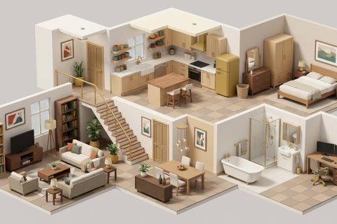

# Open Plan

In production, 63 parts so far. Every part below is already free to use.

[Open the kit on Polyfork](https://polyfork.dev/kit/open-plan-b2ebd3) · [All kits](../README.md#kits)

<table>
<tr>
<td align="center" valign="top" width="25%"> <a href="https://polyfork.dev/asset/alcove-bookcase-83894d">Alcove Bookcase</a> <a href="https://polyfork.dev/cdn/alcove-bookcase-83894d.glb">GLB</a> · <a href="https://polyfork.dev/cdn/alcove-bookcase-83894d.mjs">module</a></td>
<td align="center" valign="top" width="25%"> <a href="https://polyfork.dev/asset/arc-floor-lamp-fa0b5f">Arc Floor Lamp</a> <a href="https://polyfork.dev/cdn/arc-floor-lamp-fa0b5f.glb">GLB</a> · <a href="https://polyfork.dev/cdn/arc-floor-lamp-fa0b5f.mjs">module</a></td>
<td align="center" valign="top" width="25%"> <a href="https://polyfork.dev/asset/area-rug-5c56e2">Area Rug</a> <a href="https://polyfork.dev/cdn/area-rug-5c56e2.glb">GLB</a> · <a href="https://polyfork.dev/cdn/area-rug-5c56e2.mjs">module</a></td>
<td align="center" valign="top" width="25%"> <a href="https://polyfork.dev/asset/bar-stool-0de3c8">Bar Stool</a> <a href="https://polyfork.dev/cdn/bar-stool-0de3c8.glb">GLB</a> · <a href="https://polyfork.dev/cdn/bar-stool-0de3c8.mjs">module</a></td>
</tr>
<tr>
<td align="center" valign="top" width="25%"> <a href="https://polyfork.dev/asset/bar-stool-878f03">Bar Stool</a> <a href="https://polyfork.dev/cdn/bar-stool-878f03.glb">GLB</a> · <a href="https://polyfork.dev/cdn/bar-stool-878f03.mjs">module</a></td>
<td align="center" valign="top" width="25%"> <a href="https://polyfork.dev/asset/base-cabinet-run-71d050">Base Cabinet Run</a> <a href="https://polyfork.dev/cdn/base-cabinet-run-71d050.glb">GLB</a> · <a href="https://polyfork.dev/cdn/base-cabinet-run-71d050.mjs">module</a></td>
<td align="center" valign="top" width="25%"> <a href="https://polyfork.dev/asset/bath-fad968">Bath</a> <a href="https://polyfork.dev/cdn/bath-fad968.glb">GLB</a> · <a href="https://polyfork.dev/cdn/bath-fad968.mjs">module</a></td>
<td align="center" valign="top" width="25%"> <a href="https://polyfork.dev/asset/bed-6e10e8">Bed</a> <a href="https://polyfork.dev/cdn/bed-6e10e8.glb">GLB</a> · <a href="https://polyfork.dev/cdn/bed-6e10e8.mjs">module</a></td>
</tr>
<tr>
<td align="center" valign="top" width="25%"> <a href="https://polyfork.dev/asset/bedside-table-3f2b80">Bedside Table</a> <a href="https://polyfork.dev/cdn/bedside-table-3f2b80.glb">GLB</a> · <a href="https://polyfork.dev/cdn/bedside-table-3f2b80.mjs">module</a></td>
<td align="center" valign="top" width="25%"> <a href="https://polyfork.dev/asset/bedside-table-740c6b">Bedside Table</a> <a href="https://polyfork.dev/cdn/bedside-table-740c6b.glb">GLB</a> · <a href="https://polyfork.dev/cdn/bedside-table-740c6b.mjs">module</a></td>
<td align="center" valign="top" width="25%"> <a href="https://polyfork.dev/asset/built-in-oven-housing-d292c6">Built-In Oven Housing</a> <a href="https://polyfork.dev/cdn/built-in-oven-housing-d292c6.glb">GLB</a> · <a href="https://polyfork.dev/cdn/built-in-oven-housing-d292c6.mjs">module</a></td>
<td align="center" valign="top" width="25%"> <a href="https://polyfork.dev/asset/ceiling-cornice-run-d70ecd">Ceiling Cornice Run</a> <a href="https://polyfork.dev/cdn/ceiling-cornice-run-d70ecd.glb">GLB</a> · <a href="https://polyfork.dev/cdn/ceiling-cornice-run-d70ecd.mjs">module</a></td>
</tr>
<tr>
<td align="center" valign="top" width="25%"> <a href="https://polyfork.dev/asset/ceiling-pendant-d21307">Ceiling Pendant</a> <a href="https://polyfork.dev/cdn/ceiling-pendant-d21307.glb">GLB</a> · <a href="https://polyfork.dev/cdn/ceiling-pendant-d21307.mjs">module</a></td>
<td align="center" valign="top" width="25%"> <a href="https://polyfork.dev/asset/ceramic-floor-tile-ecf05f">Ceramic Floor Tile</a> <a href="https://polyfork.dev/cdn/ceramic-floor-tile-ecf05f.glb">GLB</a> · <a href="https://polyfork.dev/cdn/ceramic-floor-tile-ecf05f.mjs">module</a></td>
<td align="center" valign="top" width="25%"> <a href="https://polyfork.dev/asset/chest-of-drawers-cbe3e7">Chest of Drawers</a> <a href="https://polyfork.dev/cdn/chest-of-drawers-cbe3e7.glb">GLB</a> · <a href="https://polyfork.dev/cdn/chest-of-drawers-cbe3e7.mjs">module</a></td>
<td align="center" valign="top" width="25%"> <a href="https://polyfork.dev/asset/coffee-table-acc698">Coffee Table</a> <a href="https://polyfork.dev/cdn/coffee-table-acc698.glb">GLB</a> · <a href="https://polyfork.dev/cdn/coffee-table-acc698.mjs">module</a></td>
</tr>
<tr>
<td align="center" valign="top" width="25%"> <a href="https://polyfork.dev/asset/column-radiator-18af7e">Column Radiator</a> <a href="https://polyfork.dev/cdn/column-radiator-18af7e.glb">GLB</a> · <a href="https://polyfork.dev/cdn/column-radiator-18af7e.mjs">module</a></td>
<td align="center" valign="top" width="25%"> <a href="https://polyfork.dev/asset/crockery-set-43bd4b">Crockery Set</a> <a href="https://polyfork.dev/cdn/crockery-set-43bd4b.glb">GLB</a> · <a href="https://polyfork.dev/cdn/crockery-set-43bd4b.mjs">module</a></td>
<td align="center" valign="top" width="25%"> <a href="https://polyfork.dev/asset/curtain-panel-ee2ed9">Curtain Panel</a> <a href="https://polyfork.dev/cdn/curtain-panel-ee2ed9.glb">GLB</a> · <a href="https://polyfork.dev/cdn/curtain-panel-ee2ed9.mjs">module</a></td>
<td align="center" valign="top" width="25%"> <a href="https://polyfork.dev/asset/cushion-121479">Cushion</a> <a href="https://polyfork.dev/cdn/cushion-121479.glb">GLB</a> · <a href="https://polyfork.dev/cdn/cushion-121479.mjs">module</a></td>
</tr>
<tr>
<td align="center" valign="top" width="25%"> <a href="https://polyfork.dev/asset/desk-monitor-32cfce">Desk Monitor</a> <a href="https://polyfork.dev/cdn/desk-monitor-32cfce.glb">GLB</a> · <a href="https://polyfork.dev/cdn/desk-monitor-32cfce.mjs">module</a></td>
<td align="center" valign="top" width="25%"> <a href="https://polyfork.dev/asset/dining-chair-530532">Dining Chair</a> <a href="https://polyfork.dev/cdn/dining-chair-530532.glb">GLB</a> · <a href="https://polyfork.dev/cdn/dining-chair-530532.mjs">module</a></td>
<td align="center" valign="top" width="25%"> <a href="https://polyfork.dev/asset/dining-table-7af83a">Dining Table</a> <a href="https://polyfork.dev/cdn/dining-table-7af83a.glb">GLB</a> · <a href="https://polyfork.dev/cdn/dining-table-7af83a.mjs">module</a></td>
<td align="center" valign="top" width="25%"> <a href="https://polyfork.dev/asset/dishwasher-977d65">Dishwasher</a> <a href="https://polyfork.dev/cdn/dishwasher-977d65.glb">GLB</a> · <a href="https://polyfork.dev/cdn/dishwasher-977d65.mjs">module</a></td>
</tr>
<tr>
<td align="center" valign="top" width="25%"> <a href="https://polyfork.dev/asset/dressing-mirror-7c0871">Dressing Mirror</a> <a href="https://polyfork.dev/cdn/dressing-mirror-7c0871.glb">GLB</a> · <a href="https://polyfork.dev/cdn/dressing-mirror-7c0871.mjs">module</a></td>
<td align="center" valign="top" width="25%"> <a href="https://polyfork.dev/asset/extractor-hood-04a9b8">Extractor Hood</a> <a href="https://polyfork.dev/cdn/extractor-hood-04a9b8.glb">GLB</a> · <a href="https://polyfork.dev/cdn/extractor-hood-04a9b8.mjs">module</a></td>
<td align="center" valign="top" width="25%"> <a href="https://polyfork.dev/asset/filing-cabinet-f8a251">Filing Cabinet</a> <a href="https://polyfork.dev/cdn/filing-cabinet-f8a251.glb">GLB</a> · <a href="https://polyfork.dev/cdn/filing-cabinet-f8a251.mjs">module</a></td>
<td align="center" valign="top" width="25%"> <a href="https://polyfork.dev/asset/flat-screen-television-97b1f3">Flat Screen Television</a> <a href="https://polyfork.dev/cdn/flat-screen-television-97b1f3.glb">GLB</a> · <a href="https://polyfork.dev/cdn/flat-screen-television-97b1f3.mjs">module</a></td>
</tr>
<tr>
<td align="center" valign="top" width="25%"> <a href="https://polyfork.dev/asset/floor-houseplant-8fad17">Floor Houseplant</a> <a href="https://polyfork.dev/cdn/floor-houseplant-8fad17.glb">GLB</a> · <a href="https://polyfork.dev/cdn/floor-houseplant-8fad17.mjs">module</a></td>
<td align="center" valign="top" width="25%"> <a href="https://polyfork.dev/asset/framed-wall-art-d2c8a2">Framed Wall Art</a> <a href="https://polyfork.dev/cdn/framed-wall-art-d2c8a2.glb">GLB</a> · <a href="https://polyfork.dev/cdn/framed-wall-art-d2c8a2.mjs">module</a></td>
<td align="center" valign="top" width="25%"> <a href="https://polyfork.dev/asset/fridge-freezer-fb9b5a">Fridge Freezer</a> <a href="https://polyfork.dev/cdn/fridge-freezer-fb9b5a.glb">GLB</a> · <a href="https://polyfork.dev/cdn/fridge-freezer-fb9b5a.mjs">module</a></td>
<td align="center" valign="top" width="25%"> <a href="https://polyfork.dev/asset/hob-01fe88">Hob</a> <a href="https://polyfork.dev/cdn/hob-01fe88.glb">GLB</a> · <a href="https://polyfork.dev/cdn/hob-01fe88.mjs">module</a></td>
</tr>
<tr>
<td align="center" valign="top" width="25%"> <a href="https://polyfork.dev/asset/interior-door-leaf-a02f28">Interior Door Leaf</a> <a href="https://polyfork.dev/cdn/interior-door-leaf-a02f28.glb">GLB</a> · <a href="https://polyfork.dev/cdn/interior-door-leaf-a02f28.mjs">module</a></td>
<td align="center" valign="top" width="25%"> <a href="https://polyfork.dev/asset/kitchen-bin-ac6752">Kitchen Bin</a> <a href="https://polyfork.dev/cdn/kitchen-bin-ac6752.glb">GLB</a> · <a href="https://polyfork.dev/cdn/kitchen-bin-ac6752.mjs">module</a></td>
<td align="center" valign="top" width="25%"> <a href="https://polyfork.dev/asset/kitchen-island-47f4c8">Kitchen Island</a> <a href="https://polyfork.dev/cdn/kitchen-island-47f4c8.glb">GLB</a> · <a href="https://polyfork.dev/cdn/kitchen-island-47f4c8.mjs">module</a></td>
<td align="center" valign="top" width="25%"> <a href="https://polyfork.dev/asset/kitchen-sink-7ea438">Kitchen Sink</a> <a href="https://polyfork.dev/cdn/kitchen-sink-7ea438.glb">GLB</a> · <a href="https://polyfork.dev/cdn/kitchen-sink-7ea438.mjs">module</a></td>
</tr>
<tr>
<td align="center" valign="top" width="25%"> <a href="https://polyfork.dev/asset/landing-balustrade-run-d4c498">Landing Balustrade Run</a> <a href="https://polyfork.dev/cdn/landing-balustrade-run-d4c498.glb">GLB</a> · <a href="https://polyfork.dev/cdn/landing-balustrade-run-d4c498.mjs">module</a></td>
<td align="center" valign="top" width="25%"> <a href="https://polyfork.dev/asset/laundry-basket-16ed8e">Laundry Basket</a> <a href="https://polyfork.dev/cdn/laundry-basket-16ed8e.glb">GLB</a> · <a href="https://polyfork.dev/cdn/laundry-basket-16ed8e.mjs">module</a></td>
<td align="center" valign="top" width="25%"> <a href="https://polyfork.dev/asset/lounge-armchair-5a72ca">Lounge Armchair</a> <a href="https://polyfork.dev/cdn/lounge-armchair-5a72ca.glb">GLB</a> · <a href="https://polyfork.dev/cdn/lounge-armchair-5a72ca.mjs">module</a></td>
<td align="center" valign="top" width="25%"> <a href="https://polyfork.dev/asset/low-media-unit-645e61">Low Media Unit</a> <a href="https://polyfork.dev/cdn/low-media-unit-645e61.glb">GLB</a> · <a href="https://polyfork.dev/cdn/low-media-unit-645e61.mjs">module</a></td>
</tr>
<tr>
<td align="center" valign="top" width="25%"> <a href="https://polyfork.dev/asset/mirror-cabinet-3cb9fd">Mirror Cabinet</a> <a href="https://polyfork.dev/cdn/mirror-cabinet-3cb9fd.glb">GLB</a> · <a href="https://polyfork.dev/cdn/mirror-cabinet-3cb9fd.mjs">module</a></td>
<td align="center" valign="top" width="25%"> <a href="https://polyfork.dev/asset/oak-plank-floor-tile-70ee12">Oak Plank Floor Tile</a> <a href="https://polyfork.dev/cdn/oak-plank-floor-tile-70ee12.glb">GLB</a> · <a href="https://polyfork.dev/cdn/oak-plank-floor-tile-70ee12.mjs">module</a></td>
<td align="center" valign="top" width="25%"> <a href="https://polyfork.dev/asset/office-chair-7c9874">Office Chair</a> <a href="https://polyfork.dev/cdn/office-chair-7c9874.glb">GLB</a> · <a href="https://polyfork.dev/cdn/office-chair-7c9874.mjs">module</a></td>
<td align="center" valign="top" width="25%"> <a href="https://polyfork.dev/asset/office-desk-021eb3">Office Desk</a> <a href="https://polyfork.dev/cdn/office-desk-021eb3.glb">GLB</a> · <a href="https://polyfork.dev/cdn/office-desk-021eb3.mjs">module</a></td>
</tr>
<tr>
<td align="center" valign="top" width="25%"> <a href="https://polyfork.dev/asset/open-kitchen-shelf-f751de">Open Kitchen Shelf</a> <a href="https://polyfork.dev/cdn/open-kitchen-shelf-f751de.glb">GLB</a> · <a href="https://polyfork.dev/cdn/open-kitchen-shelf-f751de.mjs">module</a></td>
<td align="center" valign="top" width="25%"> <a href="https://polyfork.dev/asset/plain-wall-segment-143b6d">Plain Wall Segment</a> <a href="https://polyfork.dev/cdn/plain-wall-segment-143b6d.glb">GLB</a> · <a href="https://polyfork.dev/cdn/plain-wall-segment-143b6d.mjs">module</a></td>
<td align="center" valign="top" width="25%"> <a href="https://polyfork.dev/asset/plaster-ceiling-panel-c4727a">Plaster Ceiling Panel</a> <a href="https://polyfork.dev/cdn/plaster-ceiling-panel-c4727a.glb">GLB</a> · <a href="https://polyfork.dev/cdn/plaster-ceiling-panel-c4727a.mjs">module</a></td>
<td align="center" valign="top" width="25%"> <a href="https://polyfork.dev/asset/shower-enclosure-a50c16">Shower Enclosure</a> <a href="https://polyfork.dev/cdn/shower-enclosure-a50c16.glb">GLB</a> · <a href="https://polyfork.dev/cdn/shower-enclosure-a50c16.mjs">module</a></td>
</tr>
<tr>
<td align="center" valign="top" width="25%"> <a href="https://polyfork.dev/asset/side-table-2ea5c0">Side Table</a> <a href="https://polyfork.dev/cdn/side-table-2ea5c0.glb">GLB</a> · <a href="https://polyfork.dev/cdn/side-table-2ea5c0.mjs">module</a></td>
<td align="center" valign="top" width="25%"> <a href="https://polyfork.dev/asset/sideboard-dd343b">Sideboard</a> <a href="https://polyfork.dev/cdn/sideboard-dd343b.glb">GLB</a> · <a href="https://polyfork.dev/cdn/sideboard-dd343b.mjs">module</a></td>
<td align="center" valign="top" width="25%"> <a href="https://polyfork.dev/asset/skirting-board-run-6f012b">Skirting Board Run</a> <a href="https://polyfork.dev/cdn/skirting-board-run-6f012b.glb">GLB</a> · <a href="https://polyfork.dev/cdn/skirting-board-run-6f012b.mjs">module</a></td>
<td align="center" valign="top" width="25%"> <a href="https://polyfork.dev/asset/sofa-9c0e7e">Sofa</a> <a href="https://polyfork.dev/cdn/sofa-9c0e7e.glb">GLB</a> · <a href="https://polyfork.dev/cdn/sofa-9c0e7e.mjs">module</a></td>
</tr>
<tr>
<td align="center" valign="top" width="25%"> <a href="https://polyfork.dev/asset/straight-stair-flight-236ae7">Straight Stair Flight</a> <a href="https://polyfork.dev/cdn/straight-stair-flight-236ae7.glb">GLB</a> · <a href="https://polyfork.dev/cdn/straight-stair-flight-236ae7.mjs">module</a></td>
<td align="center" valign="top" width="25%"> <a href="https://polyfork.dev/asset/table-lamp-e25998">Table Lamp</a> <a href="https://polyfork.dev/cdn/table-lamp-e25998.glb">GLB</a> · <a href="https://polyfork.dev/cdn/table-lamp-e25998.mjs">module</a></td>
<td align="center" valign="top" width="25%"> <a href="https://polyfork.dev/asset/throw-blanket-f1ab26">Throw Blanket</a> <a href="https://polyfork.dev/cdn/throw-blanket-f1ab26.glb">GLB</a> · <a href="https://polyfork.dev/cdn/throw-blanket-f1ab26.mjs">module</a></td>
<td align="center" valign="top" width="25%"> <a href="https://polyfork.dev/asset/toilet-2edbd9">Toilet</a> <a href="https://polyfork.dev/cdn/toilet-2edbd9.glb">GLB</a> · <a href="https://polyfork.dev/cdn/toilet-2edbd9.mjs">module</a></td>
</tr>
<tr>
<td align="center" valign="top" width="25%"> <a href="https://polyfork.dev/asset/towel-rail-81254f">Towel Rail</a> <a href="https://polyfork.dev/cdn/towel-rail-81254f.glb">GLB</a> · <a href="https://polyfork.dev/cdn/towel-rail-81254f.mjs">module</a></td>
<td align="center" valign="top" width="25%"> <a href="https://polyfork.dev/asset/vanity-basin-unit-3becd9">Vanity Basin Unit</a> <a href="https://polyfork.dev/cdn/vanity-basin-unit-3becd9.glb">GLB</a> · <a href="https://polyfork.dev/cdn/vanity-basin-unit-3becd9.mjs">module</a></td>
<td align="center" valign="top" width="25%"> <a href="https://polyfork.dev/asset/wall-cabinet-run-cc0425">Wall Cabinet Run</a> <a href="https://polyfork.dev/cdn/wall-cabinet-run-cc0425.glb">GLB</a> · <a href="https://polyfork.dev/cdn/wall-cabinet-run-cc0425.mjs">module</a></td>
<td align="center" valign="top" width="25%"> <a href="https://polyfork.dev/asset/wardrobe-f3b2f2">Wardrobe</a> <a href="https://polyfork.dev/cdn/wardrobe-f3b2f2.glb">GLB</a> · <a href="https://polyfork.dev/cdn/wardrobe-f3b2f2.mjs">module</a></td>
</tr>
<tr>
<td align="center" valign="top" width="25%"> <a href="https://polyfork.dev/asset/wool-rug-ab2bd1">Wool Rug</a> <a href="https://polyfork.dev/cdn/wool-rug-ab2bd1.glb">GLB</a> · <a href="https://polyfork.dev/cdn/wool-rug-ab2bd1.mjs">module</a></td>
<td align="center" valign="top" width="25%"> <a href="https://polyfork.dev/asset/worktop-run-643552">Worktop Run</a> <a href="https://polyfork.dev/cdn/worktop-run-643552.glb">GLB</a> · <a href="https://polyfork.dev/cdn/worktop-run-643552.mjs">module</a></td>
<td align="center" valign="top" width="25%"> <a href="https://polyfork.dev/asset/woven-storage-basket-983d80">Woven Storage Basket</a> <a href="https://polyfork.dev/cdn/woven-storage-basket-983d80.glb">GLB</a> · <a href="https://polyfork.dev/cdn/woven-storage-basket-983d80.mjs">module</a></td>
</tr>
</table>
