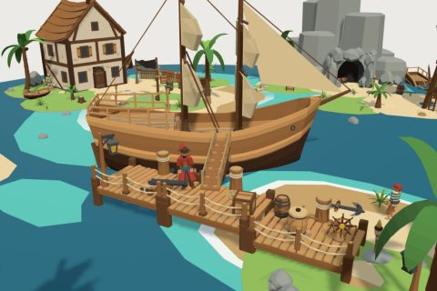

# Pirate Cove kit

61 free low-poly parts on one palette and one scale, so everything you combine belongs to the same world.

[Open the kit on Polyfork](https://polyfork.dev/kit/pirate-cove-2ebea4) · [All kits](../README.md#kits)

<table>
<tr>
<td align="center" valign="top" width="25%"> <a href="https://polyfork.dev/asset/barrel-8d63c4">Barrel</a> <a href="https://polyfork.dev/cdn/barrel-8d63c4.glb">GLB</a> · <a href="https://polyfork.dev/cdn/barrel-8d63c4.mjs">module</a></td>
<td align="center" valign="top" width="25%"> <a href="https://polyfork.dev/asset/battery-wall-section-51b723">Battery Wall Section</a> <a href="https://polyfork.dev/cdn/battery-wall-section-51b723.glb">GLB</a> · <a href="https://polyfork.dev/cdn/battery-wall-section-51b723.mjs">module</a></td>
<td align="center" valign="top" width="25%"> <a href="https://polyfork.dev/asset/beach-grass-tuft-0e699f">Beach Grass Tuft</a> <a href="https://polyfork.dev/cdn/beach-grass-tuft-0e699f.glb">GLB</a> · <a href="https://polyfork.dev/cdn/beach-grass-tuft-0e699f.mjs">module</a></td>
<td align="center" valign="top" width="25%"> <a href="https://polyfork.dev/asset/campfire-4390aa">Campfire</a> <a href="https://polyfork.dev/cdn/campfire-4390aa.glb">GLB</a> · <a href="https://polyfork.dev/cdn/campfire-4390aa.mjs">module</a></td>
</tr>
<tr>
<td align="center" valign="top" width="25%"> <a href="https://polyfork.dev/asset/cannonball-f87cdc">Cannonball</a> <a href="https://polyfork.dev/cdn/cannonball-f87cdc.glb">GLB</a> · <a href="https://polyfork.dev/cdn/cannonball-f87cdc.mjs">module</a></td>
<td align="center" valign="top" width="25%"> <a href="https://polyfork.dev/asset/capstan-fa3917">Capstan</a> <a href="https://polyfork.dev/cdn/capstan-fa3917.glb">GLB</a> · <a href="https://polyfork.dev/cdn/capstan-fa3917.mjs">module</a></td>
<td align="center" valign="top" width="25%"> <a href="https://polyfork.dev/asset/cargo-crate-9afc44">Cargo Crate</a> <a href="https://polyfork.dev/cdn/cargo-crate-9afc44.glb">GLB</a> · <a href="https://polyfork.dev/cdn/cargo-crate-9afc44.mjs">module</a></td>
<td align="center" valign="top" width="25%"> <a href="https://polyfork.dev/asset/cargo-sack-3cd3ab">Cargo Sack</a> <a href="https://polyfork.dev/cdn/cargo-sack-3cd3ab.glb">GLB</a> · <a href="https://polyfork.dev/cdn/cargo-sack-3cd3ab.mjs">module</a></td>
</tr>
<tr>
<td align="center" valign="top" width="25%"> <a href="https://polyfork.dev/asset/cove-parrot-17850c">Cove Parrot</a> <a href="https://polyfork.dev/cdn/cove-parrot-17850c.glb">GLB</a> · <a href="https://polyfork.dev/cdn/cove-parrot-17850c.mjs">module</a></td>
<td align="center" valign="top" width="25%"> <a href="https://polyfork.dev/asset/cove-tavern-5861a6">Cove Tavern</a> <a href="https://polyfork.dev/cdn/cove-tavern-5861a6.glb">GLB</a> · <a href="https://polyfork.dev/cdn/cove-tavern-5861a6.mjs">module</a></td>
<td align="center" valign="top" width="25%"> <a href="https://polyfork.dev/asset/cove-trader-0f94a6">Cove Trader</a> <a href="https://polyfork.dev/cdn/cove-trader-0f94a6.glb">GLB</a> · <a href="https://polyfork.dev/cdn/cove-trader-0f94a6.mjs">module</a></td>
<td align="center" valign="top" width="25%"> <a href="https://polyfork.dev/asset/cove-water-blob-1e44bb">Cove Water Blob</a> <a href="https://polyfork.dev/cdn/cove-water-blob-1e44bb.glb">GLB</a> · <a href="https://polyfork.dev/cdn/cove-water-blob-1e44bb.mjs">module</a></td>
</tr>
<tr>
<td align="center" valign="top" width="25%"> <a href="https://polyfork.dev/asset/deck-cannon-17849e">Deck Cannon</a> <a href="https://polyfork.dev/cdn/deck-cannon-17849e.glb">GLB</a> · <a href="https://polyfork.dev/cdn/deck-cannon-17849e.mjs">module</a></td>
<td align="center" valign="top" width="25%"> <a href="https://polyfork.dev/asset/dock-cargo-barge-69dc4b">Dock Cargo Barge</a> <a href="https://polyfork.dev/cdn/dock-cargo-barge-69dc4b.glb">GLB</a> · <a href="https://polyfork.dev/cdn/dock-cargo-barge-69dc4b.mjs">module</a></td>
<td align="center" valign="top" width="25%"> <a href="https://polyfork.dev/asset/dock-cargo-crane-ccd97f">Dock Cargo Crane</a> <a href="https://polyfork.dev/cdn/dock-cargo-crane-ccd97f.glb">GLB</a> · <a href="https://polyfork.dev/cdn/dock-cargo-crane-ccd97f.mjs">module</a></td>
<td align="center" valign="top" width="25%"> <a href="https://polyfork.dev/asset/dock-lantern-post-5e58a4">Dock Lantern Post</a> <a href="https://polyfork.dev/cdn/dock-lantern-post-5e58a4.glb">GLB</a> · <a href="https://polyfork.dev/cdn/dock-lantern-post-5e58a4.mjs">module</a></td>
</tr>
<tr>
<td align="center" valign="top" width="25%"> <a href="https://polyfork.dev/asset/dock-warehouse-bf0967">Dock Warehouse</a> <a href="https://polyfork.dev/cdn/dock-warehouse-bf0967.glb">GLB</a> · <a href="https://polyfork.dev/cdn/dock-warehouse-bf0967.mjs">module</a></td>
<td align="center" valign="top" width="25%"> <a href="https://polyfork.dev/asset/driftwood-log-90340b">Driftwood Log</a> <a href="https://polyfork.dev/cdn/driftwood-log-90340b.glb">GLB</a> · <a href="https://polyfork.dev/cdn/driftwood-log-90340b.mjs">module</a></td>
<td align="center" valign="top" width="25%"> <a href="https://polyfork.dev/asset/drying-net-rack-93ec3b">Drying Net Rack</a> <a href="https://polyfork.dev/cdn/drying-net-rack-93ec3b.glb">GLB</a> · <a href="https://polyfork.dev/cdn/drying-net-rack-93ec3b.mjs">module</a></td>
<td align="center" valign="top" width="25%"> <a href="https://polyfork.dev/asset/fisherman-shack-ea9b2b">Fisherman Shack</a> <a href="https://polyfork.dev/cdn/fisherman-shack-ea9b2b.glb">GLB</a> · <a href="https://polyfork.dev/cdn/fisherman-shack-ea9b2b.mjs">module</a></td>
</tr>
<tr>
<td align="center" valign="top" width="25%"> <a href="https://polyfork.dev/asset/gangplank-572d4e">Gangplank</a> <a href="https://polyfork.dev/cdn/gangplank-572d4e.glb">GLB</a> · <a href="https://polyfork.dev/cdn/gangplank-572d4e.mjs">module</a></td>
<td align="center" valign="top" width="25%"> <a href="https://polyfork.dev/asset/grass-terrain-blob-cb42d6">Grass Terrain Blob</a> <a href="https://polyfork.dev/cdn/grass-terrain-blob-cb42d6.glb">GLB</a> · <a href="https://polyfork.dev/cdn/grass-terrain-blob-cb42d6.mjs">module</a></td>
<td align="center" valign="top" width="25%"> <a href="https://polyfork.dev/asset/hanging-signboard-c10e01">Hanging Signboard</a> <a href="https://polyfork.dev/cdn/hanging-signboard-c10e01.glb">GLB</a> · <a href="https://polyfork.dev/cdn/hanging-signboard-c10e01.mjs">module</a></td>
<td align="center" valign="top" width="25%"> <a href="https://polyfork.dev/asset/jolly-roger-pole-803c5a">Jolly Roger Pole</a> <a href="https://polyfork.dev/cdn/jolly-roger-pole-803c5a.glb">GLB</a> · <a href="https://polyfork.dev/cdn/jolly-roger-pole-803c5a.mjs">module</a></td>
</tr>
<tr>
<td align="center" valign="top" width="25%"> <a href="https://polyfork.dev/asset/large-coastal-boulder-a2cab1">Large Coastal Boulder</a> <a href="https://polyfork.dev/cdn/large-coastal-boulder-a2cab1.glb">GLB</a> · <a href="https://polyfork.dev/cdn/large-coastal-boulder-a2cab1.mjs">module</a></td>
<td align="center" valign="top" width="25%"> <a href="https://polyfork.dev/asset/large-path-stone-1b0844">Large Path Stone</a> <a href="https://polyfork.dev/cdn/large-path-stone-1b0844.glb">GLB</a> · <a href="https://polyfork.dev/cdn/large-path-stone-1b0844.mjs">module</a></td>
<td align="center" valign="top" width="25%"> <a href="https://polyfork.dev/asset/lookout-watchtower-f1a5ce">Lookout Watchtower</a> <a href="https://polyfork.dev/cdn/lookout-watchtower-f1a5ce.glb">GLB</a> · <a href="https://polyfork.dev/cdn/lookout-watchtower-f1a5ce.mjs">module</a></td>
<td align="center" valign="top" width="25%"> <a href="https://polyfork.dev/asset/mooring-post-2b83a4">Mooring Post</a> <a href="https://polyfork.dev/cdn/mooring-post-2b83a4.glb">GLB</a> · <a href="https://polyfork.dev/cdn/mooring-post-2b83a4.mjs">module</a></td>
</tr>
<tr>
<td align="center" valign="top" width="25%"> <a href="https://polyfork.dev/asset/naval-officer-93027f">Naval Officer</a> <a href="https://polyfork.dev/cdn/naval-officer-93027f.glb">GLB</a> · <a href="https://polyfork.dev/cdn/naval-officer-93027f.mjs">module</a></td>
<td align="center" valign="top" width="25%"> <a href="https://polyfork.dev/asset/palisade-fence-section-471b1b">Palisade Fence Section</a> <a href="https://polyfork.dev/cdn/palisade-fence-section-471b1b.glb">GLB</a> · <a href="https://polyfork.dev/cdn/palisade-fence-section-471b1b.mjs">module</a></td>
<td align="center" valign="top" width="25%"> <a href="https://polyfork.dev/asset/palm-sapling-ef7ae4">Palm Sapling</a> <a href="https://polyfork.dev/cdn/palm-sapling-ef7ae4.glb">GLB</a> · <a href="https://polyfork.dev/cdn/palm-sapling-ef7ae4.mjs">module</a></td>
<td align="center" valign="top" width="25%"> <a href="https://polyfork.dev/asset/palm-tree-a307da">Palm Tree</a> <a href="https://polyfork.dev/cdn/palm-tree-a307da.glb">GLB</a> · <a href="https://polyfork.dev/cdn/palm-tree-a307da.mjs">module</a></td>
</tr>
<tr>
<td align="center" valign="top" width="25%"> <a href="https://polyfork.dev/asset/pier-access-stair-7369dc">Pier Access Stair</a> <a href="https://polyfork.dev/cdn/pier-access-stair-7369dc.glb">GLB</a> · <a href="https://polyfork.dev/cdn/pier-access-stair-7369dc.mjs">module</a></td>
<td align="center" valign="top" width="25%"> <a href="https://polyfork.dev/asset/pier-deck-corner-c56248">Pier Deck Corner</a> <a href="https://polyfork.dev/cdn/pier-deck-corner-c56248.glb">GLB</a> · <a href="https://polyfork.dev/cdn/pier-deck-corner-c56248.mjs">module</a></td>
<td align="center" valign="top" width="25%"> <a href="https://polyfork.dev/asset/pier-deck-section-7047d7">Pier Deck Section</a> <a href="https://polyfork.dev/cdn/pier-deck-section-7047d7.glb">GLB</a> · <a href="https://polyfork.dev/cdn/pier-deck-section-7047d7.mjs">module</a></td>
<td align="center" valign="top" width="25%"> <a href="https://polyfork.dev/asset/pier-rope-railing-616f5d">Pier Rope Railing</a> <a href="https://polyfork.dev/cdn/pier-rope-railing-616f5d.glb">GLB</a> · <a href="https://polyfork.dev/cdn/pier-rope-railing-616f5d.mjs">module</a></td>
</tr>
<tr>
<td align="center" valign="top" width="25%"> <a href="https://polyfork.dev/asset/pirate-brigantine-c29c57">Pirate Brigantine</a> <a href="https://polyfork.dev/cdn/pirate-brigantine-c29c57.glb">GLB</a> · <a href="https://polyfork.dev/cdn/pirate-brigantine-c29c57.mjs">module</a></td>
<td align="center" valign="top" width="25%"> <a href="https://polyfork.dev/asset/pirate-captain-91f545">Pirate Captain</a> <a href="https://polyfork.dev/cdn/pirate-captain-91f545.glb">GLB</a> · <a href="https://polyfork.dev/cdn/pirate-captain-91f545.mjs">module</a></td>
<td align="center" valign="top" width="25%"> <a href="https://polyfork.dev/asset/pirate-cove-terrain-de4636">Pirate Cove Terrain</a> <a href="https://polyfork.dev/cdn/pirate-cove-terrain-de4636.glb">GLB</a> · <a href="https://polyfork.dev/cdn/pirate-cove-terrain-de4636.mjs">module</a></td>
<td align="center" valign="top" width="25%"> <a href="https://polyfork.dev/asset/pirate-deckhand-98a6e7">Pirate Deckhand</a> <a href="https://polyfork.dev/cdn/pirate-deckhand-98a6e7.glb">GLB</a> · <a href="https://polyfork.dev/cdn/pirate-deckhand-98a6e7.mjs">module</a></td>
</tr>
<tr>
<td align="center" valign="top" width="25%"> <a href="https://polyfork.dev/asset/pirate-galleon-2e9aea">Pirate Galleon</a> <a href="https://polyfork.dev/cdn/pirate-galleon-2e9aea.glb">GLB</a> · <a href="https://polyfork.dev/cdn/pirate-galleon-2e9aea.mjs">module</a></td>
<td align="center" valign="top" width="25%"> <a href="https://polyfork.dev/asset/pirate-sloop-d8ead0">Pirate Sloop</a> <a href="https://polyfork.dev/cdn/pirate-sloop-d8ead0.glb">GLB</a> · <a href="https://polyfork.dev/cdn/pirate-sloop-d8ead0.mjs">module</a></td>
<td align="center" valign="top" width="25%"> <a href="https://polyfork.dev/asset/pirate-sloop-hull-89cd04">Pirate Sloop Hull</a> <a href="https://polyfork.dev/cdn/pirate-sloop-hull-89cd04.glb">GLB</a> · <a href="https://polyfork.dev/cdn/pirate-sloop-hull-89cd04.mjs">module</a></td>
<td align="center" valign="top" width="25%"> <a href="https://polyfork.dev/asset/rope-coil-776dcc">Rope Coil</a> <a href="https://polyfork.dev/cdn/rope-coil-776dcc.glb">GLB</a> · <a href="https://polyfork.dev/cdn/rope-coil-776dcc.mjs">module</a></td>
</tr>
<tr>
<td align="center" valign="top" width="25%"> <a href="https://polyfork.dev/asset/rowboat-c42d85">Rowboat</a> <a href="https://polyfork.dev/cdn/rowboat-c42d85.glb">GLB</a> · <a href="https://polyfork.dev/cdn/rowboat-c42d85.mjs">module</a></td>
<td align="center" valign="top" width="25%"> <a href="https://polyfork.dev/asset/sand-terrain-blob-f6255a">Sand Terrain Blob</a> <a href="https://polyfork.dev/cdn/sand-terrain-blob-f6255a.glb">GLB</a> · <a href="https://polyfork.dev/cdn/sand-terrain-blob-f6255a.mjs">module</a></td>
<td align="center" valign="top" width="25%"> <a href="https://polyfork.dev/asset/sea-stack-369791">Sea Stack</a> <a href="https://polyfork.dev/cdn/sea-stack-369791.glb">GLB</a> · <a href="https://polyfork.dev/cdn/sea-stack-369791.mjs">module</a></td>
<td align="center" valign="top" width="25%"> <a href="https://polyfork.dev/asset/ship-anchor-c2b4f1">Ship Anchor</a> <a href="https://polyfork.dev/cdn/ship-anchor-c2b4f1.glb">GLB</a> · <a href="https://polyfork.dev/cdn/ship-anchor-c2b4f1.mjs">module</a></td>
</tr>
<tr>
<td align="center" valign="top" width="25%"> <a href="https://polyfork.dev/asset/ship-s-longboat-f159fd">Ship&#039;s Longboat</a> <a href="https://polyfork.dev/cdn/ship-s-longboat-f159fd.glb">GLB</a> · <a href="https://polyfork.dev/cdn/ship-s-longboat-f159fd.mjs">module</a></td>
<td align="center" valign="top" width="25%"> <a href="https://polyfork.dev/asset/ship-s-wheel-7e7426">Ship&#039;s Wheel</a> <a href="https://polyfork.dev/cdn/ship-s-wheel-7e7426.glb">GLB</a> · <a href="https://polyfork.dev/cdn/ship-s-wheel-7e7426.mjs">module</a></td>
<td align="center" valign="top" width="25%"> <a href="https://polyfork.dev/asset/shipwright-boat-shed-9cbbc1">Shipwright Boat Shed</a> <a href="https://polyfork.dev/cdn/shipwright-boat-shed-9cbbc1.glb">GLB</a> · <a href="https://polyfork.dev/cdn/shipwright-boat-shed-9cbbc1.mjs">module</a></td>
<td align="center" valign="top" width="25%"> <a href="https://polyfork.dev/asset/signpost-ed3d77">Signpost</a> <a href="https://polyfork.dev/cdn/signpost-ed3d77.glb">GLB</a> · <a href="https://polyfork.dev/cdn/signpost-ed3d77.mjs">module</a></td>
</tr>
<tr>
<td align="center" valign="top" width="25%"> <a href="https://polyfork.dev/asset/small-path-stone-1679ff">Small Path Stone</a> <a href="https://polyfork.dev/cdn/small-path-stone-1679ff.glb">GLB</a> · <a href="https://polyfork.dev/cdn/small-path-stone-1679ff.mjs">module</a></td>
<td align="center" valign="top" width="25%"> <a href="https://polyfork.dev/asset/small-rock-457be8">Small Rock</a> <a href="https://polyfork.dev/cdn/small-rock-457be8.glb">GLB</a> · <a href="https://polyfork.dev/cdn/small-rock-457be8.mjs">module</a></td>
<td align="center" valign="top" width="25%"> <a href="https://polyfork.dev/asset/smuggler-cave-mouth-69a07e">Smuggler Cave Mouth</a> <a href="https://polyfork.dev/cdn/smuggler-cave-mouth-69a07e.glb">GLB</a> · <a href="https://polyfork.dev/cdn/smuggler-cave-mouth-69a07e.mjs">module</a></td>
<td align="center" valign="top" width="25%"> <a href="https://polyfork.dev/asset/swivel-gun-e06c4e">Swivel Gun</a> <a href="https://polyfork.dev/cdn/swivel-gun-e06c4e.glb">GLB</a> · <a href="https://polyfork.dev/cdn/swivel-gun-e06c4e.mjs">module</a></td>
</tr>
<tr>
<td align="center" valign="top" width="25%"> <a href="https://polyfork.dev/asset/torch-stake-d82a2c">Torch Stake</a> <a href="https://polyfork.dev/cdn/torch-stake-d82a2c.glb">GLB</a> · <a href="https://polyfork.dev/cdn/torch-stake-d82a2c.mjs">module</a></td>
<td align="center" valign="top" width="25%"> <a href="https://polyfork.dev/asset/treasure-chest-c2ac4f">Treasure Chest</a> <a href="https://polyfork.dev/cdn/treasure-chest-c2ac4f.glb">GLB</a> · <a href="https://polyfork.dev/cdn/treasure-chest-c2ac4f.mjs">module</a></td>
<td align="center" valign="top" width="25%"> <a href="https://polyfork.dev/asset/tree-stump-00f3bf">Tree Stump</a> <a href="https://polyfork.dev/cdn/tree-stump-00f3bf.glb">GLB</a> · <a href="https://polyfork.dev/cdn/tree-stump-00f3bf.mjs">module</a></td>
<td align="center" valign="top" width="25%"> <a href="https://polyfork.dev/asset/tropical-fern-bush-c70147">Tropical Fern Bush</a> <a href="https://polyfork.dev/cdn/tropical-fern-bush-c70147.glb">GLB</a> · <a href="https://polyfork.dev/cdn/tropical-fern-bush-c70147.mjs">module</a></td>
</tr>
<tr>
<td align="center" valign="top" width="25%"> <a href="https://polyfork.dev/asset/wrecked-hull-section-ca6755">Wrecked Hull Section</a> <a href="https://polyfork.dev/cdn/wrecked-hull-section-ca6755.glb">GLB</a> · <a href="https://polyfork.dev/cdn/wrecked-hull-section-ca6755.mjs">module</a></td>
</tr>
</table>
