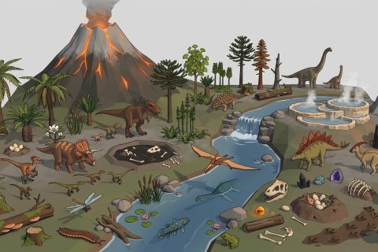

# Prehistoric Valley

In production, 58 parts so far. Every part below is already free to use.

[Open the kit on Polyfork](https://polyfork.dev/kit/prehistoric-valley-8638dc) · [All kits](../README.md#kits)

<table>
<tr>
<td align="center" valign="top" width="25%"> <a href="https://polyfork.dev/asset/amber-lump-f3a85d">Amber Lump</a> <a href="https://polyfork.dev/cdn/amber-lump-f3a85d.glb">GLB</a> · <a href="https://polyfork.dev/cdn/amber-lump-f3a85d.mjs">module</a></td>
<td align="center" valign="top" width="25%"> <a href="https://polyfork.dev/asset/ankylosaurus-b063ec">Ankylosaurus</a> <a href="https://polyfork.dev/cdn/ankylosaurus-b063ec.glb">GLB</a> · <a href="https://polyfork.dev/cdn/ankylosaurus-b063ec.mjs">module</a></td>
<td align="center" valign="top" width="25%"> <a href="https://polyfork.dev/asset/araucaria-monkey-puzzle-7c109d">Araucaria Monkey Puzzle</a> <a href="https://polyfork.dev/cdn/araucaria-monkey-puzzle-7c109d.glb">GLB</a> · <a href="https://polyfork.dev/cdn/araucaria-monkey-puzzle-7c109d.mjs">module</a></td>
<td align="center" valign="top" width="25%"> <a href="https://polyfork.dev/asset/arthropleura-giant-millipede-7ade0b">Arthropleura Giant Millipede</a> <a href="https://polyfork.dev/cdn/arthropleura-giant-millipede-7ade0b.glb">GLB</a> · <a href="https://polyfork.dev/cdn/arthropleura-giant-millipede-7ade0b.mjs">module</a></td>
</tr>
<tr>
<td align="center" valign="top" width="25%"> <a href="https://polyfork.dev/asset/basalt-column-outcrop-f1339d">Basalt Column Outcrop</a> <a href="https://polyfork.dev/cdn/basalt-column-outcrop-f1339d.glb">GLB</a> · <a href="https://polyfork.dev/cdn/basalt-column-outcrop-f1339d.mjs">module</a></td>
<td align="center" valign="top" width="25%"> <a href="https://polyfork.dev/asset/beelzebufo-giant-frog-29beae">Beelzebufo Giant Frog</a> <a href="https://polyfork.dev/cdn/beelzebufo-giant-frog-29beae.glb">GLB</a> · <a href="https://polyfork.dev/cdn/beelzebufo-giant-frog-29beae.mjs">module</a></td>
<td align="center" valign="top" width="25%"> <a href="https://polyfork.dev/asset/brachiosaurus-f795d5">Brachiosaurus</a> <a href="https://polyfork.dev/cdn/brachiosaurus-f795d5.glb">GLB</a> · <a href="https://polyfork.dev/cdn/brachiosaurus-f795d5.mjs">module</a></td>
<td align="center" valign="top" width="25%"> <a href="https://polyfork.dev/asset/bracket-fungus-log-2deef4">Bracket Fungus Log</a> <a href="https://polyfork.dev/cdn/bracket-fungus-log-2deef4.glb">GLB</a> · <a href="https://polyfork.dev/cdn/bracket-fungus-log-2deef4.mjs">module</a></td>
</tr>
<tr>
<td align="center" valign="top" width="25%"> <a href="https://polyfork.dev/asset/bubbling-mud-pool-a1c8ac">Bubbling Mud Pool</a> <a href="https://polyfork.dev/cdn/bubbling-mud-pool-a1c8ac.glb">GLB</a> · <a href="https://polyfork.dev/cdn/bubbling-mud-pool-a1c8ac.mjs">module</a></td>
<td align="center" valign="top" width="25%"> <a href="https://polyfork.dev/asset/club-moss-mat-edcb1b">Club-Moss Mat</a> <a href="https://polyfork.dev/cdn/club-moss-mat-edcb1b.glb">GLB</a> · <a href="https://polyfork.dev/cdn/club-moss-mat-edcb1b.mjs">module</a></td>
<td align="center" valign="top" width="25%"> <a href="https://polyfork.dev/asset/coelacanth-b7eae8">Coelacanth</a> <a href="https://polyfork.dev/cdn/coelacanth-b7eae8.glb">GLB</a> · <a href="https://polyfork.dev/cdn/coelacanth-b7eae8.mjs">module</a></td>
<td align="center" valign="top" width="25%"> <a href="https://polyfork.dev/asset/compsognathus-c8975e">Compsognathus</a> <a href="https://polyfork.dev/cdn/compsognathus-c8975e.glb">GLB</a> · <a href="https://polyfork.dev/cdn/compsognathus-c8975e.mjs">module</a></td>
</tr>
<tr>
<td align="center" valign="top" width="25%"> <a href="https://polyfork.dev/asset/cycad-05ad50">Cycad</a> <a href="https://polyfork.dev/cdn/cycad-05ad50.glb">GLB</a> · <a href="https://polyfork.dev/cdn/cycad-05ad50.mjs">module</a></td>
<td align="center" valign="top" width="25%"> <a href="https://polyfork.dev/asset/dawn-redwood-001c29">Dawn Redwood</a> <a href="https://polyfork.dev/cdn/dawn-redwood-001c29.glb">GLB</a> · <a href="https://polyfork.dev/cdn/dawn-redwood-001c29.mjs">module</a></td>
<td align="center" valign="top" width="25%"> <a href="https://polyfork.dev/asset/dead-snag-0b1891">Dead Snag</a> <a href="https://polyfork.dev/cdn/dead-snag-0b1891.glb">GLB</a> · <a href="https://polyfork.dev/cdn/dead-snag-0b1891.mjs">module</a></td>
<td align="center" valign="top" width="25%"> <a href="https://polyfork.dev/asset/dinosaur-bone-pile-3c285a">Dinosaur Bone Pile</a> <a href="https://polyfork.dev/cdn/dinosaur-bone-pile-3c285a.glb">GLB</a> · <a href="https://polyfork.dev/cdn/dinosaur-bone-pile-3c285a.mjs">module</a></td>
</tr>
<tr>
<td align="center" valign="top" width="25%"> <a href="https://polyfork.dev/asset/dinosaur-nest-2be2b8">Dinosaur Nest</a> <a href="https://polyfork.dev/cdn/dinosaur-nest-2be2b8.glb">GLB</a> · <a href="https://polyfork.dev/cdn/dinosaur-nest-2be2b8.mjs">module</a></td>
<td align="center" valign="top" width="25%"> <a href="https://polyfork.dev/asset/dinosaur-skull-4c3a3c">Dinosaur Skull</a> <a href="https://polyfork.dev/cdn/dinosaur-skull-4c3a3c.glb">GLB</a> · <a href="https://polyfork.dev/cdn/dinosaur-skull-4c3a3c.mjs">module</a></td>
<td align="center" valign="top" width="25%"> <a href="https://polyfork.dev/asset/dinosaur-trackway-f0aec5">Dinosaur Trackway</a> <a href="https://polyfork.dev/cdn/dinosaur-trackway-f0aec5.glb">GLB</a> · <a href="https://polyfork.dev/cdn/dinosaur-trackway-f0aec5.mjs">module</a></td>
<td align="center" valign="top" width="25%"> <a href="https://polyfork.dev/asset/driftwood-wrack-pile-a505a5">Driftwood Wrack Pile</a> <a href="https://polyfork.dev/cdn/driftwood-wrack-pile-a505a5.glb">GLB</a> · <a href="https://polyfork.dev/cdn/driftwood-wrack-pile-a505a5.mjs">module</a></td>
</tr>
<tr>
<td align="center" valign="top" width="25%"> <a href="https://polyfork.dev/asset/fern-clump-90ff4b">Fern Clump</a> <a href="https://polyfork.dev/cdn/fern-clump-90ff4b.glb">GLB</a> · <a href="https://polyfork.dev/cdn/fern-clump-90ff4b.mjs">module</a></td>
<td align="center" valign="top" width="25%"> <a href="https://polyfork.dev/asset/fern-covered-boulder-2e0375">Fern-Covered Boulder</a> <a href="https://polyfork.dev/cdn/fern-covered-boulder-2e0375.glb">GLB</a> · <a href="https://polyfork.dev/cdn/fern-covered-boulder-2e0375.mjs">module</a></td>
<td align="center" valign="top" width="25%"> <a href="https://polyfork.dev/asset/flowering-magnolia-dd76cb">Flowering Magnolia</a> <a href="https://polyfork.dev/cdn/flowering-magnolia-dd76cb.glb">GLB</a> · <a href="https://polyfork.dev/cdn/flowering-magnolia-dd76cb.mjs">module</a></td>
<td align="center" valign="top" width="25%"> <a href="https://polyfork.dev/asset/fossil-ribcage-b243c5">Fossil Ribcage</a> <a href="https://polyfork.dev/cdn/fossil-ribcage-b243c5.glb">GLB</a> · <a href="https://polyfork.dev/cdn/fossil-ribcage-b243c5.mjs">module</a></td>
</tr>
<tr>
<td align="center" valign="top" width="25%"> <a href="https://polyfork.dev/asset/fumarole-vent-8280ba">Fumarole Vent</a> <a href="https://polyfork.dev/cdn/fumarole-vent-8280ba.glb">GLB</a> · <a href="https://polyfork.dev/cdn/fumarole-vent-8280ba.mjs">module</a></td>
<td align="center" valign="top" width="25%"> <a href="https://polyfork.dev/asset/geyser-cone-2b5033">Geyser Cone</a> <a href="https://polyfork.dev/cdn/geyser-cone-2b5033.glb">GLB</a> · <a href="https://polyfork.dev/cdn/geyser-cone-2b5033.mjs">module</a></td>
<td align="center" valign="top" width="25%"> <a href="https://polyfork.dev/asset/giant-horsetail-stand-3a4f94">Giant Horsetail Stand</a> <a href="https://polyfork.dev/cdn/giant-horsetail-stand-3a4f94.glb">GLB</a> · <a href="https://polyfork.dev/cdn/giant-horsetail-stand-3a4f94.mjs">module</a></td>
<td align="center" valign="top" width="25%"> <a href="https://polyfork.dev/asset/giant-mushroom-cluster-868de6">Giant Mushroom Cluster</a> <a href="https://polyfork.dev/cdn/giant-mushroom-cluster-868de6.glb">GLB</a> · <a href="https://polyfork.dev/cdn/giant-mushroom-cluster-868de6.mjs">module</a></td>
</tr>
<tr>
<td align="center" valign="top" width="25%"> <a href="https://polyfork.dev/asset/ginkgo-leaf-litter-9784e9">Ginkgo Leaf Litter</a> <a href="https://polyfork.dev/cdn/ginkgo-leaf-litter-9784e9.glb">GLB</a> · <a href="https://polyfork.dev/cdn/ginkgo-leaf-litter-9784e9.mjs">module</a></td>
<td align="center" valign="top" width="25%"> <a href="https://polyfork.dev/asset/ginkgo-tree-baa895">Ginkgo Tree</a> <a href="https://polyfork.dev/cdn/ginkgo-tree-baa895.glb">GLB</a> · <a href="https://polyfork.dev/cdn/ginkgo-tree-baa895.mjs">module</a></td>
<td align="center" valign="top" width="25%"> <a href="https://polyfork.dev/asset/hanging-vine-run-4184f3">Hanging Vine Run</a> <a href="https://polyfork.dev/cdn/hanging-vine-run-4184f3.glb">GLB</a> · <a href="https://polyfork.dev/cdn/hanging-vine-run-4184f3.mjs">module</a></td>
<td align="center" valign="top" width="25%"> <a href="https://polyfork.dev/asset/hatching-egg-ff3379">Hatching Egg</a> <a href="https://polyfork.dev/cdn/hatching-egg-ff3379.glb">GLB</a> · <a href="https://polyfork.dev/cdn/hatching-egg-ff3379.mjs">module</a></td>
</tr>
<tr>
<td align="center" valign="top" width="25%"> <a href="https://polyfork.dev/asset/hollow-log-329fd7">Hollow Log</a> <a href="https://polyfork.dev/cdn/hollow-log-329fd7.glb">GLB</a> · <a href="https://polyfork.dev/cdn/hollow-log-329fd7.mjs">module</a></td>
<td align="center" valign="top" width="25%"> <a href="https://polyfork.dev/asset/hot-spring-pool-26312c">Hot Spring Pool</a> <a href="https://polyfork.dev/cdn/hot-spring-pool-26312c.glb">GLB</a> · <a href="https://polyfork.dev/cdn/hot-spring-pool-26312c.mjs">module</a></td>
<td align="center" valign="top" width="25%"> <a href="https://polyfork.dev/asset/lava-rock-pile-d56d19">Lava Rock Pile</a> <a href="https://polyfork.dev/cdn/lava-rock-pile-d56d19.glb">GLB</a> · <a href="https://polyfork.dev/cdn/lava-rock-pile-d56d19.mjs">module</a></td>
<td align="center" valign="top" width="25%"> <a href="https://polyfork.dev/asset/lily-pad-cluster-457382">Lily Pad Cluster</a> <a href="https://polyfork.dev/cdn/lily-pad-cluster-457382.glb">GLB</a> · <a href="https://polyfork.dev/cdn/lily-pad-cluster-457382.mjs">module</a></td>
</tr>
<tr>
<td align="center" valign="top" width="25%"> <a href="https://polyfork.dev/asset/loose-egg-clutch-8685d2">Loose Egg Clutch</a> <a href="https://polyfork.dev/cdn/loose-egg-clutch-8685d2.glb">GLB</a> · <a href="https://polyfork.dev/cdn/loose-egg-clutch-8685d2.mjs">module</a></td>
<td align="center" valign="top" width="25%"> <a href="https://polyfork.dev/asset/lotus-flower-cluster-bc129a">Lotus Flower Cluster</a> <a href="https://polyfork.dev/cdn/lotus-flower-cluster-bc129a.glb">GLB</a> · <a href="https://polyfork.dev/cdn/lotus-flower-cluster-bc129a.mjs">module</a></td>
<td align="center" valign="top" width="25%"> <a href="https://polyfork.dev/asset/mineral-geode-cluster-299927">Mineral Geode Cluster</a> <a href="https://polyfork.dev/cdn/mineral-geode-cluster-299927.glb">GLB</a> · <a href="https://polyfork.dev/cdn/mineral-geode-cluster-299927.mjs">module</a></td>
<td align="center" valign="top" width="25%"> <a href="https://polyfork.dev/asset/moss-covered-stump-7253ab">Moss-Covered Stump</a> <a href="https://polyfork.dev/cdn/moss-covered-stump-7253ab.glb">GLB</a> · <a href="https://polyfork.dev/cdn/moss-covered-stump-7253ab.mjs">module</a></td>
</tr>
<tr>
<td align="center" valign="top" width="25%"> <a href="https://polyfork.dev/asset/obsidian-shard-cluster-c8f5d3">Obsidian Shard Cluster</a> <a href="https://polyfork.dev/cdn/obsidian-shard-cluster-c8f5d3.glb">GLB</a> · <a href="https://polyfork.dev/cdn/obsidian-shard-cluster-c8f5d3.mjs">module</a></td>
<td align="center" valign="top" width="25%"> <a href="https://polyfork.dev/asset/parasaurolophus-c27741">Parasaurolophus</a> <a href="https://polyfork.dev/cdn/parasaurolophus-c27741.glb">GLB</a> · <a href="https://polyfork.dev/cdn/parasaurolophus-c27741.mjs">module</a></td>
<td align="center" valign="top" width="25%"> <a href="https://polyfork.dev/asset/petrified-log-413693">Petrified Log</a> <a href="https://polyfork.dev/cdn/petrified-log-413693.glb">GLB</a> · <a href="https://polyfork.dev/cdn/petrified-log-413693.mjs">module</a></td>
<td align="center" valign="top" width="25%"> <a href="https://polyfork.dev/asset/plesiosaurus-d58997">Plesiosaurus</a> <a href="https://polyfork.dev/cdn/plesiosaurus-d58997.glb">GLB</a> · <a href="https://polyfork.dev/cdn/plesiosaurus-d58997.mjs">module</a></td>
</tr>
<tr>
<td align="center" valign="top" width="25%"> <a href="https://polyfork.dev/asset/river-reed-cluster-cba87e">River Reed Cluster</a> <a href="https://polyfork.dev/cdn/river-reed-cluster-cba87e.glb">GLB</a> · <a href="https://polyfork.dev/cdn/river-reed-cluster-cba87e.mjs">module</a></td>
<td align="center" valign="top" width="25%"> <a href="https://polyfork.dev/asset/river-stone-cluster-0b55bc">River Stone Cluster</a> <a href="https://polyfork.dev/cdn/river-stone-cluster-0b55bc.glb">GLB</a> · <a href="https://polyfork.dev/cdn/river-stone-cluster-0b55bc.mjs">module</a></td>
<td align="center" valign="top" width="25%"> <a href="https://polyfork.dev/asset/sauropod-nest-mound-36a0eb">Sauropod Nest Mound</a> <a href="https://polyfork.dev/cdn/sauropod-nest-mound-36a0eb.glb">GLB</a> · <a href="https://polyfork.dev/cdn/sauropod-nest-mound-36a0eb.mjs">module</a></td>
<td align="center" valign="top" width="25%"> <a href="https://polyfork.dev/asset/scorched-tree-e927a3">Scorched Tree</a> <a href="https://polyfork.dev/cdn/scorched-tree-e927a3.glb">GLB</a> · <a href="https://polyfork.dev/cdn/scorched-tree-e927a3.mjs">module</a></td>
</tr>
<tr>
<td align="center" valign="top" width="25%"> <a href="https://polyfork.dev/asset/stegosaurus-96f08c">Stegosaurus</a> <a href="https://polyfork.dev/cdn/stegosaurus-96f08c.glb">GLB</a> · <a href="https://polyfork.dev/cdn/stegosaurus-96f08c.mjs">module</a></td>
<td align="center" valign="top" width="25%"> <a href="https://polyfork.dev/asset/tar-pit-d040f3">Tar Pit</a> <a href="https://polyfork.dev/cdn/tar-pit-d040f3.glb">GLB</a> · <a href="https://polyfork.dev/cdn/tar-pit-d040f3.mjs">module</a></td>
<td align="center" valign="top" width="25%"> <a href="https://polyfork.dev/asset/termite-mound-9bc94b">Termite Mound</a> <a href="https://polyfork.dev/cdn/termite-mound-9bc94b.glb">GLB</a> · <a href="https://polyfork.dev/cdn/termite-mound-9bc94b.mjs">module</a></td>
<td align="center" valign="top" width="25%"> <a href="https://polyfork.dev/asset/tree-fern-78320e">Tree Fern</a> <a href="https://polyfork.dev/cdn/tree-fern-78320e.glb">GLB</a> · <a href="https://polyfork.dev/cdn/tree-fern-78320e.mjs">module</a></td>
</tr>
<tr>
<td align="center" valign="top" width="25%"> <a href="https://polyfork.dev/asset/triceratops-6ce6f5">Triceratops</a> <a href="https://polyfork.dev/cdn/triceratops-6ce6f5.glb">GLB</a> · <a href="https://polyfork.dev/cdn/triceratops-6ce6f5.mjs">module</a></td>
<td align="center" valign="top" width="25%"> <a href="https://polyfork.dev/asset/tyrannosaurus-rex-adf79f">Tyrannosaurus Rex</a> <a href="https://polyfork.dev/cdn/tyrannosaurus-rex-adf79f.glb">GLB</a> · <a href="https://polyfork.dev/cdn/tyrannosaurus-rex-adf79f.mjs">module</a></td>
<td align="center" valign="top" width="25%"> <a href="https://polyfork.dev/asset/velociraptor-094793">Velociraptor</a> <a href="https://polyfork.dev/cdn/velociraptor-094793.glb">GLB</a> · <a href="https://polyfork.dev/cdn/velociraptor-094793.mjs">module</a></td>
<td align="center" valign="top" width="25%"> <a href="https://polyfork.dev/asset/volcanic-boulder-cluster-7e29ea">Volcanic Boulder Cluster</a> <a href="https://polyfork.dev/cdn/volcanic-boulder-cluster-7e29ea.glb">GLB</a> · <a href="https://polyfork.dev/cdn/volcanic-boulder-cluster-7e29ea.mjs">module</a></td>
</tr>
<tr>
<td align="center" valign="top" width="25%"> <a href="https://polyfork.dev/asset/williamsonia-7b0a4f">Williamsonia</a> <a href="https://polyfork.dev/cdn/williamsonia-7b0a4f.glb">GLB</a> · <a href="https://polyfork.dev/cdn/williamsonia-7b0a4f.mjs">module</a></td>
<td align="center" valign="top" width="25%"> <a href="https://polyfork.dev/asset/williamsoniella-flowering-shrub-dc53ae">Williamsoniella Flowering Shrub</a> <a href="https://polyfork.dev/cdn/williamsoniella-flowering-shrub-dc53ae.glb">GLB</a> · <a href="https://polyfork.dev/cdn/williamsoniella-flowering-shrub-dc53ae.mjs">module</a></td>
</tr>
</table>
