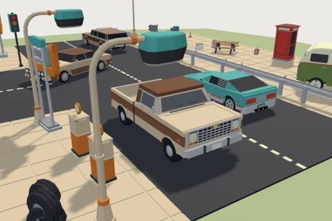

# Retro Cars Kit

29 free low-poly parts on one palette and one scale, so everything you combine belongs to the same world.

[Open the kit on Polyfork](https://polyfork.dev/kit/racing-cars-kit-660d53) · [All kits](../README.md#kits)

<table>
<tr>
<td align="center" valign="top" width="25%"> <a href="https://polyfork.dev/asset/boombox-d0048f">Boombox</a> <a href="https://polyfork.dev/cdn/boombox-d0048f.glb">GLB</a> · <a href="https://polyfork.dev/cdn/boombox-d0048f.mjs">module</a></td>
<td align="center" valign="top" width="25%"> <a href="https://polyfork.dev/asset/boxy-sedan-70s-7d55f7">Boxy-sedan-70s</a> <a href="https://polyfork.dev/cdn/boxy-sedan-70s-7d55f7.glb">GLB</a> · <a href="https://polyfork.dev/cdn/boxy-sedan-70s-7d55f7.mjs">module</a></td>
<td align="center" valign="top" width="25%"> <a href="https://polyfork.dev/asset/camper-van-8d10e2">Camper-van</a> <a href="https://polyfork.dev/cdn/camper-van-8d10e2.glb">GLB</a> · <a href="https://polyfork.dev/cdn/camper-van-8d10e2.mjs">module</a></td>
<td align="center" valign="top" width="25%"> <a href="https://polyfork.dev/asset/checkered-flag-81784a">Checkered-flag</a> <a href="https://polyfork.dev/cdn/checkered-flag-81784a.glb">GLB</a> · <a href="https://polyfork.dev/cdn/checkered-flag-81784a.mjs">module</a></td>
</tr>
<tr>
<td align="center" valign="top" width="25%"> <a href="https://polyfork.dev/asset/convertible-60s-b76f89">Convertible-60s</a> <a href="https://polyfork.dev/cdn/convertible-60s-b76f89.glb">GLB</a> · <a href="https://polyfork.dev/cdn/convertible-60s-b76f89.mjs">module</a></td>
<td align="center" valign="top" width="25%"> <a href="https://polyfork.dev/asset/diner-sign-ab5f0a">Diner-sign</a> <a href="https://polyfork.dev/cdn/diner-sign-ab5f0a.glb">GLB</a> · <a href="https://polyfork.dev/cdn/diner-sign-ab5f0a.mjs">module</a></td>
<td align="center" valign="top" width="25%"> <a href="https://polyfork.dev/asset/gas-pump-5014a8">Gas-pump</a> <a href="https://polyfork.dev/cdn/gas-pump-5014a8.glb">GLB</a> · <a href="https://polyfork.dev/cdn/gas-pump-5014a8.mjs">module</a></td>
<td align="center" valign="top" width="25%"> <a href="https://polyfork.dev/asset/guardrail-d3bd42">Guardrail</a> <a href="https://polyfork.dev/cdn/guardrail-d3bd42.glb">GLB</a> · <a href="https://polyfork.dev/cdn/guardrail-d3bd42.mjs">module</a></td>
</tr>
<tr>
<td align="center" valign="top" width="25%"> <a href="https://polyfork.dev/asset/hatchback-80s-e95554">Hatchback-80s</a> <a href="https://polyfork.dev/cdn/hatchback-80s-e95554.glb">GLB</a> · <a href="https://polyfork.dev/cdn/hatchback-80s-e95554.mjs">module</a></td>
<td align="center" valign="top" width="25%"> <a href="https://polyfork.dev/asset/jukebox-1e2ea6">Jukebox</a> <a href="https://polyfork.dev/cdn/jukebox-1e2ea6.glb">GLB</a> · <a href="https://polyfork.dev/cdn/jukebox-1e2ea6.mjs">module</a></td>
<td align="center" valign="top" width="25%"> <a href="https://polyfork.dev/asset/lane-marking-decal-d1a212">Lane-marking-decal</a> <a href="https://polyfork.dev/cdn/lane-marking-decal-d1a212.glb">GLB</a> · <a href="https://polyfork.dev/cdn/lane-marking-decal-d1a212.mjs">module</a></td>
<td align="center" valign="top" width="25%"> <a href="https://polyfork.dev/asset/motel-sign-21033b">Motel-sign</a> <a href="https://polyfork.dev/cdn/motel-sign-21033b.glb">GLB</a> · <a href="https://polyfork.dev/cdn/motel-sign-21033b.mjs">module</a></td>
</tr>
<tr>
<td align="center" valign="top" width="25%"> <a href="https://polyfork.dev/asset/muscle-car-60s-524d46">Muscle-car-60s</a> <a href="https://polyfork.dev/cdn/muscle-car-60s-524d46.glb">GLB</a> · <a href="https://polyfork.dev/cdn/muscle-car-60s-524d46.mjs">module</a></td>
<td align="center" valign="top" width="25%"> <a href="https://polyfork.dev/asset/oil-drum-386c30">Oil-drum</a> <a href="https://polyfork.dev/cdn/oil-drum-386c30.glb">GLB</a> · <a href="https://polyfork.dev/cdn/oil-drum-386c30.mjs">module</a></td>
<td align="center" valign="top" width="25%"> <a href="https://polyfork.dev/asset/phone-booth-10967f">Phone-booth</a> <a href="https://polyfork.dev/cdn/phone-booth-10967f.glb">GLB</a> · <a href="https://polyfork.dev/cdn/phone-booth-10967f.mjs">module</a></td>
<td align="center" valign="top" width="25%"> <a href="https://polyfork.dev/asset/pickup-truck-70s-8c0080">Pickup-truck-70s</a> <a href="https://polyfork.dev/cdn/pickup-truck-70s-8c0080.glb">GLB</a> · <a href="https://polyfork.dev/cdn/pickup-truck-70s-8c0080.mjs">module</a></td>
</tr>
<tr>
<td align="center" valign="top" width="25%"> <a href="https://polyfork.dev/asset/picnic-table-4ee33a">Picnic-table</a> <a href="https://polyfork.dev/cdn/picnic-table-4ee33a.glb">GLB</a> · <a href="https://polyfork.dev/cdn/picnic-table-4ee33a.mjs">module</a></td>
<td align="center" valign="top" width="25%"> <a href="https://polyfork.dev/asset/planter-f0dab0">Planter</a> <a href="https://polyfork.dev/cdn/planter-f0dab0.glb">GLB</a> · <a href="https://polyfork.dev/cdn/planter-f0dab0.mjs">module</a></td>
<td align="center" valign="top" width="25%"> <a href="https://polyfork.dev/asset/road-tile-286319">Road-tile</a> <a href="https://polyfork.dev/cdn/road-tile-286319.glb">GLB</a> · <a href="https://polyfork.dev/cdn/road-tile-286319.mjs">module</a></td>
<td align="center" valign="top" width="25%"> <a href="https://polyfork.dev/asset/sidewalk-tile-09d894">Sidewalk-tile</a> <a href="https://polyfork.dev/cdn/sidewalk-tile-09d894.glb">GLB</a> · <a href="https://polyfork.dev/cdn/sidewalk-tile-09d894.mjs">module</a></td>
</tr>
<tr>
<td align="center" valign="top" width="25%"> <a href="https://polyfork.dev/asset/speaker-post-e1503d">Speaker-post</a> <a href="https://polyfork.dev/cdn/speaker-post-e1503d.glb">GLB</a> · <a href="https://polyfork.dev/cdn/speaker-post-e1503d.mjs">module</a></td>
<td align="center" valign="top" width="25%"> <a href="https://polyfork.dev/asset/station-wagon-70s-11d67b">Station-wagon-70s</a> <a href="https://polyfork.dev/cdn/station-wagon-70s-11d67b.glb">GLB</a> · <a href="https://polyfork.dev/cdn/station-wagon-70s-11d67b.mjs">module</a></td>
<td align="center" valign="top" width="25%"> <a href="https://polyfork.dev/asset/street-lamp-b4fa26">Street-lamp</a> <a href="https://polyfork.dev/cdn/street-lamp-b4fa26.glb">GLB</a> · <a href="https://polyfork.dev/cdn/street-lamp-b4fa26.mjs">module</a></td>
<td align="center" valign="top" width="25%"> <a href="https://polyfork.dev/asset/suitcase-6c392f">Suitcase</a> <a href="https://polyfork.dev/cdn/suitcase-6c392f.glb">GLB</a> · <a href="https://polyfork.dev/cdn/suitcase-6c392f.mjs">module</a></td>
</tr>
<tr>
<td align="center" valign="top" width="25%"> <a href="https://polyfork.dev/asset/tire-ccf0eb">Tire</a> <a href="https://polyfork.dev/cdn/tire-ccf0eb.glb">GLB</a> · <a href="https://polyfork.dev/cdn/tire-ccf0eb.mjs">module</a></td>
<td align="center" valign="top" width="25%"> <a href="https://polyfork.dev/asset/traffic-cone-c421e4">Traffic-cone</a> <a href="https://polyfork.dev/cdn/traffic-cone-c421e4.glb">GLB</a> · <a href="https://polyfork.dev/cdn/traffic-cone-c421e4.mjs">module</a></td>
<td align="center" valign="top" width="25%"> <a href="https://polyfork.dev/asset/traffic-light-5e5ae6">Traffic-light</a> <a href="https://polyfork.dev/cdn/traffic-light-5e5ae6.glb">GLB</a> · <a href="https://polyfork.dev/cdn/traffic-light-5e5ae6.mjs">module</a></td>
<td align="center" valign="top" width="25%"> <a href="https://polyfork.dev/asset/two-lane-street-tile-fe56b6">Two-Lane Street Tile</a> <a href="https://polyfork.dev/cdn/two-lane-street-tile-fe56b6.glb">GLB</a> · <a href="https://polyfork.dev/cdn/two-lane-street-tile-fe56b6.mjs">module</a></td>
</tr>
<tr>
<td align="center" valign="top" width="25%"> <a href="https://polyfork.dev/asset/wedge-coupe-80s-9f8b5e">Wedge-coupe-80s</a> <a href="https://polyfork.dev/cdn/wedge-coupe-80s-9f8b5e.glb">GLB</a> · <a href="https://polyfork.dev/cdn/wedge-coupe-80s-9f8b5e.mjs">module</a></td>
</tr>
</table>
