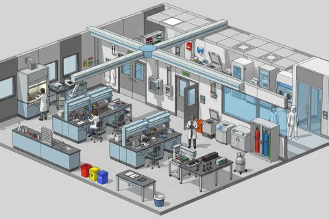

# Research Lab

In production, 61 parts so far. Every part below is already free to use.

[Open the kit on Polyfork](https://polyfork.dev/kit/research-lab-9b9b5d) · [All kits](../README.md#kits)

<table>
<tr>
<td align="center" valign="top" width="25%"> <a href="https://polyfork.dev/asset/air-shower-airlock-cabin-ed83ae">Air Shower Airlock Cabin</a> <a href="https://polyfork.dev/cdn/air-shower-airlock-cabin-ed83ae.glb">GLB</a> · <a href="https://polyfork.dev/cdn/air-shower-airlock-cabin-ed83ae.mjs">module</a></td>
<td align="center" valign="top" width="25%"> <a href="https://polyfork.dev/asset/analytical-balance-105d5c">Analytical Balance</a> <a href="https://polyfork.dev/cdn/analytical-balance-105d5c.glb">GLB</a> · <a href="https://polyfork.dev/cdn/analytical-balance-105d5c.mjs">module</a></td>
<td align="center" valign="top" width="25%"> <a href="https://polyfork.dev/asset/autoclave-d34434">Autoclave</a> <a href="https://polyfork.dev/cdn/autoclave-d34434.glb">GLB</a> · <a href="https://polyfork.dev/cdn/autoclave-d34434.mjs">module</a></td>
<td align="center" valign="top" width="25%"> <a href="https://polyfork.dev/asset/bench-researcher-d0f1b9">Bench Researcher</a> <a href="https://polyfork.dev/cdn/bench-researcher-d0f1b9.glb">GLB</a> · <a href="https://polyfork.dev/cdn/bench-researcher-d0f1b9.mjs">module</a></td>
</tr>
<tr>
<td align="center" valign="top" width="25%"> <a href="https://polyfork.dev/asset/bench-tablet-21c208">Bench Tablet</a> <a href="https://polyfork.dev/cdn/bench-tablet-21c208.glb">GLB</a> · <a href="https://polyfork.dev/cdn/bench-tablet-21c208.mjs">module</a></td>
<td align="center" valign="top" width="25%"> <a href="https://polyfork.dev/asset/benchtop-ph-meter-cf8b26">Benchtop pH Meter</a> <a href="https://polyfork.dev/cdn/benchtop-ph-meter-cf8b26.glb">GLB</a> · <a href="https://polyfork.dev/cdn/benchtop-ph-meter-cf8b26.mjs">module</a></td>
<td align="center" valign="top" width="25%"> <a href="https://polyfork.dev/asset/biosafety-cabinet-a46204">Biosafety Cabinet</a> <a href="https://polyfork.dev/cdn/biosafety-cabinet-a46204.glb">GLB</a> · <a href="https://polyfork.dev/cdn/biosafety-cabinet-a46204.mjs">module</a></td>
<td align="center" valign="top" width="25%"> <a href="https://polyfork.dev/asset/ceiling-tile-blank-dca1d2">Ceiling Tile</a> <a href="https://polyfork.dev/cdn/ceiling-tile-blank-dca1d2.glb">GLB</a> · <a href="https://polyfork.dev/cdn/ceiling-tile-blank-dca1d2.mjs">module</a></td>
</tr>
<tr>
<td align="center" valign="top" width="25%"> <a href="https://polyfork.dev/asset/centrifuge-benchtop-b76ef2">Centrifuge</a> <a href="https://polyfork.dev/cdn/centrifuge-benchtop-b76ef2.glb">GLB</a> · <a href="https://polyfork.dev/cdn/centrifuge-benchtop-b76ef2.mjs">module</a></td>
<td align="center" valign="top" width="25%"> <a href="https://polyfork.dev/asset/chemical-shelving-rack-3a188c">Chemical Shelving Rack</a> <a href="https://polyfork.dev/cdn/chemical-shelving-rack-3a188c.glb">GLB</a> · <a href="https://polyfork.dev/cdn/chemical-shelving-rack-3a188c.mjs">module</a></td>
<td align="center" valign="top" width="25%"> <a href="https://polyfork.dev/asset/chemical-spill-kit-3c71d9">Chemical Spill Kit</a> <a href="https://polyfork.dev/cdn/chemical-spill-kit-3c71d9.glb">GLB</a> · <a href="https://polyfork.dev/cdn/chemical-spill-kit-3c71d9.mjs">module</a></td>
<td align="center" valign="top" width="25%"> <a href="https://polyfork.dev/asset/clean-room-technician-da290a">Clean-Room Technician</a> <a href="https://polyfork.dev/cdn/clean-room-technician-da290a.glb">GLB</a> · <a href="https://polyfork.dev/cdn/clean-room-technician-da290a.mjs">module</a></td>
</tr>
<tr>
<td align="center" valign="top" width="25%"> <a href="https://polyfork.dev/asset/cleanroom-partition-solid-a2afb1">Cleanroom Partition</a> <a href="https://polyfork.dev/cdn/cleanroom-partition-solid-a2afb1.glb">GLB</a> · <a href="https://polyfork.dev/cdn/cleanroom-partition-solid-a2afb1.mjs">module</a></td>
<td align="center" valign="top" width="25%"> <a href="https://polyfork.dev/asset/co2-incubator-198c16">CO2 Incubator</a> <a href="https://polyfork.dev/cdn/co2-incubator-198c16.glb">GLB</a> · <a href="https://polyfork.dev/cdn/co2-incubator-198c16.mjs">module</a></td>
<td align="center" valign="top" width="25%"> <a href="https://polyfork.dev/asset/door-set-single-swing-d50024">Door Set</a> <a href="https://polyfork.dev/cdn/door-set-single-swing-d50024.glb">GLB</a> · <a href="https://polyfork.dev/cdn/door-set-single-swing-d50024.mjs">module</a></td>
<td align="center" valign="top" width="25%"> <a href="https://polyfork.dev/asset/fire-point-station-dfd230">Fire Point Station</a> <a href="https://polyfork.dev/cdn/fire-point-station-dfd230.glb">GLB</a> · <a href="https://polyfork.dev/cdn/fire-point-station-dfd230.mjs">module</a></td>
</tr>
<tr>
<td align="center" valign="top" width="25%"> <a href="https://polyfork.dev/asset/fume-extraction-arm-ceiling-c5bd3e">Fume Extraction Arm (Ceiling)</a> <a href="https://polyfork.dev/cdn/fume-extraction-arm-ceiling-c5bd3e.glb">GLB</a> · <a href="https://polyfork.dev/cdn/fume-extraction-arm-ceiling-c5bd3e.mjs">module</a></td>
<td align="center" valign="top" width="25%"> <a href="https://polyfork.dev/asset/gas-cylinder-cabinet-cea23b">Gas Cylinder Cabinet</a> <a href="https://polyfork.dev/cdn/gas-cylinder-cabinet-cea23b.glb">GLB</a> · <a href="https://polyfork.dev/cdn/gas-cylinder-cabinet-cea23b.mjs">module</a></td>
<td align="center" valign="top" width="25%"> <a href="https://polyfork.dev/asset/glass-door-sample-fridge-386715">Glass-Door Sample Fridge</a> <a href="https://polyfork.dev/cdn/glass-door-sample-fridge-386715.glb">GLB</a> · <a href="https://polyfork.dev/cdn/glass-door-sample-fridge-386715.mjs">module</a></td>
<td align="center" valign="top" width="25%"> <a href="https://polyfork.dev/asset/glassware-set-on-rack-963f2d">Glassware Set on Rack</a> <a href="https://polyfork.dev/cdn/glassware-set-on-rack-963f2d.glb">GLB</a> · <a href="https://polyfork.dev/cdn/glassware-set-on-rack-963f2d.mjs">module</a></td>
</tr>
<tr>
<td align="center" valign="top" width="25%"> <a href="https://polyfork.dev/asset/glove-dispenser-rack-11419e">Glove Dispenser Rack</a> <a href="https://polyfork.dev/cdn/glove-dispenser-rack-11419e.glb">GLB</a> · <a href="https://polyfork.dev/cdn/glove-dispenser-rack-11419e.mjs">module</a></td>
<td align="center" valign="top" width="25%"> <a href="https://polyfork.dev/asset/glovebox-737c45">Glovebox</a> <a href="https://polyfork.dev/cdn/glovebox-737c45.glb">GLB</a> · <a href="https://polyfork.dev/cdn/glovebox-737c45.mjs">module</a></td>
<td align="center" valign="top" width="25%"> <a href="https://polyfork.dev/asset/graduate-student-945ef0">Graduate Student</a> <a href="https://polyfork.dev/cdn/graduate-student-945ef0.glb">GLB</a> · <a href="https://polyfork.dev/cdn/graduate-student-945ef0.mjs">module</a></td>
<td align="center" valign="top" width="25%"> <a href="https://polyfork.dev/asset/hazard-sign-plate-d54657">Hazard Sign Plate</a> <a href="https://polyfork.dev/cdn/hazard-sign-plate-d54657.glb">GLB</a> · <a href="https://polyfork.dev/cdn/hazard-sign-plate-d54657.mjs">module</a></td>
</tr>
<tr>
<td align="center" valign="top" width="25%"> <a href="https://polyfork.dev/asset/ice-bucket-1dd869">Ice Bucket</a> <a href="https://polyfork.dev/cdn/ice-bucket-1dd869.glb">GLB</a> · <a href="https://polyfork.dev/cdn/ice-bucket-1dd869.mjs">module</a></td>
<td align="center" valign="top" width="25%"> <a href="https://polyfork.dev/asset/island-bench-spine-d046b2">Island Bench Spine</a> <a href="https://polyfork.dev/cdn/island-bench-spine-d046b2.glb">GLB</a> · <a href="https://polyfork.dev/cdn/island-bench-spine-d046b2.mjs">module</a></td>
<td align="center" valign="top" width="25%"> <a href="https://polyfork.dev/asset/lab-coat-rack-a089e3">Lab Coat Rack</a> <a href="https://polyfork.dev/cdn/lab-coat-rack-a089e3.glb">GLB</a> · <a href="https://polyfork.dev/cdn/lab-coat-rack-a089e3.mjs">module</a></td>
<td align="center" valign="top" width="25%"> <a href="https://polyfork.dev/asset/lab-floor-tile-ad0da8">Lab Floor Tile</a> <a href="https://polyfork.dev/cdn/lab-floor-tile-ad0da8.glb">GLB</a> · <a href="https://polyfork.dev/cdn/lab-floor-tile-ad0da8.mjs">module</a></td>
</tr>
<tr>
<td align="center" valign="top" width="25%"> <a href="https://polyfork.dev/asset/lab-notebook-e60f7a">Lab Notebook</a> <a href="https://polyfork.dev/cdn/lab-notebook-e60f7a.glb">GLB</a> · <a href="https://polyfork.dev/cdn/lab-notebook-e60f7a.mjs">module</a></td>
<td align="center" valign="top" width="25%"> <a href="https://polyfork.dev/asset/lab-stool-022713">Lab Stool</a> <a href="https://polyfork.dev/cdn/lab-stool-022713.glb">GLB</a> · <a href="https://polyfork.dev/cdn/lab-stool-022713.mjs">module</a></td>
<td align="center" valign="top" width="25%"> <a href="https://polyfork.dev/asset/lab-wall-solid-8bd631">Lab Wall</a> <a href="https://polyfork.dev/cdn/lab-wall-solid-8bd631.glb">GLB</a> · <a href="https://polyfork.dev/cdn/lab-wall-solid-8bd631.mjs">module</a></td>
<td align="center" valign="top" width="25%"> <a href="https://polyfork.dev/asset/laminar-flow-hood-d730bd">Laminar Flow Hood</a> <a href="https://polyfork.dev/cdn/laminar-flow-hood-d730bd.glb">GLB</a> · <a href="https://polyfork.dev/cdn/laminar-flow-hood-d730bd.mjs">module</a></td>
</tr>
<tr>
<td align="center" valign="top" width="25%"> <a href="https://polyfork.dev/asset/liquid-handling-robot-c42a98">Liquid Handling Robot</a> <a href="https://polyfork.dev/cdn/liquid-handling-robot-c42a98.glb">GLB</a> · <a href="https://polyfork.dev/cdn/liquid-handling-robot-c42a98.mjs">module</a></td>
<td align="center" valign="top" width="25%"> <a href="https://polyfork.dev/asset/magnetic-stirrer-hotplate-e88575">Magnetic Stirrer Hotplate</a> <a href="https://polyfork.dev/cdn/magnetic-stirrer-hotplate-e88575.glb">GLB</a> · <a href="https://polyfork.dev/cdn/magnetic-stirrer-hotplate-e88575.mjs">module</a></td>
<td align="center" valign="top" width="25%"> <a href="https://polyfork.dev/asset/mobile-bench-cart-4b3ff5">Mobile Bench Cart</a> <a href="https://polyfork.dev/cdn/mobile-bench-cart-4b3ff5.glb">GLB</a> · <a href="https://polyfork.dev/cdn/mobile-bench-cart-4b3ff5.mjs">module</a></td>
<td align="center" valign="top" width="25%"> <a href="https://polyfork.dev/asset/nitrogen-dewar-wheeled-c9986e">Nitrogen Dewar (Wheeled)</a> <a href="https://polyfork.dev/cdn/nitrogen-dewar-wheeled-c9986e.glb">GLB</a> · <a href="https://polyfork.dev/cdn/nitrogen-dewar-wheeled-c9986e.mjs">module</a></td>
</tr>
<tr>
<td align="center" valign="top" width="25%"> <a href="https://polyfork.dev/asset/optics-table-66db15">Optics Table</a> <a href="https://polyfork.dev/cdn/optics-table-66db15.glb">GLB</a> · <a href="https://polyfork.dev/cdn/optics-table-66db15.mjs">module</a></td>
<td align="center" valign="top" width="25%"> <a href="https://polyfork.dev/asset/oscilloscope-bench-station-495b09">Oscilloscope Bench Station</a> <a href="https://polyfork.dev/cdn/oscilloscope-bench-station-495b09.glb">GLB</a> · <a href="https://polyfork.dev/cdn/oscilloscope-bench-station-495b09.mjs">module</a></td>
<td align="center" valign="top" width="25%"> <a href="https://polyfork.dev/asset/overhead-service-spine-04edae">Overhead Service Spine</a> <a href="https://polyfork.dev/cdn/overhead-service-spine-04edae.glb">GLB</a> · <a href="https://polyfork.dev/cdn/overhead-service-spine-04edae.mjs">module</a></td>
<td align="center" valign="top" width="25%"> <a href="https://polyfork.dev/asset/pass-box-hatch-3588d9">Pass-Box Hatch</a> <a href="https://polyfork.dev/cdn/pass-box-hatch-3588d9.glb">GLB</a> · <a href="https://polyfork.dev/cdn/pass-box-hatch-3588d9.mjs">module</a></td>
</tr>
<tr>
<td align="center" valign="top" width="25%"> <a href="https://polyfork.dev/asset/petri-dish-stack-cea273">Petri Dish Stack</a> <a href="https://polyfork.dev/cdn/petri-dish-stack-cea273.glb">GLB</a> · <a href="https://polyfork.dev/cdn/petri-dish-stack-cea273.mjs">module</a></td>
<td align="center" valign="top" width="25%"> <a href="https://polyfork.dev/asset/pipette-stand-with-four-a6856c">Pipette Stand with Four Pipettes</a> <a href="https://polyfork.dev/cdn/pipette-stand-with-four-a6856c.glb">GLB</a> · <a href="https://polyfork.dev/cdn/pipette-stand-with-four-a6856c.mjs">module</a></td>
<td align="center" valign="top" width="25%"> <a href="https://polyfork.dev/asset/ppe-dispenser-station-922eaf">PPE Dispenser Station</a> <a href="https://polyfork.dev/cdn/ppe-dispenser-station-922eaf.glb">GLB</a> · <a href="https://polyfork.dev/cdn/ppe-dispenser-station-922eaf.mjs">module</a></td>
<td align="center" valign="top" width="25%"> <a href="https://polyfork.dev/asset/ppe-locker-bank-60dd99">PPE Locker Bank</a> <a href="https://polyfork.dev/cdn/ppe-locker-bank-60dd99.glb">GLB</a> · <a href="https://polyfork.dev/cdn/ppe-locker-bank-60dd99.mjs">module</a></td>
</tr>
<tr>
<td align="center" valign="top" width="25%"> <a href="https://polyfork.dev/asset/reagent-bottle-shelf-8fd723">Reagent Bottle Shelf</a> <a href="https://polyfork.dev/cdn/reagent-bottle-shelf-8fd723.glb">GLB</a> · <a href="https://polyfork.dev/cdn/reagent-bottle-shelf-8fd723.mjs">module</a></td>
<td align="center" valign="top" width="25%"> <a href="https://polyfork.dev/asset/research-microscope-77ce04">Research Microscope</a> <a href="https://polyfork.dev/cdn/research-microscope-77ce04.glb">GLB</a> · <a href="https://polyfork.dev/cdn/research-microscope-77ce04.mjs">module</a></td>
<td align="center" valign="top" width="25%"> <a href="https://polyfork.dev/asset/safety-shower-and-eyewash-1f5f20">Safety Shower and Eyewash</a> <a href="https://polyfork.dev/cdn/safety-shower-and-eyewash-1f5f20.glb">GLB</a> · <a href="https://polyfork.dev/cdn/safety-shower-and-eyewash-1f5f20.mjs">module</a></td>
<td align="center" valign="top" width="25%"> <a href="https://polyfork.dev/asset/sample-tube-rack-3a32bd">Sample Tube Rack</a> <a href="https://polyfork.dev/cdn/sample-tube-rack-3a32bd.glb">GLB</a> · <a href="https://polyfork.dev/cdn/sample-tube-rack-3a32bd.mjs">module</a></td>
</tr>
<tr>
<td align="center" valign="top" width="25%"> <a href="https://polyfork.dev/asset/senior-scientist-631736">Senior Scientist</a> <a href="https://polyfork.dev/cdn/senior-scientist-631736.glb">GLB</a> · <a href="https://polyfork.dev/cdn/senior-scientist-631736.mjs">module</a></td>
<td align="center" valign="top" width="25%"> <a href="https://polyfork.dev/asset/sink-unit-with-drying-c5d11a">Sink Unit with Drying Rack</a> <a href="https://polyfork.dev/cdn/sink-unit-with-drying-c5d11a.glb">GLB</a> · <a href="https://polyfork.dev/cdn/sink-unit-with-drying-c5d11a.mjs">module</a></td>
<td align="center" valign="top" width="25%"> <a href="https://polyfork.dev/asset/spectrophotometer-f79c78">Spectrophotometer</a> <a href="https://polyfork.dev/cdn/spectrophotometer-f79c78.glb">GLB</a> · <a href="https://polyfork.dev/cdn/spectrophotometer-f79c78.mjs">module</a></td>
<td align="center" valign="top" width="25%"> <a href="https://polyfork.dev/asset/thermocycler-514a6d">Thermocycler</a> <a href="https://polyfork.dev/cdn/thermocycler-514a6d.glb">GLB</a> · <a href="https://polyfork.dev/cdn/thermocycler-514a6d.mjs">module</a></td>
</tr>
<tr>
<td align="center" valign="top" width="25%"> <a href="https://polyfork.dev/asset/ultra-low-freezer-9a84fb">Ultra-Low Freezer</a> <a href="https://polyfork.dev/cdn/ultra-low-freezer-9a84fb.glb">GLB</a> · <a href="https://polyfork.dev/cdn/ultra-low-freezer-9a84fb.mjs">module</a></td>
<td align="center" valign="top" width="25%"> <a href="https://polyfork.dev/asset/under-bench-drawer-cabinet-2d0573">Under-Bench Drawer Cabinet</a> <a href="https://polyfork.dev/cdn/under-bench-drawer-cabinet-2d0573.glb">GLB</a> · <a href="https://polyfork.dev/cdn/under-bench-drawer-cabinet-2d0573.mjs">module</a></td>
<td align="center" valign="top" width="25%"> <a href="https://polyfork.dev/asset/vented-chemical-storage-cabinet-91b061">Vented Chemical Storage Cabinet</a> <a href="https://polyfork.dev/cdn/vented-chemical-storage-cabinet-91b061.glb">GLB</a> · <a href="https://polyfork.dev/cdn/vented-chemical-storage-cabinet-91b061.mjs">module</a></td>
<td align="center" valign="top" width="25%"> <a href="https://polyfork.dev/asset/vortex-mixer-16aaab">Vortex Mixer</a> <a href="https://polyfork.dev/cdn/vortex-mixer-16aaab.glb">GLB</a> · <a href="https://polyfork.dev/cdn/vortex-mixer-16aaab.mjs">module</a></td>
</tr>
<tr>
<td align="center" valign="top" width="25%"> <a href="https://polyfork.dev/asset/walk-in-fume-hood-bbc294">Walk-in Fume Hood</a> <a href="https://polyfork.dev/cdn/walk-in-fume-hood-bbc294.glb">GLB</a> · <a href="https://polyfork.dev/cdn/walk-in-fume-hood-bbc294.mjs">module</a></td>
<td align="center" valign="top" width="25%"> <a href="https://polyfork.dev/asset/wall-bench-spine-8c30d2">Wall Bench Spine</a> <a href="https://polyfork.dev/cdn/wall-bench-spine-8c30d2.glb">GLB</a> · <a href="https://polyfork.dev/cdn/wall-bench-spine-8c30d2.mjs">module</a></td>
<td align="center" valign="top" width="25%"> <a href="https://polyfork.dev/asset/wash-bottle-set-88f3aa">Wash Bottle Set</a> <a href="https://polyfork.dev/cdn/wash-bottle-set-88f3aa.glb">GLB</a> · <a href="https://polyfork.dev/cdn/wash-bottle-set-88f3aa.mjs">module</a></td>
<td align="center" valign="top" width="25%"> <a href="https://polyfork.dev/asset/waste-bin-sharps-bca988">Waste Bin</a> <a href="https://polyfork.dev/cdn/waste-bin-sharps-bca988.glb">GLB</a> · <a href="https://polyfork.dev/cdn/waste-bin-sharps-bca988.mjs">module</a></td>
</tr>
<tr>
<td align="center" valign="top" width="25%"> <a href="https://polyfork.dev/asset/write-up-desk-38763a">Write-up Desk</a> <a href="https://polyfork.dev/cdn/write-up-desk-38763a.glb">GLB</a> · <a href="https://polyfork.dev/cdn/write-up-desk-38763a.mjs">module</a></td>
</tr>
</table>
