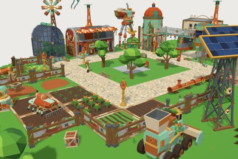

# Sky Town

62 free low-poly parts on one palette and one scale, so everything you combine belongs to the same world.

[Open the kit on Polyfork](https://polyfork.dev/kit/salvage-commons-d0be9f) · [All kits](../README.md#kits)

<table>
<tr>
<td align="center" valign="top" width="25%"> <a href="https://polyfork.dev/asset/arch-gatehouse-f4391b">Arch gatehouse</a> <a href="https://polyfork.dev/cdn/arch-gatehouse-f4391b.glb">GLB</a> · <a href="https://polyfork.dev/cdn/arch-gatehouse-f4391b.mjs">module</a></td>
<td align="center" valign="top" width="25%"> <a href="https://polyfork.dev/asset/bed-crop-plant-1d5ab7">Bed crop plant</a> <a href="https://polyfork.dev/cdn/bed-crop-plant-1d5ab7.glb">GLB</a> · <a href="https://polyfork.dev/cdn/bed-crop-plant-1d5ab7.mjs">module</a></td>
<td align="center" valign="top" width="25%"> <a href="https://polyfork.dev/asset/bolted-ladder-da8166">Bolted ladder</a> <a href="https://polyfork.dev/cdn/bolted-ladder-da8166.glb">GLB</a> · <a href="https://polyfork.dev/cdn/bolted-ladder-da8166.mjs">module</a></td>
<td align="center" valign="top" width="25%"> <a href="https://polyfork.dev/asset/brass-post-lamp-984201">Brass post lamp</a> <a href="https://polyfork.dev/cdn/brass-post-lamp-984201.glb">GLB</a> · <a href="https://polyfork.dev/cdn/brass-post-lamp-984201.mjs">module</a></td>
</tr>
<tr>
<td align="center" valign="top" width="25%"> <a href="https://polyfork.dev/asset/brass-water-tower-b0c6d9">Brass water tower</a> <a href="https://polyfork.dev/cdn/brass-water-tower-b0c6d9.glb">GLB</a> · <a href="https://polyfork.dev/cdn/brass-water-tower-b0c6d9.mjs">module</a></td>
<td align="center" valign="top" width="25%"> <a href="https://polyfork.dev/asset/brass-fitted-water-butt-3bca1b">Brass-fitted water butt</a> <a href="https://polyfork.dev/cdn/brass-fitted-water-butt-3bca1b.glb">GLB</a> · <a href="https://polyfork.dev/cdn/brass-fitted-water-butt-3bca1b.mjs">module</a></td>
<td align="center" valign="top" width="25%"> <a href="https://polyfork.dev/asset/cargo-trailer-213847">Cargo trailer</a> <a href="https://polyfork.dev/cdn/cargo-trailer-213847.glb">GLB</a> · <a href="https://polyfork.dev/cdn/cargo-trailer-213847.mjs">module</a></td>
<td align="center" valign="top" width="25%"> <a href="https://polyfork.dev/asset/cargo-walker-6b8a31">Cargo walker</a> <a href="https://polyfork.dev/cdn/cargo-walker-6b8a31.glb">GLB</a> · <a href="https://polyfork.dev/cdn/cargo-walker-6b8a31.mjs">module</a></td>
</tr>
<tr>
<td align="center" valign="top" width="25%"> <a href="https://polyfork.dev/asset/catwalk-corner-ae4630">Catwalk corner</a> <a href="https://polyfork.dev/cdn/catwalk-corner-ae4630.glb">GLB</a> · <a href="https://polyfork.dev/cdn/catwalk-corner-ae4630.mjs">module</a></td>
<td align="center" valign="top" width="25%"> <a href="https://polyfork.dev/asset/catwalk-gantry-run-f23cac">Catwalk gantry run</a> <a href="https://polyfork.dev/cdn/catwalk-gantry-run-f23cac.glb">GLB</a> · <a href="https://polyfork.dev/cdn/catwalk-gantry-run-f23cac.mjs">module</a></td>
<td align="center" valign="top" width="25%"> <a href="https://polyfork.dev/asset/companion-bot-170074">Companion bot</a> <a href="https://polyfork.dev/cdn/companion-bot-170074.glb">GLB</a> · <a href="https://polyfork.dev/cdn/companion-bot-170074.mjs">module</a></td>
<td align="center" valign="top" width="25%"> <a href="https://polyfork.dev/asset/copper-dome-dwelling-dc8848">Copper dome dwelling</a> <a href="https://polyfork.dev/cdn/copper-dome-dwelling-dc8848.glb">GLB</a> · <a href="https://polyfork.dev/cdn/copper-dome-dwelling-dc8848.mjs">module</a></td>
</tr>
<tr>
<td align="center" valign="top" width="25%"> <a href="https://polyfork.dev/asset/corrugated-awning-e758eb">Corrugated awning</a> <a href="https://polyfork.dev/cdn/corrugated-awning-e758eb.glb">GLB</a> · <a href="https://polyfork.dev/cdn/corrugated-awning-e758eb.mjs">module</a></td>
<td align="center" valign="top" width="25%"> <a href="https://polyfork.dev/asset/cowled-chimney-stack-de5055">Cowled chimney stack</a> <a href="https://polyfork.dev/cdn/cowled-chimney-stack-de5055.glb">GLB</a> · <a href="https://polyfork.dev/cdn/cowled-chimney-stack-de5055.mjs">module</a></td>
<td align="center" valign="top" width="25%"> <a href="https://polyfork.dev/asset/cut-open-drum-planter-7c42e7">Cut-open drum planter</a> <a href="https://polyfork.dev/cdn/cut-open-drum-planter-7c42e7.glb">GLB</a> · <a href="https://polyfork.dev/cdn/cut-open-drum-planter-7c42e7.mjs">module</a></td>
<td align="center" valign="top" width="25%"> <a href="https://polyfork.dev/asset/drum-wheel-harvester-0408c0">Drum-wheel harvester</a> <a href="https://polyfork.dev/cdn/drum-wheel-harvester-0408c0.glb">GLB</a> · <a href="https://polyfork.dev/cdn/drum-wheel-harvester-0408c0.mjs">module</a></td>
</tr>
<tr>
<td align="center" valign="top" width="25%"> <a href="https://polyfork.dev/asset/external-spiral-stair-e98a0a">External spiral stair</a> <a href="https://polyfork.dev/cdn/external-spiral-stair-e98a0a.glb">GLB</a> · <a href="https://polyfork.dev/cdn/external-spiral-stair-e98a0a.mjs">module</a></td>
<td align="center" valign="top" width="25%"> <a href="https://polyfork.dev/asset/field-rock-5e37c6">Field rock</a> <a href="https://polyfork.dev/cdn/field-rock-5e37c6.glb">GLB</a> · <a href="https://polyfork.dev/cdn/field-rock-5e37c6.mjs">module</a></td>
<td align="center" valign="top" width="25%"> <a href="https://polyfork.dev/asset/fruit-tree-4bb1af">Fruit tree</a> <a href="https://polyfork.dev/cdn/fruit-tree-4bb1af.glb">GLB</a> · <a href="https://polyfork.dev/cdn/fruit-tree-4bb1af.mjs">module</a></td>
<td align="center" valign="top" width="25%"> <a href="https://polyfork.dev/asset/gantry-loft-8da389">Gantry loft</a> <a href="https://polyfork.dev/cdn/gantry-loft-8da389.glb">GLB</a> · <a href="https://polyfork.dev/cdn/gantry-loft-8da389.mjs">module</a></td>
</tr>
<tr>
<td align="center" valign="top" width="25%"> <a href="https://polyfork.dev/asset/gauge-and-valve-panel-f2164c">Gauge and valve panel</a> <a href="https://polyfork.dev/cdn/gauge-and-valve-panel-f2164c.glb">GLB</a> · <a href="https://polyfork.dev/cdn/gauge-and-valve-panel-f2164c.mjs">module</a></td>
<td align="center" valign="top" width="25%"> <a href="https://polyfork.dev/asset/glass-cold-frame-3cf74e">Glass cold frame</a> <a href="https://polyfork.dev/cdn/glass-cold-frame-3cf74e.glb">GLB</a> · <a href="https://polyfork.dev/cdn/glass-cold-frame-3cf74e.mjs">module</a></td>
<td align="center" valign="top" width="25%"> <a href="https://polyfork.dev/asset/glass-conservatory-a938d5">Glass conservatory</a> <a href="https://polyfork.dev/cdn/glass-conservatory-a938d5.glb">GLB</a> · <a href="https://polyfork.dev/cdn/glass-conservatory-a938d5.mjs">module</a></td>
<td align="center" valign="top" width="25%"> <a href="https://polyfork.dev/asset/grass-tuft-62e90c">Grass tuft</a> <a href="https://polyfork.dev/cdn/grass-tuft-62e90c.glb">GLB</a> · <a href="https://polyfork.dev/cdn/grass-tuft-62e90c.mjs">module</a></td>
</tr>
<tr>
<td align="center" valign="top" width="25%"> <a href="https://polyfork.dev/asset/gravel-tile-4a99d0">Gravel tile</a> <a href="https://polyfork.dev/cdn/gravel-tile-4a99d0.glb">GLB</a> · <a href="https://polyfork.dev/cdn/gravel-tile-4a99d0.mjs">module</a></td>
<td align="center" valign="top" width="25%"> <a href="https://polyfork.dev/asset/grown-over-dirt-tile-ea4ea0">Grown-over dirt tile</a> <a href="https://polyfork.dev/cdn/grown-over-dirt-tile-ea4ea0.glb">GLB</a> · <a href="https://polyfork.dev/cdn/grown-over-dirt-tile-ea4ea0.mjs">module</a></td>
<td align="center" valign="top" width="25%"> <a href="https://polyfork.dev/asset/leafy-bush-d37bba">Leafy bush</a> <a href="https://polyfork.dev/cdn/leafy-bush-d37bba.glb">GLB</a> · <a href="https://polyfork.dev/cdn/leafy-bush-d37bba.mjs">module</a></td>
<td align="center" valign="top" width="25%"> <a href="https://polyfork.dev/asset/ledge-planter-box-2f38f5">Ledge planter box</a> <a href="https://polyfork.dev/cdn/ledge-planter-box-2f38f5.glb">GLB</a> · <a href="https://polyfork.dev/cdn/ledge-planter-box-2f38f5.mjs">module</a></td>
</tr>
<tr>
<td align="center" valign="top" width="25%"> <a href="https://polyfork.dev/asset/lighter-than-air-tender-0c7361">Lighter-than-air tender</a> <a href="https://polyfork.dev/cdn/lighter-than-air-tender-0c7361.glb">GLB</a> · <a href="https://polyfork.dev/cdn/lighter-than-air-tender-0c7361.mjs">module</a></td>
<td align="center" valign="top" width="25%"> <a href="https://polyfork.dev/asset/towering-cloud-2e00f1">Low-poly cloud</a> <a href="https://polyfork.dev/cdn/towering-cloud-2e00f1.glb">GLB</a> · <a href="https://polyfork.dev/cdn/towering-cloud-2e00f1.mjs">module</a></td>
<td align="center" valign="top" width="25%"> <a href="https://polyfork.dev/asset/machine-shed-be7361">Machine shed</a> <a href="https://polyfork.dev/cdn/machine-shed-be7361.glb">GLB</a> · <a href="https://polyfork.dev/cdn/machine-shed-be7361.mjs">module</a></td>
<td align="center" valign="top" width="25%"> <a href="https://polyfork.dev/asset/meadow-tile-d0d82a">Meadow tile</a> <a href="https://polyfork.dev/cdn/meadow-tile-d0d82a.glb">GLB</a> · <a href="https://polyfork.dev/cdn/meadow-tile-d0d82a.mjs">module</a></td>
</tr>
<tr>
<td align="center" valign="top" width="25%"> <a href="https://polyfork.dev/asset/multi-legged-tiller-24ca96">Multi-legged tiller</a> <a href="https://polyfork.dev/cdn/multi-legged-tiller-24ca96.glb">GLB</a> · <a href="https://polyfork.dev/cdn/multi-legged-tiller-24ca96.mjs">module</a></td>
<td align="center" valign="top" width="25%"> <a href="https://polyfork.dev/asset/oil-drum-wind-spinner-7c1a9d">Oil-drum wind spinner</a> <a href="https://polyfork.dev/cdn/oil-drum-wind-spinner-7c1a9d.glb">GLB</a> · <a href="https://polyfork.dev/cdn/oil-drum-wind-spinner-7c1a9d.mjs">module</a></td>
<td align="center" valign="top" width="25%"> <a href="https://polyfork.dev/asset/old-world-concrete-tile-55e7a0">Old-world concrete tile</a> <a href="https://polyfork.dev/cdn/old-world-concrete-tile-55e7a0.glb">GLB</a> · <a href="https://polyfork.dev/cdn/old-world-concrete-tile-55e7a0.mjs">module</a></td>
<td align="center" valign="top" width="25%"> <a href="https://polyfork.dev/asset/pipe-junction-5b146a">Pipe junction</a> <a href="https://polyfork.dev/cdn/pipe-junction-5b146a.glb">GLB</a> · <a href="https://polyfork.dev/cdn/pipe-junction-5b146a.mjs">module</a></td>
</tr>
<tr>
<td align="center" valign="top" width="25%"> <a href="https://polyfork.dev/asset/pipe-run-280a0d">Pipe run</a> <a href="https://polyfork.dev/cdn/pipe-run-280a0d.glb">GLB</a> · <a href="https://polyfork.dev/cdn/pipe-run-280a0d.mjs">module</a></td>
<td align="center" valign="top" width="25%"> <a href="https://polyfork.dev/asset/plate-cottage-9b52be">Plate cottage</a> <a href="https://polyfork.dev/cdn/plate-cottage-9b52be.glb">GLB</a> · <a href="https://polyfork.dev/cdn/plate-cottage-9b52be.mjs">module</a></td>
<td align="center" valign="top" width="25%"> <a href="https://polyfork.dev/asset/riveted-boiler-hall-da0c09">Riveted boiler hall</a> <a href="https://polyfork.dev/cdn/riveted-boiler-hall-da0c09.glb">GLB</a> · <a href="https://polyfork.dev/cdn/riveted-boiler-hall-da0c09.mjs">module</a></td>
<td align="center" valign="top" width="25%"> <a href="https://polyfork.dev/asset/rolled-plate-silo-42304a">Rolled plate silo</a> <a href="https://polyfork.dev/cdn/rolled-plate-silo-42304a.glb">GLB</a> · <a href="https://polyfork.dev/cdn/rolled-plate-silo-42304a.mjs">module</a></td>
</tr>
<tr>
<td align="center" valign="top" width="25%"> <a href="https://polyfork.dev/asset/roof-solar-array-c4b996">Roof solar array</a> <a href="https://polyfork.dev/cdn/roof-solar-array-c4b996.glb">GLB</a> · <a href="https://polyfork.dev/cdn/roof-solar-array-c4b996.mjs">module</a></td>
<td align="center" valign="top" width="25%"> <a href="https://polyfork.dev/asset/rooted-gantry-arm-f35c8f">Rooted gantry arm</a> <a href="https://polyfork.dev/cdn/rooted-gantry-arm-f35c8f.glb">GLB</a> · <a href="https://polyfork.dev/cdn/rooted-gantry-arm-f35c8f.mjs">module</a></td>
<td align="center" valign="top" width="25%"> <a href="https://polyfork.dev/asset/salvage-crate-3a7e1d">Salvage crate</a> <a href="https://polyfork.dev/cdn/salvage-crate-3a7e1d.glb">GLB</a> · <a href="https://polyfork.dev/cdn/salvage-crate-3a7e1d.mjs">module</a></td>
<td align="center" valign="top" width="25%"> <a href="https://polyfork.dev/asset/salvage-fence-gate-42350a">Salvage fence gate</a> <a href="https://polyfork.dev/cdn/salvage-fence-gate-42350a.glb">GLB</a> · <a href="https://polyfork.dev/cdn/salvage-fence-gate-42350a.mjs">module</a></td>
</tr>
<tr>
<td align="center" valign="top" width="25%"> <a href="https://polyfork.dev/asset/salvage-fence-run-e9538a">Salvage fence run</a> <a href="https://polyfork.dev/cdn/salvage-fence-run-e9538a.glb">GLB</a> · <a href="https://polyfork.dev/cdn/salvage-fence-run-e9538a.mjs">module</a></td>
<td align="center" valign="top" width="25%"> <a href="https://polyfork.dev/asset/salvage-hand-cart-222304">Salvage hand cart</a> <a href="https://polyfork.dev/cdn/salvage-hand-cart-222304.glb">GLB</a> · <a href="https://polyfork.dev/cdn/salvage-hand-cart-222304.mjs">module</a></td>
<td align="center" valign="top" width="25%"> <a href="https://polyfork.dev/asset/salvage-scarecrow-eec74d">Salvage scarecrow</a> <a href="https://polyfork.dev/cdn/salvage-scarecrow-eec74d.glb">GLB</a> · <a href="https://polyfork.dev/cdn/salvage-scarecrow-eec74d.mjs">module</a></td>
<td align="center" valign="top" width="25%"> <a href="https://polyfork.dev/asset/scrap-built-aeroplane-65ac95">Scrap-built aeroplane</a> <a href="https://polyfork.dev/cdn/scrap-built-aeroplane-65ac95.glb">GLB</a> · <a href="https://polyfork.dev/cdn/scrap-built-aeroplane-65ac95.mjs">module</a></td>
</tr>
<tr>
<td align="center" valign="top" width="25%"> <a href="https://polyfork.dev/asset/steampunk-farm-terrain-98cb8a">Sky Town Terrain</a> <a href="https://polyfork.dev/cdn/steampunk-farm-terrain-98cb8a.glb">GLB</a> · <a href="https://polyfork.dev/cdn/steampunk-farm-terrain-98cb8a.mjs">module</a></td>
<td align="center" valign="top" width="25%"> <a href="https://polyfork.dev/asset/steam-mule-tractor-00badc">Steam mule tractor</a> <a href="https://polyfork.dev/cdn/steam-mule-tractor-00badc.glb">GLB</a> · <a href="https://polyfork.dev/cdn/steam-mule-tractor-00badc.mjs">module</a></td>
<td align="center" valign="top" width="25%"> <a href="https://polyfork.dev/asset/steam-plume-f06841">Steam plume</a> <a href="https://polyfork.dev/cdn/steam-plume-f06841.glb">GLB</a> · <a href="https://polyfork.dev/cdn/steam-plume-f06841.mjs">module</a></td>
<td align="center" valign="top" width="25%"> <a href="https://polyfork.dev/asset/straw-bale-56facd">Straw bale</a> <a href="https://polyfork.dev/cdn/straw-bale-56facd.glb">GLB</a> · <a href="https://polyfork.dev/cdn/straw-bale-56facd.mjs">module</a></td>
</tr>
<tr>
<td align="center" valign="top" width="25%"> <a href="https://polyfork.dev/asset/tilting-solar-tracker-48051b">Tilting solar tracker</a> <a href="https://polyfork.dev/cdn/tilting-solar-tracker-48051b.glb">GLB</a> · <a href="https://polyfork.dev/cdn/tilting-solar-tracker-48051b.mjs">module</a></td>
<td align="center" valign="top" width="25%"> <a href="https://polyfork.dev/asset/vegetable-bed-tile-d66915">Vegetable bed tile</a> <a href="https://polyfork.dev/cdn/vegetable-bed-tile-d66915.glb">GLB</a> · <a href="https://polyfork.dev/cdn/vegetable-bed-tile-d66915.mjs">module</a></td>
<td align="center" valign="top" width="25%"> <a href="https://polyfork.dev/asset/village-child-bef09e">Village child</a> <a href="https://polyfork.dev/cdn/village-child-bef09e.glb">GLB</a> · <a href="https://polyfork.dev/cdn/village-child-bef09e.mjs">module</a></td>
<td align="center" valign="top" width="25%"> <a href="https://polyfork.dev/asset/village-engineer-a44949">Village engineer</a> <a href="https://polyfork.dev/cdn/village-engineer-a44949.glb">GLB</a> · <a href="https://polyfork.dev/cdn/village-engineer-a44949.mjs">module</a></td>
</tr>
<tr>
<td align="center" valign="top" width="25%"> <a href="https://polyfork.dev/asset/village-gardener-9f7af6">Village gardener</a> <a href="https://polyfork.dev/cdn/village-gardener-9f7af6.glb">GLB</a> · <a href="https://polyfork.dev/cdn/village-gardener-9f7af6.mjs">module</a></td>
<td align="center" valign="top" width="25%"> <a href="https://polyfork.dev/asset/village-mechanic-508a0a">Village mechanic</a> <a href="https://polyfork.dev/cdn/village-mechanic-508a0a.glb">GLB</a> · <a href="https://polyfork.dev/cdn/village-mechanic-508a0a.mjs">module</a></td>
<td align="center" valign="top" width="25%"> <a href="https://polyfork.dev/asset/wall-vine-curtain-c45b4e">Wall vine curtain</a> <a href="https://polyfork.dev/cdn/wall-vine-curtain-c45b4e.glb">GLB</a> · <a href="https://polyfork.dev/cdn/wall-vine-curtain-c45b4e.mjs">module</a></td>
<td align="center" valign="top" width="25%"> <a href="https://polyfork.dev/asset/washing-line-06b44e">Washing line</a> <a href="https://polyfork.dev/cdn/washing-line-06b44e.glb">GLB</a> · <a href="https://polyfork.dev/cdn/washing-line-06b44e.mjs">module</a></td>
</tr>
<tr>
<td align="center" valign="top" width="25%"> <a href="https://polyfork.dev/asset/weathervane-4b2013">Weathervane</a> <a href="https://polyfork.dev/cdn/weathervane-4b2013.glb">GLB</a> · <a href="https://polyfork.dev/cdn/weathervane-4b2013.mjs">module</a></td>
<td align="center" valign="top" width="25%"> <a href="https://polyfork.dev/asset/wildflower-plant-cf4279">Wildflower plant</a> <a href="https://polyfork.dev/cdn/wildflower-plant-cf4279.glb">GLB</a> · <a href="https://polyfork.dev/cdn/wildflower-plant-cf4279.mjs">module</a></td>
</tr>
</table>
