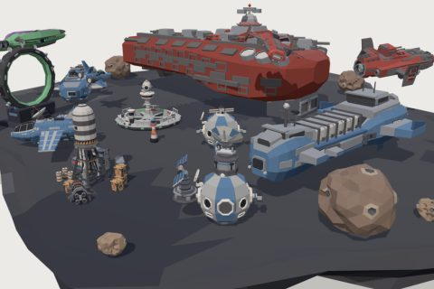

# Spaceship Wars Kit

29 free low-poly parts on one palette and one scale, so everything you combine belongs to the same world.

[Open the kit on Polyfork](https://polyfork.dev/kit/spaceship-wars-kit-234642) · [All kits](../README.md#kits)

<table>
<tr>
<td align="center" valign="top" width="25%"> <a href="https://polyfork.dev/asset/agile-starfighter-89805f">Agile Starfighter</a> <a href="https://polyfork.dev/cdn/agile-starfighter-89805f.glb">GLB</a> · <a href="https://polyfork.dev/cdn/agile-starfighter-89805f.mjs">module</a></td>
<td align="center" valign="top" width="25%"> <a href="https://polyfork.dev/asset/alien-raider-98249f">Alien Raider</a> <a href="https://polyfork.dev/cdn/alien-raider-98249f.glb">GLB</a> · <a href="https://polyfork.dev/cdn/alien-raider-98249f.mjs">module</a></td>
<td align="center" valign="top" width="25%"> <a href="https://polyfork.dev/asset/capital-cruiser-482162">Capital Cruiser</a> <a href="https://polyfork.dev/cdn/capital-cruiser-482162.glb">GLB</a> · <a href="https://polyfork.dev/cdn/capital-cruiser-482162.mjs">module</a></td>
<td align="center" valign="top" width="25%"> <a href="https://polyfork.dev/asset/cargo-container-fd73bc">Cargo Container</a> <a href="https://polyfork.dev/cdn/cargo-container-fd73bc.glb">GLB</a> · <a href="https://polyfork.dev/cdn/cargo-container-fd73bc.mjs">module</a></td>
</tr>
<tr>
<td align="center" valign="top" width="25%"> <a href="https://polyfork.dev/asset/cargo-freighter-d89fdc">Cargo Freighter</a> <a href="https://polyfork.dev/cdn/cargo-freighter-d89fdc.glb">GLB</a> · <a href="https://polyfork.dev/cdn/cargo-freighter-d89fdc.mjs">module</a></td>
<td align="center" valign="top" width="25%"> <a href="https://polyfork.dev/asset/comm-satellite-fdc2cd">Comm Satellite</a> <a href="https://polyfork.dev/cdn/comm-satellite-fdc2cd.glb">GLB</a> · <a href="https://polyfork.dev/cdn/comm-satellite-fdc2cd.mjs">module</a></td>
<td align="center" valign="top" width="25%"> <a href="https://polyfork.dev/asset/defense-turret-12ba8d">Defense Turret</a> <a href="https://polyfork.dev/cdn/defense-turret-12ba8d.glb">GLB</a> · <a href="https://polyfork.dev/cdn/defense-turret-12ba8d.mjs">module</a></td>
<td align="center" valign="top" width="25%"> <a href="https://polyfork.dev/asset/docking-clamp-b749c6">Docking Clamp</a> <a href="https://polyfork.dev/cdn/docking-clamp-b749c6.glb">GLB</a> · <a href="https://polyfork.dev/cdn/docking-clamp-b749c6.mjs">module</a></td>
</tr>
<tr>
<td align="center" valign="top" width="25%"> <a href="https://polyfork.dev/asset/docking-ring-7b4286">Docking Ring</a> <a href="https://polyfork.dev/cdn/docking-ring-7b4286.glb">GLB</a> · <a href="https://polyfork.dev/cdn/docking-ring-7b4286.mjs">module</a></td>
<td align="center" valign="top" width="25%"> <a href="https://polyfork.dev/asset/escape-pod-49232b">Escape Pod</a> <a href="https://polyfork.dev/cdn/escape-pod-49232b.glb">GLB</a> · <a href="https://polyfork.dev/cdn/escape-pod-49232b.mjs">module</a></td>
<td align="center" valign="top" width="25%"> <a href="https://polyfork.dev/asset/fuel-depot-e57cdc">Fuel Depot</a> <a href="https://polyfork.dev/cdn/fuel-depot-e57cdc.glb">GLB</a> · <a href="https://polyfork.dev/cdn/fuel-depot-e57cdc.mjs">module</a></td>
<td align="center" valign="top" width="25%"> <a href="https://polyfork.dev/asset/fuel-drum-d65fa4">Fuel Drum</a> <a href="https://polyfork.dev/cdn/fuel-drum-d65fa4.glb">GLB</a> · <a href="https://polyfork.dev/cdn/fuel-drum-d65fa4.mjs">module</a></td>
</tr>
<tr>
<td align="center" valign="top" width="25%"> <a href="https://polyfork.dev/asset/gunship-d2c5a9">Gunship</a> <a href="https://polyfork.dev/cdn/gunship-d2c5a9.glb">GLB</a> · <a href="https://polyfork.dev/cdn/gunship-d2c5a9.mjs">module</a></td>
<td align="center" valign="top" width="25%"> <a href="https://polyfork.dev/asset/heavy-bomber-62be39">Heavy Bomber</a> <a href="https://polyfork.dev/cdn/heavy-bomber-62be39.glb">GLB</a> · <a href="https://polyfork.dev/cdn/heavy-bomber-62be39.mjs">module</a></td>
<td align="center" valign="top" width="25%"> <a href="https://polyfork.dev/asset/interceptor-9d2289">Interceptor</a> <a href="https://polyfork.dev/cdn/interceptor-9d2289.glb">GLB</a> · <a href="https://polyfork.dev/cdn/interceptor-9d2289.mjs">module</a></td>
<td align="center" valign="top" width="25%"> <a href="https://polyfork.dev/asset/large-asteroid-391721">Large Asteroid</a> <a href="https://polyfork.dev/cdn/large-asteroid-391721.glb">GLB</a> · <a href="https://polyfork.dev/cdn/large-asteroid-391721.mjs">module</a></td>
</tr>
<tr>
<td align="center" valign="top" width="25%"> <a href="https://polyfork.dev/asset/medium-asteroid-ba674f">Medium Asteroid</a> <a href="https://polyfork.dev/cdn/medium-asteroid-ba674f.glb">GLB</a> · <a href="https://polyfork.dev/cdn/medium-asteroid-ba674f.mjs">module</a></td>
<td align="center" valign="top" width="25%"> <a href="https://polyfork.dev/asset/missile-0717d1">Missile</a> <a href="https://polyfork.dev/cdn/missile-0717d1.glb">GLB</a> · <a href="https://polyfork.dev/cdn/missile-0717d1.mjs">module</a></td>
<td align="center" valign="top" width="25%"> <a href="https://polyfork.dev/asset/nav-beacon-1211c9">Nav Beacon</a> <a href="https://polyfork.dev/cdn/nav-beacon-1211c9.glb">GLB</a> · <a href="https://polyfork.dev/cdn/nav-beacon-1211c9.mjs">module</a></td>
<td align="center" valign="top" width="25%"> <a href="https://polyfork.dev/asset/scout-ship-289ccc">Scout Ship</a> <a href="https://polyfork.dev/cdn/scout-ship-289ccc.glb">GLB</a> · <a href="https://polyfork.dev/cdn/scout-ship-289ccc.mjs">module</a></td>
</tr>
<tr>
<td align="center" valign="top" width="25%"> <a href="https://polyfork.dev/asset/sensor-dish-6b1108">Sensor Dish</a> <a href="https://polyfork.dev/cdn/sensor-dish-6b1108.glb">GLB</a> · <a href="https://polyfork.dev/cdn/sensor-dish-6b1108.mjs">module</a></td>
<td align="center" valign="top" width="25%"> <a href="https://polyfork.dev/asset/small-asteroid-7fc86a">Small Asteroid</a> <a href="https://polyfork.dev/cdn/small-asteroid-7fc86a.glb">GLB</a> · <a href="https://polyfork.dev/cdn/small-asteroid-7fc86a.mjs">module</a></td>
<td align="center" valign="top" width="25%"> <a href="https://polyfork.dev/asset/solar-panel-wing-a66d89">Solar Panel Wing</a> <a href="https://polyfork.dev/cdn/solar-panel-wing-a66d89.glb">GLB</a> · <a href="https://polyfork.dev/cdn/solar-panel-wing-a66d89.mjs">module</a></td>
<td align="center" valign="top" width="25%"> <a href="https://polyfork.dev/asset/space-mine-3a1654">Space Mine</a> <a href="https://polyfork.dev/cdn/space-mine-3a1654.glb">GLB</a> · <a href="https://polyfork.dev/cdn/space-mine-3a1654.mjs">module</a></td>
</tr>
<tr>
<td align="center" valign="top" width="25%"> <a href="https://polyfork.dev/asset/station-corridor-d7efdb">Station Corridor</a> <a href="https://polyfork.dev/cdn/station-corridor-d7efdb.glb">GLB</a> · <a href="https://polyfork.dev/cdn/station-corridor-d7efdb.mjs">module</a></td>
<td align="center" valign="top" width="25%"> <a href="https://polyfork.dev/asset/station-hub-67f667">Station Hub</a> <a href="https://polyfork.dev/cdn/station-hub-67f667.glb">GLB</a> · <a href="https://polyfork.dev/cdn/station-hub-67f667.mjs">module</a></td>
<td align="center" valign="top" width="25%"> <a href="https://polyfork.dev/asset/supply-crate-57aa8d">Supply Crate</a> <a href="https://polyfork.dev/cdn/supply-crate-57aa8d.glb">GLB</a> · <a href="https://polyfork.dev/cdn/supply-crate-57aa8d.mjs">module</a></td>
<td align="center" valign="top" width="25%"> <a href="https://polyfork.dev/asset/warp-gate-b507bf">Warp Gate</a> <a href="https://polyfork.dev/cdn/warp-gate-b507bf.glb">GLB</a> · <a href="https://polyfork.dev/cdn/warp-gate-b507bf.mjs">module</a></td>
</tr>
<tr>
<td align="center" valign="top" width="25%"> <a href="https://polyfork.dev/asset/wreckage-chunk-39ddf9">Wreckage Chunk</a> <a href="https://polyfork.dev/cdn/wreckage-chunk-39ddf9.glb">GLB</a> · <a href="https://polyfork.dev/cdn/wreckage-chunk-39ddf9.mjs">module</a></td>
</tr>
</table>
