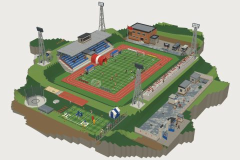

# Stadium

71 free low-poly parts on one palette and one scale, so everything you combine belongs to the same world.

[Open the kit on Polyfork](https://polyfork.dev/kit/stadium-5db167) · [All kits](../README.md#kits)

<table>
<tr>
<td align="center" valign="top" width="25%"> <a href="https://polyfork.dev/asset/advertising-hoarding-run-efe4bc">Advertising Hoarding Run</a> <a href="https://polyfork.dev/cdn/advertising-hoarding-run-efe4bc.glb">GLB</a> · <a href="https://polyfork.dev/cdn/advertising-hoarding-run-efe4bc.mjs">module</a></td>
<td align="center" valign="top" width="25%"> <a href="https://polyfork.dev/asset/agility-bag-set-e25fcd">Agility Bag Set</a> <a href="https://polyfork.dev/cdn/agility-bag-set-e25fcd.glb">GLB</a> · <a href="https://polyfork.dev/cdn/agility-bag-set-e25fcd.mjs">module</a></td>
<td align="center" valign="top" width="25%"> <a href="https://polyfork.dev/asset/agility-ladder-2a8267">Agility Ladder</a> <a href="https://polyfork.dev/cdn/agility-ladder-2a8267.glb">GLB</a> · <a href="https://polyfork.dev/cdn/agility-ladder-2a8267.mjs">module</a></td>
<td align="center" valign="top" width="25%"> <a href="https://polyfork.dev/asset/athletics-hurdle-164f6f">Athletics Hurdle</a> <a href="https://polyfork.dev/cdn/athletics-hurdle-164f6f.glb">GLB</a> · <a href="https://polyfork.dev/cdn/athletics-hurdle-164f6f.mjs">module</a></td>
</tr>
<tr>
<td align="center" valign="top" width="25%"> <a href="https://polyfork.dev/asset/ball-cart-8274fd">Ball Cart</a> <a href="https://polyfork.dev/cdn/ball-cart-8274fd.glb">GLB</a> · <a href="https://polyfork.dev/cdn/ball-cart-8274fd.mjs">module</a></td>
<td align="center" valign="top" width="25%"> <a href="https://polyfork.dev/asset/blocking-sled-d83edd">Blocking Sled</a> <a href="https://polyfork.dev/cdn/blocking-sled-d83edd.glb">GLB</a> · <a href="https://polyfork.dev/cdn/blocking-sled-d83edd.mjs">module</a></td>
<td align="center" valign="top" width="25%"> <a href="https://polyfork.dev/asset/chain-crew-set-f2efdc">Chain Crew Set</a> <a href="https://polyfork.dev/cdn/chain-crew-set-f2efdc.glb">GLB</a> · <a href="https://polyfork.dev/cdn/chain-crew-set-f2efdc.mjs">module</a></td>
<td align="center" valign="top" width="25%"> <a href="https://polyfork.dev/asset/cheerleader-90875e">Cheerleader</a> <a href="https://polyfork.dev/cdn/cheerleader-90875e.glb">GLB</a> · <a href="https://polyfork.dev/cdn/cheerleader-90875e.mjs">module</a></td>
</tr>
<tr>
<td align="center" valign="top" width="25%"> <a href="https://polyfork.dev/asset/clubhouse-8570d2">Clubhouse</a> <a href="https://polyfork.dev/cdn/clubhouse-8570d2.glb">GLB</a> · <a href="https://polyfork.dev/cdn/clubhouse-8570d2.mjs">module</a></td>
<td align="center" valign="top" width="25%"> <a href="https://polyfork.dev/asset/concourse-paving-tile-93ce9c">Concourse Paving Tile</a> <a href="https://polyfork.dev/cdn/concourse-paving-tile-93ce9c.glb">GLB</a> · <a href="https://polyfork.dev/cdn/concourse-paving-tile-93ce9c.mjs">module</a></td>
<td align="center" valign="top" width="25%"> <a href="https://polyfork.dev/asset/corner-flag-0b43b0">Corner Flag</a> <a href="https://polyfork.dev/cdn/corner-flag-0b43b0.glb">GLB</a> · <a href="https://polyfork.dev/cdn/corner-flag-0b43b0.mjs">module</a></td>
<td align="center" valign="top" width="25%"> <a href="https://polyfork.dev/asset/discus-cage-2e0e7b">Discus Cage</a> <a href="https://polyfork.dev/cdn/discus-cage-2e0e7b.glb">GLB</a> · <a href="https://polyfork.dev/cdn/discus-cage-2e0e7b.mjs">module</a></td>
</tr>
<tr>
<td align="center" valign="top" width="25%"> <a href="https://polyfork.dev/asset/equipment-rack-3b617e">Equipment Rack</a> <a href="https://polyfork.dev/cdn/equipment-rack-3b617e.glb">GLB</a> · <a href="https://polyfork.dev/cdn/equipment-rack-3b617e.mjs">module</a></td>
<td align="center" valign="top" width="25%"> <a href="https://polyfork.dev/asset/first-aid-bag-8a7f09">First Aid Bag</a> <a href="https://polyfork.dev/cdn/first-aid-bag-8a7f09.glb">GLB</a> · <a href="https://polyfork.dev/cdn/first-aid-bag-8a7f09.mjs">module</a></td>
<td align="center" valign="top" width="25%"> <a href="https://polyfork.dev/asset/first-aid-room-module-56b78b">First Aid Room Module</a> <a href="https://polyfork.dev/cdn/first-aid-room-module-56b78b.glb">GLB</a> · <a href="https://polyfork.dev/cdn/first-aid-room-module-56b78b.mjs">module</a></td>
<td align="center" valign="top" width="25%"> <a href="https://polyfork.dev/asset/flag-pole-015e53">Flag Pole</a> <a href="https://polyfork.dev/cdn/flag-pole-015e53.glb">GLB</a> · <a href="https://polyfork.dev/cdn/flag-pole-015e53.mjs">module</a></td>
</tr>
<tr>
<td align="center" valign="top" width="25%"> <a href="https://polyfork.dev/asset/floodlight-mast-4482be">Floodlight Mast</a> <a href="https://polyfork.dev/cdn/floodlight-mast-4482be.glb">GLB</a> · <a href="https://polyfork.dev/cdn/floodlight-mast-4482be.mjs">module</a></td>
<td align="center" valign="top" width="25%"> <a href="https://polyfork.dev/asset/goal-net-trolley-f5bd28">Goal Net Trolley</a> <a href="https://polyfork.dev/cdn/goal-net-trolley-f5bd28.glb">GLB</a> · <a href="https://polyfork.dev/cdn/goal-net-trolley-f5bd28.mjs">module</a></td>
<td align="center" valign="top" width="25%"> <a href="https://polyfork.dev/asset/goalkeeper-10017a">Goalkeeper</a> <a href="https://polyfork.dev/cdn/goalkeeper-10017a.glb">GLB</a> · <a href="https://polyfork.dev/cdn/goalkeeper-10017a.mjs">module</a></td>
<td align="center" valign="top" width="25%"> <a href="https://polyfork.dev/asset/grandstand-seating-run-fc9023">Grandstand Seating Run</a> <a href="https://polyfork.dev/cdn/grandstand-seating-run-fc9023.glb">GLB</a> · <a href="https://polyfork.dev/cdn/grandstand-seating-run-fc9023.mjs">module</a></td>
</tr>
<tr>
<td align="center" valign="top" width="25%"> <a href="https://polyfork.dev/asset/gravel-car-park-tile-3959ab">Gravel Car Park Tile</a> <a href="https://polyfork.dev/cdn/gravel-car-park-tile-3959ab.glb">GLB</a> · <a href="https://polyfork.dev/cdn/gravel-car-park-tile-3959ab.mjs">module</a></td>
<td align="center" valign="top" width="25%"> <a href="https://polyfork.dev/asset/gridiron-player-9d4168">Gridiron Player</a> <a href="https://polyfork.dev/cdn/gridiron-player-9d4168.glb">GLB</a> · <a href="https://polyfork.dev/cdn/gridiron-player-9d4168.mjs">module</a></td>
<td align="center" valign="top" width="25%"> <a href="https://polyfork.dev/asset/ground-litter-bin-aaaba0">Ground Litter Bin</a> <a href="https://polyfork.dev/cdn/ground-litter-bin-aaaba0.glb">GLB</a> · <a href="https://polyfork.dev/cdn/ground-litter-bin-aaaba0.mjs">module</a></td>
<td align="center" valign="top" width="25%"> <a href="https://polyfork.dev/asset/groundskeeper-71be56">Groundskeeper</a> <a href="https://polyfork.dev/cdn/groundskeeper-71be56.glb">GLB</a> · <a href="https://polyfork.dev/cdn/groundskeeper-71be56.mjs">module</a></td>
</tr>
<tr>
<td align="center" valign="top" width="25%"> <a href="https://polyfork.dev/asset/groundsman-s-store-shed-5b6996">Groundsman&#039;s Store Shed</a> <a href="https://polyfork.dev/cdn/groundsman-s-store-shed-5b6996.glb">GLB</a> · <a href="https://polyfork.dev/cdn/groundsman-s-store-shed-5b6996.mjs">module</a></td>
<td align="center" valign="top" width="25%"> <a href="https://polyfork.dev/asset/high-jump-apparatus-84ac1d">High Jump Apparatus</a> <a href="https://polyfork.dev/cdn/high-jump-apparatus-84ac1d.glb">GLB</a> · <a href="https://polyfork.dev/cdn/high-jump-apparatus-84ac1d.mjs">module</a></td>
<td align="center" valign="top" width="25%"> <a href="https://polyfork.dev/asset/inflatable-team-tunnel-c71c5c">Inflatable Team Tunnel</a> <a href="https://polyfork.dev/cdn/inflatable-team-tunnel-c71c5c.glb">GLB</a> · <a href="https://polyfork.dev/cdn/inflatable-team-tunnel-c71c5c.mjs">module</a></td>
<td align="center" valign="top" width="25%"> <a href="https://polyfork.dev/asset/kit-bag-7d617f">Kit Bag</a> <a href="https://polyfork.dev/cdn/kit-bag-7d617f.glb">GLB</a> · <a href="https://polyfork.dev/cdn/kit-bag-7d617f.mjs">module</a></td>
</tr>
<tr>
<td align="center" valign="top" width="25%"> <a href="https://polyfork.dev/asset/line-marking-cart-2f7b12">Line Marking Cart</a> <a href="https://polyfork.dev/cdn/line-marking-cart-2f7b12.glb">GLB</a> · <a href="https://polyfork.dev/cdn/line-marking-cart-2f7b12.mjs">module</a></td>
<td align="center" valign="top" width="25%"> <a href="https://polyfork.dev/asset/long-jump-pit-9d28e4">Long Jump Pit</a> <a href="https://polyfork.dev/cdn/long-jump-pit-9d28e4.glb">GLB</a> · <a href="https://polyfork.dev/cdn/long-jump-pit-9d28e4.mjs">module</a></td>
<td align="center" valign="top" width="25%"> <a href="https://polyfork.dev/asset/main-entrance-gate-bb6357">Main Entrance Gate</a> <a href="https://polyfork.dev/cdn/main-entrance-gate-bb6357.glb">GLB</a> · <a href="https://polyfork.dev/cdn/main-entrance-gate-bb6357.mjs">module</a></td>
<td align="center" valign="top" width="25%"> <a href="https://polyfork.dev/asset/marker-cone-set-8fab80">Marker Cone Set</a> <a href="https://polyfork.dev/cdn/marker-cone-set-8fab80.glb">GLB</a> · <a href="https://polyfork.dev/cdn/marker-cone-set-8fab80.mjs">module</a></td>
</tr>
<tr>
<td align="center" valign="top" width="25%"> <a href="https://polyfork.dev/asset/match-ball-0e675d">Match Ball</a> <a href="https://polyfork.dev/cdn/match-ball-0e675d.glb">GLB</a> · <a href="https://polyfork.dev/cdn/match-ball-0e675d.mjs">module</a></td>
<td align="center" valign="top" width="25%"> <a href="https://polyfork.dev/asset/match-goal-a98b60">Match Goal</a> <a href="https://polyfork.dev/cdn/match-goal-a98b60.glb">GLB</a> · <a href="https://polyfork.dev/cdn/match-goal-a98b60.mjs">module</a></td>
<td align="center" valign="top" width="25%"> <a href="https://polyfork.dev/asset/match-scoreboard-58f51e">Match Scoreboard</a> <a href="https://polyfork.dev/cdn/match-scoreboard-58f51e.glb">GLB</a> · <a href="https://polyfork.dev/cdn/match-scoreboard-58f51e.mjs">module</a></td>
<td align="center" valign="top" width="25%"> <a href="https://polyfork.dev/asset/mesh-perimeter-fence-run-ffce82">Mesh Perimeter Fence Run</a> <a href="https://polyfork.dev/cdn/mesh-perimeter-fence-run-ffce82.glb">GLB</a> · <a href="https://polyfork.dev/cdn/mesh-perimeter-fence-run-ffce82.mjs">module</a></td>
</tr>
<tr>
<td align="center" valign="top" width="25%"> <a href="https://polyfork.dev/asset/outfield-player-2b742a">Outfield Player</a> <a href="https://polyfork.dev/cdn/outfield-player-2b742a.glb">GLB</a> · <a href="https://polyfork.dev/cdn/outfield-player-2b742a.mjs">module</a></td>
<td align="center" valign="top" width="25%"> <a href="https://polyfork.dev/asset/pa-horn-post-212ec8">PA Horn Post</a> <a href="https://polyfork.dev/cdn/pa-horn-post-212ec8.glb">GLB</a> · <a href="https://polyfork.dev/cdn/pa-horn-post-212ec8.mjs">module</a></td>
<td align="center" valign="top" width="25%"> <a href="https://polyfork.dev/asset/perimeter-wall-run-adc811">Perimeter Wall Run</a> <a href="https://polyfork.dev/cdn/perimeter-wall-run-adc811.glb">GLB</a> · <a href="https://polyfork.dev/cdn/perimeter-wall-run-adc811.mjs">module</a></td>
<td align="center" valign="top" width="25%"> <a href="https://polyfork.dev/asset/pitch-roller-21c373">Pitch Roller</a> <a href="https://polyfork.dev/cdn/pitch-roller-21c373.glb">GLB</a> · <a href="https://polyfork.dev/cdn/pitch-roller-21c373.mjs">module</a></td>
</tr>
<tr>
<td align="center" valign="top" width="25%"> <a href="https://polyfork.dev/asset/players-tunnel-4a210b">Players&#039; Tunnel</a> <a href="https://polyfork.dev/cdn/players-tunnel-4a210b.glb">GLB</a> · <a href="https://polyfork.dev/cdn/players-tunnel-4a210b.mjs">module</a></td>
<td align="center" valign="top" width="25%"> <a href="https://polyfork.dev/asset/press-box-55553b">Press Box</a> <a href="https://polyfork.dev/cdn/press-box-55553b.glb">GLB</a> · <a href="https://polyfork.dev/cdn/press-box-55553b.mjs">module</a></td>
<td align="center" valign="top" width="25%"> <a href="https://polyfork.dev/asset/referee-9e9e73">Referee</a> <a href="https://polyfork.dev/cdn/referee-9e9e73.glb">GLB</a> · <a href="https://polyfork.dev/cdn/referee-9e9e73.mjs">module</a></td>
<td align="center" valign="top" width="25%"> <a href="https://polyfork.dev/asset/refreshment-kiosk-406f65">Refreshment Kiosk</a> <a href="https://polyfork.dev/cdn/refreshment-kiosk-406f65.glb">GLB</a> · <a href="https://polyfork.dev/cdn/refreshment-kiosk-406f65.mjs">module</a></td>
</tr>
<tr>
<td align="center" valign="top" width="25%"> <a href="https://polyfork.dev/asset/rolled-pitch-tarpaulin-c8a93f">Rolled Pitch Tarpaulin</a> <a href="https://polyfork.dev/cdn/rolled-pitch-tarpaulin-c8a93f.glb">GLB</a> · <a href="https://polyfork.dev/cdn/rolled-pitch-tarpaulin-c8a93f.mjs">module</a></td>
<td align="center" valign="top" width="25%"> <a href="https://polyfork.dev/asset/a-running-track-tile-daf991">Running Track Tile</a> <a href="https://polyfork.dev/cdn/a-running-track-tile-daf991.glb">GLB</a> · <a href="https://polyfork.dev/cdn/a-running-track-tile-daf991.mjs">module</a></td>
<td align="center" valign="top" width="25%"> <a href="https://polyfork.dev/asset/scaffold-camera-platform-b6702c">Scaffold Camera Platform</a> <a href="https://polyfork.dev/cdn/scaffold-camera-platform-b6702c.glb">GLB</a> · <a href="https://polyfork.dev/cdn/scaffold-camera-platform-b6702c.mjs">module</a></td>
<td align="center" valign="top" width="25%"> <a href="https://polyfork.dev/asset/shot-put-circle-a12cb9">Shot Put Circle</a> <a href="https://polyfork.dev/cdn/shot-put-circle-a12cb9.glb">GLB</a> · <a href="https://polyfork.dev/cdn/shot-put-circle-a12cb9.mjs">module</a></td>
</tr>
<tr>
<td align="center" valign="top" width="25%"> <a href="https://polyfork.dev/asset/sideline-medical-tent-ce1649">Sideline Medical Tent</a> <a href="https://polyfork.dev/cdn/sideline-medical-tent-ce1649.glb">GLB</a> · <a href="https://polyfork.dev/cdn/sideline-medical-tent-ce1649.mjs">module</a></td>
<td align="center" valign="top" width="25%"> <a href="https://polyfork.dev/asset/sideline-yard-marker-029dcc">Sideline Yard Marker</a> <a href="https://polyfork.dev/cdn/sideline-yard-marker-029dcc.glb">GLB</a> · <a href="https://polyfork.dev/cdn/sideline-yard-marker-029dcc.mjs">module</a></td>
<td align="center" valign="top" width="25%"> <a href="https://polyfork.dev/asset/spectator-d086fe">Spectator</a> <a href="https://polyfork.dev/cdn/spectator-d086fe.glb">GLB</a> · <a href="https://polyfork.dev/cdn/spectator-d086fe.mjs">module</a></td>
<td align="center" valign="top" width="25%"> <a href="https://polyfork.dev/asset/stadium-clock-post-4d1ce8">Stadium Clock Post</a> <a href="https://polyfork.dev/cdn/stadium-clock-post-4d1ce8.glb">GLB</a> · <a href="https://polyfork.dev/cdn/stadium-clock-post-4d1ce8.mjs">module</a></td>
</tr>
<tr>
<td align="center" valign="top" width="25%"> <a href="https://polyfork.dev/asset/stadium-terrain-a09f73">Stadium Terrain</a> <a href="https://polyfork.dev/cdn/stadium-terrain-a09f73.glb">GLB</a> · <a href="https://polyfork.dev/cdn/stadium-terrain-a09f73.mjs">module</a></td>
<td align="center" valign="top" width="25%"> <a href="https://polyfork.dev/asset/stand-gable-end-53847a">Stand Gable End</a> <a href="https://polyfork.dev/cdn/stand-gable-end-53847a.glb">GLB</a> · <a href="https://polyfork.dev/cdn/stand-gable-end-53847a.mjs">module</a></td>
<td align="center" valign="top" width="25%"> <a href="https://polyfork.dev/asset/stand-roof-run-cfd457">Stand Roof Run</a> <a href="https://polyfork.dev/cdn/stand-roof-run-cfd457.glb">GLB</a> · <a href="https://polyfork.dev/cdn/stand-roof-run-cfd457.mjs">module</a></td>
<td align="center" valign="top" width="25%"> <a href="https://polyfork.dev/asset/starting-blocks-9d8848">Starting Blocks</a> <a href="https://polyfork.dev/cdn/starting-blocks-9d8848.glb">GLB</a> · <a href="https://polyfork.dev/cdn/starting-blocks-9d8848.mjs">module</a></td>
</tr>
<tr>
<td align="center" valign="top" width="25%"> <a href="https://polyfork.dev/asset/substitutes-bench-ea0ef7">Substitutes&#039; Bench</a> <a href="https://polyfork.dev/cdn/substitutes-bench-ea0ef7.glb">GLB</a> · <a href="https://polyfork.dev/cdn/substitutes-bench-ea0ef7.mjs">module</a></td>
<td align="center" valign="top" width="25%"> <a href="https://polyfork.dev/asset/tackle-dummy-06aba2">Tackle Dummy</a> <a href="https://polyfork.dev/cdn/tackle-dummy-06aba2.glb">GLB</a> · <a href="https://polyfork.dev/cdn/tackle-dummy-06aba2.mjs">module</a></td>
<td align="center" valign="top" width="25%"> <a href="https://polyfork.dev/asset/tactics-board-21cfd2">Tactics Board</a> <a href="https://polyfork.dev/cdn/tactics-board-21cfd2.glb">GLB</a> · <a href="https://polyfork.dev/cdn/tactics-board-21cfd2.mjs">module</a></td>
<td align="center" valign="top" width="25%"> <a href="https://polyfork.dev/asset/team-dugout-ddb70c">Team Dugout</a> <a href="https://polyfork.dev/cdn/team-dugout-ddb70c.glb">GLB</a> · <a href="https://polyfork.dev/cdn/team-dugout-ddb70c.mjs">module</a></td>
</tr>
<tr>
<td align="center" valign="top" width="25%"> <a href="https://polyfork.dev/asset/team-mascot-abf426">Team Mascot</a> <a href="https://polyfork.dev/cdn/team-mascot-abf426.glb">GLB</a> · <a href="https://polyfork.dev/cdn/team-mascot-abf426.mjs">module</a></td>
<td align="center" valign="top" width="25%"> <a href="https://polyfork.dev/asset/team-minibus-f14295">Team Minibus</a> <a href="https://polyfork.dev/cdn/team-minibus-f14295.glb">GLB</a> · <a href="https://polyfork.dev/cdn/team-minibus-f14295.mjs">module</a></td>
<td align="center" valign="top" width="25%"> <a href="https://polyfork.dev/asset/terrace-step-run-b631a9">Terrace Step Run</a> <a href="https://polyfork.dev/cdn/terrace-step-run-b631a9.glb">GLB</a> · <a href="https://polyfork.dev/cdn/terrace-step-run-b631a9.mjs">module</a></td>
<td align="center" valign="top" width="25%"> <a href="https://polyfork.dev/asset/ticket-booth-d127f8">Ticket Booth</a> <a href="https://polyfork.dev/cdn/ticket-booth-d127f8.glb">GLB</a> · <a href="https://polyfork.dev/cdn/ticket-booth-d127f8.mjs">module</a></td>
</tr>
<tr>
<td align="center" valign="top" width="25%"> <a href="https://polyfork.dev/asset/toilet-block-da51a4">Toilet Block</a> <a href="https://polyfork.dev/cdn/toilet-block-da51a4.glb">GLB</a> · <a href="https://polyfork.dev/cdn/toilet-block-da51a4.mjs">module</a></td>
<td align="center" valign="top" width="25%"> <a href="https://polyfork.dev/asset/touchline-manager-13a94b">Touchline Manager</a> <a href="https://polyfork.dev/cdn/touchline-manager-13a94b.glb">GLB</a> · <a href="https://polyfork.dev/cdn/touchline-manager-13a94b.mjs">module</a></td>
<td align="center" valign="top" width="25%"> <a href="https://polyfork.dev/asset/touchline-stretcher-f08e97">Touchline Stretcher</a> <a href="https://polyfork.dev/cdn/touchline-stretcher-f08e97.glb">GLB</a> · <a href="https://polyfork.dev/cdn/touchline-stretcher-f08e97.mjs">module</a></td>
<td align="center" valign="top" width="25%"> <a href="https://polyfork.dev/asset/training-goal-50f1ca">Training Goal</a> <a href="https://polyfork.dev/cdn/training-goal-50f1ca.glb">GLB</a> · <a href="https://polyfork.dev/cdn/training-goal-50f1ca.mjs">module</a></td>
</tr>
<tr>
<td align="center" valign="top" width="25%"> <a href="https://polyfork.dev/asset/turf-pitch-tile-aca1ef">Turf Pitch Tile</a> <a href="https://polyfork.dev/cdn/turf-pitch-tile-aca1ef.glb">GLB</a> · <a href="https://polyfork.dev/cdn/turf-pitch-tile-aca1ef.mjs">module</a></td>
<td align="center" valign="top" width="25%"> <a href="https://polyfork.dev/asset/turnstile-bank-9294b4">Turnstile Bank</a> <a href="https://polyfork.dev/cdn/turnstile-bank-9294b4.glb">GLB</a> · <a href="https://polyfork.dev/cdn/turnstile-bank-9294b4.mjs">module</a></td>
<td align="center" valign="top" width="25%"> <a href="https://polyfork.dev/asset/water-bottle-crate-78c8db">Water Bottle Crate</a> <a href="https://polyfork.dev/cdn/water-bottle-crate-78c8db.glb">GLB</a> · <a href="https://polyfork.dev/cdn/water-bottle-crate-78c8db.mjs">module</a></td>
</tr>
</table>
