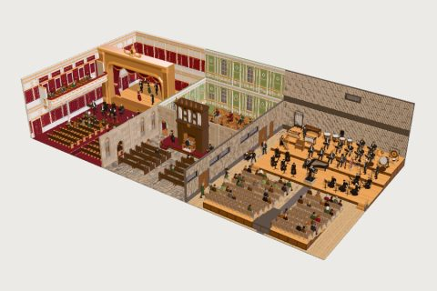

# Symphony Stagecraft kit

64 free low-poly parts on one palette and one scale, so everything you combine belongs to the same world.

[Open the kit on Polyfork](https://polyfork.dev/kit/symphony-stagecraft-kit-bf2de0) · [All kits](../README.md#kits)

<table>
<tr>
<td align="center" valign="top" width="25%"> <a href="https://polyfork.dev/asset/audience-gentleman-2c5e4b">Audience Gentleman</a> <a href="https://polyfork.dev/cdn/audience-gentleman-2c5e4b.glb">GLB</a> · <a href="https://polyfork.dev/cdn/audience-gentleman-2c5e4b.mjs">module</a></td>
<td align="center" valign="top" width="25%"> <a href="https://polyfork.dev/asset/baroque-panelled-wall-8658ed">Baroque Panelled Wall</a> <a href="https://polyfork.dev/cdn/baroque-panelled-wall-8658ed.glb">GLB</a> · <a href="https://polyfork.dev/cdn/baroque-panelled-wall-8658ed.mjs">module</a></td>
<td align="center" valign="top" width="25%"> <a href="https://polyfork.dev/asset/bass-clarinet-244d78">Bass Clarinet</a> <a href="https://polyfork.dev/cdn/bass-clarinet-244d78.glb">GLB</a> · <a href="https://polyfork.dev/cdn/bass-clarinet-244d78.mjs">module</a></td>
<td align="center" valign="top" width="25%"> <a href="https://polyfork.dev/asset/bassoon-224d4a">Bassoon</a> <a href="https://polyfork.dev/cdn/bassoon-224d4a.glb">GLB</a> · <a href="https://polyfork.dev/cdn/bassoon-224d4a.mjs">module</a></td>
</tr>
<tr>
<td align="center" valign="top" width="25%"> <a href="https://polyfork.dev/asset/castanets-50fc2f">Castanets</a> <a href="https://polyfork.dev/cdn/castanets-50fc2f.glb">GLB</a> · <a href="https://polyfork.dev/cdn/castanets-50fc2f.mjs">module</a></td>
<td align="center" valign="top" width="25%"> <a href="https://polyfork.dev/asset/celesta-a2ff99">Celesta</a> <a href="https://polyfork.dev/cdn/celesta-a2ff99.glb">GLB</a> · <a href="https://polyfork.dev/cdn/celesta-a2ff99.mjs">module</a></td>
<td align="center" valign="top" width="25%"> <a href="https://polyfork.dev/asset/cello-64a951">Cello</a> <a href="https://polyfork.dev/cdn/cello-64a951.glb">GLB</a> · <a href="https://polyfork.dev/cdn/cello-64a951.mjs">module</a></td>
<td align="center" valign="top" width="25%"> <a href="https://polyfork.dev/asset/church-flagstone-floor-tile-ab3cf2">Church Flagstone Floor Tile</a> <a href="https://polyfork.dev/cdn/church-flagstone-floor-tile-ab3cf2.glb">GLB</a> · <a href="https://polyfork.dev/cdn/church-flagstone-floor-tile-ab3cf2.mjs">module</a></td>
</tr>
<tr>
<td align="center" valign="top" width="25%"> <a href="https://polyfork.dev/asset/church-nave-wall-a6f070">Church Nave Wall</a> <a href="https://polyfork.dev/cdn/church-nave-wall-a6f070.glb">GLB</a> · <a href="https://polyfork.dev/cdn/church-nave-wall-a6f070.mjs">module</a></td>
<td align="center" valign="top" width="25%"> <a href="https://polyfork.dev/asset/church-pew-dae6d7">Church Pew</a> <a href="https://polyfork.dev/cdn/church-pew-dae6d7.glb">GLB</a> · <a href="https://polyfork.dev/cdn/church-pew-dae6d7.mjs">module</a></td>
<td align="center" valign="top" width="25%"> <a href="https://polyfork.dev/asset/clarinet-4e9b0b">Clarinet</a> <a href="https://polyfork.dev/cdn/clarinet-4e9b0b.glb">GLB</a> · <a href="https://polyfork.dev/cdn/clarinet-4e9b0b.mjs">module</a></td>
<td align="center" valign="top" width="25%"> <a href="https://polyfork.dev/asset/concert-bass-drum-88ee8e">Concert Bass Drum</a> <a href="https://polyfork.dev/cdn/concert-bass-drum-88ee8e.glb">GLB</a> · <a href="https://polyfork.dev/cdn/concert-bass-drum-88ee8e.mjs">module</a></td>
</tr>
<tr>
<td align="center" valign="top" width="25%"> <a href="https://polyfork.dev/asset/concert-grand-piano-85c5b1">Concert Grand Piano</a> <a href="https://polyfork.dev/cdn/concert-grand-piano-85c5b1.glb">GLB</a> · <a href="https://polyfork.dev/cdn/concert-grand-piano-85c5b1.mjs">module</a></td>
<td align="center" valign="top" width="25%"> <a href="https://polyfork.dev/asset/concert-hall-floor-tile-c35ae9">Concert Hall Floor Tile</a> <a href="https://polyfork.dev/cdn/concert-hall-floor-tile-c35ae9.glb">GLB</a> · <a href="https://polyfork.dev/cdn/concert-hall-floor-tile-c35ae9.mjs">module</a></td>
<td align="center" valign="top" width="25%"> <a href="https://polyfork.dev/asset/concert-pedal-harp-eb1a21">Concert Pedal Harp</a> <a href="https://polyfork.dev/cdn/concert-pedal-harp-eb1a21.glb">GLB</a> · <a href="https://polyfork.dev/cdn/concert-pedal-harp-eb1a21.mjs">module</a></td>
<td align="center" valign="top" width="25%"> <a href="https://polyfork.dev/asset/concert-pianist-28a66d">Concert Pianist</a> <a href="https://polyfork.dev/cdn/concert-pianist-28a66d.glb">GLB</a> · <a href="https://polyfork.dev/cdn/concert-pianist-28a66d.mjs">module</a></td>
</tr>
<tr>
<td align="center" valign="top" width="25%"> <a href="https://polyfork.dev/asset/concert-seat-row-b11dd8">Concert Seat Row</a> <a href="https://polyfork.dev/cdn/concert-seat-row-b11dd8.glb">GLB</a> · <a href="https://polyfork.dev/cdn/concert-seat-row-b11dd8.mjs">module</a></td>
<td align="center" valign="top" width="25%"> <a href="https://polyfork.dev/asset/concert-tambourine-492931">Concert Tambourine</a> <a href="https://polyfork.dev/cdn/concert-tambourine-492931.glb">GLB</a> · <a href="https://polyfork.dev/cdn/concert-tambourine-492931.mjs">module</a></td>
<td align="center" valign="top" width="25%"> <a href="https://polyfork.dev/asset/conductor-09d4d1">Conductor</a> <a href="https://polyfork.dev/cdn/conductor-09d4d1.glb">GLB</a> · <a href="https://polyfork.dev/cdn/conductor-09d4d1.mjs">module</a></td>
<td align="center" valign="top" width="25%"> <a href="https://polyfork.dev/asset/conductor-s-podium-e53ba7">Conductor&#039;s Podium</a> <a href="https://polyfork.dev/cdn/conductor-s-podium-e53ba7.glb">GLB</a> · <a href="https://polyfork.dev/cdn/conductor-s-podium-e53ba7.mjs">module</a></td>
</tr>
<tr>
<td align="center" valign="top" width="25%"> <a href="https://polyfork.dev/asset/contrabassoon-d65a7e">Contrabassoon</a> <a href="https://polyfork.dev/cdn/contrabassoon-d65a7e.glb">GLB</a> · <a href="https://polyfork.dev/cdn/contrabassoon-d65a7e.mjs">module</a></td>
<td align="center" valign="top" width="25%"> <a href="https://polyfork.dev/asset/double-bass-5c7959">Double Bass</a> <a href="https://polyfork.dev/cdn/double-bass-5c7959.glb">GLB</a> · <a href="https://polyfork.dev/cdn/double-bass-5c7959.mjs">module</a></td>
<td align="center" valign="top" width="25%"> <a href="https://polyfork.dev/asset/elderly-audience-member-115d5e">Elderly Audience Member</a> <a href="https://polyfork.dev/cdn/elderly-audience-member-115d5e.glb">GLB</a> · <a href="https://polyfork.dev/cdn/elderly-audience-member-115d5e.mjs">module</a></td>
<td align="center" valign="top" width="25%"> <a href="https://polyfork.dev/asset/flute-dad6f2">Flute</a> <a href="https://polyfork.dev/cdn/flute-dad6f2.glb">GLB</a> · <a href="https://polyfork.dev/cdn/flute-dad6f2.mjs">module</a></td>
</tr>
<tr>
<td align="center" valign="top" width="25%"> <a href="https://polyfork.dev/asset/french-horn-58da56">French Horn</a> <a href="https://polyfork.dev/cdn/french-horn-58da56.glb">GLB</a> · <a href="https://polyfork.dev/cdn/french-horn-58da56.mjs">module</a></td>
<td align="center" valign="top" width="25%"> <a href="https://polyfork.dev/asset/harpist-4a1fde">Harpist</a> <a href="https://polyfork.dev/cdn/harpist-4a1fde.glb">GLB</a> · <a href="https://polyfork.dev/cdn/harpist-4a1fde.mjs">module</a></td>
<td align="center" valign="top" width="25%"> <a href="https://polyfork.dev/asset/harpsichord-ac1869">Harpsichord</a> <a href="https://polyfork.dev/cdn/harpsichord-ac1869.glb">GLB</a> · <a href="https://polyfork.dev/cdn/harpsichord-ac1869.mjs">module</a></td>
<td align="center" valign="top" width="25%"> <a href="https://polyfork.dev/asset/keyboard-bench-564d56">Keyboard Bench</a> <a href="https://polyfork.dev/cdn/keyboard-bench-564d56.glb">GLB</a> · <a href="https://polyfork.dev/cdn/keyboard-bench-564d56.mjs">module</a></td>
</tr>
<tr>
<td align="center" valign="top" width="25%"> <a href="https://polyfork.dev/asset/maraca-dc6dce">Maraca</a> <a href="https://polyfork.dev/cdn/maraca-dc6dce.glb">GLB</a> · <a href="https://polyfork.dev/cdn/maraca-dc6dce.mjs">module</a></td>
<td align="center" valign="top" width="25%"> <a href="https://polyfork.dev/asset/marimba-70965b">Marimba</a> <a href="https://polyfork.dev/cdn/marimba-70965b.glb">GLB</a> · <a href="https://polyfork.dev/cdn/marimba-70965b.mjs">module</a></td>
<td align="center" valign="top" width="25%"> <a href="https://polyfork.dev/asset/modern-acoustic-wall-54b9be">Modern Acoustic Wall</a> <a href="https://polyfork.dev/cdn/modern-acoustic-wall-54b9be.glb">GLB</a> · <a href="https://polyfork.dev/cdn/modern-acoustic-wall-54b9be.mjs">module</a></td>
<td align="center" valign="top" width="25%"> <a href="https://polyfork.dev/asset/oboe-8eec6a">Oboe</a> <a href="https://polyfork.dev/cdn/oboe-8eec6a.glb">GLB</a> · <a href="https://polyfork.dev/cdn/oboe-8eec6a.mjs">module</a></td>
</tr>
<tr>
<td align="center" valign="top" width="25%"> <a href="https://polyfork.dev/asset/opera-baritone-bb3b5d">Opera Baritone</a> <a href="https://polyfork.dev/cdn/opera-baritone-bb3b5d.glb">GLB</a> · <a href="https://polyfork.dev/cdn/opera-baritone-bb3b5d.mjs">module</a></td>
<td align="center" valign="top" width="25%"> <a href="https://polyfork.dev/asset/opera-box-tier-d7fdd1">Opera Box Tier</a> <a href="https://polyfork.dev/cdn/opera-box-tier-d7fdd1.glb">GLB</a> · <a href="https://polyfork.dev/cdn/opera-box-tier-d7fdd1.mjs">module</a></td>
<td align="center" valign="top" width="25%"> <a href="https://polyfork.dev/asset/opera-house-wall-5f3d7f">Opera House Wall</a> <a href="https://polyfork.dev/cdn/opera-house-wall-5f3d7f.glb">GLB</a> · <a href="https://polyfork.dev/cdn/opera-house-wall-5f3d7f.mjs">module</a></td>
<td align="center" valign="top" width="25%"> <a href="https://polyfork.dev/asset/opera-proscenium-arch-19e969">Opera Proscenium Arch</a> <a href="https://polyfork.dev/cdn/opera-proscenium-arch-19e969.glb">GLB</a> · <a href="https://polyfork.dev/cdn/opera-proscenium-arch-19e969.mjs">module</a></td>
</tr>
<tr>
<td align="center" valign="top" width="25%"> <a href="https://polyfork.dev/asset/opera-soprano-e0f678">Opera Soprano</a> <a href="https://polyfork.dev/cdn/opera-soprano-e0f678.glb">GLB</a> · <a href="https://polyfork.dev/cdn/opera-soprano-e0f678.mjs">module</a></td>
<td align="center" valign="top" width="25%"> <a href="https://polyfork.dev/asset/orchestra-chair-9538ec">Orchestra Chair</a> <a href="https://polyfork.dev/cdn/orchestra-chair-9538ec.glb">GLB</a> · <a href="https://polyfork.dev/cdn/orchestra-chair-9538ec.mjs">module</a></td>
<td align="center" valign="top" width="25%"> <a href="https://polyfork.dev/asset/orchestral-cymbal-5edbc4">Orchestral Cymbal</a> <a href="https://polyfork.dev/cdn/orchestral-cymbal-5edbc4.glb">GLB</a> · <a href="https://polyfork.dev/cdn/orchestral-cymbal-5edbc4.mjs">module</a></td>
<td align="center" valign="top" width="25%"> <a href="https://polyfork.dev/asset/orchestral-music-stand-5c1eee">Orchestral Music Stand</a> <a href="https://polyfork.dev/cdn/orchestral-music-stand-5c1eee.glb">GLB</a> · <a href="https://polyfork.dev/cdn/orchestral-music-stand-5c1eee.mjs">module</a></td>
</tr>
<tr>
<td align="center" valign="top" width="25%"> <a href="https://polyfork.dev/asset/percussion-trap-table-3a81cf">Percussion Trap Table</a> <a href="https://polyfork.dev/cdn/percussion-trap-table-3a81cf.glb">GLB</a> · <a href="https://polyfork.dev/cdn/percussion-trap-table-3a81cf.mjs">module</a></td>
<td align="center" valign="top" width="25%"> <a href="https://polyfork.dev/asset/pipe-organ-36e035">Pipe Organ</a> <a href="https://polyfork.dev/cdn/pipe-organ-36e035.glb">GLB</a> · <a href="https://polyfork.dev/cdn/pipe-organ-36e035.mjs">module</a></td>
<td align="center" valign="top" width="25%"> <a href="https://polyfork.dev/asset/saxophone-3dd28f">Saxophone</a> <a href="https://polyfork.dev/cdn/saxophone-3dd28f.glb">GLB</a> · <a href="https://polyfork.dev/cdn/saxophone-3dd28f.mjs">module</a></td>
<td align="center" valign="top" width="25%"> <a href="https://polyfork.dev/asset/seated-brass-player-fb0348">Seated Brass Player</a> <a href="https://polyfork.dev/cdn/seated-brass-player-fb0348.glb">GLB</a> · <a href="https://polyfork.dev/cdn/seated-brass-player-fb0348.mjs">module</a></td>
</tr>
<tr>
<td align="center" valign="top" width="25%"> <a href="https://polyfork.dev/asset/seated-string-player-0bb3c9">Seated String Player</a> <a href="https://polyfork.dev/cdn/seated-string-player-0bb3c9.glb">GLB</a> · <a href="https://polyfork.dev/cdn/seated-string-player-0bb3c9.mjs">module</a></td>
<td align="center" valign="top" width="25%"> <a href="https://polyfork.dev/asset/seated-woodwind-player-daef6e">Seated Woodwind Player</a> <a href="https://polyfork.dev/cdn/seated-woodwind-player-daef6e.glb">GLB</a> · <a href="https://polyfork.dev/cdn/seated-woodwind-player-daef6e.mjs">module</a></td>
<td align="center" valign="top" width="25%"> <a href="https://polyfork.dev/asset/snare-drum-601c48">Snare Drum</a> <a href="https://polyfork.dev/cdn/snare-drum-601c48.glb">GLB</a> · <a href="https://polyfork.dev/cdn/snare-drum-601c48.mjs">module</a></td>
<td align="center" valign="top" width="25%"> <a href="https://polyfork.dev/asset/stage-riser-deck-6f7c04">Stage Riser Deck</a> <a href="https://polyfork.dev/cdn/stage-riser-deck-6f7c04.glb">GLB</a> · <a href="https://polyfork.dev/cdn/stage-riser-deck-6f7c04.mjs">module</a></td>
</tr>
<tr>
<td align="center" valign="top" width="25%"> <a href="https://polyfork.dev/asset/stage-stair-unit-63da58">Stage Stair Unit</a> <a href="https://polyfork.dev/cdn/stage-stair-unit-63da58.glb">GLB</a> · <a href="https://polyfork.dev/cdn/stage-stair-unit-63da58.mjs">module</a></td>
<td align="center" valign="top" width="25%"> <a href="https://polyfork.dev/asset/standing-double-bass-player-62f9cc">Standing Double Bass Player</a> <a href="https://polyfork.dev/cdn/standing-double-bass-player-62f9cc.glb">GLB</a> · <a href="https://polyfork.dev/cdn/standing-double-bass-player-62f9cc.mjs">module</a></td>
<td align="center" valign="top" width="25%"> <a href="https://polyfork.dev/asset/standing-percussionist-52922e">Standing Percussionist</a> <a href="https://polyfork.dev/cdn/standing-percussionist-52922e.glb">GLB</a> · <a href="https://polyfork.dev/cdn/standing-percussionist-52922e.mjs">module</a></td>
<td align="center" valign="top" width="25%"> <a href="https://polyfork.dev/asset/string-bow-6ae03c">String Bow</a> <a href="https://polyfork.dev/cdn/string-bow-6ae03c.glb">GLB</a> · <a href="https://polyfork.dev/cdn/string-bow-6ae03c.mjs">module</a></td>
</tr>
<tr>
<td align="center" valign="top" width="25%"> <a href="https://polyfork.dev/asset/tam-tam-gong-dd318c">Tam-Tam Gong</a> <a href="https://polyfork.dev/cdn/tam-tam-gong-dd318c.glb">GLB</a> · <a href="https://polyfork.dev/cdn/tam-tam-gong-dd318c.mjs">module</a></td>
<td align="center" valign="top" width="25%"> <a href="https://polyfork.dev/asset/teen-audience-member-3e0f6f">Teen Audience Member</a> <a href="https://polyfork.dev/cdn/teen-audience-member-3e0f6f.glb">GLB</a> · <a href="https://polyfork.dev/cdn/teen-audience-member-3e0f6f.mjs">module</a></td>
<td align="center" valign="top" width="25%"> <a href="https://polyfork.dev/asset/timpani-kettle-drum-23cb97">Timpani Kettle Drum</a> <a href="https://polyfork.dev/cdn/timpani-kettle-drum-23cb97.glb">GLB</a> · <a href="https://polyfork.dev/cdn/timpani-kettle-drum-23cb97.mjs">module</a></td>
<td align="center" valign="top" width="25%"> <a href="https://polyfork.dev/asset/triangle-58e13c">Triangle</a> <a href="https://polyfork.dev/cdn/triangle-58e13c.glb">GLB</a> · <a href="https://polyfork.dev/cdn/triangle-58e13c.mjs">module</a></td>
</tr>
<tr>
<td align="center" valign="top" width="25%"> <a href="https://polyfork.dev/asset/trombone-f9069e">Trombone</a> <a href="https://polyfork.dev/cdn/trombone-f9069e.glb">GLB</a> · <a href="https://polyfork.dev/cdn/trombone-f9069e.mjs">module</a></td>
<td align="center" valign="top" width="25%"> <a href="https://polyfork.dev/asset/trumpet-349b2e">Trumpet</a> <a href="https://polyfork.dev/cdn/trumpet-349b2e.glb">GLB</a> · <a href="https://polyfork.dev/cdn/trumpet-349b2e.mjs">module</a></td>
<td align="center" valign="top" width="25%"> <a href="https://polyfork.dev/asset/tuba-a7b667">Tuba</a> <a href="https://polyfork.dev/cdn/tuba-a7b667.glb">GLB</a> · <a href="https://polyfork.dev/cdn/tuba-a7b667.mjs">module</a></td>
<td align="center" valign="top" width="25%"> <a href="https://polyfork.dev/asset/tubular-bells-15a893">Tubular Bells</a> <a href="https://polyfork.dev/cdn/tubular-bells-15a893.glb">GLB</a> · <a href="https://polyfork.dev/cdn/tubular-bells-15a893.mjs">module</a></td>
</tr>
<tr>
<td align="center" valign="top" width="25%"> <a href="https://polyfork.dev/asset/vibraphone-e48315">Vibraphone</a> <a href="https://polyfork.dev/cdn/vibraphone-e48315.glb">GLB</a> · <a href="https://polyfork.dev/cdn/vibraphone-e48315.mjs">module</a></td>
<td align="center" valign="top" width="25%"> <a href="https://polyfork.dev/asset/violin-515f9c">Violin</a> <a href="https://polyfork.dev/cdn/violin-515f9c.glb">GLB</a> · <a href="https://polyfork.dev/cdn/violin-515f9c.mjs">module</a></td>
<td align="center" valign="top" width="25%"> <a href="https://polyfork.dev/asset/woodblock-b1d33d">Woodblock</a> <a href="https://polyfork.dev/cdn/woodblock-b1d33d.glb">GLB</a> · <a href="https://polyfork.dev/cdn/woodblock-b1d33d.mjs">module</a></td>
<td align="center" valign="top" width="25%"> <a href="https://polyfork.dev/asset/xylophone-5a7f8e">Xylophone</a> <a href="https://polyfork.dev/cdn/xylophone-5a7f8e.glb">GLB</a> · <a href="https://polyfork.dev/cdn/xylophone-5a7f8e.mjs">module</a></td>
</tr>
</table>
