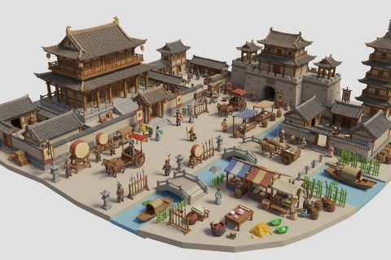

# Three Kingdoms Settlements

In production, 18 parts so far. Every part below is already free to use.

[Open the kit on Polyfork](https://polyfork.dev/kit/three-kingdoms-settlements-a-1e817b) · [All kits](../README.md#kits)

<table>
<tr>
<td align="center" valign="top" width="25%"> <a href="https://polyfork.dev/asset/ancestral-shrine-de7ed2">Ancestral Shrine</a> <a href="https://polyfork.dev/cdn/ancestral-shrine-de7ed2.glb">GLB</a> · <a href="https://polyfork.dev/cdn/ancestral-shrine-de7ed2.mjs">module</a></td>
<td align="center" valign="top" width="25%"> <a href="https://polyfork.dev/asset/bamboo-grove-clump-7c747d">Bamboo Grove Clump</a> <a href="https://polyfork.dev/cdn/bamboo-grove-clump-7c747d.glb">GLB</a> · <a href="https://polyfork.dev/cdn/bamboo-grove-clump-7c747d.mjs">module</a></td>
<td align="center" valign="top" width="25%"> <a href="https://polyfork.dev/asset/bamboo-notice-board-f1e26d">Bamboo Notice Board</a> <a href="https://polyfork.dev/cdn/bamboo-notice-board-f1e26d.glb">GLB</a> · <a href="https://polyfork.dev/cdn/bamboo-notice-board-f1e26d.mjs">module</a></td>
<td align="center" valign="top" width="25%"> <a href="https://polyfork.dev/asset/bronze-lamp-stand-59b9d2">Bronze Lamp Stand</a> <a href="https://polyfork.dev/cdn/bronze-lamp-stand-59b9d2.glb">GLB</a> · <a href="https://polyfork.dev/cdn/bronze-lamp-stand-59b9d2.mjs">module</a></td>
</tr>
<tr>
<td align="center" valign="top" width="25%"> <a href="https://polyfork.dev/asset/camp-gate-2de13f">Camp Gate</a> <a href="https://polyfork.dev/cdn/camp-gate-2de13f.glb">GLB</a> · <a href="https://polyfork.dev/cdn/camp-gate-2de13f.mjs">module</a></td>
<td align="center" valign="top" width="25%"> <a href="https://polyfork.dev/asset/city-gate-77d012">City Gate</a> <a href="https://polyfork.dev/cdn/city-gate-77d012.glb">GLB</a> · <a href="https://polyfork.dev/cdn/city-gate-77d012.mjs">module</a></td>
<td align="center" valign="top" width="25%"> <a href="https://polyfork.dev/asset/courtyard-residence-342ac2">Courtyard Residence</a> <a href="https://polyfork.dev/cdn/courtyard-residence-342ac2.glb">GLB</a> · <a href="https://polyfork.dev/cdn/courtyard-residence-342ac2.mjs">module</a></td>
<td align="center" valign="top" width="25%"> <a href="https://polyfork.dev/asset/crossbowman-4bf6b1">Crossbowman</a> <a href="https://polyfork.dev/cdn/crossbowman-4bf6b1.glb">GLB</a> · <a href="https://polyfork.dev/cdn/crossbowman-4bf6b1.mjs">module</a></td>
</tr>
<tr>
<td align="center" valign="top" width="25%"> <a href="https://polyfork.dev/asset/faction-banner-pole-39835b">Faction Banner Pole</a> <a href="https://polyfork.dev/cdn/faction-banner-pole-39835b.glb">GLB</a> · <a href="https://polyfork.dev/cdn/faction-banner-pole-39835b.mjs">module</a></td>
<td align="center" valign="top" width="25%"> <a href="https://polyfork.dev/asset/governor-s-audience-hall-a4d777">Governor&#039;s Audience Hall</a> <a href="https://polyfork.dev/cdn/governor-s-audience-hall-a4d777.glb">GLB</a> · <a href="https://polyfork.dev/cdn/governor-s-audience-hall-a4d777.mjs">module</a></td>
<td align="center" valign="top" width="25%"> <a href="https://polyfork.dev/asset/hemp-grain-sack-f91edc">Hemp Grain Sack</a> <a href="https://polyfork.dev/cdn/hemp-grain-sack-f91edc.glb">GLB</a> · <a href="https://polyfork.dev/cdn/hemp-grain-sack-f91edc.mjs">module</a></td>
<td align="center" valign="top" width="25%"> <a href="https://polyfork.dev/asset/ji-halberd-1257ef">Ji Halberd</a> <a href="https://polyfork.dev/cdn/ji-halberd-1257ef.glb">GLB</a> · <a href="https://polyfork.dev/cdn/ji-halberd-1257ef.mjs">module</a></td>
</tr>
<tr>
<td align="center" valign="top" width="25%"> <a href="https://polyfork.dev/asset/karst-limestone-peak-ee1b76">Karst Limestone Peak</a> <a href="https://polyfork.dev/cdn/karst-limestone-peak-ee1b76.glb">GLB</a> · <a href="https://polyfork.dev/cdn/karst-limestone-peak-ee1b76.mjs">module</a></td>
<td align="center" valign="top" width="25%"> <a href="https://polyfork.dev/asset/leather-forge-bellows-7f6d42">Leather Forge Bellows</a> <a href="https://polyfork.dev/cdn/leather-forge-bellows-7f6d42.glb">GLB</a> · <a href="https://polyfork.dev/cdn/leather-forge-bellows-7f6d42.mjs">module</a></td>
<td align="center" valign="top" width="25%"> <a href="https://polyfork.dev/asset/market-drum-tower-f133f3">Market Drum Tower</a> <a href="https://polyfork.dev/cdn/market-drum-tower-f133f3.glb">GLB</a> · <a href="https://polyfork.dev/cdn/market-drum-tower-f133f3.mjs">module</a></td>
<td align="center" valign="top" width="25%"> <a href="https://polyfork.dev/asset/mounted-bed-crossbow-edb36f">Mounted Bed Crossbow</a> <a href="https://polyfork.dev/cdn/mounted-bed-crossbow-edb36f.glb">GLB</a> · <a href="https://polyfork.dev/cdn/mounted-bed-crossbow-edb36f.mjs">module</a></td>
</tr>
<tr>
<td align="center" valign="top" width="25%"> <a href="https://polyfork.dev/asset/signal-beacon-tower-9c0d1a">Signal Beacon Tower</a> <a href="https://polyfork.dev/cdn/signal-beacon-tower-9c0d1a.glb">GLB</a> · <a href="https://polyfork.dev/cdn/signal-beacon-tower-9c0d1a.mjs">module</a></td>
<td align="center" valign="top" width="25%"> <a href="https://polyfork.dev/asset/spear-soldier-dcfb4b">Spear Soldier</a> <a href="https://polyfork.dev/cdn/spear-soldier-dcfb4b.glb">GLB</a> · <a href="https://polyfork.dev/cdn/spear-soldier-dcfb4b.mjs">module</a></td>
</tr>
</table>
